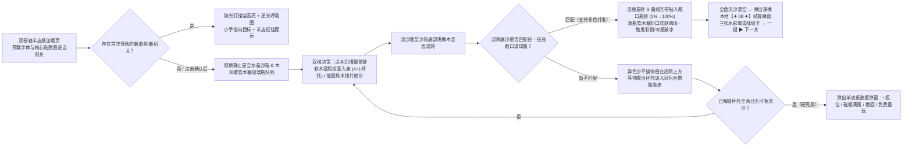

# 《星夜流沙瓶》微信小游戏设计文档（GDD v5.0 星夜工坊绘本水彩版）

> [!NOTE]
> 本文档面向微信小游戏混合休闲解谜赛道，严格对齐 5 张权威 UI 设计原稿（[`docs/assets/ui_design/`](./assets/ui_design/)），确立**「星夜玻璃花房木作工坊绘本水彩风 + 内置 `StarryStorybook` 手账字体全中文界面 + 上层通透水晶沙箱控流 × 下层实木工作台 `4+1` 圆杯托敞口瓶与 `4` 条 3D 深胡桃木凹槽下近上远博弈 + 流萤星砂 S 曲线入瓶光带 + G 大调治愈音乐」**的完整设计基准。

---

## 1. 项目概览与核心审美定位

| 维度 | 设定 |
| :--- | :--- |
| **游戏名称** | **《星夜流沙瓶》**（星夜工坊绘本水彩版） |
| **目标平台** | 微信小游戏（竖屏单手操作，纯 IAA 激励接口预留；Web 端与微信端 100% 共用同一套 TypeScript 源码与 `StarryStorybook` 手账字体） |
| **核心体验公式** | **极速直进纯序号关卡（`01~20`）** × **星空水晶沙箱抽杆雪崩（治愈 ASMR）** × **`4+1` 圆形杯托敞口瓶与 `4` 条深胡桃木凹槽软木塞玻璃瓶深度调度** |
| **单局思考时长** | 第 `01` 关 20 秒直觉破冰；第 `02~20` 关配置 `10~20` 只系丝带玻璃瓶与多层耦合机关，单局深度思考 45~120 秒 |
| **目标画风与字体** | **星夜花房木作工坊绘本水彩风（`starry_storybook_atelier_v5`）**：温润深胡桃褐（`#3B2416`）手绘钢笔细线 + 蜂蜜浅橡木工作台 + 象牙羊皮纸木框弹窗 + 水彩晕染卡片；内置开源手账楷体子集 `StarryStorybook`（霞鹜文楷 Medium 子集 `ui_storybook.ttf`），全界面 **100% 纯中文呈现**，零英文残留、零系统原生 Emoji |
| **局内实机参考图** | [gameplay_ref.jpg](./assets/gameplay_ref.jpg) / [gameplay.webp](./assets/ui_design/gameplay.webp)（局内水晶沙箱、圆珠木拨片、木齿滤网、流萤 S 曲线沙流、实木工作台与木凹槽玻璃瓶唯一基准） |
| **全套权威设计稿** | [splash.webp](./assets/ui_design/splash.webp)、[gameplay.webp](./assets/ui_design/gameplay.webp)、[guide_modal.webp](./assets/ui_design/guide_modal.webp)、[level_drawer.webp](./assets/ui_design/level_drawer.webp)、[victory_modal.webp](./assets/ui_design/victory_modal.webp) |

---

## 2. 核心玩法循环与高密度双核耦合规则

### 2.1 七大核心规则（含开局静稳态与「下近上远」木凹槽透视）
1. **开局 100% 静稳态（零提前流动 Bug）**：
   - 关卡载入瞬间，引擎在首帧渲染前静默执行确定性预落定（`settleInitialState`），使隔间内所有沙堆完全贴合静态磨砂石英条与圆珠木拨片自然安息角——**玩家未做任何操作前，画面中的每一粒沙子 100% 静止安宁**。
2. **星空通透水晶沙箱与浅橡木竖齿滤网**：
   - 采用 `150×165` 元胞自动机颗粒物理，空白区域完全透明透出后方深邃星夜花房天窗，底部镶嵌梯形浅橡木竖齿滤网（`| | | |`）。
   - 沙箱底口与敞口玻璃瓶口之间预留充裕星夜流光净空：匹配当前在座玻璃瓶颜色（或通配星耀金沙）的流沙化作**三层柔和荧光 S 曲线流沙光带与细微星砂粒子**钻入敞口瓶颈，透过透明瓶颈呈现垂直细沙丝落向立体椭圆彩沙液面（`0% → 100%`）。
3. **蜂蜜橡木工作台 `4+1` 圆形杯托与同色 FIFO 优先满瓶**：
   - 工作台上层设 **4 枚圆形立体杯托**（在座瓶配同色马卡龙杯托，空位配象牙陶瓷小圆碟；第 5 位默认配 `+1` 灰石圆托与立式小挂锁，可通过道具开启）。
   - 同色玻璃瓶同时在座时，严格按**入座先后顺序（FIFO `placedSeq`）**优先灌满先入座的一只，满瓶瞬间自动塞上软木塞轻快跃起腾出杯托。
4. **`4` 条 3D 深胡桃木凹槽与「下近上远」软木塞玻璃瓶队列**：
   - 工作台下层挖设 `3~4` 条上窄下宽、带斜接内壁的深胡桃木凹槽，严格遵循自然桌面俯视透视：**最下方近景（`r = 0`，靠近玩家大拇指侧）为当前可点击的已揭晓彩带软木塞玻璃瓶**，后排（`r = 1..3`）依次向凹槽上方远端递进，100% 无遮挡露出每只后排瓶的软木塞、瓶颈与胸口 `?` / 冰晶壳；点选前排瓶后，后排瓶平滑向前顺移补位（超 `4` 瓶时远端微露第 `5` 只软木塞头与 `+N` 角标）。
5. **特殊玻璃瓶机制**：
   - **雾面问号瓶（`mystery: true`）**：位于后排（`r >= 1`）时为塞着软木塞、不系彩带、胸口印深褐 `?` 的雾面羊皮纸磨砂瓶；推进至最前排（`r = 0`）瞬间自动揭晓真实丝带与彩沙颜色。
   - **冰晶瓶（`iceLayers: 1~3`）**：瓶身覆有多切面淡蓝冰晶护壳与雪花层数胶囊 `❄ ×N`，暂不可点；场上每装满任意 `1` 只玻璃瓶，所有冰晶瓶同步震裂 `-1` 层寒冰。
6. **高辨识度沙箱内部机关**：
   - **固定隔条（`staticWalls`）**：半透明磨砂石英玻璃隔条（带清澈白亮折光边）；
   - **可抽圆珠木拨片（`boards`）**：温润蜂蜜浅橡木圆杆，外端配立体球形木拉扣（斜向可抽导流杆顶端配小木圆珠，颜色锁杆正中挂同色挂锁）；
   - **翡翠胶囊染色环（`dye`）**：悬浮半透明彩色玻璃胶囊光环，穿过其中的流沙永久改染为对应颜色。
7. **1:1 严格颗粒守恒与两阶段死局救援**：
   - 每关各色玻璃瓶目标容量总和 100% 等于对应沙区实粒总数；全部已解锁杯托占满且无可吸流沙达 `0.85s` 时，弹出浅橡木羊皮纸救援弹窗供玩家一键化解。

---

## 3. 五大界面规范与渐进聚光灯引导体系

1. **启动加载页（`SplashScreen`）**：立体双描边木牌《星夜流沙瓶》+ 微拱羊皮纸飘带「流沙入瓶 · 静谧解谜」+ 中央悬浮粉丝带许愿瓶与呼吸星芒 + 底部双卷轴羊皮纸进度条（「正在加载中...」+ 百分比）+ 左下绿底白框「`8+ 适龄提示`」。
2. **局内主界面（`GameHUD`）**：微信胶囊正下方 `5px` 对称排布左 `[⊞ 08]` 羊皮纸胶囊与右 `[?][↻]` 圆木牌；桌下深棕暗影栏居中排布 4 枚暖奶油圆角方卡道具钮（右上角嵌奶油圆角小方标动态显示剩余次数）。
3. **玩法与机关图鉴弹窗（`GuideModal`）**：右下微卷折角羊皮纸面板 + 顶部飘带「玩法与机关图鉴」+ 右上珊瑚粉 `×` 圆钮 + 5 张圆角白底水彩插画卡（点击任意卡片弹出单行规则轻提示）。
4. **选关与设置抽屉（`LevelDrawer`）**：顶部全中文 4 圆钮（`音效 / 震动 / 图鉴 / 云同步`）与手写微倾 `01—20` + `4×5` 木框/发光金框/凹石板选关网格（`10/20` 关顶戴小皇冠）+ 底部 `8+ 适龄`、`隐私指引` 与双嫩叶 `07/20` 进度章。
5. **通关结算弹窗（`VictoryModal`）**：飘落暖金发光纸屑 + 大号微倾 `✦ 08 ✦` + 暖金发光连胜胶囊 + 三张手绘水彩晕染战绩竖卡（秒表 / 脚印 / 皇冠）+ 左方形木钮 `↻` 与右森林绿宽钮 `▶ 09`。

---

## 4. 治愈音乐与纯 IAA 救援道具体系

* **无缝循环治愈 BGM（`bgm_workshop_starry.mp3`，`500.5 KB` 归入 `audio` 分包）**：`75 BPM` 4/4 拍温暖 G 大调 `Gmaj9 → Em9 → Cmaj9 → D13sus4` 室内乐，搭配 WebAudio 实时合成的清亮水晶玻璃轻碰声、温润木拨片滑轨声与五声音阶满瓶风铃声。
* **四大渐进解锁救援道具（`RewardManager`）**：`02` 关解锁**撤回**（深 3 步原子快照）与**+加瓶位**（开启第 5 杯托）、`03` 关解锁**隔空磁吸**（`1:1` 精准吸满在座瓶）、`04` 关解锁**候选洗牌**（智能保底匹配底沙瓶推至木凹槽最前排）。

---

## 5. 技术架构与包体门禁

* **单套统一 TypeScript + 原生 Canvas 2D**：微信构建产物主包实测仅 **`1.42 MB`（`1452.2 KB ≤ 1.80 MB` 上限，含 30 张核心美术 `1017.2 KB` 与 `ui_storybook.ttf` 手账字体 `187.6 KB`）**，`audio` 独立分包 `500.5 KB`，低端机稳跑 `60 FPS`。
