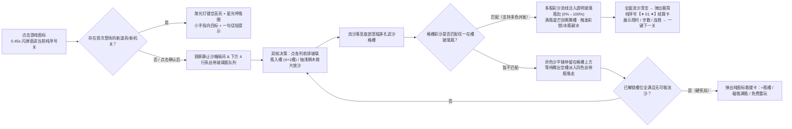

# 《沙里淘大红》微信小游戏设计文档（GDD v4.0 日系治愈极简玻璃瓶版）

> [!NOTE]
> 本文档面向微信小游戏混合休闲解谜赛道，确立**「日系静谧星夜轻绘风 + 纯序号无字图标极简 UI + 上层宽幅玻璃沙箱控流 × 下层 `4+1` 接沙槽与高密度系丝带玻璃瓶博弈 + G 大调治愈钢琴风铃音乐」**的完整设计基准——全游取消关卡文字命名（仅保留 `01~20` 纯序号），用晶莹系丝带糖果玻璃瓶取代复古木桶，用磨砂石英玻璃隔条与浅枫木奶油拨片统一沙箱内部视觉，并在新道具与新机关首次登场时提供无打扰聚光灯手势指引。

---

## 1. 项目概览与核心审美定位

| 维度 | 设定 |
| :--- | :--- |
| **游戏名称** | **《沙里淘大红》**（日系治愈极简流沙解谜版） |
| **目标平台** | 微信小游戏（竖屏单手操作，纯 IAA 激励接口预留；Web 端与微信端 100% 共用同一套 TypeScript 源码） |
| **核心体验公式** | **1 秒直进纯序号关卡（`01~20`）** × **宽幅玻璃沙箱抽片雪崩（治愈 ASMR）** × **`4+1` 接沙槽与 `4` 行高密度系丝带玻璃瓶深度调度** |
| **单局思考时长** | 第 `01` 关 20 秒直觉破冰；第 `02~20` 关配置 `10~20` 只系丝带玻璃瓶与多层耦合机关，单局深度思考 45~120 秒 |
| **目标画风** | **日系静谧星夜轻绘极简风（`serene_starry_glass_atelier_v3`）**：摒弃一切厚重深棕复古木牌、黄铜铆钉与繁杂文字按钮；采用静谧星夜蓝紫和纸背景 + 磨砂象牙奶油半透明卡片（`#FFFCF5`）+ 柔和暖灰水彩细描边（`#9E8E82`）+ **圆润通透系彩绸丝带蝴蝶结糖果玻璃瓶** + **磨砂石英玻璃固定隔条 & 浅枫木奶油抽拉拨片**；**能用图标表达的按钮一律零文字，严禁系统原生 Emoji** |
| **局内实机参考图** | [gameplay_ref.jpg](./assets/gameplay_ref.jpg)（局内极简无字图标顶底栏、磨砂石英隔条与浅枫木拨片、系丝带透明玻璃瓶队列及流沙飞线唯一视觉锚点） |
| **品牌启动参考图** | [cover.jpg](./assets/cover.jpg)（仅用于启动页品牌氛围参考，不作为局内 UI 与器物渲染依据） |

---

## 2. 核心玩法循环与高密度双核耦合规则

### 2.1 七大核心规则（含开局静稳态与高密度排瓶）
1. **开局 100% 静稳态（零提前流动 Bug）**：
   - 关卡载入瞬间，引擎在首帧渲染前静默执行确定性预落定（`settleInitialState`），使隔间内所有沙堆完全贴合静态磨砂玻璃隔条与浅枫木拨片自然安息角，且底部滤网微光滚动严格受真实沙流门控——**玩家未做任何操作前，画面中的每一粒沙子 100% 静止安宁**。
2. **宽幅玻璃沙箱（`93.5%` 屏宽）与多孔滤沙格栅**：
   - 采用 `150×165` 元胞自动机颗粒物理，沙箱横向拉宽至屏幕 `93.5%` 高屏效占比，底部铺设 `76~100` 格宽水平滤沙格栅（`y = 159..163`）。
   - 匹配当前在槽玻璃瓶颜色（或通配星耀金沙）的颗粒穿过格栅，化作彩色流沙丝线注入对应透明玻璃瓶肚内，实时呈现瓶腹彩沙液面由 `0%` 升至 `100%` 的治愈过程。
3. **`4+1` 激活接沙槽与同色 FIFO 优先满瓶**：
   - 玻璃托盘上层常驻 **4 个圆润磨砂接沙凹槽**（可通过 `+瓶槽` 道具扩容开启最右侧 **第 5 槽**）。
   - 同色玻璃瓶同时在槽时，严格按**入槽先后顺序（FIFO `placedSeq`）**优先灌满先入槽的一只，迅速腾出稀缺周转槽位。
4. **`4` 行同屏可见的高密度系丝带玻璃瓶队列**：
   - 托盘下层排列 `3~4` 列纵向滑道，同屏完整展示多达 **`4` 行系着对应沙色绸缎蝴蝶结的透明糖果玻璃瓶**（第 `02~20` 关总瓶数达 **`10~20` 只**，第 `20` 关呈现 `4×5 = 20` 瓶满屏矩阵）。
   - 严守**前排挡后排**规则：仅各列最前排（`Row 0`）饱满高亮的玻璃瓶可点击入槽；想要拿到深藏在第 `3~4` 行的关键底沙瓶，必须精密规划先后暂存顺序，告别无脑乱点。
5. **特殊玻璃瓶机制（无文字纯视觉表达）**：
   - **和纸问号盲瓶（`mystery: true`）**：位于后排（`Row >= 1`）时瓶身裹有半透明奶油磨砂和纸与素色丝带，轻印柔光 `?`；推至列首（`Row 0`）瞬间和纸散开，揭晓真实丝带颜色。
   - **冰封玻璃瓶（`iceLayers: 1~3`）**：瓶身覆有清透薄荷冰晶壳与极简矢量雪花徽标 `❄ ×N`（无汉字“冰”），暂不可点；场上每装满飞走任意 `1` 只玻璃瓶，所有在场冰封瓶冰层同步晶裂 `-1`，归零即破冰解锁。
6. **统一轻盈化的沙箱内部构件**：
   - **固定隔板与斜溜槽（`staticWalls`）**：统一渲染为与沙箱浑然一体的**半透明磨砂石英玻璃隔条**（柔白折射高光边，告别突兀黑棕粗木棍）。
   - **可抽拉横片与可拆斜导流片（`boards`）**：统一为纤巧温润的**日系浅枫木奶油拨片**，外侧配极简圆润枫木/白瓷小圆钮（可抽斜导流片外端配精致金属小拉环，彻底移除老旧悬挂木牌文字“抽/推/拉”）。
7. **1:1 严格颗粒守恒与两阶段死局救援**：
   - 每关各色玻璃瓶目标容量总和 100% 等于对应沙区实粒总数；装填达 `≥ 98.5%` 且静止 `0.40s` 后自动 `1:1` 吸净边角残沙。
   - 全部已解锁卡槽占满且无可吸流沙达 `0.85s` 时，弹出极简磨砂奶油救援卡（纯图标选择：**加第 5 瓶槽 / 磁吸满瓶 / 免费重玩**）。

---

## 3. 极简无字图标 UI 与渐进聚光灯引导体系

### 3.1 去文字化极简 HUD 规范
1. **纯序号关卡体系（零关卡名）**：
   - 全游取消关卡文字标题，顶栏、选关抽屉与通关结算卡统一仅展示清爽的两位纯数字序号 **`01` ~ `20`**。
2. **顶栏三枚轻绘磨砂控件（自动避让微信右上角胶囊）**：
   - 左：紧凑磨砂奶油胶囊（`2×2` 马卡龙圆角方块选关图标 + 纯序号 `01`）；
   - 右二：纯圆形无字图标按钮 **`?`**（呼出极简图解速查卡 `GuideModal`）；
   - 右一：纯圆形无字图标按钮 **`↻`**（一键免费重玩，零广告）。
3. **底栏四枚纯图标道具圆卡（零底部文字标签）**：
   - 仅绘制高辨识度日系轻绘图形图标（柔和回旋箭头 / 红蓝马卡龙U型磁铁 / 系丝带小玻璃瓶`+` / 交叉洗牌双箭头）+ 右上角小巧数量胶囊角标，彻底取消按钮下方中文标签。

### 3.2 渐进式道具解锁 + 聚光灯首次登场指引
为保证新玩家认知零负担，并在每次出现新道具或新机关时给予清晰优雅的说明，`FtueOverlay` 采用双轨引导设计（已读状态持久化于 `SaveData.seenGuides`，每项仅首次触发一次）：
1. **第 `01` 关沉浸四步直觉引导**：隐藏底部道具栏，零干扰手把手完成「点蓝瓶 → 点黄瓶 → 抽浅枫木拨片 → 点粉瓶」四步清罐。
2. **第 `02 ~ 04` 关渐进解锁四大道具并聚光灯指引**：
   - **`02` 关**：解锁 **撤回**（`UNDO`）与 **加第 5 瓶槽**（`EXTRA_SLOT`）+ 斜导流隔条指引；
   - **`03` 关**：解锁 **磁吸满瓶**（`VACUUM`）+ 银丝滑轮联动双拨片指引；
   - **`04` 关**：解锁 **候选洗牌**（`SHUFFLE`）+ 高空脆冰硬底破冰指引。
3. **中后期新机制首次登场聚光灯指引**：
   - **`05` 关**（颜色锁拨片 & 星耀金沙）、**`07` 关**（`?` 和纸盲瓶）、**`08` 关**（水彩染色星环 & 可抽斜导流片）、**`11` 关**（`❄` 冰封玻璃瓶）：首次进入对应关卡时，半透明星夜柔幕自动镂空高亮目标机关或玻璃瓶，配合星光呼吸圈、轻绘小手与一句话磨砂奶油短卡，轻触任意处即刻开玩。

---

## 4. 日系治愈音乐与晶莹玻璃音效设计

采用 **G 大调 `maj9` 温暖治愈原声室内乐 + 清脆玻璃器皿 ASMR** 双层声学架构：
1. **无缝循环治愈 BGM（`bgm_workshop_starry.mp3`，`500.5 KB` 归入 `audio` 分包）**：
   - **调性与配器**：`75 BPM` 4/4 拍，温暖 G 大调色彩和声循环（`Gmaj9 → Em9 → Cmaj9 → D13sus4`），由**羊毛毡柔音立式钢琴（Felt Piano）+ 晶莹钢片琴（Celesta）+ 温润红木马林巴（Rosewood Marimba）+ 偶发微风玻璃风铃泛音**交织而成，51.2 秒采样级无缝循环。
   - **频谱避让**：在 `2.2kHz ~ 3.4kHz` 流沙颗粒摩擦核心频段预留 `-7dB` 柔和凹槽，久听松弛治愈、绝不掩盖流沙声。
2. **玻璃瓶与枫木拨片定制 SFX（WebAudio 零体积实时合成）**：
   - **点选玻璃瓶入槽**：清亮剔透的水晶玻璃轻碰声（Glass Clink）叠柔和马林巴单音；
   - **抽动浅枫木拨片**：温润细腻的浅木滑轨轻响；
   - **彩沙灌满玻璃瓶飞离**：G 大调五声音阶（`G5-A5-B5-D6-E6-G6`）递升钢片琴 + 风铃泛音欢跃声；
   - **通关礼赞**：温暖明亮的 `Gmaj9` 钢琴与风铃琶音礼赞。

---

## 5. 纯 IAA 救援道具体系（`RewardManager`）

| 奖励点位 (`RewardScene`) | 解锁关卡 | 纯图标表现 | 核心守恒效果 |
| :--- | :---: | :--- | :--- |
| **撤回上一步** (`UNDO`) | `02` | 奶油珊瑚柔和回旋箭头 | 双动作环形栈（深 3 步），一键原子回退「点玻璃瓶入槽」或「抽枫木拨片」，保留已解锁第 5 瓶槽权益 |
| **加第 5 瓶槽** (`EXTRA_SLOT`) | `02` | 系丝带透明小玻璃瓶 `+` | 本关永久开启最右侧第 5 接沙凹槽（`4 → 5` 槽并发），瞬间盘活高密度排瓶空间 |
| **磁吸满瓶** (`VACUUM`) | `03` | 马卡龙红蓝 U 型小磁铁 | 优先锁定装填度最高的在槽玻璃瓶，按「格栅 → 散沙 → 脆冰破冰 → 待染原沙」`1:1` 精准吸满腾槽 |
| **候选洗牌** (`SHUFFLE`) | `04` | 薄荷绿双弧交叉洗牌箭头 | 重排各列非冰封玻璃瓶，并**智能保底将匹配当前滤网底沙的玻璃瓶推至列首 `Row 0`** |

---

## 6. 技术架构与默认生图压缩规范

* **单套统一 TypeScript + 原生 Canvas 2D**：Web 与微信小游戏 100% 共享 `src/` 代码库；微信构建产物主包实测仅 **`1.14 MB`**（含全部 30 张压缩治愈风美术资产，零美术分包），`audio` 独立分包 `500.5 KB`，低端机稳跑 `60 FPS`。
* **默认生图服务与画风锚点**：默认调用 Colab 部署的 ComfyUI + Qwen-Image-2.1（`TextEncodeQwenImage21` 节点），局内 UI、玻璃瓶与流沙质感严格以 [`docs/assets/gameplay_ref.jpg`](./assets/gameplay_ref.jpg) 为唯一参考基准；所有生成图片必须经 [`scripts/compress_assets.py`](../scripts/compress_assets.py) 泛洪去背与 8-bit 调色板压缩，并通过 [`tools/validate-content.js`](../tools/validate-content.js) 体积与 `dHash` 去重门禁后方可入库。
