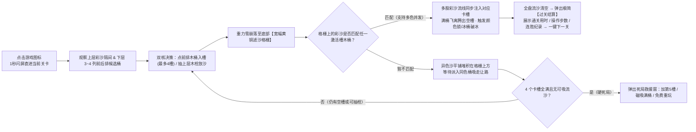

# 《沙里淘大红》微信小游戏设计文档（GDD v3.0 极致纯粹流沙抽栓版）

> [!NOTE]
> 本文档面向微信小游戏超休闲 / 混合休闲赛道，深度融合**《沙画消消》（下层 `4+1` 小卡槽与前后排木桶顺序博弈）**与**《打个螺丝》/ 抽栓解谜（上层精简控流与流沙雪崩 ASMR）**，主打**「极简 1 秒直进关卡 + 上下双核强耦合流沙解谜 + 纯 IAA 救援道具」**——彻底剔除臃肿的盲盒、公仔、藏馆、主页大厅等外围系统，回归极致纯粹的解压与烧脑乐趣。

---

## 1. 项目概览与核心定位

| 维度 | 设定 |
| :--- | :--- |
| **游戏名称** | **《沙里淘大红》**（纯粹流沙抽栓解谜版） |
| **目标平台** | 微信小游戏（竖屏单手操作，无需版号，纯 IAA 广告变现；Web 端与微信端 100% 共用同一套 TypeScript 源码） |
| **核心体验公式** | **1 秒直进当前关（零主页大厅）** × **上层抽栓流沙雪崩（控流 ASMR 解压）** × **下层 `4+1` 卡槽与前后排木桶调度（空间槽位博弈）** |
| **单局时长** | 前期 20~40 秒/关，中后期 50~90 秒/关（极度适配碎片化解压场景） |
| **目标画风** | **日系治愈手绘墨线木屋星夜绘本风**（局内实机界面与流沙质感以 [gameplay_ref.jpg](./assets/gameplay_ref.jpg) 为唯一基准；[cover.jpg](./assets/cover.jpg) 仅作为品牌启动主视觉参考：深棕手绘钢笔勾线 `#3E2311` + 暖色调水粉纸纹上色、圆角通透玻璃沙箱 + **底部宽幅黄铜滤沙格栅** + 双层木工接沙台；**严禁系统原生 Emoji、3D 塑料或赛博霓虹风格**） |
| **局内实机参考图** | [gameplay_ref.jpg](./assets/gameplay_ref.jpg)（局内沙箱、流沙颗粒质感、穿墙雕花木栓、流沙飞线与木艺工作台视觉锚点） |
| **游戏封面参考图** | [cover.jpg](./assets/cover.jpg)（仅用于启动页品牌主视觉，不作为局内沙罐与流沙渲染依据） |

---

## 2. 核心玩法循环与上下双核耦合规则



### 2.1 局内六大硬性规则（上下联动核心）
1. **宽底黄铜滤沙格栅（取代传统窄漏斗单点堵死）**：
   - 采用 `150×165` 2D 元胞自动机颗粒物理，沙箱底部铺设宽达 **`76~100` 格的水平黄铜多孔滤沙格栅**（`y = 159..163`）。
   - 流沙落到格栅上会自然横向铺开：凡是当前**激活接沙槽**中存在对应颜色（或通配黄金沙）的颗粒，都会直接穿过格栅孔洞，化作多股彩色贝塞尔沙柱精准汇入各自卡槽的木桶中；尚未派桶对应的异色沙则安静停留在格栅表面——只要下方还有空卡槽能派出对应色桶，格栅上的沙随时可被吸空让路。
2. **`4+1` 小卡槽并发接沙与同色 FIFO 规则**：
   - 工作台上半层常驻 **4 个激活接沙小卡槽**（可通过局内道具解锁最右侧 **第 5 临时槽**）。
   - 当激活槽内同时存在两只相同颜色的木桶时，严格按**入槽先后顺序（FIFO `placedSeq`）**优先灌满先入槽的那一只，尽快腾出空位，杜绝两桶各装一半占死双槽。
3. **`3~4` 列「前排挡后排」候选木桶滑道**：
   - 工作台下半层纵向排列 **3~4 列候选木桶**，每列遵循**前排挡后排**铁律：只有各列最前排（`Row 0`）的木桶可点击派入上方空卡槽；派走后，该列后排木桶整体顺移向前递补。
   - **核心博弈**：想拿到某列后排急需的关键桶，必须先用有限的 `4` 个卡槽消化掉挡在它前面的异色桶；若盲目乱点前排桶把 `4` 个卡槽塞满，就会触发**满槽死锁**。
4. **候选队列专属特殊桶机制**：
   - **问号盲桶（`mystery: true`）**：位于后排（`Row >= 1`）时桶身呈深胡桃神秘漆色并贴有羊皮纸「`?`」封签，隐藏真实颜色；唯有排走前桶、推进至列首（`Row 0`）瞬间才翻转揭晓真实桶色。
   - **冰封木桶（`iceLayers: 1~3`）**：位于列首的木桶被晶莹冰壳包裹，暂时无法点击入槽；场上每成功装满并飞走**任意 1 只**接沙桶，所有在场冰封木桶的冰层自动震裂 `-1`，归零破冰后即可调遣。
5. **1:1 严格容量守恒与零残留清尾**：
   - 全关每种颜色所有候选木桶的目标容量总和，严格等于沙盘中该颜色（染色后）沙粒总数（`100%` 守恒）。
   - 当某一激活槽木桶装填度达到 `≥ 98.5%` 且格栅连续 `0.40s` 无同色沙自然流入时，自动精准吸走挂在墙角或斜板接缝处的同色尾沙（严格按 `1:1` 扣除真实网格沙粒），确保零残留痛快满桶。
6. **两阶段卡关预警与死局救援闭环**：
   - **第一阶段（柔和堵口提示）**：格栅上有异色沙停留超过 `1.5s` 但玩家仍有空卡槽或可抽木栓时，仅浮现非阻塞暖黄轻提示条。
   - **第二阶段（硬死局救援弹窗）**：当所有已解锁卡槽（`4/4` 或 `5/5`）全部占满、连续 `0.85s` 零沙粒可吸入、且上层没有任何可手动抽开的木栓能放出匹配流沙时，自动弹出三选一救援面板：**【加开第 5 槽】** / **【磁吸满桶腾槽】** / **【免费重玩本关】**。

---

## 3. 上下双核机关体系与难度曲线

上层沙盘精选 **6 类高辨识度控流机关**，与下层 **3 类木桶队列机制** 深度咬合：

### 3.1 上层控流 × 下层桶序双核机制矩阵
| 所属域 | 机制名称 | 机制说明 | 上下双核耦合解谜价值 |
| :---: | :--- | :--- | :--- |
| **下层桶台** | **前后排候选桶 + `4+1` 卡槽** | `3~4` 列纵深队列，仅各列排头 `Row 0` 可点入上方空槽；同色激活桶按 FIFO 依次灌满 | 槽位是全游最核心的稀缺资源：每一次点桶入槽都必须兼顾上层当前能流出的沙色 |
| **下层桶台** | **问号盲桶** | 后排隐藏桶色，推进至列首 `Row 0` 时翻牌揭晓 | 制造适度未知悬念，鼓励优先保留 `1~2` 个机动空槽探路 |
| **下层桶台** | **冰封木桶** | 列首冰壳锁死 `N` 层，每满任意 1 桶自动减 1 层冰 | 迫使玩家先用其余列木桶配合表层沙完成“破冰热身”，再解锁关键桶列 |
| **上层沙箱** | **普通抽拉木栓** | 横向/竖向阻挡流沙，点击瞬间抽出触发流沙雪崩 | 控制哪一层颜色先落向底部格栅，与下方排头桶形成先后呼应 |
| **上层沙箱** | **倾斜导流斜桥** | 陡坡（斜率 `≥ 0.78`）把流沙精准导向侧仓或染色环，可点击抽走恢复直落 | 实现“先借桥过环变色 → 再拆桥原色直落”的经典空间分流 |
| **上层沙箱** | **绳轮联动双栓** | 麻绳与黄铜滑轮连接两根木栓，抽动任一根同步拉开另一根 | 一次抽栓同时倾泻双仓双色沙，必须提前在下方备好双色卡槽承接 |
| **上层沙箱** | **高空脆冰砖** | 刚体冰沙块，必须排空下垫软沙腾出 **`≥ 44 格` 净空直砸裸硬底格栅**才碎裂化沙；垫有 1 粒软沙即缓冲不碎 | 要求玩家先派桶吸干格栅垫底沙，再抽高空冰栓完成爽脆破冰 |
| **上层沙箱** | **颜色锁木栓** | 挂载彩锁不可手抽；当下方**首只同色木桶 `100%` 装满飞走**瞬间自动崩锁开栓 | 上下强耦合灵魂机制：下层满桶直接改写上层地形 |
| **上层沙箱** | **魔法染色环** | 指定颜色流沙穿过圆环实时改写为目标色 | 盘面缺某色沙时，需思考“抽哪仓原沙过环造色”来喂饱下方卡槽 |
| **双核通配** | **黄金狂热沙** | 通配任意颜色的璀璨金沙，落上格栅后可被任何在槽彩桶极速狂吸 | 高难金库破局或福利关终章的满屏多流泄洪高潮 |

### 3.2 首章 20 关进阶节奏表（以《关卡设计文档》与 `data/levels/chapter_01.json` 为准）
| 关卡区间 | 引入双核元素 | 核心设计目标 |
| :--- | :--- | :--- |
| **第 1~5 关** | L1 双核四步直觉教学 → L2 前后排错位让槽 → L3 绳轮联动双栓 → L4 高空脆冰硬底破冰 → L5 黄锁惊雷 + 黄金狂热沙 | 30 秒秒懂“点桶入槽 + 抽栓放沙”双核手感，第 2 关起彻底告别无脑乱点 |
| **第 6~10 关** | L6 借沙融寒 → L7 问号盲桶登场 → L8 断桥染翠（拆桥保色） → L9 双霜夹心 → L10 玄铁大坝黄金 Boss | 建立“留空槽探盲桶”、“拆桥保色”、“吸干垫沙再砸脆冰”三大中阶策略 |
| **第 11~20 关** | L11 冰封木桶破冰登场 → 冰火双劫 / 玉漏千钧 / 塞口绝境 / 奶茶暗流 → 阶梯三冰锁 / 双生诡锁 / 寒锁奇谋 / 双环迷宫 → **第 20 关《星夜大金库》终极 Boss** | `4` 列纵深候选桶 + 上层复合控流全面交织，兼具极高解谜成就感与四道具救援深度 |

---

## 4. 极简无干扰界面与过关成就体验

为避免传统小游戏冗余大厅、抽卡养成与弹窗轰炸带来的注意力割裂，本版本实行**零外围、1 秒直玩**的极简结构：
1. **启动 1 秒直进关卡**：`SPLASH`（0.45s 丝滑淡出）→ 直接进入上次游玩进度关卡 `PLAYING`，零 HomeScreen 大厅、零红点打卡、零多余二级弹窗。
2. **极简三枚顶栏 HUD**：彻底清空顶部视觉噪声，仅保留 3 枚低存在感手绘木牌胶囊（自动避让微信右上角胶囊区）：
   - `⚙️ 第 X 关 · 关卡名 ▾`：呼出选关与音效/震动设置抽屉（支持 1~20 关自由回玩与进度展示）；
   - `📖 玩法`：单页极简核心玩法与机关速查卡；
   - `🔄 重玩`：永不捆绑广告的一键免费重玩按钮。
3. **纯粹过关结算面板（`VictoryModal`）**：
   - 全盘流沙清零后，伴随清脆五声音阶通关礼赞与暖色彩带爆裂，弹出干净的木屋羊皮纸过关卡片，展示**本关用时（刷新个人最快纪录时亮起 `新纪录!` 徽章）**、**操作步数**、**当前连胜场次**，以及**【下一关】**与**【再玩一次】**两枚清晰主次按钮。

---

## 5. 局内道具与商业化预留（纯 IAA 模式）

> [!TIP]
> **冷启动 → 流量主平滑切换策略**：代码层统一封装 `RewardManager.requestReward(scene)`——冷启动期提供免费救援/分享体验，开通流量主后仅需替换内部为微信激励视频 API，**业务代码零改动**。顶栏常驻独立的 **一键免费重玩按钮**（永不捆绑广告），四大核心救援道具集中在底栏与硬死局救援窗：

| 奖励点位 (`RewardScene`) | 触发场景 | 功能效果 | 商业化价值 |
| :--- | :--- | :--- | :--- |
| **加开第 5 接沙槽** (`EXTRA_SLOT`) | `4` 个卡槽占满周转不开，或触发硬死局弹窗 | 本关永久解锁最右侧**第 5 临时激活槽**（`4 → 5` 槽并发） | **最高频刚需点**，多 1 槽立刻盘活全局 |
| **磁吸满桶腾槽** (`VACUUM`) | 激活槽内木桶差沙卡住或满槽死锁 | 优先选中当前装填度最高的在槽木桶，按「格栅 → 散沙 → 脆冰破冰 → 待染原沙」四级优先级 **`1:1` 精准吸满并飞走腾出空槽** | 瞬间破死局 + 100% 严守容量守恒 |
| **撤回上一步** (`UNDO`) | 点错前排木桶占槽，或手滑抽错上层木栓 | **双动作精准回退**：无论上一步是「派桶入槽」还是「抽开木栓」，均一键回退沙盘网格、卡槽、候选列、`?`盲桶状态与冰桶层数（保留已解锁的第 5 槽权益） | 低门槛高频容错，转化率稳健 |
| **候选洗牌** (`SHUFFLE`) | 各列排头 `Row 0` 全非当前急需颜色 | 重排所有候选列中的非冰封木桶，并**智能保底至少 1 列排头 `Row 0` 匹配当前格栅表面沙色** | 极具策略翻盘爽感的救援手段 |

---

## 6. 解压感官细节规范（Juice & ASMR）

1. **视觉反馈**：
   - 每粒沙子自带 `±12` 亮度随机噪点与 `3x` 超采样平滑沙脊，呈现温润细腻的水粉彩沙质感。
   - 流沙穿过底部**宽幅黄铜滤沙格栅**时，对应孔洞泛起琥珀微光，并拉出多股指向对应卡槽木桶的**彩色贝塞尔流沙飞线**；满桶瞬间桶身挤压弹飞 + 冰桶震裂冰晶 / 问号盲桶翻牌揭晓。
   - 过关瞬间触发暖色节日彩带粒子爆裂与清爽木牌结算弹入。
2. **听觉 ASMR**：
   - 点桶入槽与抽木栓：清脆实木滑入卡槽咔嗒声、木栓抽离“咔嗒-咻”声、盲桶翻牌清音与冰桶裂冰脆响。
   - 流沙滤网吸入：随流速动态扫频的带通滤波**细腻沙沙白噪音**。
   - 满桶 & 通关：五声音阶递增清脆叮咚音，清罐通关奏响明快木琴和弦（`LEVEL_VICTORY`）。
3. **微信手机触觉（`wx.vibrateShort`）**：
   - 点桶入槽 / 抽走木栓 / 盲桶揭晓：`light` 轻震；
   - 高空脆冰摔碎 / 冰桶裂冰 / 满桶飞走：`medium` 中震；
   - 完美清罐过关：清脆双连震确认。

---

## 7. 技术选型与单套代码库路线

* **选定方案：单套统一 TypeScript + 原生 Canvas 2D（离屏像素缓冲）**
  - **一套代码双端运行**：全部物理引擎、双层桶槽逻辑与手绘木屋 UI 100% 统一在 `src/` 单一代码库中，仅通过极薄的 `PlatformBridge` 适配 Web 浏览器与微信小游戏真机环境。
  - **单主包极致轻量与 60 FPS**：全游戏仅保留 30 张压缩绘本风核心资产，全部直接打入微信主包（**零美术分包，实测主包 `1.34 MB` ≤ `1.80 MB` 上限**），点击秒开、低端机稳跑 60 FPS。

---

## 8. 开发落地关键细节规范

1. **前 30 秒双核新手引导（FTUE）**：
   - 第 1 关采用**零弹窗四步手把手引导**：依次引导玩家点击第 1 列蓝桶、第 2 列黄桶入槽吸净底层滤网彩沙 → 点击抽开上层木栓触发粉沙雪崩 → 点击第 3 列粉桶收尾通关。
2. **微信竖屏五段式安全区布局（`LayoutManager`）**：
   - **极简三胶囊顶栏**：自动避让微信右上角官方胶囊区，仅排布 `[⚙️ 第X关·关卡名 ▾]`、`[📖 玩法]`、`[🔄 重玩]`。
   - **中部宽底玻璃沙箱**：横向拉满屏幕宽度 **`90%~94%`**，底部镶嵌多孔黄铜滤沙格栅。
   - **底部双层木工接沙台 + 四道具栏**：清晰划分 `4+1` 小卡槽接沙行、`3~4` 列带景深遮挡的纵向候选木桶滑道、以及底部 `4` 枚木牌道具钮（预留 iOS `safeArea.bottom`）。
3. **纯粹存档 Schema v2 与切后台容错**：
   - 使用 `wx.setStorageSync` 即时持久化 `maxUnlockedLevel`、`currentLevel`、`totalClears`、`winStreak`、`bestTimeSecMap` 与音效/震动设置；监听 `wx.onHide` / `wx.onShow` 自动挂起/恢复物理循环与音频上下文。
4. **声明式双核关卡 JSON 与离线自动化校验**：
   - 关卡数据统一存放在 [`data/levels/chapter_01.json`](../data/levels/chapter_01.json)，每次修改均由 [`tools/validate-content.js`](../tools/validate-content.js) 驱动无头模拟器自动验证：双随机种子必通关、零残留、反「无脑轮流塞槽」机器人、反「开局全抽木栓」机器人、死局陷阱存在性及布局去重。
5. **双动作内存快照规范（`SnapshotStack`）**：
   - 每次玩家手动「派桶入槽」或「抽开木栓」前，自动压入一份包含 `Uint8Array` 网格、各卡槽填充进度、各列候选桶与盲桶揭晓态、冰桶层数的完整快照（环形栈保留最近 3 步），撤回时 100% 原子级精准还原且保留已解锁的第 5 槽权益。

---

## 9. 默认生图模型与美术资产生产规范（强制默认）

> [!IMPORTANT]
> **项目全局生图约定**：在用户未另行说明的情况下，本项目所有概念图、UI 背景、局内贴图与图标生成任务，**一律默认调用用户在 Colab 部署的 ComfyUI + Qwen-Image-2.1 服务**。

### 9.1 服务地址与存活探针
* **Base URL**：`https://hub-rates-deaths-programmers.trycloudflare.com`（无鉴权、无 API Key）
* **前置探活（必做）**：每次生图前先请求 `GET /system_stats`；若返回 `502` 或连接超时，说明 Colab 隧道已断开，立即停止并提示用户重连或提供新地址。

### 9.2 已就位模型与核心避坑约束
* **DiT 模型**：`qwen_image_2.1_bf16.safetensors`
* **文本编码器**：`qwen3vl_8b_bf16.safetensors`（`CLIPLoader` 的 `type` 只能填 `"qwen_image"`）
* **VAE 模型**：`qwen_image_2.1_vae_bf16.safetensors`
* **专用编码节点**：必须使用 `"TextEncodeQwenImage21"` 节点，**严禁**使用标准 `CLIPTextEncode`。

### 9.3 画风锁定与素材清单（强制）
* **双参考锚点职责划分**：
  - **局内实机基准（[gameplay_ref.jpg](./assets/gameplay_ref.jpg)）**：局内圆角通透玻璃沙箱、颗粒彩沙、流沙飞线、抽拉木栓、木桶队列与 HUD 布局的唯一视觉参考。
  - **品牌启动图基准（[cover.jpg](./assets/cover.jpg)）**：仅用于启动页品牌主视觉参考。
* 所有 30 项核心素材的完整提示词、尺寸、种子、输出路径统一维护在 [`data/art/prompts.json`](../data/art/prompts.json)，由脚本生成《[美术资产清单与生图提示词手册](./美术资产清单与生图提示词手册.md)》。
* 下方模板为最小节点集；带风格参考图的完整工作流由 [`tools/lib/prompt.js`](../tools/lib/prompt.js) 的 `buildComfyWorkflow()` 生成。

### 9.4 标准调用模板（`POST /prompt`）
提交后通过 `GET /history/{prompt_id}` 轮询结果，并通过 `GET /view?filename=...&subfolder=...&type=...` 下载产物图片：

```json
{
  "prompt": {
    "1": {
      "class_type": "UNETLoader",
      "inputs": {
        "unet_name": "qwen_image_2.1_bf16.safetensors",
        "weight_dtype": "default"
      }
    },
    "2": {
      "class_type": "CLIPLoader",
      "inputs": {
        "clip_name": "qwen3vl_8b_bf16.safetensors",
        "type": "qwen_image"
      }
    },
    "3": {
      "class_type": "VAELoader",
      "inputs": {
        "vae_name": "qwen_image_2.1_vae_bf16.safetensors"
      }
    },
    "4": {
      "class_type": "TextEncodeQwenImage21",
      "inputs": {
        "prompt": "中文提示词",
        "negative_prompt": "",
        "resolution": 0,
        "clip": ["2", 0],
        "vae": ["3", 0]
      }
    },
    "5": {
      "class_type": "EmptyLatentImage",
      "inputs": {
        "width": 1024,
        "height": 1024,
        "batch_size": 1
      }
    },
    "6": {
      "class_type": "KSampler",
      "inputs": {
        "model": ["1", 0],
        "positive": ["4", 0],
        "negative": ["4", 1],
        "latent_image": ["5", 0],
        "seed": 123456789,
        "steps": 25,
        "cfg": 4.0,
        "sampler_name": "euler",
        "scheduler": "simple",
        "denoise": 1.0
      }
    },
    "7": {
      "class_type": "VAEDecode",
      "inputs": {
        "samples": ["6", 0],
        "vae": ["3", 0]
      }
    },
    "8": {
      "class_type": "SaveImage",
      "inputs": {
        "images": ["7", 0],
        "filename_prefix": "qwen21_asset"
      }
    }
  },
  "client_id": "agent-1"
}
```

### 9.4 素材压缩准入规范（强制）
* **所有生成的图片素材（含概念图、封面图、UI 切图、盲盒与公仔立绘等）必须经过本地压缩工具压缩后方可使用与入库**，以严格控制微信小游戏包体与首屏加载体积。
* 压缩脚本位于 [`scripts/compress_assets.py`](../scripts/compress_assets.py)（基于本地 `Pillow` 无额度限制压缩）：
  ```bash
  python3 scripts/compress_assets.py <图片路径或目录> [-o 输出路径] [--quality 85]
  ```

