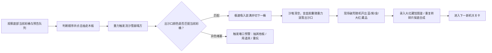

# 《沙里淘大红》微信小游戏设计文档（GDD v1.0）

> [!NOTE]
> 本文档面向微信小游戏超休闲 / 混合休闲赛道，遵循**「高解压流沙塌方 + 轻策略顺序抽板 + 沙里淘大红盲盒图鉴 + 纯 IAA 激励广告预留」**设计原则，可直接作为 MVP v1.0 研发与关卡制作的标准依据。

---

## 1. 项目概览与核心定位

| 维度 | 设定 |
| :--- | :--- |
| **游戏名称** | **《沙里淘大红》** |
| **目标平台** | 微信小游戏（竖屏单手操作，无需版号，纯 IAA 广告变现） |
| **核心体验公式** | **抽木板雪崩塌方（ASMR 解压）** + **按序接沙防堵口（微策略上瘾）** + **流沙挖宝“出大红”（全图鉴长线留存）** |
| **单局时长** | 前期 20~40 秒/关，中后期 60~90 秒/关（极度适配碎片化摸鱼场景） |
| **目标画风** | **日系治愈手绘墨线木屋星夜绘本风**（基准图 `/home/antigravity/IMG_8344.png` / ComfyUI `style_anchor_hoshi.png`：深棕钢笔勾线与排线阴影、暖木质工坊与星夜窗、高对比糖果色流沙与高价值“大红”潮玩藏品） |

---

## 2. 核心玩法循环与规则



### 2.1 局内硬性规则
1. **沙盒与流沙物理**：
   - 采用 2D 元胞自动机颗粒物理（约 150×165 网格），沙粒具备自然重力下落、斜坡滑落、堆积坍塌效果。
   - **1:1 严格容量配比**：每一关中每种颜色的彩桶容量严格等于该颜色沙子的总粒数（100%）。
   - **防卡死清尾机制**：当某一彩桶装满度达到 `≥ 98.5%` 时，自动吸走角落里残留的极少量同色散沙，确保**零残留、不误堵下一桶**。
2. **抽木板交互**：
   - 点击木板（或其上的“抽”标签），木板沿方向瞬间抽出，失去支撑的上层流沙立即发生塌方。
   - 不设高压倒计时，保持“解压不焦虑”；策略紧张感完全来自**抽错顺序导致的异色沙堵口**。
3. **底部接沙口与队列**：
   - 默认激活 **1 个主接沙桶**，同时在旁边透明预告**接下来 2~3 个桶的颜色顺序**。
   - 同色沙到达底部漏斗出沙口时，自动以高频沙沙声极速吸入桶中；满桶后立刻弹飞并补上下一桶。
4. **过关与卡关判定**：
   - **过关**：所有队列中的彩桶全部装满（剩余未滚出的已暴露盲盒自动飞入收取）。
   - **卡关提示**：出沙口连续 1.5 秒被异色沙堵死时，弹出柔和提示条，引导玩家抽其他可破局的木板、使用局内道具或一键免费重玩。

---

## 3. 关卡机关体系与难度曲线

为避免“单纯把沙子越堆越多”导致的疲劳感，关卡通过**「容器造型变化 + 6 种物理机关组合」**实现 100+ 关持续新鲜感。

### 3.1 六大核心物理机关
| 机关 | 机制说明 | 解压与策略价值 |
| :--- | :--- | :--- |
| **普通抽拉木板** | 横向/竖向阻挡流沙，点击直接抽走 | 最基础的顺序控制与塌方触发器 |
| **倾斜导流滑板** | 呈 30°~45° 倾斜，可把左/右侧流沙引导至指定隔间，或抽走后直落 | 制造分流路线与双层交错谜题 |
| **🧊 冰冻沙块** | 冻成一整块的彩色沙砖，不流动；需先抽板/吸空其下方空间让它**自由落体摔碎**化作流沙 | 极强的物理破坏爽感 + 先后顺序约束 |
| **🌀 染色漏斗** | 沙子流经漏斗时自动变成指定颜色（如白沙/红沙变蓝沙） | 破解“缺色”或“颜色被埋”的趣味解法 |
| **🔒 上锁木板** | 木板上带颜色锁，需先装满对应颜色的 1 个彩桶才能自动解锁抽走 | 强制拆分阶段性目标，提升中后期思考深度 |
| **✨ 黄金狂热沙** | 无颜色限制，任何桶都能极速狂吸，用于穿插福利爽关 | 烧脑关卡后的彻底情绪泄洪 |

### 3.2 关卡进阶节奏表（以《关卡设计文档》与 `data/levels/` 为准）
| 关卡区间 | 引入元素 | 核心设计目标 |
| :--- | :--- | :--- |
| **第 1~5 关** | 双层横板、左右分仓、倾斜导流板（第 4 关） | **100% 顺滑爽过**，30 秒内建立“抽板→塌方→挖出第一只盲盒”的爽感闭环 |
| **第 6~10 关** | 2×2 四色密室、V 字斜板、**同色分批**（第 9 关） | 引入清晰顺序思考与堵口卡点，自然教导玩家使用“撤回 / 吸尘器 / 加开接沙槽” |
| **第 11~15 关** | **🧊 冰冻沙块**（第 11 关教学）、连环砸冰、冰砖塞口陷阱 | 物理砸碎冰块的新鲜感爆发 |
| **第 16~20 关** | **🔒 颜色锁**（第 16 关教学）、锁链、冰+锁复合、**🌀 染色环**（第 19 关教学） | 形成“差一步就全通”的高留存心流 |
| **第 21~60 关** | 双色染色环、跷跷板导流片、流沙风车、定量阀门、异形容器（沙漏、汉堡盒、招财猫） | 多机关复合解谜，结合容器主题外观带来强视觉新鲜感 |
| **福利关 / Boss 关** | 福利关：第 5、15、25…关（✨黄金狂热沙）；Boss 关：第 10、20、30…关（🔴至尊大红箱） | 烧脑后情绪泄洪 + 里程碑大奖，拉高次日留存 |

---

## 4. 盲盒藏品与「大红图鉴」收集系统（对标《三角洲行动》品质体系）

> [!IMPORTANT]
> **“沙里淘大红”** 借鉴《三角洲行动》极度上头的摸金出货体验：**6 档经典色系（白→绿→蓝→紫→金→红）+ 检视转圈悬念 + 藏馆总身价估值**，让每一颗从沙子里滚出来的盲盒都自带“搜保险箱搏大红”的肾上腺素！

### 4.1 局内盲盒分级与「通关慢转圈检视」节奏
* **局内不打断（先入兜）**：沙子漏空后，埋藏的盲盒胶囊随重力滚落底部出沙口，“咻”地收进屏幕角落的**【本关战利品兜】**，绝不打断抽板塌方的解压心流。
* **通关集中开箱（放大镜慢转）**：整关沙盒清空后进入**「本关出货鉴定台」**，把淘出的盲盒并排展开，触发《三角洲行动》同款**放大镜转圈鉴定**——**转得越慢，货越贵！**（时长以《盲盒设计文档》§3.2 为唯一标准）
  - ⚪白 / 🟢绿：`0.35 秒` 秒出；🔵蓝：`0.55 秒`；
  - 🟣紫：`1.00 秒` 紫光电弧 + 中震；
  - 🟡金：`1.55 秒` 金光聚拢 + 心跳鼓点 + 强震；
  - **🔴大红**：`2.25 秒` 极慢阻尼转圈 + 四周泛红 + 连续强震 ×2 → 炸出**红底金纹卡面 + 估值跳字**！

### 4.2 盲盒胶囊 × 六档公仔品质概率表（对标《三角洲行动》）
首批共 **6 种盲盒**（4 档品质盒 + 🧊极寒冰封盒 + 🎁双黄蛋盒），完整概率矩阵、保底与暗保底规则见《盲盒设计文档》，程序配置见 [`data/blindboxes.json`](../data/blindboxes.json)。四档品质盒概率如下：

| 盲盒品质（容器） | 出现场景 | ⚪ 白 | 🟢 绿 | 🔵 蓝 | 🟣 紫 | 🟡 金 | 🔴 大红 |
| :--- | :--- | :---: | :---: | :---: | :---: | :---: | :---: |
| **⚪ 银白常规盒** | 全关卡常规埋藏 | `35%` | `30%` | `20%` | `10%` | `4%` | **`1%`** |
| **🟣 炫紫进阶盒** | 中后期关卡 / 深层隔间 | `0%` | `20%` | `35%` | `28%` | `13%` | **`4%`** |
| **🟡 流光金盒** | 高难机关关 / 福利关 | `0%` | `0%` | `10%` | `35%` | `40%` | **`15%`** |
| **🔴 至尊大红箱** | 第 10 / 20 关等 Boss 关 | `0%` | `0%` | `0%` | `0%` | `45%` | **`55%`** |

> [!TIP]
> **新手前 30 秒高光钩子**：第 1 关专门放 1 颗**🟣 炫紫进阶盒**（首次必出 🟣紫 70% / 🟡金 30%），让玩家第一把就直观感受到高品盲盒慢转圈出好货的爽感！

### 4.3 首期大红图鉴（MVP 上线 2 套共 30 款原创潮玩公仔）
> [!CAUTION]
> **版权合规红线**：品质色系与“出大红”机制可自由借鉴，但**具体物品名称与美术造型必须 100% 原创 Q 萌化**，切勿直接复用《三角洲行动》原版名称或写实素材。

> [!NOTE]
> 早期草案中的“18 件《沙盒摸金珍品》”已废弃，统一以《公仔设计文档》与 [`data/figurines.json`](../data/figurines.json) 为准；废弃名称不进入注册表，可在后续新套系中经查重后复用。

| 套系 | 编号 | 数量（白/绿/蓝/紫/金/红） | 集齐奖励 |
| :--- | :--- | :---: | :--- |
| **第一弹《摸金打工萌宠》** | `fig_001` ~ `fig_015` | 3 / 3 / 3 / 2 / 2 / 2 | 🌌 银河闪粉流沙皮肤 + 头衔「摸鱼界首富」 |
| **第二弹《深夜暴富食堂》** | `fig_016` ~ `fig_030` | 3 / 3 / 3 / 2 / 2 / 2 | 🌈 彩虹流光吸沙特效 + 头衔「食神大亨」 |
| 第三弹《暴富招财宝库》（v1.2 规划） | 从 `fig_031` 起由注册表发号 | — | ✨ 黄金流沙皮肤 |

   - 主页实时展示玩家**【藏馆总身价】**（所有已淘藏品估值累加，数字飙升极度解压）。
   - 每款公仔的造型与生图提示词见《美术资产清单与生图提示词手册》。

### 4.4 重复消化与微信社交裂变
* **碎片保底合成（杜绝挫败感）**：开到已拥有的藏品，仍会增加**藏馆总身价**，并按品质转化为淘金碎片（白/绿 +1、蓝 +2、紫 +3、金 +5、大红 +10）；**5 碎片**可普通保底合成 1 款未拥有公仔，**25 碎片**可定向合成 1 款未拥有的 🟣紫 / 🟡金 / 🔴大红。
* **微信好友互赠（零成本拉新，v1.1 上线）**：多余的紫/金藏品可点击“送给好友”，生成微信小程序卡片发到微信群，好友点击领取即完成拉新。

---

## 5. 局内道具与商业化预留（纯 IAA 模式）

> [!TIP]
> **冷启动 → 流量主平滑切换策略**：微信小游戏需满 **500 UV** 才可开通流量主。代码层统一封装 `RewardManager.requestReward(scene, callback)`——v1.0 上线初期走「每日免费次数 / 分享给好友免费领」快速冲破 500 UV；开通流量主后仅需替换该函数内部为微信激励视频 API，**业务代码零改动**。

| 奖励点位 | 触发场景 | 功能效果 | 商业化价值 |
| :--- | :--- | :--- | :--- |
| **➕ 加开第 2 接沙槽** | 抽错顺序堵口，或想加速通关 | 本关永久多开 1 个并发接沙槽（可同时吸 2 种颜色） | **最高频刚需点**，彻底化解卡关焦虑 |
| **🌪️ 万能吸尘清堵** | 少量异色沙堵在出沙口 | 无视颜色限制，强力吸走底部漏斗区一片沙子（并同步扣减后续对应桶容量） | 精准救场，爽感极强 |
| **↩️ 撤回上一步** | 手滑抽错木板引发塌方 | 回退到抽上一块木板前的沙盒快照 | 强策略挽救，转化率高 |
| **🎁 盲盒重抽 / 额外再开** | 挖出普通白/蓝款不满意，或通关结算时 | 再抽一次搏**大红** / 额外多领 1 颗盲盒胶囊 | **图鉴党高转化变现点** |

---

## 6. 解压感官细节规范（Juice & ASMR）

1. **视觉反馈**：
   - 每粒沙子自带 `±12` 亮度随机噪点，呈现出真实细腻的彩沙质感而非平涂色块。
   - 沙子吸入彩桶时生成向桶口汇聚的**彩色沙粒飞线**；满桶瞬间桶身弹性缩放 + 飘字。
   - 开出**🔴 绝世大红**时触发全屏红金闪光 + 彩带爆裂 + 高估值身价弹窗。
2. **听觉 ASMR**：
   - 抽木板：清脆的木头“咔嗒/咻”声。
   - 流沙吸入：随流速动态触发的带通滤波**细腻沙沙白噪音**。
   - 满桶 & 破壳：五声音阶递增清脆叮咚音，出**大红**附带专属出货欢呼和弦。
3. **微信手机触觉（`wx.vibrateShort`）**：
   - 抽走木板：`light` 轻震；
   - 冰块摔碎 / 满桶：`medium` 中震；
   - 开出**绝世大红**：`heavy` 强震。

---

## 7. MVP v1.0 研发范围与技术路线

### 7.1 技术选型建议
* **推荐方案：微信小游戏原生 TypeScript + Canvas 2D（离屏像素缓冲）**
  - **理由**：流沙核心是直接操作 `Uint8Array` 网格与 `ImageData` 像素数组，原生 Canvas 2D 零引擎冗余，首包可轻松控制在 **2MB 以内**（秒开不流失），真机稳跑 **60 FPS**，且极易在浏览器与微信开发者工具双端同步调试。

### 7.2 版本迭代边界
| 版本 | 核心交付范围 |
| :--- | :--- |
| **MVP v1.0（首批上线冲 500 UV）** | ① 完整流沙引擎与 1:1 零残留接沙机制<br>② **20 个递进关卡**（详见《关卡设计文档》）<br>③ **6 种差异化盲盒 + 30 款双套系公仔图鉴**（详见《盲盒设计文档》与《公仔设计文档》）<br>④ 3 大局内道具（加槽、吸尘、撤回）+ `RewardManager` 统一接口（初期接免费/微信分享）<br>⑤ 完整 WebAudio 音效 + 微信短震动接口 |
| **v1.1（开通流量主变现）** | ① `RewardManager` 接入微信真实激励视频广告<br>② 扩充至 60 关（加入染色漏斗、上锁木板、异形玻璃容器）<br>③ 接入第二弹大红套系 + 微信好友互赠藏品分享卡片 |
| **v1.2（长线运营）** | ① 每日挑战关 + 全国省队排行榜（“为广东淘出第 100 件大红”）<br>② 大红展示柜与皮肤商城 |

---

## 8. 容易遗漏但开发前必定的关键细节

1. **前 30 秒新手引导（FTUE）**：
   - 第 1 关采用**零弹窗强手把手引导**：高亮底部蓝色桶 + 半透明小手直接指着蓝沙下方木板；玩家点一下立刻触发雪崩吸沙，再引导抽第二块板并挖出人生第一颗盲盒（第 1 关**首颗盲盒必保底出 🟣紫 或 🟡金**，让新手 20 秒内尝到高价值出货甜头！）。
2. **微信竖屏 UI 布局与安全区适配（满屏大沙盘规范）**：
   - 顶部必须调用 `wx.getMenuButtonBoundingClientRect()` 动态避让微信右上角**“胶囊按钮”**（顶栏压缩在 `10%~12%` 高度内）；底部接沙桶与道具栏占 `22%~24%` 高度并预留 iOS Home 指示条安全高度。
   - **沙盘占屏硬指标**：主玻璃沙框必须横向拉满至屏幕宽度的 **`90%~94%`**、纵向占 **`60%~64%`** 高度，杜绝两侧大块留白，确保手机端单手点抽木板和观察沙粒流动清晰顺手。
   - 整游仅需 **4 个核心界面**（极简不迷路）：① 主局内流沙界面（打开游戏 1 秒直接开玩，不设繁琐大厅） ② 过关/检视出大红弹窗 ③ 大红藏馆（图鉴 + 总身价 + 碎片合成） ④ 设置/选关抽屉。
3. **本地存档与切后台容错**：
   - 使用 `wx.setStorageSync` 持久化：`{ currentLevel, totalNetWorth, ownedMap, shards, soundOn, vibrateOn }`。
   - 监听 `wx.onHide` / `wx.onShow` 自动暂停/恢复物理循环与音频上下文，防止锁屏耗电或切回无声音。
4. **声明式关卡 JSON 规范（支撑未来 100 关快速量产）**：
   - 关卡不写死在代码逻辑里，而是抽离成纯 JSON 数据：[`data/levels/chapter_XX.json`](../data/levels/chapter_01.json)（木板、沙区、冰砖、染色环、胶囊、桶队列→沙区映射、标准解法）+ [`data/vessels.json`](../data/vessels.json)（容器模板）。
   - 每次提交都由 `node tools/validate-content.js` 用无头物理模拟器（[`tools/lib/sim.js`](../tools/lib/sim.js)，规则与正式引擎一致）自动验证：标准解法必通关、零残留、防死锁、陷阱存在、布局不重复。详见《内容去重与校验规范》。
5. **微信小游戏提审与合规避坑**：
   - **资质提前办**：纯广告变现**不需要版号**，但个人/企业主体上架必须提前准备**《计算机软件著作权》**（建议开发期间同步提交申请）。
   - **合规硬指标**：首包体积严格控制在 `≤ 4MB`；登录界面附带官方适龄提示（8+）与隐私合规声明；所有藏品美术与命名保持原创 Q 萌风格，避免侵权风险。
6. **无体力限制（零劝退重玩）**：
   - 不设“体力值”限制，玩家堵口后可**无限次免费重玩当前关**，确保解压体验不中断；付费/广告点集中在“保住当前进度不重来（加槽/吸尘/撤回）”和“重抽搏大红”。
7. **流沙与盲盒胶囊防撞色规范**：
   - 流沙采用柔和糖果色（草莓粉/柠檬黄/天蓝/薄荷绿），而盲盒胶囊采用**粗黑/亮白金属双描边 + 呼吸脉冲光晕 + 中心星标**，确保🟣紫盒/🟡金盒/🔴红盒埋在同色沙子里也能一眼看清。
8. **「撤回上一步」内存快照规范**：
   - 每次点击抽走木板前，自动复制一份当前 `Uint8Array` 沙盘网格与胶囊坐标快照（单步仅约 `24KB`），最多保留最近 3 步，性能零开销且可 100% 精准回滚。

---

## 9. 默认生图模型与美术资产生产规范（强制默认）

> [!IMPORTANT]
> **项目全局生图约定**：在用户未另行说明的情况下，本项目所有概念图、UI 背景、盲盒图标、30+ 款公仔立绘、分享海报等图片生成任务，**一律默认调用用户在 Colab 部署的 ComfyUI + Qwen-Image-2.1 服务**，不使用内置默认生图工具。

### 9.1 服务地址与存活探针
* **Base URL**：`https://hub-rates-deaths-programmers.trycloudflare.com`（无鉴权、无 API Key）
* **前置探活（必做）**：每次生图前先请求 `GET /system_stats`；若返回 `502` 或连接超时，说明 Colab 隧道已断开，立即停止并提示用户重连或提供新地址。

### 9.2 已就位模型与核心避坑约束
* **DiT 模型**：`qwen_image_2.1_bf16.safetensors`
* **文本编码器**：`qwen3vl_8b_bf16.safetensors`（**注意**：`CLIPLoader` 的 `type` 只能填 `"qwen_image"`，不存在 `"qwen_image_2.1"`）
* **VAE 模型**：`qwen_image_2.1_vae_bf16.safetensors`
* **专用编码节点**：必须使用 `"TextEncodeQwenImage21"` 节点，**严禁**使用标准 `CLIPTextEncode`。

### 9.3 画风锁定与素材清单（强制）
* **图1·风格参考图**：`style_anchor_hoshi.png`（本地源 `IMG_8344.png`）必须通过 `LoadImage` 接入 `TextEncodeQwenImage21` 的 `images.image_1`（`resolution: 768`）；**图2·游戏主图** `key_art_main.png` 上传后接入 `images.image_2`。
* 所有素材的完整提示词、尺寸、种子、输出路径统一维护在 [`data/art/prompts.json`](../data/art/prompts.json)，由脚本生成《[美术资产清单与生图提示词手册](./美术资产清单与生图提示词手册.md)》；**禁止脱离该清单临时写提示词**，以保证 77 项素材画风一致且不重复。
* 下方模板为最小节点集；带风格参考图的完整工作流由 [`tools/lib/prompt.js`](../tools/lib/prompt.js) 的 `buildComfyWorkflow()` 生成（额外包含 `"9": LoadImage` 节点）。

### 9.4 标准调用模板（`POST /prompt`）
提交后通过 `GET /history/{prompt_id}` 轮询结果，并通过 `GET /view?filename=...&subfolder=...&type=...` 下载产物图片：

```json
{
  "prompt": {
    "1": {
      "class_type": "UNETLoader",
      "inputs": {
        "unet_name": "qwen_image_2.1_bf16.safetensors",
        "weight_dtype": "default"
      }
    },
    "2": {
      "class_type": "CLIPLoader",
      "inputs": {
        "clip_name": "qwen3vl_8b_bf16.safetensors",
        "type": "qwen_image"
      }
    },
    "3": {
      "class_type": "VAELoader",
      "inputs": {
        "vae_name": "qwen_image_2.1_vae_bf16.safetensors"
      }
    },
    "4": {
      "class_type": "TextEncodeQwenImage21",
      "inputs": {
        "prompt": "中文提示词",
        "negative_prompt": "",
        "resolution": 0,
        "clip": ["2", 0],
        "vae": ["3", 0]
      }
    },
    "5": {
      "class_type": "EmptyLatentImage",
      "inputs": {
        "width": 1024,
        "height": 1024,
        "batch_size": 1
      }
    },
    "6": {
      "class_type": "KSampler",
      "inputs": {
        "model": ["1", 0],
        "positive": ["4", 0],
        "negative": ["4", 1],
        "latent_image": ["5", 0],
        "seed": 123456789,
        "steps": 25,
        "cfg": 4.0,
        "sampler_name": "euler",
        "scheduler": "simple",
        "denoise": 1.0
      }
    },
    "7": {
      "class_type": "VAEDecode",
      "inputs": {
        "samples": ["6", 0],
        "vae": ["3", 0]
      }
    },
    "8": {
      "class_type": "SaveImage",
      "inputs": {
        "images": ["7", 0],
        "filename_prefix": "qwen21_asset"
      }
    }
  },
  "client_id": "agent-1"
}
```
