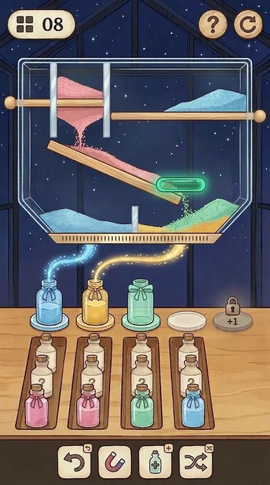
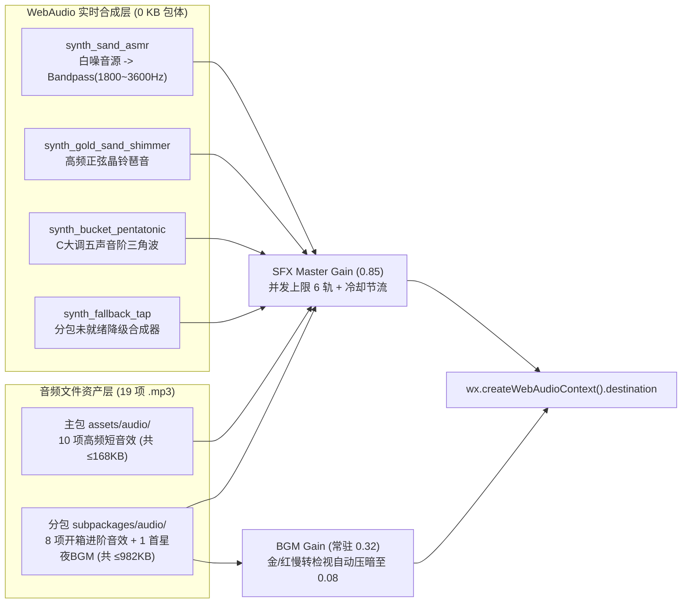

# 《沙里淘大红》UI/UX 交互与视听资产规范（v1.0）

> [!NOTE]
> 本文档为《沙里淘大红》首个上线版本（MVP v1.0）的 **UI 视觉令牌、6 大界面像素级布局线框、交互动效时间轴、粒子特效算法、WebAudio 实时合成参数及全量音效/震动资产交付清单**。
> * **静态美术资产与生图提示词（85 项）**：由 [`data/art/prompts.json`](../data/art/prompts.json) 自动生成至《[美术资产清单与生图提示词手册.md](./美术资产清单与生图提示词手册.md)》；
> * **UI 设计令牌数据源**：[`data/ui_tokens.json`](../data/ui_tokens.json)；
> * **音频与触觉配置数据源**：[`data/audio_haptics.json`](../data/audio_haptics.json)。

---

## 1. 全局视觉设计系统（Design System & Tokens）

### 1.1 画风落地的 Canvas 2D 渲染准则

**局内界面、玻璃沙箱与流沙颗粒质感严格遵循局内实机参考图 [`gameplay_ref.jpg`](./assets/gameplay_ref.jpg)**（[`cover.jpg`](./assets/cover.jpg) 仅作为游戏封面与主视觉参考，不作为局内沙罐造型及流沙纹理依据）。代码自绘层与 AI 切图混合渲染时必须遵守以下 5 条视觉统一铁律：



1. **禁用纯黑描边与纯白刺眼底**：所有 Canvas 自绘文字描边、进度条边框、分割线一律使用**温暖深棕墨线 `#4E2E18` / `#5A3A22`**（次级辅助线 `#7A4F30`），弹窗底色统一采用**暖羊皮纸 `#FFF8EC`**，严禁使用 `#000000` 或冷灰 `#E5E7EB` 破坏绘本暖感。
2. **圆润倒角与厚度阴影**：所有自绘胶囊条、进度槽圆角半径 `borderRadius ≥ 10px`，底部附带 `2px~3px` 不模糊的实心深木色厚度投影（`#8C5423`），还原手绘木牌立体感，不使用大范围高斯黑阴影。
3. **白底切图程序着色（离屏缓存）**：针对需随沙色/品质变色的通用资产（`ui_bucket`、`ui_lock_badge`、`ui_dye_ring`、`ui_scan_ring`、`ui_badge_rank_base`），启动时在离屏 Canvas 使用 `globalCompositeOperation = 'multiply'` 叠加上表标准色值并缓存为 `HTMLCanvasElement` 纹理，运行期 `drawImage` 零性能损耗。
4. **双轮廓半透明厚壁圆角玻璃沙箱 + 底部宽幅多孔黄铜滤沙格栅 + 穿墙雕花木栓**：
   - 采用独立外环/内腔双路径奇偶填充（`evenodd`）表现约 `10px` 半透明暖乳白玻璃壁厚，仅外壁勾勒浓棕钢笔墨线 `#3E2311`，内腔配亮白折光线，并在最上层叠绘四角高光弯月与前层玻璃反光幕；
   - **宽幅多孔黄铜滤沙格栅**：沙箱底部平直收口处镶嵌宽达 `76~100` 格的手绘暖黄铜多孔滤沙网板（含铆钉包边与排孔阴影）；当某孔位正上方流沙匹配在槽木桶时，该孔洞泛起琥珀吸沙微光；
   - 木栓杆身真实穿过半透明玻璃壁插槽，玻璃外壁紧贴竖向圆木卡箍与六瓣雕花拉手；**Canvas 全局严禁直接渲染系统原生 Emoji**，所有按钮与角标图形均由 `UIHelpers.drawHandDrawnGlyph` 以深棕墨线水粉矢量绘制。
5. **水粉体积光影 + 粗细双阶颗粒彩沙 + 多股并行贝塞尔流沙柱**：
   - **消除阶梯锯齿与蓬松颗粒沙脊**：采用 `3x` 超采样（`450 × 495`）子像素密度平滑重建斜坡轮廓，并在暴露沙脊外沿叠加微米级随机砂粒凸起与暖棕彩铅细描边；
   - **立体沙丘光影与接触暗部（AO）**：暴露沙坡顶部 `4~5` 格形成柔和奶油受光亮脊，木栓下方与玻璃罐壁/格栅交界处自然压暗形成厚重堆积感；
   - **随沙粒物理流动的粗细双阶砂砾**：在每颗沙粒的 `shade` 状态中编码水粉云团明暗与粗暗砂砾/细亮石英砂标记；
   - **宽网多股贝塞尔流沙飞线与桶内堆尖沙丘**：支持多色流沙从格栅不同横坐标 `slotPourX[s]` 同时拉出多股带深棕细描边的彩色贝塞尔沙柱，精准注入各自对应的激活小木桶槽，桶口随进度堆起圆锥形彩沙尖顶。

### 1.2 绘本木屋 UI 主题色板（对齐 `data/ui_tokens.json`）

| Token 键名 | 色值 (`Hex / RGBA`) | 视觉语义与使用场景 |
| :--- | :---: | :--- |
| `inkOutline` | `#4E2E18` | 全局主墨线描边、深色正文、木牌刻字 |
| `inkSecondary` | `#7A4F30` | 次级辅助描边、未激活 Tab 文字、副标题 |
| `woodPrimary` | `#D99B52` | 蜂蜜木主色调（顶栏胶囊底、按钮边框、沙罐托架） |
| `woodDark` | `#8C5423` | 木板侧面厚度边、凹槽内底色、按钮按压加深色 |
| `woodHighlight` | `#F6D59E` | 木质上沿高光细线、选中态内发光 |
| `parchmentBg` | `#FFF8EC` | 弹窗主背景、抽屉底色、气泡提示框底色 |
| `parchmentCard` | `#FDF1DC` | 列表内嵌卡片、合成台底栏、选关节点亮底 |
| `starryNightBg` | `#1E294B` | 顶栏星夜底衬、未解锁公仔剪影深色磨砂底 |
| `amberGlow` | `#F59E0B` | 琥珀吊灯暖光、可抽板呼吸提示、红点/高亮边框 |
| `brassAccent` | `#D4A037` | 黄铜包角、铆钉、复古放大镜金属框色 |
| `modalBackdrop` | `rgba(26, 17, 11, 0.66)` | 模态弹窗全屏暖黑压暗遮罩（杜绝死黑遮罩） |

### 1.3 流沙 5 色颗粒噪点调色板（严格吸色对齐 `gameplay_ref.jpg`）

每粒流沙出生时绑定水粉明暗阶与粗细砂砾类型，渲染时预计算三段式水粉渐变查找表与粗暗砾/细亮砂色表：

| `SandColorId` | 名称 | 基础色 `baseHex` | 受光亮脊 `highlightHex` | 暗部/粗砂砾 `shadowHex` | 接沙桶着色 `bucketTint` | 噪点幅度 `±Δ` | 特殊颗粒表现 |
| :---: | :--- | :---: | :---: | :---: | :---: | :---: | :--- |
| `1` | **珊瑚蜜桃粉** | `#EC9FA0` | `#FAD0CA` | `#C46E70` | `#EE9FA0` | `±12` | 暖调珊瑚蜜桃粉 + 深玫瑰粗砂砾斑点 |
| `2` | **暖麦金黄沙** | `#F1C94E` | `#FFF099` | `#C99626` | `#F3CE5A` | `±12` | 饱满暖麦奶油黄 + 琥珀赭石粗砂砾 |
| `3` | **海盐雾蓝沙** | `#7EBBD6` | `#BFE6F5` | `#4E8CA8` | `#86C1DC` | `±12` | 清透海盐灰天蓝 + 深海蓝粗砂砾斑点 |
| `4` | **薄荷鼠尾草绿** | `#80CFA0` | `#BFEFD2` | `#4D9E6F` | `#8AD4A8` | `±12` | 温润鼠尾草嫩绿 + 松石绿粗砂砾斑点 |
| `5` | **黄金狂热沙** | `#EEA825` | `#FFF3A8` | `#B87314` | `#F4B63A` | `±16` | 蜂蜜琥珀金砂 + 暖白石英细闪晶粒 |

### 1.4 六档大红品质色卡与 6 阶头衔徽章色表

#### 六档品质视觉 Token
| 品质 (`Rarity`) | 品质名 | 主色 `primary` | 卡面内底 `cardBg` | 边框色 `border` | 呼吸光晕 `glow` | 对应卡框切图 | 慢转时长 |
| :--- | :---: | :---: | :---: | :---: | :---: | :--- | :---: |
| `WHITE` | **普通** | `#9CA3AF` | `#FAF6F0` | `#B8A99A` | `rgba(255,255,255,0.35)` | `ui_card_frame_white` | `0.35s` |
| `GREEN` | **常见** | `#34D399` | `#ECFDF5` | `#10B981` | `rgba(52,211,153,0.45)` | `ui_card_frame_green` | `0.35s` |
| `BLUE` | **精良** | `#38BDF8` | `#F0F9FF` | `#0284C7` | `rgba(56,189,248,0.50)` | `ui_card_frame_blue` | `0.55s` |
| `PURPLE` | **稀有** | `#A855F7` | `#FAF5FF` | `#7E22CE` | `rgba(168,85,247,0.60)` | `ui_card_frame_purple` | `1.00s` |
| `GOLD` | **传说** | `#F59E0B` | `#FFFBEB` | `#D97706` | `rgba(245,158,11,0.72)` | `ui_card_frame_gold` | `1.55s` |
| `RED` | **绝世大红** | `#EF4444` | `#FEF2F2` | `#B91C1C` | `rgba(239,68,68,0.85)` | `ui_card_frame_red` *(描金 `#FBBF24`)* | **`2.25s`** |

#### 六阶身价头衔徽章着色方案
| 阶位 | 头衔名称 | 身价门槛 | 绑定切图 `assetId` | 底面着色 `tintHex` | 描边色 `borderHex` |
| :---: | :--- | :---: | :--- | :---: | :---: |
| `Lv.1` | 拾荒新手 | `0` | `ui_badge_rank_base` | `#C89F72` | `#7C5335` |
| `Lv.2` | 淘沙学徒 | `50,000` | `ui_badge_rank_base` | `#6EE7B7` | `#059669` |
| `Lv.3` | 摸金达人 | `500,000` | `ui_badge_rank_base` | `#7DD3FC` | `#0284C7` |
| `Lv.4` | 百万富翁 | `2,000,000` | `ui_badge_rank_base` | `#D8B4FE` | `#7E22CE` |
| `Lv.5` | 千万大红收藏家 | `10,000,000` | `ui_badge_rank_base` | `#FDE047` | `#B45309` |
| `Lv.6` | **沙海首富神豪** | `50,000,000` | **`ui_badge_collector`** *(独立红金勋章)* | 原图直出 | `#FBBF24` 流光 |

### 1.5 字体排印层级规范（Typography Scale）

* **中文字体栈**：`"PingFang SC", "Hiragino Sans GB", "Microsoft YaHei", sans-serif`（圆体/黑体加粗，禁用细体）。
* **金额/百分比数字字体栈**：`"DIN Alternate", "SF Pro Rounded", "PingFang SC", monospace`，且开启 `fontVariantNumeric = 'tabular-nums'`，保证身价跳字与桶百分比从 `0% → 100%` 变化时**宽度恒定不左右抖动**。

| 字号等级 | 逻辑字号 (`pt/px`) | 字重 | 描边规范 | 典型应用场景 |
| :--- | :---: | :---: | :--- | :--- |
| `heroValuation` | `32px` | `800` | `3px #5A3A22` 外描边 + 暖金渐变填充 | 出大红全屏特写估值（如 `1,314 万`）、藏馆总身价主数字 |
| `modalTitle` | `22px` | `700` | `2.5px #5A3A22` 外描边 + `#FFF8EC` 填充 | 鉴定台主标题、大红藏馆标题、设置抽屉标题 |
| `sectionTitle` | `17px` | `700` | 无描边，`#5A3A22` 实心字 | 套系 Tab 标题、公仔详情卡名称、主操作按钮大字 |
| `hudPrimary` | `15px` | `700` | `2px #5A3A22` 外描边 | 局内顶栏关卡号、顶栏身价数字、彩桶实时百分比 `76%` |
| `body` | `13px` | `600` | 无描边，`#5A3A22` / `#7C5335` | 鉴宝台词、堵口预警文案、新机关顶部提示条、公仔卡名 |
| `caption` | `11px` | `600` | 无描边 | 道具名称、选关卡片副标题、概率公示表格正文 |
| `badgeMicro` | `10px` | `700` | `1.5px` 深色描边 | 按钮右上角激励角标（`免费 3/3` / `分享`）、`NEW!` 角标、持有数 `×3` |

---

## 2. 竖屏安全区栅格与 6 大界面像素级线框规范（Wireframe Spec）

### 2.1 响应式视口与五段式双核工作台线框公式（基准屏 `390 × 844`）

启动与 `wx.onWindowResize` 时读取 `win = wx.getWindowInfo()` 与 `menu = wx.getMenuButtonBoundingClientRect()`，动态划定**五段式竖屏双核布局**（单位：逻辑像素 `px`）：

```text
+-------------------------------------------------------------------+  y = 0 (屏幕物理顶边)
|                    状态栏安全留白 (statusBarHeight)                |
+-------------------------------------------------------------------+  y = topHudY = menu.top
| [🏠] [🔄重玩] [⚙️第18关▾] [💰1,528万🔴] [🎒×2] | (微信官方胶囊区) |  1. 顶栏五胶囊 HUD (避让左右胶囊)
+-------------------------------------------------------------------+  y = chamberTop = menu.bottom + 6
|     +-------------------------------------------------------+     |
|     |             宽底玻璃沙箱主视口 (SandViewport)          |     |  2. 上层控流沙箱区:
|     |          宽 W_sand = win.width * 0.90 ~ 0.94          |     |     150:165 网格等比居中
|     |          内部木栓 / 斜桥 / 脆冰 / 彩锁 / 染色环        |     |     柔和堵口条 (Stage 1)
|     +=======[ ░░░░░ 宽幅多孔黄铜滤沙格栅 (76~100格) ░░░░░ ]==+     |     多股贝塞尔流沙飞线 ↓
+-------------------------------------------------------------------+  y = slotRowRect.y
|   [🪣槽1 76%]   [🪣槽2 18%]   [  空槽3  ]   [  空槽4  ]  [🔒+第5槽] |  3. 激活接沙小卡槽行 (4+1 槽)
+-------------------------------------------------------------------+  y = candidateAreaRect.y
|     列 1          列 2          列 3          列 4 (前排挡后排)    |  4. 纵向候选木桶滑道区:
|   [🪣排头可点]  [🪣排头可点]  [🧊冰×2桶]    [🪣排头可点]           |     Row 0 放大高亮可调遣
|    [❓盲桶]      [🪣后排]      [❓盲桶]      [🪣后排]             |     后排透视叠放 + 翻牌动效
+-------------------------------------------------------------------+  y = propRowRect.y
|    [↩️ 撤回]     [🧲 磁吸满桶]   [➕ 加第5槽]   [🔀 候选洗牌]      |  5. 四道具木牌操作栏
+-------------------------------------------------------------------+  y = win.safeArea.bottom
|                 iOS Home Indicator 底部安全留白                    |
+-------------------------------------------------------------------+  y = win.screenHeight
```

* **极端屏幕比例自适应兜底**：
  * **超长全面屏（如 `390 × 880`，高宽比 `> 2.15`）**：沙箱横向拉满 `92%`，富余纵向空间分配给候选木桶滑道纵深间距，前后排层次更舒展。
  * **矮宽屏（如 iPhone SE `375 × 667`，高宽比 `< 1.85`）**：按可用高度反推 `H_sand` 并紧凑压缩卡槽与滑道垂直步进，确保五段分区绝不重叠挤压。

### 2.2 六大界面逐屏尺寸与排版规格

#### 1. 启动加载页（`SplashScreen`）
* **背景**：`ui_bg_splash` 按 `cover` 模式居中铺满全屏。
* **品牌 Logo**：`ui_logo_title` 宽度 `260px`（高宽比自适应），中心位于 `(win.width * 0.5, win.height * 0.22)`，带上下 `±4px` 轻柔呼吸浮动（周期 `2.4s`）。
* **底部流沙进度条**：宽 `220px × 高 12px`，位于 `y = win.safeArea.bottom - 56px`，深棕木槽底 + 金色细沙填充条。
* **合规适龄徽标**：左下角 `(16px, win.safeArea.bottom - 52px)` 绘制 `ui_badge_cadpa_frame`（尺寸 `36 × 44px`），正中叠绘白色粗体 `8+`；点击弹出 `310 × 220px` 羊皮纸说明框。

#### 2. 主局内双核工作台界面（`MainHUD`）组件精确尺寸
* **顶栏五胶囊（高 `32px`，与微信右上角官方胶囊严格水平对齐）**：
  1. `主页圆钮`（`homePill`）：手绘小木屋图标，一键返回星夜工坊大厅。
  2. `免费重玩钮`（`restartPill`）：手绘回旋木箭图标，**全程零广告免费一键重开本关**（若本关已用过道具或已有盲盒入袋则弹二次防误触确认）。
  3. `关卡/设置胶囊`（`settingsPill`）：手绘木齿轮 + `第18关 ▾`，点击滑出选关与设置抽屉。
  4. `总身价/藏馆胶囊`（`netWorthPill`）：嵌当前阶位头衔徽章 + 缩写身价；当 `shards >= 5` 且有未解锁公仔时右上角亮朱红圆点。
  5. `本关战利品兜`（`lootBagPill`）：右对齐至 `menu.left - 12px`，展示手绘麻布袋与本关已入袋盲盒数 `×N`。
* **双层木工接沙台（上半行 `4+1` 小卡槽 + 下半区 `3~4` 列候选滑道）**：
  * **上半行 `activeSlotRects[0..4]`**：默认激活前 `4` 个深木内凹圆角底座，入槽木桶实时显示彩沙圆锥尖顶与数字百分比；第 `5` 槽默认覆手绘铜锁与 `+槽` 角标，点击可直接拉起 `EXTRA_SLOT` 激励解锁。
  * **下半区 `candidateAreaRect`**：按关卡 `numCols`（`3` 或 `4` 列）等分纵向木质导槽；每列从下往上倒序先画后排再画前排（前排自然遮挡后排下半桶身）：
    * `Row 0` 排头可点桶：`1.0x` 比例高亮，桶口微倾朝向玩家；
    * `❓ 问号盲桶`（后排未揭晓态）：深胡桃神秘木桶 `#8B5A34` + 奶油羊皮纸「`?`」封签；推进至 `Row 0` 瞬间播放 `240ms` 横向翻转（`scaleX: 1 → 0 → 1`）揭晓真实彩桶；
    * `🧊 冰封木桶`（`iceLayers > 0`）：桶身外罩半透明冰蓝棱角冰壳与 `冰×N` 角标，误点时左右抖动并提示“先装满其他木桶震碎寒冰”；每满任意 1 桶播放冰裂闪烁动效。
* **底栏四道具操作栏（`propButtons[0..3]`，4 等分木牌网格）**：
  * 从左至右固定为：**`撤回`**（手绘弯箭）、**`磁吸满桶`**（手绘红蓝U形磁铁）、**`加第5槽`**（手绘木槽加号）、**`候选洗牌`**（手绘双交叉洗牌箭），右上角挂载激励状态胶囊（`免费` / `分享` / `视频` / `已满`）。
* **两阶段死局反馈层**：
  * **Stage 1 柔和提示胶囊**：格栅滞沙满 `1.5s` 且仍有操作空间时，在沙箱下沿浮现非阻塞暖黄条；
  * **Stage 2 硬死局救援模态窗**：卡槽全满且彻底无沙可吸满 `0.85s` 时，居中弹出绘本羊皮纸救援卡，提供 **`[➕ 加开第5接沙槽]`**、**`[🧲 磁吸直接满1桶]`**、**`[🔄 免费重新挑战]`** 三选一破局入口。

#### 3. 通关出货鉴定台（`AppraisalModal` & `RedJackpotOverlay`）
* **主面板**：居中宽 `354px × 高 540px`（`ui_bg_appraisal` 裁切圆角卡片或叠加 `ui_panel_parchment`）。
* **盲盒检视卡片网格区（中心区域 `322px × 310px`）**：
  * `1 盒`：单张大卡 `156 × 208px` 居中；
  * `2 盒`：两张 `142 × 190px` 并排（水平间距 `16px`）；
  * `3~4 盒`：`2×2` 网格，单卡 `126 × 168px`（间距 `12px`）；
  * `5 盒（含双黄蛋分裂 + 空投盒）`：上排 3 张 + 下排 2 张居中，单卡 `100 × 134px`。
* **单卡内部元素锚点**：
  * 卡框 `ui_card_frame_{rarity}` 铺满卡片；公仔立绘居中占卡片宽 `72%`；底部名称条高 `24px`；
  * 左上角 `(-6px, -6px)`：首次获得贴金色斜角标 `NEW!`；
  * 右下角 `(卡片内底 -26px)`：重复获得贴半透明琥珀条 `🧩 碎片 +X`；
  * 卡片正下方 `+6px`：若满足白/绿重抽条件，挂载 `108 × 30px` 小木钮 `[🔄 重抽必升档]`；
  * 空投锁定格：盲盒上方悬挂 `44×44px` `ui_airdrop_parachute` 轻微摇摆，盒面叠半透明锁幕与 `[🪂 免费领空投]` 按钮。
* **首次出大红全屏特写层（`RedJackpotOverlay`）**：
  * 叠加在鉴定台之上，背景铺满 `ui_bg_share_poster`，中央展示 `220 × 292px` 大号朱红金纹卡面 + 顶部 `32px` 滚动身价大字 `+13,140,000` + 中部趣味鉴宝台词卷轴 + 底部双按钮：`[🔥 炫耀晒单]`（宽 `156px`，朱红描金高亮）与 `[收入囊中]`（宽 `136px`，蜂蜜木按钮）。

#### 4. 大红藏馆与合成界面（`GalleryModal`）
* **全屏模态页**：铺满 `ui_bg_collection`，顶部避让微信胶囊区域设 `[← 返回局内]` 木质圆钮（左上角 `x=12px, y=menu.top`）。
* **顶部个人信息与总身价栏（`y = menu.bottom + 8px`，高 `72px`，宽 `366px` 居中羊皮纸横幅）**：
  * 左侧：`48×48px` 圆形头像框（未授权绘 `ui_avatar_default_duck`，已授权绘微信头像）+ 昵称 `14px` + 当前阶位头衔徽章（宽 `84×22px`）。
  * **微信 `UserInfoButton` 透明覆盖精确坐标**：未授权时在昵称右侧绘制 `88 × 24px` 浅木色胶囊 `[同步微信头像 ›]`，调用 `wx.createUserInfoButton({ type: 'text', text: '', style: { left, top, width: 88, height: 24, backgroundColor: '#00000000', borderColor: '#00000000', borderWidth: 0 } })`，打开藏馆时创建，关闭藏馆或授权成功后立即 `.destroy()` 防止透明热区残留拦截局内点击！
  * 右侧：右对齐展示 `藏馆总身价` 小标 + `24px` 金色数字 + `收集进度 X / 30`。
* **双套系 Tab 与 `15/15` 奖励条（高 `84px`）**：
  * 上行：左右双 Tab（各宽 `178px × 高 36px`）切换《摸金打工萌宠》与《深夜暴富食堂》。
  * 下行：套系集齐奖励横幅（`366px × 42px`），左侧放 `34×34px` `ui_reward_skin_galaxy` 或 `ui_reward_fx_rainbow` 图标 + 奖励名 + 进度条，右侧放 `84×30px` 状态钮（`X/15` / `🎁激活` / `穿戴中✓`）。
* **中部 `3 列 × 5 行` 图鉴滚动视口**：
  * 视口宽 `366px`，单卡 `112px × 148px`（列间距 `11px`，行间距 `10px`），支持纵向惯性阻尼滑动（`overscroll` 回弹 `24px`）。
  * 未解锁态将对应公仔立绘绘制到离屏缓冲后用 `source-in` 填充 `#1E294B` 星夜剪影色（透明度 `0.55`），既保留神秘感又能看出角色轮廓特征。
* **底部常驻【淘金碎片合成台】（固定吸底，高 `82px` + `safeArea` 留白）**：
  * 左侧：`ui_shard_icon`（`28×28px`）+ 库存数字 `🧩 28` + `[ⓘ 概率]` 小圆钮（点击弹出 `336×420px` 概率公示表）。
  * 右侧双按钮：`[🧩5 普通合成]`（宽 `112px × 50px`，海盐蓝木钮）与 `[🧩25 紫金红冲刺]`（宽 `128px × 50px`，流光金红渐变木钮）。

#### 5. 设置与选关抽屉（`LevelSettingsDrawer`）
* **进场方式**：从屏幕左侧或底部向上滑出的 `366px × 620px` 抽屉面板（底图 `ui_bg_level_drawer` 叠羊皮纸内衬）。
* **顶部开关行（高 `56px`）**：并列两个胶囊开关 `[🔊 音效: 开]`（配 `ui_icon_sound_horn`）与 `[📳 震动: 开]`，右侧附 `[☁️ 已云同步]` 状态字。
* **中部 `4 列 × 5 行` 选关网格**：单节点 `76px × 76px` 圆角木牌，展示关卡序号 `01~20`、关卡名缩写、Boss/福利小皇冠图标及通关对勾 `✓`。

### 2.3 通用按钮四态交互规范

| 组件状态 | 缩放比例 `scale` | 透明度 `alpha` | 附加视觉变化 | 响应规则 |
| :--- | :---: | :---: | :--- | :--- |
| **默认态 (`Normal`)** | `1.00` | `1.00` | 正常显示底部 `3px` 深木色厚度边 | 正常接收点击 |
| **按压态 (`Pressed`)** | `0.93` | `1.00` | 整体下移 `+2px`，底部厚度边缩至 `1px`，叠 `8%` 暖白高光 | `pointerdown` 90ms 内缩到位；移出热区或滑动 `>20px` 恢复 `Normal` 不触发 |
| **呼吸推荐态 (`Pulse`)** | `1.00 ↔ 1.05` | `1.00` | 外缘叠加 `#F59E0B` 琥珀色呼吸光圈（周期 `1.1s` 正弦波） | 堵口超过 `1.5s` 时的【清堵/加槽】、鉴定台【下一关】、藏馆【免费激活大奖】 |
| **禁用/锁定态 (`Disabled`)** | `1.00` | `0.45` | 降低饱和度，隐藏发光粒子 | 撤回栈为空时不响应；碎片不足/未解锁关点击弹 `1.5s` 轻提示 Toast 并轻微左右抖动 `±4px` |

---

## 3. 关键交互动效、缓动曲线与粒子特效规范（Motion & VFX Spec）

### 3.1 核心交互逐帧时间轴总表（Motion Timeline）

| 动效编号与场景 | 总时长 | 缓动函数 (`Easing`) | 关键帧分段编排（`0% → 100%`） |
| :--- | :---: | :---: | :--- |
| **M-01 抽拉木板抽出** | `120ms` | `easeInQuad` | `0~25ms` 木板反向微缩 `3px` 蓄力 → `25~120ms` 沿板身外侧极速滑出容器壁并淡出，原网格阻挡在第 `25ms` 帧即刻擦除触发流沙瞬时雪崩（零操作延迟感） |
| **M-02 冰砖坠地碎裂** | `320ms` | `easeOutCubic` | 撞底帧（`0ms`）沙盘整体纵向微震 `±3px`（持续 `90ms`），冰砖解冻化为流沙，同时在撞击面喷发 `18 颗` 淡蓝白棱角冰碴粒子（初速度向上扇形散射，受重力下落淡出） |
| **M-03 颜色锁自动崩开** | `280ms` | `easeOutBack` | 对应彩桶满桶帧触发：`0~80ms` 锁身放大至 `1.3x` 闪白 → `80~200ms` 播放三段碎裂动势（锁梁弹飞 + 4 颗同色四角星迸射）→ `200~280ms` 木板自动抽出 |
| **M-04 吸沙飞线与满桶切换** | `220ms` | `easeOutBack` | 吸沙期每帧生成 `2~4 条` 从出沙口指向当前激活桶口的二次贝塞尔彩色流线；达 `100%` 瞬间桶身挤压形变 `(scaleX:1.18, scaleY:0.84)` → 向上弹起 `28px` `(0.88, 1.15)` 溅出小星点并向左侧飞离，队列下一桶同步滑入主槽 |
| **M-05 盲盒胶囊飞入宝袋** | `400ms` | `easeInOutQuad` | 盲盒滚出漏斗口后放大至 `1.35x` 亮起品质光环，沿抛物线（控制点向屏幕中心拱起 `60px`）飞向右上角 `ui_loot_bag`，抵达瞬间宝袋缩放 `1.0 → 1.28 → 1.0` 并飘字 `+1` |
| **M-06 双黄蛋惊喜盒分裂** | `450ms` | `easeOutBack` | `0~220ms` 原地高频左右摇晃 `±14°` 蓄力膨胀至 `1.22x` → `220ms` 闪白爆出粉蓝丝带粒子，向左右两侧对称弹开分裂为 **2 张独立盲盒格** |
| **M-07 复古放大镜慢转检视** | `0.35s ~ 2.25s` | 分品质阻尼曲线 | 放大镜 `ui_magnifier` 镜心沿半径 `26px` 圆周公转，底部 `ui_scan_ring` 反向自转：<br>• **白/绿 (`0.35s`) / 蓝 (`0.55s`)**：匀速轻快扫完 `1` 圈即刻翻牌；<br>• **紫 (`1.00s`) / 金 (`1.55s`)**：前 `60%` 快速转 `1.2` 圈，后 `40%` 强阻尼减速定格在宝盒高光处爆光；<br>• **绝世大红 (`2.25s`)**：全屏背景压暗至 `82%`，四周边缘泛起频率随心跳加快的朱红呼吸暗角（`0.8Hz → 2.2Hz`），放大镜极慢阻尼滑行并在第 `2.10s` 短暂悬停 `150ms` 屏息帧，第 `2.25s` 全屏红金闪白炸开！ |
| **M-08 绝世大红砸卡特写** | `650ms` | `easeOutBack` | 闪白消退同时，大红卡面从 `scale 2.2x` 携残影砸落至 `1.0x` 中心位，震起一圈金色冲击波纹与 `45 颗` 持续飘落的红金手绘彩纸与四角星芒 |
| **M-09 藏馆总身价跳字** | `600ms` | `easeOutExpo` | 新增身价时顶栏与结算台数字执行 `600ms` 滚动递增插值，字号临时放大 `1.15x` 并刷过一道暖金扫光；若跨越头衔阈值，弹出 `1.4s` 头衔晋升勋章横幅 |
| **M-10 弹窗打开与收起** | `260ms / 180ms` | `easeOutBack` / `easeInCubic` | 打开：遮罩 `0 → 0.68` 线性淡入，面板 `scale 0.82 → 1.0` 回弹出现；关闭：`scale 1.0 → 0.90` + `alpha 1 → 0` 快速收起不拖泥带水 |

### 3.2 双套系 `15/15` 集齐奖励局内特效渲染规范（零额外帧率负担）

1. **第一弹大奖【🌌 银河闪粉流沙皮肤】（`skin_galaxy_glitter`）**：
   - **渲染算法**：激活穿戴后，在 `SandRenderer` 像素着色阶段，利用沙粒自身的 `shade` 哈希种子筛选出约 **`6%` 的幸运沙粒**，根据 `(frameCount + cellSeed) % 24` 相位周期将其颜色平滑插值至奶白星芒色 `#FFFBEB`，同时在沙堆表面随机浮现每秒 `6~8 颗` 缓慢升腾消散的 `4px` 手绘十字小星点，整罐彩沙宛如流动的璀璨星河，CPU 额外耗时 `< 0.2ms/帧`。
2. **第二弹大奖【🌈 彩虹流光吸沙特效】（`fx_rainbow_drain`）**：
   - **渲染算法**：激活穿戴后，出沙口飞向接沙桶的吸沙流线由单一沙色升级为 **5 色马卡龙动态渐变流光尾迹**（色相随帧时间 `hsl((frame * 6 + i * 30) % 360, 85%, 72%)` 循环流转），桶口伴随透明水彩小气泡升腾，且吸沙音效自动叠加上 `synth_gold_sand_shimmer` 清脆星尘晶铃泛音。

### 3.3 粒子系统对象池配额（Object Pool — 运行期零 GC）

全局共享单一 `ParticleSystem` 预分配固定长度 `Float32Array` 属性池（上限 **120 颗活跃粒子**）：
* 吸沙飞线与桶口星点：预留 `40` 槽位；
* 冰砖碎裂冰碴 / 锁头崩开飞星 / 染色环星尘：共享 `35` 槽位；
* 鉴定台开箱爆光与出大红满屏彩纸礼花：共享 `45` 槽位；
* **低端机自适应降级**：当连续 `30` 帧平均帧耗时 `> 20ms`（低于 `50 FPS`）时，自动将单次粒子发射数折半（上限压至 `60` 颗），优先保障流沙物理 `60Hz` 丝滑手感。

---

## 4. 听觉（WebAudio ASMR + BGM/SFX）与触觉震动资产总清单

### 4.1 音频混合架构图（WebAudio 合成 + 双包音频文件）



### 4.2 WebAudio 实时合成器精确参数表（对齐 `data/audio_haptics.json`）

| 合成器 ID | 用途 | 振荡/噪声源 | 滤波器与频率参数 | 动态增益与节流规则 |
| :--- | :--- | :--- | :--- | :--- |
| `synth_sand_asmr` | **流沙塌方与漏斗吸入沙沙声** | `2.0s` 预生成单声道白噪音 `AudioBuffer` 循环播放 | `BiquadFilterNode` (`bandpass`, `Q = 1.8`)；中心频率随每帧流速 $v \in [0, 35]$ 从 `1800Hz` 线性扫频至 `3600Hz` | 目标音量 `gain = clamp(v / 35, 0, 0.28)`，使用 `setTargetAtTime(gain, now, 0.06)` 平滑过渡；无沙流动时自动静默至 `0` |
| `synth_gold_sand_shimmer` | **黄金狂热沙 / 彩虹特效晶铃泛音** | `OscillatorNode` (`sine`) | 在 E6/G6/B6/E7 (`[1318.5, 1568.0, 1975.5, 2637.0] Hz`) 中随机挑音 | 单音指数衰减 `95ms`，峰值增益 `0.14`，最小触发间隔 `cooldownMs = 70ms` |
| `synth_bucket_pentatonic` | **接沙桶水位递升五声音阶** | `OscillatorNode` (`triangle`) | C5 五声音阶：`[523.25, 587.33, 659.25, 783.99, 880.00, 1046.50] Hz` | 当前桶每上涨约 `16%` 水位触发对应阶音符（越接近满桶音高越高），衰减 `110ms`，增益 `0.18`，冷却 `60ms` |
| `synth_fallback_tap` | **分包未就绪零延迟兜底音** | `OscillatorNode` (`triangle` + `sine`) | `220Hz → 880Hz` 快速上滑包络 | 仅在极弱网下玩家秒通第 1 关而 `subpackages/audio` 尚未下载完成时自动顶替开箱音效，杜绝哑巴开箱 |

### 4.3 19 项音频资产生产与分包预算总清单（总体积 `≤ 1.15 MB`）

* **音频制作总基调**：与绘本木屋星夜画风一致，器乐以**温暖实木敲击、黄铜怀表发条、指弹原声木吉他、复古八音盒、竖琴、玻璃风铃与柔和管弦**为主，**严禁使用电子街机刺耳激光音、警报蜂鸣音或金属重工业噪音**。
* **格式规范**：全部导出为 `.mp3`（`44.1kHz`，去除首尾静音留白 `< 5ms` 及无用 ID3 封面标签）；主包短音效统一采用**单声道 `64kbps`** 极致控体，分包高光演出音效与 BGM 采用**立体声 `96kbps`**。

#### A. 主包音频清单（`assets/audio/` — 共 10 项，合计上限 `168 KB ≤ 250 KB` 预算）

| # | `audioId` | 资产名称 | 时长 | 声道 / 码率 | 体积上限 | 节流冷却 | 输出路径 | 声音设计描述（供音效制作/AI 音效生成） |
| :---: | :--- | :--- | :---: | :---: | :---: | :---: | :--- | :--- |
| 1 | `sfx_ui_click` | 通用木质按钮轻点 | `0.08s` | 单声道 64k | `6 KB` | `40ms` | `assets/audio/sfx_ui_click.mp3` | 温暖短促的实木圆钮轻敲咔嗒声，干净利落无尖锐毛刺 |
| 2 | `sfx_board_pull` | 抽拉木板清脆抽出 | `0.18s` | 单声道 64k | `12 KB` | `50ms` | `assets/audio/sfx_board_pull.mp3` | 木槽快速抽离的清脆木头滑擦“咔嗒-咻”声，解压干脆 |
| 3 | `sfx_board_locked` | 误点颜色锁木板闷响 | `0.22s` | 单声道 64k | `12 KB` | `180ms` | `assets/audio/sfx_board_locked.mp3` | 黄铜小挂锁晃动轻磕木板的低沉“咔哒”两连响 |
| 4 | `sfx_lock_break` | 颜色锁自动崩开解锁 | `0.35s` | 单声道 64k | `18 KB` | `100ms` | `assets/audio/sfx_lock_break.mp3` | 清脆弹簧锁梁弹开声叠加一颗明亮风铃叮声 |
| 5 | `sfx_ice_shatter` | 冰冻沙砖坠地摔碎 | `0.45s` | 单声道 64k | `24 KB` | `120ms` | `assets/audio/sfx_ice_shatter.mp3` | 厚实冰块撞击碎裂成细密冰晶颗粒的清脆咔嚓声 |
| 6 | `sfx_dye_pass` | 流沙穿过魔法染色环 | `0.20s` | 单声道 64k | `12 KB` | `150ms` | `assets/audio/sfx_dye_pass.mp3` | 轻柔水彩气泡“啵”声与细微星尘泛音（连续流过按 `150ms` 节流） |
| 7 | `sfx_bucket_full` | 接沙桶100%装满弹飞 | `0.40s` | 单声道 64k | `20 KB` | `80ms` | `assets/audio/sfx_bucket_full.mp3` | 小木桶拍合封口“嘭”声接上扬大三和弦清脆叮咚 |
| 8 | `sfx_capsule_pocket` | 盲盒飞入右上角战利品袋 | `0.35s` | 单声道 64k | `18 KB` | `80ms` | `assets/audio/sfx_capsule_pocket.mp3` | 柔和流光飞掠声落入亚麻布袋，伴随宝盒轻碰清脆响声 |
| 9 | `sfx_jam_warn` | 异色流沙堵口柔和提醒 | `0.45s` | 单声道 64k | `20 KB` | `2000ms` | `assets/audio/sfx_jam_warn.mp3` | 温暖马林巴木琴双降音（G4→E4），温和提醒堵口、绝不制造焦虑 |
| 10 | `sfx_prop_vacuum` | 万能吸尘器清堵旋风 | `0.55s` | 单声道 64k | `26 KB` | `300ms` | `assets/audio/sfx_prop_vacuum.mp3` | 复古手持小吸尘器柔和旋风吸入声接干脆“啵”地收口音 |

#### B. 音频分包清单（`subpackages/audio/` — 共 9 项，合计上限 `982 KB ≤ 1,500 KB` 预算）

| # | `audioId` | 资产名称 | 时长 | 声道 / 码率 | 体积上限 | 循环 | 输出路径 | 声音设计描述（供音效制作/AI 音效生成） |
| :---: | :--- | :--- | :---: | :---: | :---: | :---: | :--- | :--- |
| 11 | `sfx_prop_undo` | 撤回上一步时光倒流 | `0.40s` | 单声道 80k | `24 KB` | 否 | `subpackages/audio/sfx_prop_undo.mp3` | 倒放细沙回流声叠加轻盈竖琴下行滑音 |
| 12 | `sfx_box_double_split` | 双黄蛋惊喜盒裂开双倍 | `0.55s` | 单声道 80k | `28 KB` | 否 | `subpackages/audio/sfx_box_double_split.mp3` | 礼盒丝带弹开“啵啵”双响与手绘彩纸散落欢快音 |
| 13 | `sfx_scan_loop_normal` | 复古放大镜常规检视扫描 | `1.00s` | 单声道 80k | `32 KB` | **是** | `subpackages/audio/sfx_scan_loop_normal.mp3` | 黄铜放大镜旋转时轻巧的怀表发条齿轮嘀嗒声与微光扫过声 |
| 14 | `sfx_scan_heartbeat_red` | 金/大红极慢检视心跳蓄力 | `2.30s` | 单声道 80k | `68 KB` | 否 | `subpackages/audio/sfx_scan_heartbeat_red.mp3` | 由慢渐快的低频胸腔心跳鼓点（4 拍加速）叠加持续升调的星芒悬念嗡鸣 |
| 15 | `sfx_reveal_low` | 白/绿/蓝品质揭晓翻牌 | `0.45s` | 单声道 80k | `24 KB` | 否 | `subpackages/audio/sfx_reveal_low.mp3` | 羊皮纸卡片轻快翻转声配玻璃风铃单音（开出蓝色时播放 `playbackRate = 1.12` 自动升调提亮） |
| 16 | `sfx_reveal_purple` | 紫色稀有品质揭晓绽放 | `0.90s` | 立体声 96k | `42 KB` | 否 | `subpackages/audio/sfx_reveal_purple.mp3` | 梦幻竖琴琶音快速上扬接水晶星光闪烁叮鸣 |
| 17 | `sfx_reveal_gold` | 金色传说品质揭晓星辉 | `1.40s` | 立体声 96k | `64 KB` | 否 | `subpackages/audio/sfx_reveal_gold.mp3` | 温暖圆号与钟琴奏响辉煌大调和弦，尾音伴随金币滚动清脆泛音 |
| 18 | `sfx_reveal_red_jackpot` | **绝世大红出货庆典交响和弦** | `2.60s` | 立体声 96k | `120 KB` | 否 | `subpackages/audio/sfx_reveal_red_jackpot.mp3` | 重低音宝匣开启轰鸣 → 庆典弦乐铜管华彩乐句冲天 → 礼花绽放与漫天星光瀑布尾韵 |
| 19 | `bgm_workshop_starry` | **星夜木屋工坊治愈主背景乐** ✅ 已交付 | `47.37s` | 立体声 96k | `580 KB`（实测 `556 KB`） | **是** | `subpackages/audio/bgm_workshop_starry.mp3`（仓库源：`assets/audio/`，由 `npm run gen:bgm` 确定性生成） | 温暖指弹原声木吉他与复古八音盒交织的日系绘本夜曲（`BPM 76`，F 大调 `3/4` 摇篮曲拍，20 小节 = A 段吉他+八音盒 / B 段柔和管弦铺底 / 尾声 Bbm6 怀旧色彩回主和弦，两处竖琴琶音过门；母带在 `2.75kHz` 宽口挖空 `-7dB` 不遮盖流沙 `2~3.5kHz` 白噪音，环形渲染首尾零采样无缝循环 `loopSamples = 2088947`） |

> [!NOTE]
> **BGM 运行时混音规则**（[`AudioManager`](../src/platform/AudioManager.ts)）：闪屏静音 → 主菜单 / 局内 / 鉴定台 / 藏馆共用本曲，首次起播 `1.8s` 慢淡入；局内大面积流沙时按流速对 BGM 侧链让位最多 `30%`（`mixer.bgmSandFlowDuckRatio`）；金 / 大红慢转检视 `200ms` 压暗至 `0.08`，揭晓音效播完后 `500ms` 恢复至 `0.32`；切后台随 AudioContext 挂起，声音开关关闭时淡出并停止。

### 4.4 混音闪避（Ducking）与全事件「声·光·震」四维联动表

1. **混音台防爆音与开箱闪避规则**：
   - 全局同时播放的非循环短音效上限为 **`6 轨`**；若超出上限，优先丢弃最早播放的 `sfx_dye_pass` / `sfx_ui_click`，**绝不抢占 `sfx_bucket_full` 或开箱揭晓音效**。
   - **开箱悬念 BGM 闪避（Ducking）**：当鉴定台开始检视 `🟡 GOLD` 或 `🔴 RED` 盲盒时，`bgm_workshop_starry` 音量在 `200ms` 内从 `0.32` 自动压低至 `0.08`，让心跳声与大红交响和弦极具穿透力；揭晓完毕 `500ms` 后平滑恢复至 `0.32`。
2. **微信触觉反馈封装（`HapticManager`）**：
   - 统一封装 `wx.vibrateShort({ type })`，严格受玩家存档 `settings.vibrateOn` 开关控制；iOS/Android 低版本不支持 `type` 参数时自动无感 catch 降级，不抛异常。
3. **28 项核心事件四维反馈绑定速查表**（与 [`data/audio_haptics.json`](../data/audio_haptics.json) 1:1 对应）：

| 事件标识 (`event`) | 触发时机 | 播放音效 / 合成器 | 微信震动 (`wx.vibrateShort`) | 视觉动效与粒子反馈 |
| :--- | :--- | :--- | :---: | :--- |
| `UI_BUTTON_TAP` | 点击任意常规可用按钮 | `sfx_ui_click` | 不震动 | 按钮 `90ms` 按压至 `0.93x` 后回弹 |
| `BUCKET_DISPATCH` | 点击列首候选木桶调入上方激活卡槽 | `sfx_ui_click` | `light` ×1 | 排头桶沿弧线跃入目标空槽，后排桶顺移递补 |
| `BUCKET_TAP_BLOCKED` | 点击后排被挡木桶、冰封桶或卡槽已满 | `sfx_board_locked` | `light` ×1 | 目标桶左右轻抖 `±5px` + 飘出原因提示 |
| `BUCKET_MYSTERY_REVEAL` | 后排 `❓` 问号盲桶推进至列首揭晓 | `sfx_dye_pass` | `light` ×1 | `240ms` 横向翻牌动画揭开真实彩桶漆面 |
| `BUCKET_ICE_CRACK` | 满桶震裂候选列冰封木桶 1 层冰壳 | `sfx_ice_shatter` | `light` ×1 | 冰壳闪烁裂纹、层数 `-1`（归零飞散冰晶解封） |
| `BOARD_PULL` | 点击抽走普通/倾斜木栓 | `sfx_board_pull` | `light` ×1 | 木栓沿轴向 `120ms` 抽出 + 木屑微粒 |
| `BOARD_TAP_LOCKED` | 误点尚未解锁的颜色锁栓 | `sfx_board_locked` | `light` ×1 | 锁头左右摇晃 `±12°` + 对应色木桶闪烁提示 |
| `LOCK_AUTO_BREAK` | 首只同色桶装满自动崩开颜色锁 | `sfx_lock_break` | `medium` ×1 | 锁头崩裂飞星 + 木栓自动滑出 |
| `SAND_FLOWING_LOOP` | 沙粒下落或穿过宽幅滤沙格栅 | `synth_sand_asmr` | 不震动 | 流速调制白噪音 + 多股贝塞尔彩沙流线 |
| `GOLD_SAND_DRAIN` | 吸入黄金狂热沙或穿戴彩虹特效 | `synth_gold_sand_shimmer` | 不震动 | 金色星芒/七彩尾迹涌入桶口 |
| `DYE_RING_PASS` | 流沙穿过魔法染色环改色 | `sfx_dye_pass` *(150ms节流)* | 不震动 | 染色环内圈微亮 + 水彩星点迸发 |
| `ICE_BLOCK_SHATTER` | 高空脆冰坠落 `≥44` 格砸裸硬底碎裂 | `sfx_ice_shatter` | `medium` ×1 | `18 颗` 冰碴飞溅 + 沙盘纵向微震 `±3px` |
| `BUCKET_STEP_FILL` | 在槽木桶水位每上涨 `16%` | `synth_bucket_pentatonic` | 不震动 | 水位圆锥沙顶上涨 + 五声音阶逐级升高 |
| `BUCKET_FULL_SWAP` | 在槽木桶达 `100%` 满桶飞离腾槽 | `sfx_bucket_full` | `medium` ×1 | 满桶挤压向上弹飞清出空槽 + 触发冰桶减层 |
| `CAPSULE_INTO_BAG` | 盲盒滚落触达格栅飞入战利品袋 | `sfx_capsule_pocket` | `light` ×1 | 抛物线流光入袋 + 宝袋放大 `1.28x` 弹跳 |
| `CLOG_WARNING_SHOW` | 格栅滞沙满 `1.5s` / 触发硬死局弹窗 | `sfx_jam_warn` | `light` ×1 | 柔和提示条淡入 / 满槽硬死局救援窗弹出 |
| `PROP_EXTRA_SLOT` | 激活【加开第 5 接沙槽】 | `sfx_lock_break` | `medium` ×1 | 最右侧第 5 卡槽铜锁弹开，扩容为 5 槽并发 |
| `PROP_VACUUM_CLEAN` | 激活【磁吸满桶腾槽】 | `sfx_prop_vacuum` | `medium` ×1 | 目标槽木桶触发磁吸飞线，`1:1` 抽沙瞬间灌满腾槽 |
| `PROP_UNDO_SNAPSHOT` | 激活【撤回上一步（双动作回退）】 | `sfx_prop_undo` | `light` ×1 | 沙盘暖光一闪，网格/卡槽/候选列/宝袋原子回滚 |
| `PROP_SHUFFLE` | 激活【候选木桶智能洗牌】 | `sfx_box_double_split` | `medium` ×1 | 各列非冰封桶洗牌重排，保底列首出现格栅匹配色 |
| `BOX_DOUBLE_SPLIT` | 鉴定台双黄蛋惊喜盒分裂 | `sfx_box_double_split` | `medium` ×1 | 礼盒摇晃裂开彩带，原地展开为 2 张独立检视格 |
| `APPRAISAL_SCAN_NORMAL` | 白/绿/蓝/紫放大镜扫描期 | `sfx_scan_loop_normal` | 不震动 | 复古木柄放大镜匀速/减速画圆扫描 |
| `APPRAISAL_SCAN_HIGH` | 金 (`1.55s`) / 大红 (`2.25s`) 慢转期 | `sfx_scan_heartbeat_red` | **心跳脉冲震动序列**<br>*(light×2→medium×2→heavy)* | BGM 压暗至 `0.08` + 极慢阻尼转圈 + 屏幕四周泛暖红光 |
| `REVEAL_WHITE_GREEN` | 揭晓白色/绿色普通公仔 | `sfx_reveal_low` *(1.0x)* | 不震动 | `0.35s` 快速翻牌展示立绘 |
| `REVEAL_BLUE` | 揭晓蓝色精良公仔 | `sfx_reveal_low` *(1.12x)* | `light` ×1 | `0.55s` 淡蓝星光微闪翻牌 |
| `REVEAL_PURPLE` | 揭晓紫色稀有公仔 | `sfx_reveal_purple` | `medium` ×1 | `1.00s` 薰衣草紫星光绽放 + 飘字 *“出小紫！”* |
| `REVEAL_GOLD` | 揭晓金色传说公仔 | `sfx_reveal_gold` | `heavy` ×1 | `1.55s` 暖金星辉光束绽放 + 身价跳字 |
| `REVEAL_RED_JACKPOT` | **揭晓红色绝世大红公仔** | `sfx_reveal_red_jackpot` | **连续 `heavy` 强震 ×2**<br>*(间隔 `160ms`)* | `2.25s` 全屏红金闪白 + 大卡砸落特写 + 漫天彩纸 + 晒单层 |

---

## 5. 87 项视觉美术资产客户端装配与裁切规范

《[美术资产清单与生图提示词手册.md](./美术资产清单与生图提示词手册.md)》共定义 **87 项** 静态美术资产，从生图原图经抠图与 [`scripts/compress_assets.py`](../scripts/compress_assets.py) 压缩入库时的**目标运行分辨率、分包归属与特殊渲染装配方式**如下：

| 资产分组 | 项数 | 入库压缩目标尺寸 | 分包归属 | 客户端特殊装配（九宫格 / 锚点 / 着色）说明 |
| :--- | :---: | :--- | :---: | :--- |
| **背景插画** (`ui_bg_*`) | `6` | `750 × 1334` (8-bit PNG，单张 `≤ 185KB`) | `ui_bg_gameplay` / `ui_bg_splash` 入**主包**；其余 4 张入 `figurines` 分包（未就绪前用羊皮纸色底平滑过渡） | 按 `Math.max(winW / imgW, winH / imgH)` 居中 `cover` 绘制，核心留白区与 `LayoutManager` 沙盘视口对齐 |
| **品牌标识** (`ui_logo_*` / `app_icon`) | `2` | Logo `512 × 256` 透明 PNG；Icon `512 × 512` | **主包** | `ui_logo_title` 中心锚点 `(0.5, 0.5)` |
| **局内机关与沙罐件** (`ui_vessel_*` / `board` / `push_gate` / `linked_gear` / `ice` / `lock` / `bucket` 等) | `15` | 单件缩至 `128 × 128` 或长条 `256 × 96` | **主包** | • `ui_board_wood` / `ui_board_slant` / `ui_board_push_gate`：适配任意长度木板，推入式闸门初始绘制琥珀虚线导槽与外侧 `推▶` 短柄，点击后 `120ms` 滑入封闭；<br>• `ui_linked_gear`：叠绘于 `linkedTo` 双栓中心，两板之间连有琥珀麻绳虚线；<br>• `ui_bucket` / `ui_lock_badge` / `ui_dye_ring`：纯白区域按 `sandPalette[color].bucketTint` 离屏 `multiply` 染出粉/黄/蓝/绿四色纹理 |
| **道具与鉴定图标** (`ui_prop_*` / `ui_magnifier` / `ui_airdrop_parachute` 等) | `9` | `128 × 128` 透明 PNG | **主包** | • `ui_magnifier` 旋转锚点设在**圆形镜片几何中心**（而非图片正中心），确保镜框沿盲盒中心精准画圆；<br>• `ui_scan_ring` 按目标品质 `rarityTokens[r].primary` 动态着色 |
| **藏馆与通用 UI 组件** (`ui_btn_wood` / `ui_panel_parchment` / 头衔 / 摸金鸭头像 / 套系奖励等) | `13` | 图标 `128 × 128`；面板 `384 × 512` | **主包** | • `ui_btn_wood` 九宫格拉伸边距：`left:28, right:28, top:18, bottom:22`；<br>• `ui_panel_parchment` 九宫格拉伸边距：`left:40, right:40, top:56, bottom:44`；<br>• `ui_badge_cadpa_frame` 中央叠绘 `16px` 白色描边粗体 `8+` |
| **品质卡框** (`ui_card_frame_*`) | `6` | `240 × 320` 透明 PNG | **主包** | 内嵌立绘安全框为 `(x:12%, y:10%, w:76%, h:62%)`，底部 `24%` 留给公仔名与估值标签 |
| **盲盒容器** (`box_*`) | `6` | `160 × 160` 透明 PNG | **主包** | 局内物理胶囊渲染尺寸按 `radiusGrid * gridScale * 2.25` 绘制，底层叠加脉冲呼吸 `glowColor` 圆环 |
| **双套系公仔立绘** (`fig_001` ~ `fig_030`) | `30` | `256 × 256` 透明 PNG（单张 `≤ 35KB`，合计 `≤ 0.85MB`） | **`subpackages/figurines` 分包** | 进入第 1 关后静默 `wx.loadSubpackage` 预加载；未就绪时自动使用品质底色徽章 + 剪影/矢量图标零阻塞兜底 |

---

## 6. 视听与 UI/UX 交付完备度核对清单

- [x] **静态视觉资产（87 项）**：覆盖 6 张绘本背景、2 项品牌图、15 项局内机关贴图（含推入式木闸 `ui_board_push_gate` 与联动双栓滑轮 `ui_linked_gear`）、6 项道具图标、3 项鉴定图标（含空投降落伞）、7 项藏馆图标（含默认摸金鸭头像、6 阶头衔通用底板、双套系限定皮肤/特效预览图）、6 项通用/引导组件（含设置齿轮、留声喇叭、`8+` 适龄盾牌框）、6 张品质卡框、6 款盲盒、30 款公仔立绘，全部登记于 [`id_registry.json`](../data/registry/id_registry.json) 并由 [`prompts.json`](../data/art/prompts.json) 锁定画风。
- [x] **UI 设计令牌与像素线框**：全部色值、字号、安全区几何公式、6 大界面坐标规格及 `wx.createUserInfoButton` 销毁防穿透生命周期均已固化至本文档与 [`data/ui_tokens.json`](../data/ui_tokens.json)。
- [x] **交互动效与套系皮肤算法**：关键动效逐帧曲线、120 粒子零 GC 对象池配额及两套 `15/15` 大奖的轻量 Canvas 渲染算法均已明确。
- [x] **听觉与触觉资产（4 组合成器 + 19 项音频文件 + 23 条事件映射）**：主包音频 `≤ 168KB`、分包音频 `≤ 982KB`、BGM 压暗闪避与三级 `wx.vibrateShort` 序列全部固化至 [`data/audio_haptics.json`](../data/audio_haptics.json) 并接入 `npm run validate` 自动校验。
