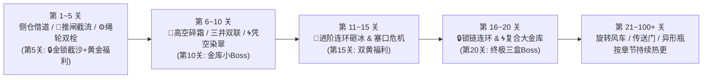

# 《沙里淘大红》关卡设计文档（首批 20 关 + 后续扩展规范）

> [!NOTE]
> 本文档定义《沙里淘大红》首批上线的 **1~20 关完整配置** 及 **后续无限扩充关卡的数据标准**。每 5 关构成一个心流波峰（`教学/新机关 → 进阶变化 → 复合烧脑 → 福利/Boss爆大红`），确保难度平滑递增且绝无死局。

---

## 1. 难度递增模型与心流曲线



### 核心关卡设计铁律
1. **1:1 零残留配比**：每桶需求沙粒数严格等于对应批次流沙粒数（达 `98.5%` 自动吸附边角散沙清零），绝不因物理边角残留误堵下一桶。
2. **反无脑贪心铁律（`antiGreedy: true`）**：除第 1 关 5 秒破冰教学与福利泄洪关外，前中期解谜关严禁退化为“底部桶要什么颜色就无脑抽该色木板”或“自下而上排队抽板”；校验器内置 `color_match` 与 `bottom_up` 双贪心机器人自动实测，凡被无脑策略盲打通关的关卡一律拦截。
3. **高价值盲盒视觉锚点**：高阶盲盒（🟣紫 / 🟡金 / 🔴红）优先埋藏在**最后解锁的顶层或深层隔间**，用肉眼可见的光晕吸引玩家把整罐流沙彻底清空。

---

## 2. 首批 20 关详细设计表

### 第一阶段：极速上手与前置烧脑机关破冰（第 1~5 关）

| 关卡 | 关卡名 | 难度 | 容器与隔板结构 | 底部接沙桶队列 | 标准通关解法 & 反贪心堵口陷阱 | 埋藏盲盒配置 |
| :---: | :--- | :---: | :--- | :--- | :--- | :--- |
| **01** | **初入沙场** | ★☆☆☆☆ | 标准方罐；上下 2 块水平木板（上层粉沙、下层蓝沙） | `蓝 → 粉` | **解法**：5 秒破冰教学，手势引导先抽下板放蓝沙，流空后再抽上板放粉沙。 | `🟣 炫紫盒 ×1` *(锁定首抽必出紫/金)* |
| **02** | **借道侧仓** | ★★☆☆☆ | 左塔上蓝下粉；中部架设**可拆卸陡坡导流桥**直通右侧暂存侧仓 | `蓝 → 粉` | **解法**：中粉板（粉沙顺陡坡滑入右侧暂存仓）→ 抽走导流斜桥腾空主井 → 上蓝板放蓝沙入首桶 → 侧仓底门放粉。<br>**反贪心陷阱**：首桶要蓝沙，若直接抽上蓝板会混入粉沙；若先抽底板/斜桥则粉沙直落堵死蓝桶！ | `⚪ 素白盒 ×1` *(上蓝仓)* |
| **03** | **推栓截流** | ★★☆☆☆ | **新机关：🚧推入式闸门**；顶层双色共板同时托着左粉右蓝，右井设虚线推闸与底层黄沙 | `粉 → 黄 → 蓝` | **解法**：先点右截流闸【推入关闸】→ 抽双色共板（左粉直落入桶，右蓝被木闸稳稳截留）→ 抽右下黄板 → 再次点击右截流闸【拉开】放蓝。<br>**反贪心陷阱**：不先推闸就抽顶板，右蓝会砸入黄沙并堵死队列！ | `⚪ 素白盒 ×1` *(右室)*<br>`🟣 炫紫盒 ×1` *(左室)* |
| **04** | **绳轮双栓** | ★★★☆☆ | **新机关：⚙️绳轮联动双栓**；珍珠奶茶杯内左下蓝板与左上粉板由绳轮联动，中设虚线护盾闸 | `蓝 → 绿 → 粉 → 黄` | **解法**：先推入左护盾闸 → 抽联动蓝板（蓝沙入桶，同时被联动的左上粉板自动抽开、粉沙被护盾闸接住）→ 右下绿板 → 拉开左护盾闸放粉 → 右上黄板。<br>**反贪心陷阱**：直接抽蓝板会联动放落顶粉混流堵口！ | `⚪ 素白盒 ×1`<br>`🟣 炫紫盒 ×1` |
| **05** | **金锁截沙**<br>*(锁门+福利关)* | ★★★☆☆ | **前置引入：🔒颜色锁 + ✨黄金狂热沙**；宽口沙漏腰部黄锁托着粉沙，腰下设虚线护闸，底层左黄右蓝，顶层黄金库 | `黄(解粉) → 蓝 → 粉 → 狂热金` | **解法**：先推入腰下护闸 → 抽左下黄板（黄桶满瞬间腰部黄锁自动崩开，护闸半空截住倾泻的粉沙！）→ 抽右下蓝板 → 拉开护闸放粉 → 抽金库顶门享黄金雪崩！<br>**反贪心陷阱**：不关护闸直接放黄沙，黄锁崩开后粉沙直接冲入漏斗堵死蓝桶！ | `⚪ 素白盒 ×1`<br>**`🟡 流光金盒 ×1`** |

---

### 第二阶段：破冰、双联与无色选路染色（第 6~10 关）

| 关卡 | 关卡名 | 难度 | 容器与隔板结构 | 底部接沙桶队列 | 标准通关解法 & 反贪心堵口陷阱 | 埋藏盲盒配置 |
| :---: | :--- | :---: | :--- | :--- | :--- | :--- |
| **06** | **高空碎霜** | ★★★☆☆ | **前置引入：🧊冰冻沙砖**；右塔顶悬绿冰砖，正下方粉沙垫底阻碍落差，中部左倾导流坡通左侧暂存仓，右下压蓝沙 | `蓝 → 绿冰 → 粉` | **解法**：右底蓝板 → 中层粉板（粉沙滑入左侧暂存仓）→ 抽走导流斜坡腾出满罐落差 → 抽冰砖托板让绿冰砖高空坠地摔碎 → 左仓底门放粉。<br>**反贪心陷阱**：蓝桶满后若贪心直抽绿冰砖，仅落 7 格砸在粉沙上摔不碎，彻底卡死！ | `⚪ 素白盒 ×1`<br>`🟣 炫紫盒 ×1` |
| **07** | **三井双联** | ★★★★☆ | 左/中/右三竖井复合谜题：两组联动木栓（中下黄↔中上蓝、左上粉↔右上绿）配合中井、右井双推入式护闸 | `黄 → 粉 → 蓝 → 绿` | **解法**：推入中井护闸 → 抽中下黄栓（截住联动蓝沙）→ 推入右井护闸 → 抽左上粉栓（截住联动绿沙）→ 拉开中井护闸放蓝 → 拉开右井护闸放绿。<br>**反贪心陷阱**：任一联动栓未提前关闸即抽都会触发双色陪跑塌方！ | `⚪ 素白盒 ×1`<br>`🟣 炫紫盒 ×1` |
| **08** | **凭空染翠** | ★★★★☆ | **前置引入：🌀无绿选路染色**；盘面仅有两批粉沙与一批蓝沙（**零绿沙**），可拆卸染环斜桥通向右侧绿色魔环 | `绿(粉染绿) → 蓝 → 原粉` | **解法**：先抽中层染粉板（粉沙借斜桥穿绿环变绿入首桶）→ 抽左底蓝板 → **先拆掉染环斜桥** → 最后抽顶层原粉直落左井保住粉色！<br>**反贪心陷阱**：开局找不到绿沙盲抽底蓝必堵；后半程忘拆斜桥会把第二批粉沙也染成绿沙导致缺粉！ | `⚪ 素白盒 ×1`<br>`🟣 炫紫盒 ×1` |
| **09** | **同色分仓陷阱** | ★★★☆☆ | **同色分两批**：底仓蓝①、中仓粉、左上蓝②、右上黄 | `蓝① → 粉 → 蓝② → 黄` | **解法**：先放底仓蓝①，必须忍住**不抽左上蓝②**，先放中仓粉，再放左上蓝②。<br>**陷阱**：贪快把两批蓝沙合流会把粉沙夹死在中间！ | `🟣 炫紫盒 ×2` |
| **10** | **大坝金库**<br>*(小 Boss 关)* | ★★★★☆ | 五室金库容器（底部主室绿、左下室蓝①、右下室黄、右上室粉、**顶部中央金库**蓝②，共 5 块抽板） | `绿 → 蓝① → 黄 → 粉 → 蓝②` | **解法**：主室 → 左下 → 右下 → 右上，最后抽开顶部中央金库门放出蓝②与隐藏红盒！<br>**陷阱**：提前开金库门会让蓝②与蓝①合流、把黄/粉夹死。 | `🟡 流光金盒 ×1` *(右上室)*<br>**`🔴 至尊大红箱 ×1`** *(金库内)* |

---

### 第三阶段：冰冻沙块与物理破冰（第 11~15 关）

| 关卡 | 关卡名 | 难度 | 容器与隔板结构 | 底部接沙桶队列 | 标准通关解法 & 堵口陷阱 | 埋藏盲盒配置 |
| :---: | :--- | :---: | :--- | :--- | :--- | :--- |
| **11** | **破冰行动** | ★★☆☆☆ | **破冰爽感节奏关**：顶层悬空一块 **🧊蓝沙冰砖**，底层铺满粉沙 | `粉 → 蓝` | **解法**：抽底板排空粉沙 → 腾出高度后抽顶板，蓝冰砖自由落体撞底摔碎成流沙！ | **`🧊 极寒冰封盒 ×1`** *(嵌于冰砖上方)* |
| **12** | **冰火两重天** | ★★★☆☆ | 左室【黄沙冰砖】（下垫蓝沙），右室常规绿沙 + 粉沙 | `蓝 → 黄 → 绿 → 粉` | **解法**：先抽左下排空蓝沙制造落差 → 抽左上摔碎黄冰砖 → 再依次清右侧绿、粉。 | `⚪ 素白盒 ×1`<br>`🧊 极寒冰封盒 ×1` |
| **13** | **连环砸冰** | ★★★★☆ | 上下双冰砖！顶层粉冰砖、中右蓝冰砖、底层绿流沙与黄流沙 | `绿 → 蓝 → 黄 → 粉` | **解法**：每次排空下垫流沙为上方冰砖腾出 `≥30格` 坠落空间，连续两次破冰震屏。 | `🟣 炫紫盒 ×1`<br>`🧊 极寒冰封盒 ×1` |
| **14** | **冰封塞口危机** | ★★★★☆ | 左侧主仓：高空绿沙冰砖正下方压着厚层蓝沙（中）与黄沙（底）；粉沙位于**右侧独立竖井** | `黄 → 蓝 → 绿 → 粉` | **解法**：黄层板 → 蓝层板 → 冰托板 → 右竖井。必须把黄、蓝两层全部吸空再抽冰砖板！<br>**陷阱**：若底沙未清就放冰砖，落差不足摔不碎，整块冰砖直接塞死漏斗口！ | `⚪ 素白盒 ×1`<br>`🟡 流光金盒 ×1` |
| **15** | **双黄狂欢**<br>*(福利爽关)* | ★☆☆☆☆ | 珍珠奶茶杯造型；4 层彩虹流沙 + **✨黄金狂热沙**，无障碍畅流 | `粉 → 黄 → 蓝 → 狂热金` | **解法**：顺次连抽 4 块吸管隔板，丝滑到底，奖励特殊双开盲盒！ | `🟣 炫紫盒 ×1`<br>**`🎁 双黄蛋盒 ×1`** |

---

### 第四阶段：上锁木板与复合机关（第 16~20 关）

| 关卡 | 关卡名 | 难度 | 容器与隔板结构 | 底部接沙桶队列 | 标准通关解法 & 堵口陷阱 | 埋藏盲盒配置 |
| :---: | :--- | :---: | :--- | :--- | :--- | :--- |
| **16** | **密码锁初现** | ★★★☆☆ | **锁门连携进阶**：左侧三层（底部通铺绿、左中蓝、左上黄），右上粉沙仓带 **🔒蓝色锁** | `绿 → 蓝(解锁) → 粉 → 黄` | **解法**：底板排绿 → 左中排蓝（蓝桶满瞬间自动崩开右上蓝锁，粉沙自动流出）→ 粉桶满后抽左上排黄。<br>**陷阱**：粉未流完就抽左上，黄粉混流堵口。 | `⚪ 素白盒 ×1`<br>`🟣 炫紫盒 ×1` |
| **17** | **双锁连环扣** | ★★★★☆ | 底部粉沙、左中绿沙；**🔒绿锁**扣住右中蓝仓，**🔒蓝锁**扣住顶层黄仓与金盒 | `粉 → 绿(解蓝) → 蓝(解黄) → 黄` | **解法**：只需手动抽底板、左中板，之后每满一桶“咔哒”自动弹开下一道锁门，节奏感极强。 | `🟣 炫紫盒 ×1`<br>`🟡 流光金盒 ×1` *(顶仓)* |
| **18** | **冰锁奇谋** | ★★★★☆ | **复合机关**：左侧上粉下蓝；右侧**🔒粉锁木板**托着 **🧊绿沙冰砖**，冰砖上方为右顶黄沙仓 | `蓝 → 粉(解锁砸冰) → 绿 → 黄` | **解法**：左下排蓝 → 左上排粉（粉桶满自动抽开粉锁）→ 绿冰砖坠落摔碎入桶 → 最后抽右顶仓排黄。<br>**陷阱**：先抽右顶仓，黄沙压在冰砖上一起下落混流。 | `🧊 极寒冰封盒 ×1`<br>`🟣 炫紫盒 ×1` |
| **19** | **染色魔术** | ★★★★★ | **复合染色进阶**：右侧装有 **🌀绿色染色环**（只染粉→绿）；左侧三层（上黄、中粉②、下蓝），右侧仓粉① | `蓝 → 绿(粉①染绿) → 粉② → 黄` | **解法**：左下排蓝 → 抽右板让粉①穿过染色环变成绿沙入桶 → 左中排原色粉② → 左上排黄。 | `🟣 炫紫盒 ×1`<br>`🟡 流光金盒 ×1` |
| **20** | **星夜大金库**<br>*(首章终极Boss)* | ★★★★★ | 6 隔间巨型木艺玻璃金库：底部蓝①、左中绿①、右中黄；左上粉沙仓与右上**🧊绿冰砖仓**的底板为**双导流斜托板**；顶部中央金库（蓝②）由 **🔒粉锁金库门**封住 | `蓝① → 绿① → 黄 → 粉(解金库) → 蓝② → 绿冰` | **解法**：底板 → 左中 → 右中 → 左上斜托（粉桶满自动打开金库门放出蓝②）→ 最后抽右上斜托，绿冰砖借满罐落差摔碎。综合运用“等排空、腾高度破冰、满桶自动开锁”，清空金库迎接三盒齐爆！ | **`🔴 至尊大红箱 ×1`** *(金库内)*<br>**`🎁 双黄蛋盒 ×1`**<br>`🟡 流光金盒 ×1` |

> [!IMPORTANT]
> **上锁、推闸与联动统一规则**：
> - 带 `lockColor` 的木板**不能手动抽**；当队列中**第一只该颜色的桶装满**时自动抽开（“咔哒”解锁），锁板永远不出现在 `solution` 中。
> - 带 `startsOpen: true` 的**推入式闸门**初始呈虚线开口态：第 1 次点击推入关闸（`solution` 记 1 次 ID），第 2 次点击抽出开闸（`solution` 再记 1 次该 ID）。
> - 带 `linkedTo` 的**绳轮联动双栓**点击任意一块会同步触发配对伙伴板（`solution` 只需填写主动点击的那一块）。
>
> 首章 20 关的**可执行数据**见 [`data/levels/chapter_01.json`](../data/levels/chapter_01.json)，全部经无头物理模拟器双种子验证可通关（零残留 ≤1.5%）、第 2~8 关全部通过反贪心机器人测试（`antiGreedy: true`），详见 [内容校验报告](reports/内容校验报告.md)；俯视预览图见 [overview_chapter_01.png](level_previews/overview_chapter_01.png)。

---

## 3. 后续关卡扩展规划（第 21~100+ 关）

后续新增关卡无需改动底层流沙物理引擎，按 **每 20 关一个主题章节** 持续扩充：

* **第 2 章（21~40 关）《染色工坊》**：全面铺开 **🌀双色染色环** 与 **可切换方向的木质跷跷板导流片**。
* **第 3 章（41~60 关）《木艺齿轮工坊》**：呼应封面木屋齿轮元素，新增 **⚙️木质流沙风车**（沙流冲击风车旋转，带动联动木齿轮开门）与 **⏱️定量木闸**（流够一半自动关闸）。
* **第 4 章（61~80 关）《星夜传送门》**：呼应封面星夜窗元素，新增 **🌌星夜双色传送门**（底部吸不到的死角沙通过星光门从顶部另一侧喷出）。
* **无限每日挑战关**：基于种子随机数从模版库组合生成每日残局，全服玩家同图竞速淘大红。

---

## 4. 可扩展关卡 JSON 配置规范（`LevelSchema` v2.1）

所有关卡统一存放在 `data/levels/chapter_XX.json`（首章：[`data/levels/chapter_01.json`](../data/levels/chapter_01.json)），容器模板在 [`data/vessels.json`](../data/vessels.json)。坐标系为 **150×165 网格**，出沙口统一位于 `x 58~91` 的漏斗底部。颜色编码：`1 粉 / 2 黄 / 3 蓝 / 4 绿 / 5 金(狂热沙)`。

```json
{
  "levelId": 4,
  "key": "lvl_0004",
  "title": "绳轮双栓",
  "difficulty": 3,
  "type": "normal",
  "mechanics": ["board", "linked_boards", "push_gate", "split_chamber"],
  "vesselTemplate": "milk_tea_cup_v1",
  "hint": "左下蓝板与左上粉板被绳轮联动！先推入左侧护盾闸门挡住粉沙，再抽蓝板",
  "staticWalls": [{ "x0": 75, "y0": 8, "x1": 75, "y1": 116, "thickness": 2 }],
  "boards": [
    { "id": "b_pink_top", "label": "联动粉板", "x0": 18, "y0": 42,  "x1": 75,  "y1": 42,  "linkedTo": "b_blue" },
    { "id": "g_shield",   "label": "左护盾闸", "x0": 24, "y0": 76,  "x1": 75,  "y1": 76,  "startsOpen": true },
    { "id": "b_blue",     "label": "联动蓝板", "x0": 30, "y0": 116, "x1": 75,  "y1": 116, "linkedTo": "b_pink_top" },
    { "id": "b_yellow_top","label": "右上黄板","x0": 75, "y0": 54,  "x1": 129, "y1": 54 },
    { "id": "b_green",    "label": "右下绿板", "x0": 75, "y0": 116, "x1": 119, "y1": 116 }
  ],
  "sandZones": [
    { "id": "z_pink",   "color": 1, "shape": "rect", "x0": 22, "y0": 14, "x1": 72,  "y1": 38 },
    { "id": "z_blue",   "color": 3, "shape": "rect", "x0": 32, "y0": 86, "x1": 72,  "y1": 112 },
    { "id": "z_yellow", "color": 2, "shape": "rect", "x0": 78, "y0": 14, "x1": 126, "y1": 50 },
    { "id": "z_green",  "color": 4, "shape": "rect", "x0": 78, "y0": 66, "x1": 116, "y1": 112 }
  ],
  "dyeRings": [],
  "bucketQueue": [
    { "color": 3, "zones": ["z_blue"] },
    { "color": 4, "zones": ["z_green"] },
    { "color": 1, "zones": ["z_pink"] },
    { "color": 2, "zones": ["z_yellow"] }
  ],
  "solution": ["g_shield", "b_blue", "b_green", "g_shield", "b_yellow_top"],
  "expectTrap": true,
  "antiGreedy": true,
  "capsules": [
    { "boxType": "box_white",  "x": 98, "y": 90 },
    { "boxType": "box_purple", "x": 48, "y": 26 }
  ]
}
```

| 字段 | 说明 |
| :--- | :--- |
| `key` | 永久唯一键 `lvl_XXXX`，由 `node tools/registry.js allocate level "<关卡名>"` 发号，**永不复用** |
| `type` | `tutorial / normal / bonus / boss` |
| `mechanics` | 机关标签（首章已用）：`board / slant_board / push_gate / linked_boards / split_chamber / multi_layer / same_color_batches / gold_sand / ice_block / multi_ice / ice_clog_trap / shaped_vessel / color_lock / lock_chain / dye_ring` |
| `boards[].kind` | 省略为水平抽板；`slant` 为倾斜导流托板 |
| `boards[].startsOpen` | `true` 时为**推入式关合闸门**（初始虚线开口，第 1 次点击推入关闸并零损耗排开槽位沙粒，第 2 次点击抽出放沙） |
| `boards[].linkedTo` | 指向另一块木板 `id` 构成**绳轮联动双栓**，点击任一块将同步触发配对木板 |
| `boards[].lockColor` | 颜色锁：第一只该色桶装满时自动抽开，不得写入 `solution` |
| `sandZones[]` | `shape: rect` 或 `poly`（`points` 多边形）；`frozen` 冰砖，`shatterDrop` 摔碎所需最小落差（默认 28 格）；`expectDyeTo` 标注应被染色环染成的颜色 |
| `dyeRings[]` | `{ id, fromColors[], toColor, x0, y0, x1, y1 }`，沙粒穿过矩形区域即被染色 |
| `bucketQueue[]` | 按顺序出现的桶；`zones` 指定该桶对应的沙区（同色分批必填），桶容量 = 对应沙区粒数之和（1:1 零残留） |
| `solution` | 标准手动操作序列（不含锁板），校验器会用它跑双随机种子物理模拟必须 `win` |
| `expectTrap` | `true` 时校验器会尝试最多 6 种错误顺序，至少一种必须堵口，否则说明“陷阱”是假的 |
| `antiGreedy` | `true` 时校验器自动运行「按桶找色直抽」与「自下而上盲抽」两种贪心机器人，若任一机器人能通关则直接判不通过 |
| `capsules[]` | 盲盒 `boxType` 对应 [`data/blindboxes.json`](../data/blindboxes.json)；不要放在墙尖/斜板顶，否则滚不出来 |

### 新增关卡流程

1. `node tools/registry.js allocate level "关卡名"` 申请 `levelId` / `key`（名称与已有/已退役关卡相似度 ≥0.6 会被拒绝）。
2. 在章节 JSON 里追加关卡对象。
3. `node tools/validate-content.js --level <id>` 跑物理通关 + 陷阱验证 + **关卡指纹去重**（与已有关卡布局相似度 ≥90% 报错、≥80% 警告，含镜像与换色检测）。
4. `node tools/render-levels.js` 生成预览图自查；`node tools/registry.js bootstrap` 写入指纹。

完整规则见 [内容去重与校验规范](内容去重与校验规范.md)。
