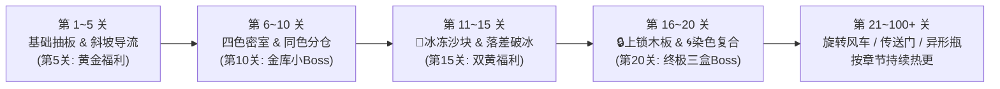

# 《沙里淘大红》关卡设计文档（首批 20 关 + 后续扩展规范）

> [!NOTE]
> 本文档定义《沙里淘大红》首批上线的 **1~20 关完整配置** 及 **后续无限扩充关卡的数据标准**。每 5 关构成一个心流波峰（`教学/新机关 → 进阶变化 → 复合烧脑 → 福利/Boss爆大红`），确保难度平滑递增且绝无死局。

---

## 1. 难度递增模型与心流曲线



### 核心关卡设计铁律
1. **1:1 零残留配比**：每桶需求沙粒数严格等于对应批次流沙粒数（达 `98.5%` 自动吸附边角散沙清零），绝不因物理边角残留误堵下一桶。
2. **必有纯手法无道具通关节奏**：所有关卡在不使用道具的情况下均存在明确的**标准抽板顺序**；抽错顺序或提前抢抽才会引发异色沙混流堵口。
3. **高价值盲盒视觉锚点**：高阶盲盒（🟣紫 / 🟡金 / 🔴红）优先埋藏在**最后解锁的顶层或深层隔间**，用肉眼可见的光晕吸引玩家把整罐流沙彻底清空。

---

## 2. 首批 20 关详细设计表

### 第一阶段：新手爽局与顺序建立（第 1~5 关）

| 关卡 | 关卡名 | 难度 | 容器与隔板结构 | 底部接沙桶队列 | 标准通关解法 & 堵口陷阱 | 埋藏盲盒配置 |
| :---: | :--- | :---: | :--- | :--- | :--- | :--- |
| **01** | **初入沙场** | ★☆☆☆☆ | 标准方罐；上下 2 块水平木板（上层粉沙、下层蓝沙） | `蓝 → 粉` | **解法**：手势引导先抽下板放蓝沙，流空后再抽上板放粉沙。<br>**陷阱**：抢抽上板会让粉沙压在蓝沙上，延迟出沙。 | `🟣 炫紫盒 ×1` *(锁定首抽必出紫/金)* |
| **02** | **三明治彩罐** | ★☆☆☆☆ | 窄高直筒罐；上中下 3 块水平木板（上黄、中粉、下绿） | `绿 → 粉 → 黄` | **解法**：自下而上依次抽板，体验三连瀑布流沙。<br>**陷阱**：提前抽顶板会让黄沙贯穿混入中层。 | `⚪ 银白盒 ×1` *(顶层黄沙内)* |
| **03** | **左右开弓** | ★★☆☆☆ | 上半部中轴竖墙分为左右两室（左黄、右蓝），下半部通铺粉沙 | `粉 → 蓝 → 黄` | **解法**：抽底板放粉 → 抽右板放蓝 → 抽左板放黄。<br>**陷阱**：粉沙流完后若误抽左板，黄沙会彻底堵死出沙口！ | `⚪ 银白盒 ×1` *(右室)*<br>`🟣 炫紫盒 ×1` *(左室)* |
| **04** | **斜坡初体验** | ★★☆☆☆ | 首次引入**倾斜导流木板**；左上粉沙、右上绿沙，中部斜板护住底层蓝沙 | `蓝 → 绿 → 粉` | **解法**：先抽底板清蓝 → 抽右上板让绿沙顺斜坡滑入漏斗 → 抽左上板放粉。 | `⚪ 银白盒 ×1`<br>`🟣 炫紫盒 ×1` |
| **05** | **黄金瀑布**<br>*(福利爽关)* | ★☆☆☆☆ | 宽口大沙漏；全罐装满 **✨黄金狂热沙**（不限颜色狂吸），内设 3 块交错木板 | `狂热大金桶 ×1` | **解法**：任意顺序连抽 3 块木板，满屏金沙雪崩式倾泻一空，零卡点纯解压！ | `⚪ 银白盒 ×1`<br>**`🟡 流光金盒 ×1`** |

---

### 第二阶段：四色密室与分流诱饵（第 6~10 关）

| 关卡 | 关卡名 | 难度 | 容器与隔板结构 | 底部接沙桶队列 | 标准通关解法 & 堵口陷阱 | 埋藏盲盒配置 |
| :---: | :--- | :---: | :--- | :--- | :--- | :--- |
| **06** | **田字四色房** | ★★☆☆☆ | 2×2 十字隔断四密室（左上粉、右上绿、左下蓝、右下黄） | `黄 → 蓝 → 绿 → 粉` | **解法**：右下 → 左下 → 右上 → 左上。<br>**陷阱**：右下黄沙未流尽前过早抽右上，会导致绿沙掺入黄沙尾部堵口。 | `⚪ 银白盒 ×1`<br>`🟣 炫紫盒 ×1` |
| **07** | **双层漏斗阵** | ★★★☆☆ | 上层左蓝右粉，中层通铺黄沙，底层绿沙（共 4 块板） | `绿 → 黄 → 粉 → 蓝` | **解法**：底板 → 中板 → 右上板 → 左上板，考验等待每层排空的手感节奏。 | `⚪ 银白盒 ×1`<br>`🟣 炫紫盒 ×1` |
| **08** | **交叉斜板迷踪** | ★★★☆☆ | 左右双斜板呈 V 字交汇（左上绿、右上黄、中仓蓝、底仓粉） | `粉 → 蓝 → 黄 → 绿` | **解法**：底仓粉 → 中仓蓝 → 右斜板黄 → 左斜板绿。<br>**陷阱**：左右斜板视觉有错觉，看准导流出口再抽。 | `⚪ 银白盒 ×1`<br>`🟣 炫紫盒 ×1` |
| **09** | **同色分仓陷阱** | ★★★☆☆ | 首次出现**同色分两批**！底仓蓝①、中仓粉、左上蓝②、右上黄 | `蓝① → 粉 → 蓝② → 黄` | **解法**：先放底仓蓝①，必须忍住**不抽左上蓝②**，先放中仓粉，再放左上蓝②。<br>**陷阱**：贪快把两批蓝沙合流会把粉沙夹死在中间！ | `🟣 炫紫盒 ×2` |
| **10** | **大坝金库**<br>*(小 Boss 关)* | ★★★★☆ | 五室金库容器（左2室、右2室、底1主室，共 5 块抽板） | `绿 → 蓝 → 黄 → 粉 → 蓝` | **解法**：按 5 段队列逐室泄沙，最后抽开顶部中央金库门放出隐藏红盒！ | `🟡 流光金盒 ×1`<br>**`🔴 至尊红盒 ×1`** |

---

### 第三阶段：冰冻沙块与物理破冰（第 11~15 关）

| 关卡 | 关卡名 | 难度 | 容器与隔板结构 | 底部接沙桶队列 | 标准通关解法 & 堵口陷阱 | 埋藏盲盒配置 |
| :---: | :--- | :---: | :--- | :--- | :--- | :--- |
| **11** | **破冰行动** | ★★☆☆☆ | **新机关教学**：顶层悬空一块 **🧊蓝沙冰砖**，底层铺满粉沙 | `粉 → 蓝` | **解法**：抽底板排空粉沙 → 腾出高度后抽顶板，蓝冰砖自由落体撞底摔碎成流沙！ | **`🧊 极寒冰封盒 ×1`** *(嵌于冰砖上方)* |
| **12** | **冰火两重天** | ★★★☆☆ | 左室【黄沙冰砖】（下垫蓝沙），右室常规绿沙 + 粉沙 | `蓝 → 黄 → 绿 → 粉` | **解法**：先抽左下排空蓝沙制造落差 → 抽左上摔碎黄冰砖 → 再依次清右侧绿、粉。 | `⚪ 银白盒 ×1`<br>`🧊 极寒冰封盒 ×1` |
| **13** | **连环砸冰** | ★★★★☆ | 上下双冰砖！顶层粉冰砖、中右蓝冰砖、底层绿流沙与黄流沙 | `绿 → 蓝 → 黄 → 粉` | **解法**：每次排空下垫流沙为上方冰砖腾出 `≥30格` 坠落空间，连续两次破冰震屏。 | `🟣 炫紫盒 ×1`<br>`🧊 极寒冰封盒 ×1` |
| **14** | **冰封塞口危机** | ★★★★☆ | 高空绿沙冰砖正下方压着厚层黄沙与蓝沙 | `黄 → 蓝 → 绿 → 粉` | **解法**：必须把黄、蓝两层全部吸空再抽冰砖板！<br>**陷阱**：若底沙未清就放冰砖，落差不足摔不碎，整块冰砖直接塞死漏斗口！ | `⚪ 银白盒 ×1`<br>`🟡 流光金盒 ×1` |
| **15** | **双黄狂欢**<br>*(福利爽关)* | ★☆☆☆☆ | 珍珠奶茶杯造型；4 层彩虹流沙 + **✨黄金狂热沙**，无障碍畅流 | `粉 → 黄 → 蓝 → 狂热金` | **解法**：顺次连抽 4 块吸管隔板，丝滑到底，奖励特殊双开盲盒！ | `🟣 炫紫盒 ×1`<br>**`🎁 双黄蛋盒 ×1`** |

---

### 第四阶段：上锁木板与复合机关（第 16~20 关）

| 关卡 | 关卡名 | 难度 | 容器与隔板结构 | 底部接沙桶队列 | 标准通关解法 & 堵口陷阱 | 埋藏盲盒配置 |
| :---: | :--- | :---: | :--- | :--- | :--- | :--- |
| **16** | **密码锁初现** | ★★★☆☆ | **新机关教学**：右上粉沙仓带 **🔒蓝色锁**（需装满 1 桶蓝沙自动解锁） | `绿 → 蓝(解锁) → 粉 → 黄` | **解法**：底板排绿 → 左仓排蓝（蓝桶满瞬间自动崩开右上蓝锁）→ 排粉 → 排黄。 | `⚪ 银白盒 ×1`<br>`🟣 炫紫盒 ×1` |
| **17** | **双锁连环扣** | ★★★★☆ | 绿锁扣住蓝仓，蓝锁扣住顶层黄仓与金盒 | `粉 → 绿(解蓝) → 蓝(解黄) → 黄` | **解法**：单线环环相扣，每满一桶“咔哒”自动弹开下一道锁门，节奏感极强。 | `🟣 炫紫盒 ×1`<br>`🟡 流光金盒 ×1` |
| **18** | **冰锁奇谋** | ★★★★☆ | **复合机关**：🔒粉锁木板上方托着 **🧊绿沙冰砖**，左侧为蓝沙与粉沙 | `蓝 → 粉(解锁砸冰) → 绿 → 黄` | **解法**：先清蓝沙腾空底部 → 清粉沙触发粉锁自动抽板 → 绿冰砖瞬间坠落摔碎入桶！ | `🧊 极寒冰封盒 ×1`<br>`🟣 炫紫盒 ×1` |
| **19** | **染色魔术** | ★★★★★ | **新机关引入**：右侧装有 **🌀绿色染色环**；罐内仅有蓝沙、两份粉沙与黄沙 | `蓝 → 绿(粉染绿) → 粉 → 黄` | **解法**：先排蓝 → 抽右板让第一份粉沙穿过染色环变成绿沙入桶 → 再抽左板排原色粉沙与黄沙。 | `🟣 炫紫盒 ×1`<br>`🟡 流光金盒 ×1` |
| **20** | **航天金库**<br>*(首章终极Boss)* | ★★★★★ | 6 隔间巨型金库（含 1 块高空冰砖 + 1 道金锁板 + 双导流斜板） | `蓝 → 绿 → 黄 → 粉 → 蓝 → 绿` | **解法**：综合运用“等排空、腾高度破冰、满桶自动开锁”，清空金库迎接三盒齐爆！ | **`🔴 至尊红盒 ×1`**<br>**`🎁 双黄蛋盒 ×1`**<br>`🟡 流光金盒 ×1` |

---

## 3. 后续关卡扩展规划（第 21~100+ 关）

后续新增关卡无需改动底层流沙物理引擎，按 **每 20 关一个主题章节** 持续扩充：

* **第 2 章（21~40 关）《染色工坊》**：全面铺开 **🌀双色染色环** 与 **可切换方向的跷跷板导流片**。
* **第 3 章（41~60 关）《机械迷城》**：新增 **⚙️流沙风车**（沙流冲击风车旋转，带动联动齿轮开门）与 **⏱️定量阀门**（流够一半自动关闸）。
* **第 4 章（61~80 关）《次元虫洞》**：新增 **🌌双色传送门**（底部吸不到的死角沙通过虫洞从顶部另一侧喷出）。
* **无限每日挑战关**：基于种子随机数从模版库组合生成每日残局，全服玩家同图竞速淘大红。

---

## 4. 可扩展关卡 JSON 配置规范（`LevelSchema`）

所有关卡统一存放在 `levels/chapter_X.json` 中，新增关卡只需按以下结构追加对象：

```json
{
  "levelId": 18,
  "chapter": 1,
  "title": "冰锁奇谋",
  "vesselTemplate": "standard_funnel_v1",
  "staticWalls": [
    { "x0": 75, "y0": 12, "x1": 75, "y1": 96, "thickness": 3 }
  ],
  "boards": [
    { "id": "b1", "x0": 10, "y0": 118, "x1": 72, "y1": 118, "label": "左下", "lockColor": null },
    { "id": "b2", "x0": 10, "y0": 68,  "x1": 72, "y1": 68,  "label": "左上", "lockColor": null },
    { "id": "b3", "x0": 78, "y0": 72,  "x1": 140, "y1": 72, "label": "冰托板", "lockColor": 1 }
  ],
  "sandZones": [
    { "shape": "rect", "x0": 12, "y0": 74, "x1": 70, "y1": 114, "color": 3, "frozen": false },
    { "shape": "rect", "x0": 12, "y0": 20, "x1": 70, "y1": 64,  "color": 1, "frozen": false },
    { "shape": "rect", "x0": 82, "y0": 26, "x1": 136, "y1": 66, "color": 4, "frozen": true, "shatterDrop": 28 }
  ],
  "dyeRings": [],
  "bucketQueue": [3, 1, 4],
  "capsules": [
    { "boxType": "box_ice", "x": 109, "y": 20 },
    { "boxType": "box_purple", "x": 40, "y": 40 }
  ]
}
```
