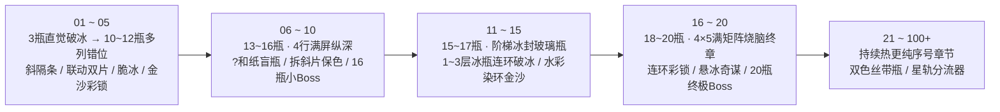

# 《沙里淘大红》日系治愈极简版 关卡设计文档（纯序号 01~20 关 + 扩展规范）

> [!NOTE]
> 本文档定义《沙里淘大红》日系治愈极简版首批上线的 **纯序号 `01~20` 关高密度上下双核完整配置** 及 **`LevelSchema v3.1` 数据标准**。全游彻底取消关卡文字命名（仅保留两位纯序号 `01`~`20`）；除 `01` 关四步直觉引导外，**`02~20` 关全面升级为 `10~20` 只系丝带透明玻璃瓶的高密度 `4` 列纵深队列**，大幅提升屏幕利用率与单局思考深度，且每关均通过开局零误流静稳态与双机器人反无脑校验。

---

## 1. 难度递增曲线与高密度双核设计五条铁律

### 核心关卡设计五条铁律
1. **纯序号无命名极简规范**：
   - 所有关卡不设 `title` 文字字段，数据层、注册表、预览图与局内 UI 统一使用纯两位序号 `01`~`20` 标识。
2. **开局 100% 静稳态（零提前流沙）**：
   - 每关沙区初始布局与 `settleInitialState` 预落定完全吻合：在玩家点击第 1 只玻璃瓶或抽动第 1 片浅枫木拨片前，没有任何悬空漏沙或跨隔板滑落。
3. **高屏效高密度排瓶博弈（`10~20` 只系丝带玻璃瓶）**：
   - 第 `01` 关为 `3` 瓶直觉教学；第 `02~05` 关提升至 `10~12` 瓶；第 `06~12` 关提升至 `13~16` 瓶；第 `13~20` 关高达 `16~20` 瓶（同屏展示 `4` 行圆润玻璃瓶）。
   - 底层滤沙格栅的关键接沙瓶被错位深埋于非相邻列（如第 `0` 列与第 `2` 列）的第 `2~4` 行，迫使玩家精密规划 `4` 个激活接沙槽的周转顺序。
4. **全章硬核双机器人反无脑校验（`antiGreedy: true`）**：
   - **`02~20` 全部 19 关**强制通过离线无头模拟器双重反测：
     - **`runBlindColumnBot`**：无脑轮流点选列首玻璃瓶塞满 `4` 槽并顺手抽拨片 → 100% 触发满槽死锁拦截；
     - **`runPrematurePinSpamBot`**：开局无脑抽光全部未上锁拨片再按底网颜色派瓶 → 100% 因异色活埋底网、软沙垫废脆冰或漏拆斜片误染而失败拦截。
5. **物理净空与零挂沙斜率铁律**：
   - 可拆浅枫木斜导流片（`kind: 'slant'`）与磨砂石英斜隔条斜率严格满足陡坡落沙无残留（关键长跨度斜片 `|dy| / |dx| ≥ 1.0`）；高空脆冰必须先排空格栅下垫软沙、腾出 `≥ 44` 格净空直砸裸硬底才碎裂化沙。

---

## 2. 首批 01~20 纯序号关卡详细设计表

### 第一阶段：双核破冰与渐进道具解锁（`01` ~ `05`）

| 序号 | 类型 / 难度 | 玻璃瓶数 | 容器与沙箱机关（含首次聚光灯指引） | 下方系丝带玻璃瓶队列（`列0 \| 列1 \| 列2 \| 列3`，前→后） | 双核耦合解谜要点 & 死局陷阱 |
| :---: | :---: | :---: | :--- | :--- | :--- |
| **01** | 教学 ★☆☆☆☆ | **3 瓶** | 标准方罐；底网左蓝右黄 + 上层 1 片浅枫木横拨片托粉沙 *(四步手势引导)* | `[蓝] \| [黄] \| [粉]` *(3列)* | 零弹窗直觉破冰：点蓝、黄丝带瓶吸净底网彩沙，再抽开浅枫木拨片泄下粉沙装满粉瓶。 |
| **02** | 常规 ★★☆☆☆ | **10 瓶** | 标准方罐；磨砂斜导流隔条 + 左绿、中黄、右粉多仓拨片 *(指引：撤回/+瓶槽、斜隔条)* | `[黄→蓝→粉] \| [黄→粉] \| [黄→蓝→绿] \| [粉→绿]` | 底网蓝沙成对深藏在第 `0、2` 列次排！必须先借 2 槽暂存黄瓶挖出双蓝瓶清底，再抽中黄片腾槽；盲塞前排 3 黄瓶或早抽绿/粉片必堵死。 |
| **03** | 常规 ★★★☆☆ | **11 瓶** | 珍珠奶茶杯；中塔蓝拨片 + 左右双翼滑轮联动双拨片 *(指引：磁吸、联动双片)* | `[蓝→黄→蓝] \| [蓝→粉→绿] \| [蓝→黄→绿] \| [粉→绿]` | 底网由粉、黄双色托底：先暂存第 `0、2` 列蓝瓶救出双黄瓶并点粉瓶清净杯底，再用中塔蓝沙消掉在槽蓝瓶腾空卡槽，最后拉联动双片双流齐收。 |
| **04** | 常规 ★★★☆☆ | **12 瓶** | 标准方罐；左顶绿脆冰（下垫粉、蓝双层软沙）+ 右侧黄/绿拨片 *(指引：洗牌、高空脆冰)* | `[黄→粉→绿] \| [黄→粉→绿] \| [蓝→绿→蓝] \| [蓝→绿→蓝]` | 先点第 `2、3` 列双蓝瓶并借 2 槽暂存黄瓶挖出双粉瓶，彻底吸干左侧软沙垫腾出 `≥44` 格裸硬底，再敲落绿脆冰；早抽冰片必被软沙缓冲废局。 |
| **05** | 福利 ★★★☆☆ | **12 瓶** | 宽口大沙漏；沙漏腰部黄锁拨片（封存星耀金沙+粉海）+ 右黄栓 + 底绿陷阱 *(指引：颜色锁&金沙)* | `[粉→绿→黄] \| [金→粉→黄] \| [粉→绿→蓝] \| [金→蓝→粉]` | 暂存金瓶与粉瓶先救出双蓝瓶排空左底，再抽右黄拨片喂满黄瓶崩开腰部黄锁，星耀通配金沙倾泻灌满在槽多色瓶！抢抽底绿片必封死格栅。 |

---

### 第二阶段：和纸盲瓶、拆片保色与 16 瓶大坝 Boss（`06` ~ `10`）

| 序号 | 类型 / 难度 | 玻璃瓶数 | 容器与沙箱机关（含首次聚光灯指引） | 下方系丝带玻璃瓶队列（`列0 \| 列1 \| 列2 \| 列3`，前→后） | 双核耦合解谜要点 & 死局陷阱 |
| :---: :---: | :---: | :---: | :--- | :--- | :--- |
| **06** | 常规 ★★★★☆ | **13 瓶** | 标准方罐；中轴磨砂隔墙分左右双底（左蓝底、右黄底）+ 左顶粉锁 + 右顶粉脆冰 | `[绿→黄→黄→蓝] \| [绿→黄→蓝→蓝] \| [粉→蓝→黄] \| [粉→黄]` | 左右底网异色隔离：借前两列暂存双绿瓶先清右底双黄沙，腾出右侧裸硬底砸碎粉脆冰并崩开左粉锁，倾泻绿海瞬间灌满在槽绿瓶。 |
| **07** | 常规 ★★★★☆ | **14 瓶** | 标准方罐；左/中/右三阙磨砂斜槽 + 右阙粉锁拨片 *(指引：`?`和纸盲瓶)* | `[黄→?蓝→?蓝→?绿] \| [黄→?蓝→?粉→?绿] \| [粉→?绿→?绿] \| [黄→?蓝→?蓝]` | 3 列排头为被粉锁封住的黄瓶！精选第 `0、3` 列暂存双黄瓶翻开后排 `?蓝` 和纸盲瓶清空右底，再抽中阙粉沙开粉锁泄黄沙。 |
| **08** | 常规 ★★★★☆ | **14 瓶** | 标准方罐；左顶原粉仓 + 左中待染粉仓 + 带拉环可抽斜导流片 + 右染翠星环 *(指引：水彩染环&可拆斜片)* | `[粉→?蓝→?黄→?绿] \| [粉→?蓝→?黄→?粉] \| [绿→蓝→?黄] \| [绿→蓝→?蓝]` | 盘面零现成绿沙！先清右底蓝黄双层垫沙，抽左中粉片借斜导流片滑入右星环染绿喂满绿瓶，最后**抽走斜导流片**让左顶原粉直落保色。 |
| **09** | 常规 ★★★★☆ | **15 瓶** | 窄高直筒罐；左顶黄脆冰 + 右顶粉脆冰 + 腰部三层蓝/绿/黄隔仓 | `[蓝→?绿→?黄→?黄] \| [蓝→?绿→?黄→?粉] \| [蓝→?绿→?绿→?黄] \| [粉→?蓝→?蓝]` | 修长窄罐高密度探盲：暂存前排蓝瓶翻出 `?绿` 与 `?黄` 和纸盲瓶吸净底层双色软垫，依次敲碎左右双脆冰，最后泄下腰仓蓝沙收尾。 |
| **10** | Boss ★★★★★ | **16 瓶** | 标准方罐；绿锁金库大坝（封存双份星耀金沙+粉仓）+ 左蓝源仓 + 可拆斜片 + 染绿星环 | `[蓝→?黄→?粉→?粉] \| [蓝→?黄→?粉→?粉] \| [黄→?粉→?黄→绿] \| [金→?黄→绿→?金]` | `4×4` 满阵小 Boss：先翻出 `?黄` 盲瓶清净底垫，抽左蓝源沙经斜片入星环化绿，**先拆斜片保住上层原蓝**再喂满双绿瓶冲开金库大坝！ |

---

### 第三阶段：冰封玻璃瓶连环破冰与高密度分流（`11` ~ `15`）

| 序号 | 类型 / 难度 | 玻璃瓶数 | 容器与沙箱机关（含首次聚光灯指引） | 下方系丝带玻璃瓶队列（`列0 \| 列1 \| 列2 \| 列3`，前→后） | 双核耦合解谜要点 & 死局陷阱 |
| :---: :---: | :---: | :---: | :--- | :--- | :--- |
| **11** | 常规 ★★★★☆ | **15 瓶** | 珍珠奶茶杯；左顶绿脆冰（下垫黄、蓝软沙）+ 右顶绿锁粉仓 *(指引：`❄`冰封玻璃瓶)* | `[粉→黄→冰2蓝→冰3黄] \| [粉→黄→冰2蓝→冰3黄] \| [粉→冰2蓝→冰3黄→冰3绿] \| [粉→冰3绿→粉]` | `4` 列排头全为粉瓶！先借 2 槽暂存粉瓶清掉表层双黄沙（满 2 瓶震裂 `冰2蓝`），再清蓝底震裂 `冰3` 并腾空硬底砸碎绿脆冰冲开右顶绿锁。 |
| **12** | 常规 ★★★★☆ | **16 瓶** | 标准方罐；中轴磨砂全隔墙 + 左顶蓝脆冰 + 右腰蓝锁粉海 | `[粉→绿→冰2黄→冰3绿→冰3蓝] \| [粉→绿→冰2黄→冰3绿→冰3蓝] \| [粉→冰2黄→黄→黄→冰3绿] \| [粉]` | 暂存双粉瓶先清右底双绿沙破开 `冰2黄`，再清左底黄沙凑满破冰数解封 `冰3蓝` 并腾出左侧硬底，敲碎蓝脆冰解锁右侧粉海。 |
| **13** | 常规 ★★★★☆ | **16 瓶** | 宽口大沙漏；中轴延伸隔墙 + 绿锁天门 + 双翼滑轮联动拨片 + 右顶蓝脆冰 | `[蓝→?粉→?黄→冰3粉] \| [蓝→?粉→?黄→冰3粉] \| [绿→?粉→?黄→冰3蓝] \| [绿→?粉→?黄→冰3蓝]` | 暂存前排蓝/绿瓶翻出 `?粉`、`?黄` 盲瓶清干双侧底垫并解封 `冰3蓝`，敲碎蓝脆冰后再拉联动双片喂满绿瓶冲开沙漏天门。 |
| **14** | 常规 ★★★★☆ | **17 瓶** | 窄高直筒罐；右上粉仓 + 陡坡可拆斜导流片 + 染蓝星环 + 左腰绿陷阱 | `[黄→?蓝→?绿→冰3粉→蓝] \| [黄→?蓝→?绿→冰3粉→蓝] \| [粉→蓝→冰2绿→蓝] \| [粉→冰3蓝→黄]` | 先清底网蓝绿双沙破开冰封瓶并消化全部 4 只粉瓶，最后借陡坡斜导流片将上层黄沙导入星环化蓝精准喂饱尾盘蓝瓶，严禁早拆斜片或早抽绿栓。 |
| **15** | 福利 ★★★★☆ | **17 瓶** | 珍珠奶茶杯；左腰奶黄仓 + 可拆吸管斜片 + 染粉星环 + 左顶双金沙仓 | `[黄→绿→冰2蓝→粉→蓝] \| [黄→绿→冰2蓝→粉] \| [绿→冰1蓝→粉→蓝] \| [冰3粉→金→金→蓝]` | 先清杯底绿沙与蓝沙逐级震裂 `冰1/冰2/冰3` 玻璃瓶，借吸管斜片把奶黄染成樱花粉，最后抽走斜片释放原黄与双份星耀金沙畅快清盘！ |

---

### 第四阶段：18~20 瓶满矩阵终章与星夜大金库（`16` ~ `20`）

| 序号 | 类型 / 难度 | 玻璃瓶数 | 容器与沙箱机关 | 下方系丝带玻璃瓶队列（`列0 \| 列1 \| 列2 \| 列3`，前→后） | 双核耦合解谜要点 & 死局陷阱 |
| :---: | :---: | :---: | :--- | :--- | :--- |
| **16** | 常规 ★★★★★ | **18 瓶** | 标准方罐；右顶绿锁粉仓 + 左顶粉锁蓝仓 + 左脆冰 + 双翼联动黄拨片 | `[蓝→黄→冰2粉→冰3黄→粉] \| [蓝→黄→冰2粉→冰3黄→粉] \| [绿→黄→冰2粉→黄→蓝] \| [绿→冰3蓝→蓝]` | 环环相扣四重奏：清黄底破 `冰2粉` → 抽绿片满绿瓶开右顶绿锁 → 满粉瓶破 `冰3` 并开左顶粉锁 → 砸脆冰并拉联动黄拨片收官。 |
| **17** | 常规 ★★★★★ | **18 瓶** | 窄高直筒罐；左顶绿锁原黄仓 + 右顶蓝锁 + 陡斜导流片 + 染绿星环 | `[黄→?粉→?蓝→冰3绿→黄] \| [黄→?粉→?蓝→冰3绿→黄] \| [粉→?蓝→?粉→绿→黄] \| [冰3粉→粉→绿]` | 清粉蓝双底开右蓝锁并破开 `冰3绿`，放中层黄沙过桥染绿——**务必在绿瓶满瓶崩开左顶绿锁前先抽走斜导流片**，否则顶层原黄滑入星环即满盘皆输！ |
| **18** | 常规 ★★★★★ | **19 瓶** | 标准方罐；中轴异色双底 + **左顶粉锁直接悬吊绿脆冰** + 右顶绿锁粉海 | `[绿→黄→?蓝→冰3蓝→冰3黄] \| [绿→黄→?蓝→冰3蓝→冰3黄] \| [粉→冰1黄→?蓝→冰3黄→粉] \| [粉→?粉→?粉→?粉]` | 暂存双绿瓶排净右黄底与左蓝底（清空左侧硬底并破冰），再抽中仓粉沙满粉瓶自动崩开左粉锁，让悬吊绿脆冰直坠裸硬底连环冲开右绿锁！ |
| **19** | 常规 ★★★★★ | **19 瓶** | 标准方罐；**左染黄星环 + 右染绿星环** + 居中可拆斜导流片 | `[绿→?粉→?黄→冰3黄→?粉] \| [绿→?粉→?黄→冰3黄→?粉] \| [粉→?黄→冰2绿→黄→粉] \| [粉→冰3绿→黄→粉]` | 上层全为原色蓝沙！先清左右粉黄双底震碎全部冰封瓶，抽中层蓝沙沿斜片入右环染绿，**抽走斜导流片**后再放顶层蓝沙直落左环染黄。 |
| **20** | 终章 ★★★★★ | **20 瓶** | 标准方罐；绿锁星夜金库（封存三份金沙+蓝海）+ 左蓝脆冰 + 可拆斜片 + 染绿星环 | `[蓝→?粉→冰2黄→冰3绿→?蓝] \| [蓝→?粉→冰2黄→冰3绿→?蓝] \| [粉→黄→冰2黄→绿→?蓝] \| [黄→冰1黄→金→金→?金]` | **`4×5 = 20` 瓶满屏毕业大考**：先清左右黄粉双底破冰并腾空左侧硬底 → 敲碎蓝脆冰消化前排蓝瓶 → 借斜片导粉入环化绿并先拆桥 → 绿满冲开星夜大金库三连金沙狂潮通关！ |

---

## 3. 可扩展关卡 JSON 配置规范（`LevelSchema v3.1`）

所有关卡存放在 `data/levels/chapter_XX.json`（首章：[`data/levels/chapter_01.json`](../data/levels/chapter_01.json)），容器模板见 [`data/vessels.json`](../data/vessels.json)。坐标系为 `150×165` 网格，底部滤沙格栅位于 `x ∈ [22, 127], y ∈ [159, 163]`。颜色编码：`1 樱花粉 / 2 奶油杏黄 / 3 晴空海盐蓝 / 4 若竹薄荷绿 / 5 星耀金沙`。

| 字段 | 说明 |
| :--- | :--- |
| `key` / `levelId` | 永久唯一键 `lvl_XXXX` 与递增纯序号 `levelId`（**严禁设置 `title` 关卡名字段**） |
| `type` | `tutorial / normal / bonus / boss` |
| `numCols` | 底部系丝带玻璃瓶队列列数（`01` 关为 `3`，`02~20` 关统一为 `4`） |
| `mechanics` | `bucket_order / mystery_bucket / iced_bucket / board / slant_board / linked_boards / ice_block / color_lock / dye_ring / gold_sand` |
| `staticWalls[]` | 沙箱内部半透明磨砂石英玻璃固定隔条与斜导流槽 |
| `boards[]` | 日系浅枫木奶油拨片（`kind: 'slant'` 为带小拉环可拆斜导流片；`linkedTo` 为滑轮联动双片；`lockColor` 为满瓶自动崩锁） |
| `sandZones[]` | 沙区几何定义；`frozen: true` 为高空脆冰（净空 `≥ 44` 格砸裸硬底碎裂）；`expectDyeTo` 标注预期染色目标色 |
| `bucketQueue[]` | `{ col, color, zones[], mystery?, iceLayers? }`：系丝带玻璃瓶队列，单瓶目标容量严格等于关联 `zones` 实粒总和 |
| `solution[]` | 标准混合动作序列（`"col:K"` 派第 `K` 列排头玻璃瓶入槽，或 `"<boardId>"` 抽开指定拨片），双随机种子模拟必 `win` |
| `expectTrap` / `antiGreedy` | `02~20` 关全开 `true`，强制校验错误顺序死局陷阱与双无脑机器人必败拦截 |
