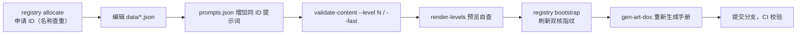

# 《沙里淘大红》内容去重与校验规范

> [!IMPORTANT]
> 目标：版本持续迭代（新关卡、新公仔、新盲盒、新美术资产）时，**ID 永不撞号、内容不换皮重复、上下双核关卡 100% 可解且具备真实策略博弈深度**。所有规则由脚本强制执行，CI 不通过不得合入。

## 1. 唯一数据源

| 内容 | 文件 |
| :--- | :--- |
| 关卡 | `data/levels/chapter_XX.json`（宽底格栅容器模板 `data/vessels.json`） |
| 公仔 / 套系 | `data/figurines.json` |
| 盲盒 / 保底 | `data/blindboxes.json` |
| 美术提示词 | `data/art/prompts.json`（手册由 `tools/gen-art-doc.js` 生成，共 87 项） |
| UI 设计令牌 | `data/ui_tokens.json`（调色板、品质色卡、6 阶头衔、五段式栅格比例与缓动曲线） |
| 音频与触觉 | `data/audio_haptics.json`（4 组 WebAudio 合成器、19 项主包/分包音频规格、震动与 28 条事件映射） |
| 已生成图片 | `assets/manifest.json`（含 `promptHash`、`dhash`） |
| **ID 注册表** | `data/registry/id_registry.json` |

## 2. ID 注册表策略

- 类型：`level`（`lvl_0001`）、`figurine`（`fig_001`）、`box`、`series`、`asset`、`audio`。
- **发号只增不减**：`next` 计数器单调递增，删除内容不会回收 ID。
- **下架 ≠ 删除**：`retire` 后条目保留 `status: retired`、原名称、双核关卡指纹、公仔物种+造型，新内容仍要和它们做查重，防止“下架后换皮重上”。
- 公仔/盲盒的美术资产与本体同 ID，唯一性按类型分别判定。

```bash
node tools/registry.js bootstrap                     # 从现有数据补全注册表、刷新双核关卡指纹（新增/改关后必跑）
node tools/registry.js allocate level "关卡名"        # 申请新关卡 ID（精确 + 模糊查名）
node tools/registry.js allocate figurine "公仔名"     # 申请新公仔 ID
node tools/registry.js retire fig_007 "下架原因"       # 下架，永久占位
node tools/registry.js list [type]
```

## 3. 查重算法与阈值

| 检查项 | 算法 | 报错 | 警告 |
| :--- | :--- | :---: | :---: |
| 名称（发号时） | 归一化（去空格/标点/全半角）后，取 **字二元组 Jaccard** 与 **最长公共子序列比** 的较大值；对比现存 + 已下架 | 完全同名 / ≥0.60 拒绝发号 | — |
| 名称（校验时） | 同上，两两比较 | 完全同名 | ≥0.50 |
| 公仔造型 | `species + archetype` 组合键 | 完全相同（含已下架） | 同物种出现多次 |
| 双核关卡布局 | `30×33` 上层沙盘粗网格指纹 + **下层候选桶列结构签名（列数、各列前后排颜色序列、`❓`盲桶与`🧊`冰桶层数）**；颜色按首次出现顺序归一化（换色无效）；同时比较**左右镜像（含候选列镜像反转）** | ≥90% | ≥80% |
| 关卡 vs 已下架关卡 | 同上，使用注册表保存的指纹 | ≥90% | — |
| 美术提示词 | 主体描述字二元组相似度 | ≥0.80 | ≥0.62 |
| 生成图片 | 64 位 dHash 汉明距离 | ≤6 | — |
| 盲盒概率 | 每张权重表求和 | ≠100 | — |

当前首章 20 关最高两两布局相似度仅 **57%**（`L8–L19`），远低于 80% 警告线（详见 [内容校验报告](reports/内容校验报告.md)）。

## 4. 上下双核关卡可解性与博弈深度校验（物理模拟）

[`tools/lib/sim.js`](../tools/lib/sim.js) 是与运行时 [`SandEngine.ts`](../src/engine/SandEngine.ts) + [`BucketSystem.ts`](../src/engine/BucketSystem.ts) 100% 同源规则的无头确定性模拟器，[`tools/validate-content.js`](../tools/validate-content.js) 对每关依次执行：

1. **双种子混合解法必胜验证**：按 `solution`（`"col:K"` 派桶入槽 + `"<boardId>"` 抽木栓；颜色锁在首只同色桶满时自动崩锁）用 2 个不同随机种子各跑一次，必须全部 `win`。
2. **`1:1` 残沙清尾门禁**：自动清尾吸走的边角散沙占比必须 `≤ 3%`（防止静态隔墙死角过大藏沙）。
3. **双反无脑机器人拦截（`antiGreedy: true`）**：
   - `runBlindSlotSpamBot`：模拟「无脑轮流点选各列排头木桶塞满 4 槽 + 顺抽木栓」，若能通关则直接报错（证明下层选桶顺序缺乏博弈约束）；
   - `runPrematurePinSpamBot`：模拟「开局无脑抽光全部未上锁木栓后再按滤网颜色点桶」，若能通关则直接报错（证明上层控流与下层接沙缺乏物理耦合）。
4. **死局陷阱存在性（`expectTrap: true`）**：自动生成至多 8 组错误派桶/抽栓扰动序列，至少 1 组必须触发 `jam / stuck`。
5. **盲盒自然触网校验**：验证所有埋藏胶囊在通关过程中自然滚落触达底部滤沙格栅（`y ≥ 152`），卡在半空溜槽将触发警告。

## 5. 新增内容标准流程



## 6. 命令速查（`package.json`）

| 命令 | 作用 |
| :--- | :--- |
| `npm run validate` | 全量双核物理模拟 + 双反测机器人 + 陷阱搜索，写入 `docs/reports/内容校验报告.md` |
| `npm run validate:fast` | 快速数据契约与图片 dHash 去重校验（跳过多轮陷阱穷举），CI 使用 |
| `npm run test:dedupe` | 去重算法自测（换色 / 左右镜像+桶列反转 / 微调克隆、改名换皮等 9 项断言） |
| `npm run test:ac` | PRD 全量 14 项自动化验收测试（双核引擎、4+1 卡槽、四道具守恒、盲盒双保底与五段布局） |
| `npm run render:levels` | 生成 `docs/level_previews/` 上层沙箱 + 下层候选桶列俯视预览图 |
| `npm run gen:art-doc` | 由 `prompts.json` 重新生成美术手册 |
| `npm run registry -- <子命令>` | 注册表发号、刷新与下架操作 |
