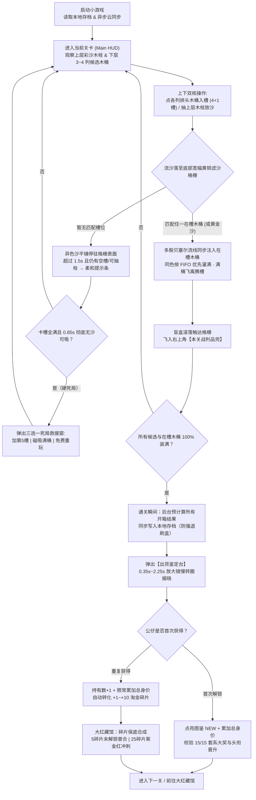
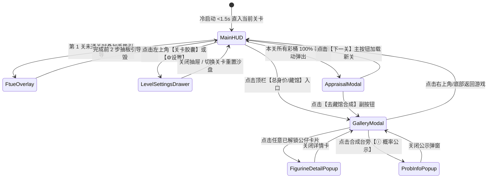

# 《沙里淘大红》游戏功能需求文档（PRD v1.0）

> [!NOTE]
> 本文档为《沙里淘大红》**首个上线版本（MVP v1.0）**的全量功能需求规格说明书（PRD），承接《[GDD_流沙抽板盲盒.md](./GDD_流沙抽板盲盒.md)》、《[关卡设计文档_沙里淘大红.md](./关卡设计文档_沙里淘大红.md)》、《[盲盒设计文档_沙里淘大红.md](./盲盒设计文档_沙里淘大红.md)》、《[公仔设计文档_沙里淘大红.md](./公仔设计文档_沙里淘大红.md)》与《[技术选型与架构设计文档.md](./技术选型与架构设计文档.md)》，重点明确 **宝箱获取与掉落概率、公仔稀有度与单款权重算法、碎片转化与保底合成规则、局内机关与道具边界逻辑、全界面交互流转及异常防刷规范**，作为研发编码与 QA 测试验收的唯一判定依据。

---

## 1. 版本范围与功能模块总览（MVP v1.0 Scope）

### 1.1 V1.0 核心功能交付矩阵

| 模块分类 | 功能子项 | V1.0 优先级 | 功能边界说明 |
| :--- | :--- | :---: | :--- |
| **启动与合规** | 静默登录、星夜工坊大厅/秒进关卡、`8+` 适龄提示、隐私指引 | **P0** | 单套统一 TypeScript 代码库双端运行（Web 预览端与微信小游戏真机 100% 同源） |
| **上下双核玩法** | 上层精简控流（木栓/斜桥/连栓/脆冰/彩锁/染环/金沙）× 下层 `4+1` 小卡槽与 `3~4` 列前后排候选木桶 | **P0** | 底部宽幅多孔黄铜滤沙格栅（`76~100` 格）、同色在槽桶 FIFO 灌满、`❓`问号盲桶揭晓、`🧊`冰封木桶破冰 |
| **关卡内容** | 第 1 章共 **20 个上下强耦合关卡** + 选关复刷机制 | **P0** | 区分「首通高阶盒掉落」与「复刷常规淘金掉落」，顶栏常驻无限免体力免费重玩 |
| **局内四大道具** | 撤回上一步、磁吸满桶腾槽、加开第 5 接沙槽、候选木桶洗牌 | **P0** | 含双动作（抽栓/派桶）环形快照、四级 `1:1` 守恒磁吸算法、保底匹配格栅色的智能洗牌 |
| **宝箱与抽奖系统** | **6 种盲盒容器**、放大镜慢转鉴定、新手锁、双暗保底 | **P0** | 第 1 关必爽锁、`15 抽小金保底`、`40 抽大红保底`、白/绿重抽提档、每 3 关空投 |
| **公仔与图鉴系统** | **2 大套系共 30 款公仔**、6 档估值、6 阶身价头衔 | **P0** | 《摸金打工萌宠》15 款 + 《深夜暴富食堂》15 款，套系集齐解锁流沙皮肤/特效 |
| **碎片合成系统** | 重复自动转碎片、`5 碎片` 普合、`25 碎片` 高阶冲刺 | **P0** | 含未解锁池动态归一化、满图鉴后「身价冲刺盒」防套利兜底 |
| **激励与分享** | `RewardManager`（每日免费额度 + 微信分享解锁）、大红晒单 | **P0** | v1.0 冲刺 500 UV 期间采用免费+分享，预留配置一键切换微信激励视频广告 |
| **存档与云同步** | 本地 `Storage` 即时落盘 + 微信云开发保高同步 + 头像授权 | **P0** | 开箱结果预落盘防 SL 强退刷盒，藏馆内按需触发 `UserInfoButton` 授权 |
| **后续版本暂缓** | 好友互赠公仔卡片、第 21~60 关、省队排行榜、第 3 套系 | *V1.1+* | V1.0 界面不展示死入口，保持极简闭环 |

### 1.2 核心业务闭环数据流

---

## 2. 局内上下双核玩法与四大道具功能需求

### 2.1 宽底滤沙格栅、`4+1` 小卡槽与 `1:1` 零残留接沙规则

1. **沙盒物理与宽底黄铜滤沙格栅规格**：
   - 逻辑网格固定为 `150 × 165`，固定物理步长 `60Hz`（奇偶步交替左右遍历消除单侧偏斜）。
   - 底部 `x ∈ [22, 127], y ∈ [159, 163]` 为**宽幅多孔黄铜滤沙格栅（`OUTLET`）**（各容器净宽 `76~100` 格）：匹配在槽木桶颜色的颗粒直接穿过孔洞注入对应卡槽；未匹配颗粒自然平铺在格栅表面，一旦后续派入同色木桶即刻吸走让路。
   - 流沙颜色共 **5 种枚举值**：`1=草莓粉`、`2=柠檬黄`、`3=天蓝`、`4=薄荷绿`、`5=黄金狂热沙（无未完金桶时通配任意在槽桶）`。
2. **`4+1` 激活小卡槽与同色 FIFO 优先灌满**：
   - 工作台上半行默认开放 **`4` 个激活接沙小卡槽**（可通过 `EXTRA_SLOT` 道具解锁第 `5` 槽）。
   - 当多个激活卡槽中同时存在相同颜色的木桶时，严格按**入槽先后序号（`placedSeq` 升序 FIFO）**将流沙集中灌入最早入槽的那只桶，使其最快达到 `100%` 弹飞腾出空槽，杜绝同色双桶各装一半锁死双槽。
3. **`3~4` 列「前排挡后排」候选木桶滑道与特殊桶**：
   - 工作台下半区纵向排列 `3` 或 `4` 列候选木桶：仅各列最前排（`Row 0`）且未被冰封的木桶可点击跃入上方首个空槽；调走后该列后排木桶整体前移递补。
   - **❓ 问号盲桶（`mystery: true`）**：处于后排（`Row >= 1`）时隐藏真实颜色，显示深胡桃神秘木桶与 `?` 封签；当排头桶被调走、该桶推进至 `Row 0` 瞬间，自动翻转揭晓真实桶色。
   - **🧊 冰封木桶（`iceLayers: 1~3`）**：外覆寒冰壳锁死不可点击；场上每完成**任意 1 只**在槽木桶 `100%` 满桶飞走，所有候选列中冰封木桶的 `iceLayers` 自动同步 `-1`，减至 `0` 时碎冰解封。
4. **`1:1` 容量守恒与 `≥ 98.5%` 实粒清尾机制**：
   - 关卡加载时严格按每只候选桶绑定的 `zones` 统计真实沙粒数作为 `targetCount`，保证全盘总沙粒数 `===` 所有木桶容量总和。
   - 当任一在槽木桶装填率 `filled / targetCount ≥ 98.5%` 且连续 `0.40s` 无同色沙自然入网时，系统扫描全沙盘内归属该桶或同色的边角残沙执行 **`1:1` 实粒清尾**（真实擦除对应网格沙粒并补入桶内），杜绝物理台阶挂沙卡死。

### 2.2 上层精简控流机关详细交互与边界判定

| 机关名称 | 触发与物理逻辑 | 玩家交互反馈 | 关键边界条件 |
| :--- | :--- | :--- | :--- |
| **① 普通抽拉木栓** | 阻挡上层流沙与胶囊；点击后沿轴向滑出（`0.12s`），擦除对应网格阻挡像素 | 轻点即抽，`light` 轻震 + 木栓清脆“咔嗒-咻”声 | 点击热区在法线方向外扩 `12px`；抽出动画期间忽略重复点击 |
| **② 倾斜导流斜桥** | 以陡斜率（`|dy|/|dx| ≥ 0.78`）引导流沙滑向侧仓或染色环；点击后沿轴向抽离恢复直落 | 同普通木栓 | 连续光栅化无斜缝漏沙，且陡坡保证零元胞台阶滞沙 |
| **③ ⚙️ 绳轮联动双栓** | 两根木栓通过 `linkedTo` 互绑；点击任一根同步触发配对伙伴栓抽离 | 麻绳连线 + 黄铜滑轮标识，双栓同步滑出 | 仅在主点击时压入 1 次原子撤回快照，撤回时双栓同步复原 |
| **④ 🧊 高空脆冰砖** | `iceType: 'brittle'` 刚体冰沙块，悬空整体下落并累计 `fall` | 摔碎时触发 `18` 颗冰碴粒子 + 咔嚓音 + `medium` 中震 | **软沙缓冲铁律**：着陆时只要正下方阻挡格含任意流沙或其他冰砖即被缓冲**绝不碎裂**；仅当直砸裸硬底且 `fall ≥ shatterDrop`（默认 **`44` 格**）才碎裂化沙 |
| **⑤ 🔒 颜色锁木栓** | 木栓挂载对应颜色铜锁（`lockColor ∈ {1,2,3,4}`），上锁态不可手抽 | 误点时锁头摇晃 + 低沉咔哒声 + 对应色木桶闪烁提示，不记步数 | 当下方 `BucketSystem` 完成**首只匹配 `lockColor` 的木桶满桶**瞬间，自动崩锁抽开场上所有同色锁栓 |
| **⑥ 🌀 魔法染色环** | 固定矩形区域光学染色环；匹配 `fromColors` 的流沙穿过时实时改写为 `toColor` | 穿过时闪烁水彩微光 + 轻柔气泡音（`150ms` 节流） | 改色不可逆；盲盒胶囊穿过染色环时**不受影响**；支持同局双染色环分流 |
| **⑦ ✨ 黄金狂热沙** | 颜色 ID 为 `5`（璀璨金砂）；当无未完专属金桶时视为全颜色通配 | 吸入时叠加星尘晶铃泛音 | 落上宽幅格栅后可同时向在槽彩桶高速注入 |

### 2.3 两阶段死局检测、过关与顶栏免费重玩规则

1. **两阶段卡关与死局判定**：
   - **Stage 1 柔和堵网提示（Soft Jam Banner）**：当宽幅格栅上存在静止异色沙连续满 **`1.50 秒`** 零吸入，但玩家**仍有空余卡槽或仍有可破局木栓**时，仅在沙箱下沿淡入非阻塞暖黄提示条，一旦恢复吸沙或操作即刻淡出。
   - **Stage 2 满槽硬死局救援弹窗（Hard Deadlock Modal）**：当全部已解锁卡槽（`4/4` 或 `5/5`）均被占满、连续 **`0.85 秒`** 零沙粒吸入、场上无正在下落/待染的匹配色流沙，且上层没有任何可手动抽开的木栓能释放匹配在槽颜色的流沙时，自动弹出**硬死局救援模态窗**，提供 **【➕ 加开第 5 接沙槽】**、**【🧲 磁吸直接满 1 桶】**、**【🔄 免费重玩本关】** 三大一键破局选项。
2. **过关判定与残余盲盒磁吸回收**：
   - 当关卡所有候选木桶全部入槽并达到 `100%` 装满时，立即判定**本关完美清罐**；若沙盘内仍有未触达格栅的盲盒胶囊，自动沿抛物线磁吸飞入右上角【本关战利品兜】，确保 100% 收齐本关全部盲盒。
3. **顶栏常驻无限免费重玩（零广告门槛）**：
   - 【重玩】按钮独立常驻于**顶栏左二位置（`restartPill`）**，全游戏不设体力限制、永不绑定激励广告：
     - 若本关尚未使用任何激励道具且战利品兜暂存盲盒数为 `0`：点击直接 `0.15s` 秒速重置本关；
     - 若本关已使用过激励道具或已有盲盒入袋：弹出轻量二次确认框防误触。

### 2.4 局内四大救援道具详细规则与 `1:1` 防漏洞约束

| 道具 ID | 道具名称 | 单关上限 | 置灰禁用条件 | 精确执行逻辑与核心防漏洞规则 |
| :--- | :--- | :---: | :--- | :--- |
| `UNDO` | **↩️ 撤回上一步** | `不限总次数` *(环形栈深3步)* | `SnapshotStack` 为空（尚未派桶/抽栓，或已连退 3 步） | 1. **双动作全覆盖**：每次玩家手动「点击列首派桶入槽」或「点击抽开木栓」前均压入完整快照； 2. 回退时原子还原网格 `cells/shade/tag`、各卡槽进度、各列桶序、`❓`盲桶揭晓态、`🧊`冰桶层数与入袋盲盒（已入袋盲盒退回沙盘原位且宝袋计数同步扣减，杜绝刷盒漏洞）； 3. **权益保留**：若本关已解锁【第 5 接沙槽】，撤回时保留 5 槽容量资格不回退。 |
| `VACUUM` | **🧲 磁吸满桶腾槽** | `3 次/关` | ① 本关已用满 3 次； ② 在槽与候选列已无未满可吸木桶 | 1. 优先锁定当前激活槽中装填率最高（`filled / targetCount` 最大）的木桶；若当前激活槽全空，则自动从候选列首提入第 1 只可调遣木桶； 2. **四级 `1:1` 严格容量守恒抽沙**：按精确缺口粒数 `need = targetCount - filled`，依次从「① 格栅表层同色沙 → ② 沙盘任意位置同色散沙 → ③ 未碎同色脆冰（直接破冰取沙） → ④ 染色环上方匹配 `fromColors` 的待染原沙」真实擦除 `need` 粒沙子，将该桶瞬间灌满 `100%` 弹飞腾出空槽，确保后续其余木桶 **100% 容量严丝合缝**！ |
| `EXTRA_SLOT` | **➕ 加开第 5 接沙槽** | `1 次/关` | ① 本关已开启第 5 槽； ② 剩余未完成木桶数 `≤ 1` | 1. 解锁工作台最右侧锁定的第 5 激活接沙槽（`activeSlots` 由 `4` 槽扩容至 `5` 槽并发）； 2. 本关全程有效（重玩或进入下一关恢复默认 `4` 槽）。 |
| `SHUFFLE` | **🔀 候选木桶洗牌** | `2 次/关` | ① 本关已用满 2 次； ② 所有候选列中非冰封待派木桶总数 `< 2` | 1. 提取 `columns` 中所有 `iceLayers === 0` 的待派木桶执行 Fisher-Yates 洗牌回填（冰封木桶保持原位与冰层不变）； 2. **智能破局保底**：扫描当前宽幅格栅表层停驻的沙色集合，若洗牌后没有任何一列 `Row 0` 匹配格栅沙色、但后排存在匹配色木桶，自动将该木桶置换至某列 `Row 0` 排头（所有新处于 `Row 0` 的问号盲桶同步翻牌揭晓）。 |

### 2.5 纯 IAA 商业化激励发放规则（`RewardManager` v1.0 冷启动策略）

1. **六大统一激励触发点**：
   - 局内四道具：`UNDO`（撤回上一步）、`VACUUM`（磁吸满桶腾槽）、`EXTRA_SLOT`（加开第 5 接沙槽）、`SHUFFLE`（候选木桶洗牌）。
   - 局外结算：`REROLL_BOX`（鉴定台白/绿盲盒重抽必升档）、`BONUS_BOX`（每 3 关额外盲盒空投）。
2. **v1.0 冷启动发放规则（冲刺 500 UV 阶段，免视频广告）**：
   - **每日免费秒领配额**：每个自然日零点刷新赠送 **`3 次`** 全局免费激励次数（角标显示绿色 `免费`），点击即刻生效。
   - **微信分享无限解锁**：当日免费额度用完后切换为 `分享领`；开通流量主后仅需将配置切为 `WX_REWARD_AD` 即可无缝接入微信激励视频广告（无填充自动降级分享兜底）。

---

## 3. 宝箱（盲盒）获取与品质掉落概率需求

### 3.1 六种宝箱容器基础属性表

| 宝箱 ID | 宝箱名称 | 碰撞半径 | 单盒开出次数 | 局内手绘绘本风视觉识别特征 | 主要投放途径 |
| :--- | :--- | :---: | :---: | :--- | :--- |
| `box_white` | **⚪ 素白常规盒** | `6.5 格` | `1 抽` | 手绘素白磨砂瓷盒 + 深棕墨线中缝 + 奶油白外描边 + `?` 火漆印章 | 第 2~20 关常规埋藏、已通关复刷基础掉落 |
| `box_purple` | **🟣 炫紫进阶盒** | `6.5 格` | `1 抽` | 薰衣草紫釉面漆盒 + 奶油白外描边 + 淡紫星光呼吸光圈 | 各关深层隔间、每 3 关空投（70%）、复刷惊喜掉落 |
| `box_gold` | **🟡 流光金盒** | `6.5 格` | `1 抽` | 暖金雕花木纹宝盒 + 复古铜边包角 + 手绘十字星芒光晕 | 第 5/10/14/17/19/20 关、每 3 关空投（30%） |
| `box_red` | **🔴 至尊大红箱** | `7.5 格` | `1 抽` | 朱红漆面金边古风宝箱 + 复古黄铜锁扣与云纹描金 + 暖红金辉光晕 | 第 10 关（小 Boss）、第 20 关（首章终极 Boss）首通专属 |
| `box_ice` | **🧊 极寒冰封盒** | `6.5 格` | `1 抽` | 手绘冰蓝半透明结晶六角盒 + 水彩霜花纹路 + 飘落小雪花 | 第 11/12/13/18 关（冰砖关卡专属埋藏） |
| `box_double` | **🎁 双黄蛋惊喜盒** | `7.5 格` | **`2 抽`** | 手绘粉蓝糖果双拼礼盒 + 顶部暖金丝带蝴蝶结 + 轻微晃动星光 | 第 15 关（福利关）、第 20 关（终极 Boss）首通专属 |

### 3.2 关卡首通掉落 vs 复刷关卡掉落规则（防刷经济平衡）

为兼顾「无体力自由重刷老关攒碎片」与「防止反复秒刷第 10/20 关无限白嫖至尊大红箱导致 5 分钟毕业」，严格区分**首通掉落**与**复刷掉落**：

1. **关卡首通掉落（`levelId > maxClearedLevel`）**：
   - 严格 100% 按照《关卡设计文档》配置表生成对应高阶宝箱。
   - **第 1~20 关首通全量宝箱统计**：共埋藏 **`38 颗`** 盲盒实体（因含 2 颗双黄蛋盒，合计 **`40 次`** 独立开箱抽取）：
     - `box_white` × **10 颗**（10 抽）
     - `box_purple` × **14 颗**（14 抽，其中第 1 关首盒触发新手必爽锁）
     - `box_gold` × **6 颗**（6 抽）
     - `box_red` × **2 颗**（2 抽，位于第 10、20 关）
     - `box_ice` × **4 颗**（4 抽，位于第 11、12、13、18 关）
     - `box_double` × **2 颗**（4 抽，位于第 15、20 关）
2. **已通关关卡复刷掉落（`levelId <= maxClearedLevel`）**：
   - 关卡中胶囊的**数量与初始埋藏坐标保持不变**，但胶囊生成时对原配置中的高阶固定盒（`box_purple` / `box_gold` / `box_red` / `box_double`）执行**复刷淘金替换**：
     - 原 `box_white` 槽位：`100%` 保持 `box_white`；
     - 原 `box_ice` 槽位（冰砖关）：`75%` 替换为 `box_white` + **`25%` 概率刷出 `box_ice`**（保留刷冰系定向藏品途径）；
     - 原 `box_purple` / `box_gold` / `box_red` / `box_double` 槽位：`85%` 替换为 `box_white` + **`15%` 概率惊喜刷出 `box_purple`**。
   - 选关界面在已通关卡片上明确标注 *「首通高阶盒已领 · 复刷可淘常规/炫紫盒」*，预期清晰透明。
3. **每 3 关结算【额外盲盒空投】生成概率**：
   - **触发频率**：首通进度每逢 **3 的倍数关**（第 3、6、9、12、15、18 关）结算时 `100%` 触发；全部 20 关通关后，玩家复刷每累计通关满 `5 局` 亦触发 1 次。
   - **空投盒品质权重**：后台随机生成 **`70% 概率 box_purple（炫紫进阶盒）` + `30% 概率 box_gold（流光金盒）`**，在鉴定台末尾以“带降落伞锁定槽位”直接展示真实盒体外观（玩家先看到刷出的是紫盒还是金盒，再决定是否点击激励解锁当场开箱，大幅提升解锁意愿）。

### 3.3 宝箱开出 6 档公仔品质基础概率表（Stage 1：定品质）

每次开箱分两步独立运算：**Stage 1 先根据宝箱品质权重表骰出公仔品质档位（`Rarity`）**，**Stage 2 再从该品质候选公仔池中按个体权重骰出具体公仔（`FigurineId`）**。

| 宝箱 ID 与抽取批次 | ⚪ 白色 *(普通)* | 🟢 绿色 *(常见)* | 🔵 蓝色 *(精良)* | 🟣 紫色 *(稀有)* | 🟡 金色 *(传说)* | 🔴 大红 *(绝世)* | 权重总和 |
| :--- | :---: | :---: | :---: | :---: | :---: | :---: | :---: |
| `box_white` **素白常规盒** | `35%` | `30%` | `20%` | `10%` | `4%` | **`1%`** | `100%` |
| `box_purple` **炫紫进阶盒** | `0%` | `20%` | `35%` | `28%` | `13%` | **`4%`** | `100%` |
| `box_gold` **流光金盒** | `0%` | `0%` | `10%` | `35%` | `40%` | **`15%`** | `100%` |
| `box_red` **至尊大红箱** | `0%` | `0%` | `0%` | `0%` | `45%` | **`55%`** | `100%` |
| `box_ice` **极寒冰封盒** | `0%` | `10%` | `30%` | `40%` | `14%` | **`6%`** | `100%` |
| `box_double` **双黄蛋（第 1 抽）** | `20%` | `25%` | `30%` | `15%` | `8%` | **`2%`** | `100%` |
| `box_double` **双黄蛋（第 2 抽）** | `0%` | `0%` | `45%` | `35%` | `15%` | **`5%`** | `100%` |

### 3.4 概率修正、双暗保底状态机与重抽提档公式

Stage 1 品质判定严格遵循以下 **优先级顺序（由高到低）**：

#### 优先级 P0：新手首盒必爽锁（First-Box Hook）
* **触发条件**：`levelId === 1 && save.ftueFirstBoxOpened === false`。
* **锁定权重**：忽略原表，强制按 **`🟣 PURPLE: 70%` + `🟡 GOLD: 30%`** 抽取。
* **状态更新**：抽取后立即标记 `ftueFirstBoxOpened = true`；若出 `GOLD` 则 `pityGoldCount = 0`，若出 `PURPLE` 则 `pityGoldCount = 1`；`pityRedCount` 记为 `1`。

#### 优先级 P1：鉴定台【重抽此盒】提档重算（Reroll Upgrade）
* **出现条件**：鉴定台内某单抽结果最终揭晓为 **`⚪ WHITE` 或 `🟢 GREEN`**，且本关尚未使用过重抽（**每关全局限 1 次**）。
* **提档重算公式**：设原抽取结果为品质 $R_{\text{old}}$，读取该宝箱原始 `dropWeights`，将所有品质等级 $\le R_{\text{old}}$ 的权重强制清零，剩余更高品质权重归一化：

$$
P_{\text{reroll}}(R) = \begin{cases} 0, & \text{rank}(R) \le \text{rank}(R_{\text{old}}) \\ \dfrac{W_{\text{raw}}(R)}{\sum_{\text{rank}(K) > \text{rank}(R_{\text{old}})} W_{\text{raw}}(K)}, & \text{rank}(R) > \text{rank}(R_{\text{old}}) \end{cases}
$$

  - *示例 1*：`box_white` 开出 `⚪ WHITE` 后点击重抽 → 剔除 `WHITE (35%)`，在剩余 `65%` 池中重算：`🟢绿 46.15% / 🔵蓝 30.77% / 🟣紫 15.38% / 🟡金 6.15% / 🔴大红 1.54%`（**100% 保底升档**）。
  - *示例 2*：`box_white` 开出 `🟢 GREEN` 后点击重抽 → 剔除 `WHITE + GREEN (65%)`，在剩余 `35%` 池中重算：`🔵蓝 57.14% / 🟣紫 28.57% / 🟡金 11.43% / 🔴大红 2.86%`（**100% 必出蓝及以上**）。
  - *示例 3*：`box_purple` 开出 `🟢 GREEN` 后点击重抽 → 剔除 `GREEN (20%)`，在剩余 `80%` 池中重算：`🔵蓝 43.75% / 🟣紫 35.00% / 🟡金 16.25% / 🔴大红 5.00%`。
* **覆盖式账务回滚（防双份套利）**：执行重抽时，系统先回滚原白/绿公仔刚刚增加的 `totalNetWorth`、持有数 `ownedMap`（或重复转化的 `+1` 碎片）及当次累加的保底计数，再以重抽产出的新公仔执行正式入账。

#### 优先级 P2：40 抽绝世大红暗保底（`pityRedCount`）
* **计数规则**：每次正常开箱抽取（`box_double` 按第 1 抽、第 2 抽依次独立结算 2 次），若结果不为 `🔴 RED`，则 `pityRedCount += 1`；一旦任意途径开箱抽出 `🔴 RED`，立即重置 `pityRedCount = 0` 且 `pityGoldCount = 0`。
* **保底触发规则**：当 `pityRedCount >= 40` 时，账号进入**「大红必爆就绪态」**——下一次开启**进阶及以上高阶盲盒**（定义为基础 `RED` 权重 $\ge 4\%$ 的盲盒，即 `box_purple`、`box_gold`、`box_red`、`box_ice` 及 `box_double` 第 2 抽）时，Stage 1 **100% 强制命中 `🔴 RED`**，并重置 `pityRedCount = 0`、`pityGoldCount = 0`。（注：若就绪态下开启的是 `box_white` 或 `box_double` 第 1 抽，仍按正常概率抽取，未出红则保持 `pityRedCount` 继续累加不浪费保底资格，直至开启下一颗高阶盲盒必爆大红）。

#### 优先级 P3：15 抽传说小金暗保底（`pityGoldCount`）
* **计数规则**：每次正常开箱抽取，若结果品质低于 `🟡 GOLD`（即白/绿/蓝/紫），则 `pityGoldCount += 1`；一旦开箱抽出 `🟡 GOLD` 或 `🔴 RED`，立即重置 `pityGoldCount = 0`。
* **保底触发规则**：当未命中 P2 大红保底、且 `pityGoldCount >= 15` 时，本次开启**任意盲盒（含素白常规盒）**强制剔除 `WHITE ~ PURPLE` 权重，仅保留该盲盒原有的 `GOLD` 与 `RED` 权重按比例归一化抽取：
  - 例如第 16 抽开启 `box_white`（原 `GOLD 4% : RED 1%`）→ 归一化为 **`80.0% 🟡 GOLD` + `20.0% 🔴 RED`**；
  - 第 16 抽开启 `box_purple`（原 `GOLD 13% : RED 4%`）→ 归一化为 **`76.47% 🟡 GOLD` + `23.53% 🔴 RED`**。

---

## 4. 公仔稀有度与单款获得概率需求

### 4.1 首期 30 款公仔品质结构与经济数值表

首期共 **30 款** 原创手绘绘本风公仔藏品，均分为两大主题套系（每套系各 15 款，各品质数量完全对称）：

| 品质档位 (`Rarity`) | 全池款数 | 单套系款数 | 固定身价估值区间 | 重复转化淘金碎片 | 对应编号范围（第一弹 / 第二弹） |
| :--- | :---: | :---: | :---: | :---: | :--- |
| **⚪ 白色（普通）** | `6 款` | `3 款 × 2` | `1,200 ~ 2,800` | **`+1 碎片`** | `fig_001~003` / `fig_016~018` |
| **🟢 绿色（常见）** | `6 款` | `3 款 × 2` | `5,800 ~ 12,000` | **`+1 碎片`** | `fig_004~006` / `fig_019~021` |
| **🔵 蓝色（精良）** | `6 款` | `3 款 × 2` | `18,000 ~ 42,000` | **`+2 碎片`** | `fig_007~009` / `fig_022~024` |
| **🟣 紫色（稀有）** | `4 款` | `2 款 × 2` | `98,000 ~ 180,000` | **`+3 碎片`** | `fig_010~011` / `fig_025~026` |
| **🟡 金色（传说）** | `4 款` | `2 款 × 2` | `480,000 ~ 880,000` | **`+5 碎片`** | `fig_012~013` / `fig_027~028` |
| **🔴 大红（绝世）** | **`4 款`** | **`2 款 × 2`** | **`5,200,000 ~ 13,140,000`** | **`+10 碎片`** | `fig_014~015` / `fig_029~030` |

### 4.2 同品质池内单款公仔权重公式（Stage 2：定具体公仔）

当 Stage 1 确定本次产出的品质为 $R$ 后，从全池 30 款中筛选出品质等于 $R$ 的候选集合 $C_R$（白/绿/蓝各 6 款，紫/金/大红各 4 款）。每款候选公仔 $i \in C_R$ 的动态抽取权重 $W(i)$ 计算公式为：

$$
W(i) = W_{\text{unlock}}(i) \times W_{\text{theme}}(i, \text{boxId})
$$

1. **未解锁优先修正系数 $W_{\text{unlock}}(i)$**：
   - 若玩家当前**尚未拥有**该公仔（`ownedMap[i] === 0`）：$W_{\text{unlock}}(i) = \mathbf{1.5}$；
   - 若玩家**已拥有**该公仔（`ownedMap[i] >= 1`）：$W_{\text{unlock}}(i) = \mathbf{1.0}$。
2. **冰封盒「冰晶/水彩通透/冰饮」主题定向系数 $W_{\text{theme}}(i, \text{boxId})$**：
   - 除 `box_ice` 外的其余 5 种盲盒：所有公仔 $W_{\text{theme}} = \mathbf{1.0}$。
   - 当开启 **`box_ice`（极寒冰封盒）** 时，以下 **8 款** 具备冰晶、水彩宝石通透质感或冰镇特饮特征的公仔享有 **$W_{\text{theme}} = \mathbf{2.0}$** 双倍定向权重（其余公仔为 `1.0`）：
     - 🟢 绿：`fig_019`（翡翠小青柠）
     - 🔵 蓝：`fig_022`（海盐波霸奶茶）、`fig_024`（冰镇快乐水）
     - 🟣 紫：`fig_010`（果冻透视水母）、`fig_025`（星空葡萄冰沙）
     - 🟡 金：`fig_013`（摸鱼终身金杯·深蓝宝石底座）
     - 🔴 大红：`fig_014`（非洲之心鸭·朱红宝石水彩通透质感）、`fig_029`（海洋之泪珍珠蚌·暖彩宝珠）
3. **单款最终命中概率**：

$$
P(\text{Figurine } i) = P_{\text{Stage1}}(R) \times \frac{W(i)}{\sum_{j \in C_R} W(j)}
$$

### 4.3 各宝箱下单款公仔综合获得概率速查表（基准态公示表）

下表为初始等权基准态（即 $0/30$ 全未解锁状态，或全解锁状态，$W_{\text{unlock}}$ 比值恒为 $1:1$）下，开启 1 次对应宝箱获得**某一款指定公仔**的精确综合概率（直接用于游戏内概率公示页与 QA 蒙特卡洛自动化校验）：

| 指定公仔类别（总款数） | `box_white` 素白盒 | `box_purple` 炫紫盒 | `box_gold` 流光金盒 | `box_red` 至尊大红箱 | `box_double` 第 1 抽 | `box_double` 第 2 抽 | `box_ice` 极寒冰封盒 *(冰系UP款 / 常规款)* |
| :--- | :---: | :---: | :---: | :---: | :---: | :---: | :---: |
| **单款 ⚪ 白色公仔** *(共6款)* | `5.83%` | `0%` | `0%` | `0%` | `3.33%` | `0%` | `0%` |
| **单款 🟢 绿色公仔** *(共6款)* | `5.00%` | `3.33%` | `0%` | `0%` | `4.17%` | `0%` | **`2.86%`** *(1款)* / `1.43%` *(5款)* |
| **单款 🔵 蓝色公仔** *(共6款)* | `3.33%` | `5.83%` | `1.67%` | `0%` | `5.00%` | `7.50%` | **`7.50%`** *(2款)* / `3.75%` *(4款)* |
| **单款 🟣 紫色公仔** *(共4款)* | `2.50%` | `7.00%` | `8.75%` | `0%` | `3.75%` | `8.75%` | **`13.33%`** *(2款)* / `6.67%` *(2款)* |
| **单款 🟡 金色公仔** *(共4款)* | `1.00%` | `3.25%` | `10.00%` | `11.25%` | `2.00%` | `3.75%` | **`5.60%`** *(1款)* / `2.80%` *(3款)* |
| **单款 🔴 大红公仔** *(共4款)* | **`0.25%`** | **`1.00%`** | **`3.75%`** | **`13.75%`** | **`0.50%`** | **`1.25%`** | **`2.00%`** *(2款)* / **`1.00%`** *(2款)* |

> [!TIP]
> **第 1~20 关首通全流程数值期望验证**：
> 玩家首通完第 1~20 关（基础 `40 抽`，不含空投）的数学期望产出为：`⚪白 3.9 抽`、`🟢绿 6.3 抽`、`🔵蓝 10.6 抽`、`🟣紫 9.8 抽`、`🟡金 6.4 抽`、**`🔴大红 3.0 抽`**。
> 结合「未解锁 `×1.5` 权重」与「40 抽大红保底」，首通完 20 关时：
> * **100% 玩家至少拥有 `1~3 款` 绝世大红**（不会因脸黑零大红流失，也不会首通直接凑齐全部 4 款大红导致毕业）；
> * 期望点亮图鉴约 **`19 ~ 23 / 30 款`**，同时自然积累约 **`24 ~ 34 枚` 淘金碎片**，恰好引导玩家首次体验 **25 碎片高阶定向合成** 并开启复刷补全图鉴长线目标！

---

## 5. 重复转化、碎片合成与藏馆成长规则

### 5.1 首次解锁 vs 重复获得结算对比

| 结算维度 | 首次获得某款公仔 (`ownedMap[id] === 0`) | 重复获得已拥有公仔 (`ownedMap[id] >= 1`) |
| :--- | :--- | :--- |
| **持有数量 (`ownedMap`)** | 初始化设为 `1` | 累加 `+1`（上限 `9999`） |
| **藏馆总身价 (`totalNetWorth`)** | **全额累加** `+ item.valuation` | **照常全额累加** `+ item.valuation`（保障每次出货身价均暴涨） |
| **淘金碎片 (`shards`)** | 不转化碎片（`+0`） | 按品质自动转化：**白`+1` / 绿`+1` / 蓝`+2` / 紫`+3` / 金`+5` / 大红`+10`** |
| **鉴定卡面角标** | 左上角闪烁金色 **`NEW! 新收录`** 角标 | 右下角弹出流光胶囊角标 **`已拥有 · 转化 🧩+X`** |
| **套系集齐校验** | 检查所属套系是否达成 `15/15` 全点亮 | 无需重复触发 |

### 5.2 双档碎片保底合成详细规则与满图鉴兜底

藏馆底部常驻两大合成入口，**碎片合成与盲盒开箱的暗保底计数器（`pityGoldCount` / `pityRedCount`）完全独立隔离**，合成结果不消耗、不重置盲盒保底计数。

#### 1. 普通保底合成（消耗 `5 枚` 淘金碎片）
* **核心定位**：低门槛快速补齐未解锁图鉴（尤其是白/绿/蓝及少量紫金缺口）。
* **正常态抽取算法（全图鉴已解锁 `< 30` 款时）**：
  1. 筛选出当前全 30 款中所有 **`ownedMap[id] === 0`（未解锁）** 的公仔。
  2. 按品质档位赋予合成基础权重：**`⚪白: 35`、`🟢绿: 28`、`🔵蓝: 20`、`🟣紫: 10`、`🟡金: 5`、`🔴大红: 2`**。
  3. **动态剔除空池归一化**：若某一品质下的公仔已全部解锁（该品质未解锁款数为 `0`），则将该品质权重置为 `0`，剩余仍有未解锁款的品质按权重比例归一化抽取品质 $R$，随后在品质 $R$ 的未解锁公仔中等概率随机产出 1 款！（即：**只要未满 30 款，5 碎片合成 100% 必出新图鉴，绝不歪重复**）。
* **满图鉴兜底态（全图鉴已达成 `30/30` 集齐时）**：
  - 按钮文案自动切换为 **【🧩5 · 身价冲刺盒】**。
  - 点击消耗 `5 碎片`，按 `白35% / 绿28% / 蓝20% / 紫10% / 金5% / 红2%` 从全 30 款公仔中抽取 1 款，正常累加持有数与**藏馆总身价**，但**不再二次转化返还淘金碎片**（防止消耗 5 碎片开出金/红返还 5~10 碎片的无限永动机漏洞，并在概率说明中明确标注）。

#### 2. 高阶定向冲刺合成（消耗 `25 枚` 淘金碎片）
* **核心定位**：收集党长线终极盼头，定向攻克最难凑齐的 `🟣紫 / 🟡金 / 🔴大红` 镇馆藏品。
* **正常态抽取算法（12 款紫/金/大红存在未解锁款时）**：
  1. 候选池严格限定为全池 `4紫 + 4金 + 4大红 = 12 款` 中 **`ownedMap[id] === 0`（未解锁）** 的公仔。
  2. 高阶品质基础权重配比：**`🟣 PURPLE: 60%`、`🟡 GOLD: 30%`、`🔴 RED: 10%`**。
  3. **动态剔除空池归一化**：
     - 若 `🟣紫` 已 4/4 集齐，仅剩金、红未齐 → 自动归一化为 `🟡金 75% / 🔴大红 25%`；
     - 若 `🟣紫` 与 `🟡金` 均已集齐，仅剩 `🔴大红` 未齐 → **`🔴大红 100%`（25 碎片必出未解锁绝世大红！）**。
  4. 在命中的品质未解锁款中等概率随机抽取 1 款。
* **高阶池满收集兜底态（12 款紫/金/大红已 `12/12` 全齐时）**：
  - **情况 A（白/绿/蓝尚有未解锁款）**：点击 25 碎片按钮时弹出友好拦截提示 *“高阶紫/金/大红藏品已 12/12 全部集齐！建议点击左侧【5 碎片普通合成】100% 补齐剩余图鉴，或继续开启高阶身价冲刺（不返还碎片）”*（提供【改用 5 碎片合成】主按钮与【继续冲刺身价】副按钮）。
  - **情况 B（全 30/30 图鉴均已集齐）**：按钮文案切换为 **【🧩25 · 高阶身价冲刺】**，按 `60% 紫 / 30% 金 / 10% 红` 从 12 款高阶公仔中抽取 1 款大幅飙升藏馆总身价（同样不二次返还碎片）。
* **碎片不足交互**：当 `shards < 5` 或 `shards < 25` 时，对应按钮呈半透明锁定态并实时显示进度（如 `🧩 18 / 25`），点击弹出轻提示 Toast：*“淘金碎片不足（当前 X 枚），过关开出重复公仔即可自动获得碎片！”*。
* **合成揭晓演出**：点击合成扣除碎片后，在藏馆中央直接弹出单格「放大镜慢转圈」检视动画（复用 `1.00s ~ 2.25s` 品质悬念节奏），揭晓新公仔并播放身价暴涨跳字。

### 5.3 藏馆总身价、6 阶头衔晋升与套系集齐奖励

1. **6 阶自动身价头衔体系**（随 `totalNetWorth` 突破阈值即时自动晋升，在局内顶栏与藏馆顶部高亮展示）：

| 阶位 | 头衔名称 | 累计总身价门槛 (`totalNetWorth`) | 徽章底色样式 | 预期达成节点 |
| :---: | :--- | :---: | :--- | :--- |
| **Lv.1** | **拾荒新手** | `0` | 原木浅褐徽章 | 初始默认 |
| **Lv.2** | **淘沙学徒** | `≥ 50,000` *(5 万)* | 翠绿新芽徽章 | 第 1 关开出首盒即秒升（建立即时成长反馈） |
| **Lv.3** | **摸金达人** | `≥ 500,000` *(50 万)* | 海盐亮蓝徽章 | 第 4~6 关或开出首只小金 |
| **Lv.4** | **百万富翁** | `≥ 2,000,000` *(200 万)* | 幻彩炫紫徽章 | 第 8~10 关 |
| **Lv.5** | **千万大红收藏家** | `≥ 10,000,000` *(1,000 万)* | 流光纯金徽章 | 开出 1~2 件绝世大红后达成 |
| **Lv.6** | **沙海首富神豪** | `≥ 50,000,000` *(5,000 万)* | **深红暗金动态流光徽章** | 集齐多件大红或长线复刷合成达成 |

2. **套系 15/15 集齐大奖与穿戴切换逻辑**：
   - **第一弹《摸金打工萌宠》集齐 `15/15`**：解锁限定流沙材质 **【🌌 银河闪粉流沙皮肤】**（局内所有糖果彩沙叠加动态闪烁星尘高光点）+ 专属荣耀称号 **「摸鱼界首富」**。
   - **第二弹《深夜暴富食堂》集齐 `15/15`**：解锁限定吸沙粒子 **【🌈 彩虹流光吸沙特效】**（沙粒飞入彩桶时拖曳七彩渐变流光尾迹 + 专属清脆气泡和弦）+ 专属荣耀称号 **「食神大亨」**。
   - **领取与穿戴状态机**：
     - `未集齐`：套系横幅右侧显示进度条 `已收集 X / 15` 及奖励预览小图标（点击可浮动查看特效说明）；
     - `已集齐待激活`：达成 `15/15` 后套系横幅出现高亮红点与【🎁 免费激活大奖】跳动按钮，点击播放解锁庆典弹窗并默认自动穿戴；
     - `已激活`：提供独立开关按钮【穿戴中 ✓】/【恢复默认】，支持玩家随时自由开启或关闭皮肤与吸沙特效（两套奖励分别作用于“沙粒表面材质”与“吸沙飞线特效”，可同时叠加生效！）。

---

## 6. 全界面交互流程与 UI 状态规范

### 6.1 全局界面层级与流转拓扑

整款游戏严格控制在 **1 个常驻主舞台 + 3 个模态弹层 + 1 个轻量引导层**，零冗余跳转：

### 6.2 各界面详细布局、组件状态与交互响应表

#### 界面一：启动页与合规提示（Boot & Splash）
1. **加载表现**：绘本木屋暖色底图 + 居中游戏 Logo + 底部极细流沙进度条（无文字弹窗打扰），主包加载完立即切入 `MainHUD`。
2. **适龄与隐私合规**：
   - 加载页左下角与【设置抽屉】内常驻官方标准 **`CADPA 8+ 适龄提示`** 徽标；点击弹出说明框：*“本游戏是一款休闲益智解谜类小游戏，适用于年满 8 周岁及以上的用户，建议未成年人在家长监护下使用游戏产品。游戏内无现金充值付费功能。”*
   - 首次启动按微信平台规范加载隐私保护指引组件，不同意则仅退出小程序，无强制索取个人敏感权限行为。

#### 界面二：主局内双核工作台界面（`MainHUD` — 占 90% 游戏时长）
严格执行竖屏安全区计算（顶栏动态避让左右微信胶囊）：
1. **顶栏五胶囊区**：
   - `🏠 主页圆钮`：一键返回星夜工坊主大厅。
   - `🔄 免费重玩钮`：常驻免费重开本关（未用道具且无入袋盲盒时秒速重开，否则二次确认）。
   - `⚙️ 关卡/设置胶囊`（显示 `第 X 关 ▾`）：点击滑出【设置与选关抽屉】。
   - `💰 藏馆总身价胶囊`（展示当前头衔小徽章 + 格式化身价；`shards >= 5` 且有未解锁款时常驻小红点）：点击打开【大红藏馆】。
   - `🎒 本关战利品兜`（位于微信官方胶囊左侧 `12px` 安全距离外）：展示麻布袋与本关已入袋盲盒数 `×N`。
2. **中部宽底玻璃沙箱区（宽 `90%~94%` 居中拉满）**：
   - 高透玻璃容器 + **底部宽幅多孔黄铜滤沙格栅** + 内部流沙、木栓、斜桥、高空脆冰、颜色锁、染色环与呼吸发光盲盒胶囊。
   - **手势防误触规范**：仅识别单指 `pointerdown` 点击；位移 `> 20px` 视为滑动取消，防止误抽木栓或误派候选桶。
3. **底部双层木工台与四道具栏（预留底部 `safeArea`）**：
   - **激活接沙卡槽行**：水平并排 `4` 个默认接沙小卡槽 + 最右侧 `1` 个锁定第 5 槽（`+槽`），多股贝塞尔流沙飞线实时注入在槽木桶。
   - **纵向候选木桶滑道区**：`3~4` 列带前后遮挡景深的候选队列，仅各列排头 `Row 0` 可点击跃入空槽，支持后排 `❓问号盲桶` 翻牌揭晓与列首 `🧊冰封木桶` 满桶减层破冰。
   - **四道具木牌栏**：从左至右固定为 **【↩️ 撤回】**、**【🧲 磁吸满桶】**、**【➕ 加第5槽】**、**【🔀 候选洗牌】**，右上角展示激励状态角标（`免费` / `分享` / `已满`）。

#### 界面三：双核新手引导（FTUE）与新机制首次登场微提示
1. **第 1 关四步零弹窗双核强引导（仅 `maxClearedLevel === 0` 时触发）**：
   - **Step 1**：高亮底部第 1 列排头【蓝桶】，手绘小手引导点击将蓝桶派入上方卡槽，瞬间吸净左侧滤网蓝沙。
   - **Step 2**：小手移向第 2 列排头【黄桶】，点击入槽吸净右侧滤网黄沙（直观建立“点前排木桶入槽接沙”核心认知）。
   - **Step 3**：小手移向上层【木栓】，点击抽开触发粉沙雪崩，同时 `🟣 炫紫盒` 滚落触网飞入战利品兜。
   - **Step 4**：小手引导点击第 3 列排头【粉桶】入槽吸空粉沙，自动弹出【出货鉴定台】（首盒 100% 必爆 `🟣紫` 或 `🟡金` 公仔）。
2. **新机制首次登场微提示（顶部非阻塞横幅，绝不锁屏，零剧透解法）**：
   - **第 2 关（前后排让槽）**：提示优先观察各列后排被挡住的关键颜色木桶，切勿乱塞占满 4 槽；
   - **第 3 关（绳轮联动双栓）**：提示麻绳相连的双栓会同步拉开，需提前留好对应卡槽；
   - **第 4 关（4 列滑道 + 高空脆冰）**：提示脆冰必须先派桶吸干下垫软沙、直砸裸硬底格栅才碎裂；
   - **第 5 关（颜色锁 + 黄金狂热沙）**：提示首只同色桶满桶自动崩锁，黄金沙可通配任意在槽木桶；
   - **第 7 关（❓问号盲桶）**：提示后排盲桶推进至列首即翻牌亮色，建议保留机动空槽探路；
   - **第 8 关（🌀魔法染色环 + 可拆斜桥）**：提示流沙穿环变色、抽走斜桥可恢复原色直落；
   - **第 11 关（🧊冰封木桶）**：提示每装满任意 1 只木桶即可震裂冰封桶 1 层寒冰。

#### 界面四：通关出货鉴定台（`AppraisalModal`）
1. **进场编排**：本关所有桶满且盲盒入兜后，背景压暗 `65%` 模糊，中央弹出绘本木纹鉴宝台，标题显示 `🎉 第 X 关完美清罐！` 及本关战利品网格。
2. **多盒排布与双黄蛋分裂演出**：
   - 若本关含 `box_double`（双黄蛋盒），进场后 `0.45s` 双黄蛋盒剧烈摇晃“嘭”地裂开彩带，在网格中原地分裂展开为 **2 张独立待检视盲盒格**（第 2 格带 `保底精良+` 闪光角标）。
   - 网格自适应：`1 格` 居中大卡；`2 格` 左右双列；`3~4 格` 为 `2×2` 矩阵；若叠加空投盒达 `5 格` 则采用 `上3下2` 居中排布。
3. **串行「复古放大镜慢转圈」检视时序与跳过交互**：
   - 使用与封面图一致的**复古木柄黄铜框放大镜**，按从左到右、从上到下顺序自动逐格启动旋转扫描，**由该格预计算出的目标品质决定旋转时长与声光反馈**：

| 目标品质 | 旋转时长 | 过程声光悬念 | 揭晓瞬间表现 + `wx.vibrateShort` | 点击屏幕跳过规则 |
| :--- | :---: | :--- | :--- | :--- |
| **⚪ 白 / 🟢 绿** | `0.35s` | 暖白手绘光晕快扫半圈 | 轻快“啵”声翻牌，无震动 | 点击任意处立即直接翻开 |
| **🔵 蓝色** | `0.55s` | 淡蓝星光环匀速转半圈 | 清脆风铃声 + 蓝光微闪 + `light` 轻震 | 点击任意处立即直接翻开 |
| **🟣 紫色** | `1.00s` | 明显减速 + 镜框淡紫星尘与暖光涟漪蓄力音 | 紫光绽放 + 飘字 *“出小紫！”* + `medium` 中震 | 前 `0.3s` 后允许点击快进至爆光帧 |
| **🟡 金色** | `1.55s` | 阻尼慢转 + 暖金星屑向中心聚拢 + 低频心跳 | 金色星辉绽放 + 估值滚动跳字 + `heavy` 强震 ×1 | 首次出金完整播放；后续允许 `0.5s` 后快进 |
| **🔴 绝世大红** | **`2.25s`** | **极慢阻尼转圈 + 全屏四周压暗泛暖红光 + 急促双倍心跳声** | **全屏红金暖光闪白 + 朱红描金绘本大卡砸落全屏特写 + 手绘彩纸星光满屏 + 鉴宝台词横幅 + 连续 `heavy` 强震 ×2** | 首次解锁该款大红时强制完整演出 `2.25s` 拉满肾上腺素，并弹出独立全屏大红特写层（含 **【🔥 炫耀晒单】** 与 **【收入囊中】** 按钮） |

4. **鉴定台内商业化与流转按钮**：
   - **单卡【🔄 重抽升档】按钮**：全部常规格检视完毕后，若存在 `⚪白` 或 `🟢绿` 结果卡，在其中品质最低的第 1 张卡正下方浮现高亮小按钮 `🔄 重抽必升档`；点击走 `RewardManager` 激励，成功后该格重新播放慢转圈检视新公仔，随后本关所有卡不再显示重抽按钮。
   - **【🪂 空投盲盒】额外格**：逢第 3/6/9/12/15/18 关（或复刷触发）时，网格最末位附带 1 格半透明锁定的 `🟣炫紫盒` 或 `🟡流光金盒`，点击【解锁空投】走 `RewardManager`，当场开启慢转检视。
   - **底部操作区**：展示 `本关总入账身价：+X,XXX,XXX` 滚动汇总；主按钮为宽大的绿色/金色 **【下一关 ▶】**（若已通关第 20 关则文案为 **【返回选关 / 自由淘金】** 并提示后续章节敬请期待）；左侧副按钮为 **【🏛️ 大红藏馆】**（有可合成碎片时带红点气泡 `可合成!`）。

#### 界面五：大红藏馆与碎片合成界面（`GalleryModal`）
1. **顶部资产与微信授权栏**：
   - 左侧展示玩家圆形头像、昵称与当前 **6 阶身价头衔徽章**。
   - **合规无缝授权交互**：当 `isAuthorized === false` 时，展示默认手绘绘本风摸金鸭头像与游客昵称（如 `摸金新人_8421`），并在右侧附带小标签 `同步微信头像 ›`，在该标签矩形坐标上精准透明覆盖 `wx.createUserInfoButton()`；玩家主动点击允许后，立即刷新为真实微信头像昵称并调用 `updateProfile` 云函数保存；若玩家拒绝或忽略，**零报错、零二次骚扰**，完全不影响后续游玩。
   - 右侧大字展示 **【藏馆累计总身价】** 与 **【全图鉴收集率 `X / 30`】**。
2. **双套系切换 Tab 与集齐奖励横幅**：
   - 两个圆角 Tab：`🐾 摸金打工萌宠 (X/15)` 与 `🍜 深夜暴富食堂 (X/15)`（未激活奖励时带红点）。
   - Tab 下方紧跟套系奖励展示条，显示套系限定皮肤/吸沙特效图标、解锁进度及【激活/穿戴】开关。
3. **中部 `3 列 × 5 行` 公仔图鉴滚动网格**：
   - 按品质从低到高（`白 → 绿 → 蓝 → 紫 → 金 → 大红`）固定排序，最后两格压轴展示该套系的 **2 款镇馆大红**（尺寸或边框纹饰更具视觉张力）。
   - **未解锁卡片**：对应品质色细边框 + 深色磨砂底板 + 公仔黑色剪影 + `???`（让玩家一眼知道自己还差几紫、几金、几大红）。
   - **已解锁卡片**：对应品质华丽底板（紫卡扫光、金卡星尘、大红暗金流光）+ 公仔立绘 + 名称 + 右上角持有数 `×N`；点击弹出 **【公仔检视详情弹窗】**（高清放大立绘、品质徽标、单件固定估值、累计获得件数、趣味鉴宝台词，其中 `🟡金 / 🔴大红` 详情卡底部附带 **【📤 晒给好友沾欧气】** 分享按钮）。
4. **底部常驻【淘金碎片合成台】**：
   - 左侧显示当前碎片库存 `🧩 淘金碎片：XX`，旁设 `ⓘ 概率公示` 小图标（点击弹出完整盲盒 6 档概率表与 5/25 碎片合成权重表，100% 合规透明）。
   - 右侧并列双按钮：**【🧩5 普通未解锁合成】** 与 **【🧩25 紫金红冲刺】**。

#### 界面六：设置与选关抽屉（`LevelSettingsDrawer`）
1. **快捷设置区**：
   - `🔊 游戏音效（开 / 关）`：即时静音/恢复 WebAudio 白噪音与音效并落盘。
   - `📳 触感震动（开 / 关）`：即时控制 `wx.vibrateShort` 开关并落盘。
   - `☁️ 云端存档状态`：显示 `已自动同步至微信云端`（附手动【立即同步】小按钮，节流冷却 `5s`）。
   - 底部小字入口：`[8+ 适龄提示]` · `[隐私保护指引]` · `版本号 v1.0.0`。
2. **第 1~20 关选关矩阵（`4 列 × 5 行`）**：
   - **已通关关卡（`1 ~ maxClearedLevel`）**：亮色卡片 + 关卡编号与简称 + 绿色 `✓ 已清罐` 角标（Boss 第 10/20 关与福利第 5/15 关带专属皇冠/礼盒小角标）；点击可随时切入复刷。
   - **当前最高待挑战关（`maxClearedLevel + 1`）**：金边高亮呼吸卡片 + `挑战中` 标记。
   - **未解锁关卡（`> maxClearedLevel + 1`）**：灰色小锁态，点击轻提示 *“请先通关第 X 关解锁哦~”*。
   - **切关防误触**：若当前正在进行的关卡已有抽板进度且战利品兜内已有暂存盲盒，切换至其他关卡前弹出二次确认提示。

---

## 7. 社交分享、数据存档与防作弊容错规范

### 7.1 微信分享卡片文案与配图矩阵

| 分享触发入口 | 分享卡片标题文案（随机轮播防审美疲劳） | 卡片配图规范（`5:4` 比例） |
| :--- | :--- | :--- |
| **激励道具解锁分享** | ① *“救命！这罐流沙快溢出来了，帮我抽块板！”* ② *“差一点就挖到底层金盲盒了，快来帮把手！”* | 高清绘本风流沙玻璃罐埋藏发光大红箱概念图（复用主包封面切图） |
| **开出大红/小金炫耀晒单** | *“🔥卧槽沙里淘出大红！价值 {valuation} 万【{公仔名}】入库，你敢来鉴定吗？”* | Canvas 动态合成图：红金背景 + 公仔立绘 + 巨幅身价估值数字 + 游戏名角标 |
| **微信右上角 `···` 系统转发** | *“超解压流沙挖盲盒！看看你能淘出几件千万级大红？”* | 游戏主视觉封面图 `assets/cover.jpg` |

### 7.2 存档一致性与反作弊容错红线

1. **开箱结果预落盘铁律（防 SL 强退刷大红）**：
   - 当本关最后一只彩桶装满触发通关的**同一帧**，客户端立即调用 `GachaSystem` 一次性算出本关战利品兜内所有盲盒的开箱结果，更新 `maxClearedLevel`、`ownedMap`、`totalNetWorth`、`shards`、`pityGoldCount`、`pityRedCount` 并**同步调用 `wx.setStorageSync` 落盘**，然后再弹出 `AppraisalModal` 播放放大镜慢转圈动画。
   - 若玩家在转圈动画中途强杀小程序或断电重启，重新打开游戏时奖励与图鉴已安全入库，且直接进入下一关，**无法通过反复强退重开同一颗盲盒刷取大红**。
2. **切前后台生命周期保护**：
   - `wx.onHide`：立即暂停物理主循环 `RAF`、挂起 `WebAudioContext`（消除切微信聊天时背景残留沙沙声），若存档有脏标记立即触发一次同步本地写盘与云端异步推送。
   - `wx.onShow`：恢复 `WebAudioContext.resume()` 与渲染帧循环，并结算正在等待的分享激励回调。
3. **分包资源未就绪降级容错**：
   - 玩家在极弱网环境下秒通第 1 关时，若 `subpackages/figurines` 高清公仔立绘分包尚未下载完毕，`AppraisalModal` 与 `GalleryModal` 自动使用 `FigurineItem.visual` 配置的高精度 Canvas 渐变徽章 + 矢量图标平滑渲染，分包加载完成事件触发后无感热替换为高清立绘，**绝不因等图片转圈阻塞开箱**。

---

## 8. V1.0 核心功能验收清单（QA Acceptance Criteria — 对应 `npm run test:ac`）

研发提测前须逐项通过以下 **14 项自动化硬性验收标准**（由 [`scripts/verify-mvp-ac.mjs`](../scripts/verify-mvp-ac.mjs) 直接驱动运行时 `SandEngine`、`GachaSystem` 与 `LayoutManager` 执行校验）：

- [x] **AC-01（双核容量守恒与清尾）**：第 1~20 关全部按混合 `solution`（`"col:K"` 派桶 + `"<boardId>"` 抽栓）无道具通关测试一遍，所有候选桶 `100%` 装满，`4` 卡槽同色 FIFO 灌满正常，单桶 `≥ 98.5%` 自动 `1:1` 实粒清尾，零死锁卡关。
- [x] **AC-02（高空脆冰软沙缓冲 & 满槽硬死局判定）**：验证高空脆冰排空底沙直砸裸硬底（`≥ 44` 格）必碎裂化沙；故意不排软沙早抽冰栓或乱塞 `4` 只无沙可接木桶时，脆冰受软沙缓冲不碎，且满槽无沙满 `0.85s` 准确激活 `hardDeadlockActive` 救援态。
- [x] **AC-03（颜色锁、染色环、`❓`盲桶与`🧊`冰桶联动）**：首只同色桶满瞬间自动崩开对应 `lockColor` 木栓；流沙穿染色环准确变色；后排 `mystery` 盲桶推进至 `Row 0` 即刻翻牌揭晓；任意满桶同步扣减全列 `iceLayers`。
- [x] **AC-04（磁吸满桶 `1:1` 守恒 & 候选智能洗牌）**：制造卡槽阻塞后触发【磁吸满桶】与【候选洗牌】，目标桶按四级优先级 `1:1` 精确抽走真实网格沙粒灌满腾槽，洗牌保底列首匹配格栅沙色，且后续所有剩余木桶依然 `100%` 严丝合缝满桶通关。
- [x] **AC-05（双动作撤回防刷盒与第 5 槽权益保留）**：分别验证「派桶入槽」与「抽开木栓 + 盲盒入兜」后点击【撤回上一步】，卡槽/列序/盲桶揭晓态与入袋盲盒计数精准回退（不复制盲盒），且已解锁的【第 5 接沙槽】容量权益完整保留。
- [x] **AC-06（新手首盒必爽锁与四步双核引导）**：清除存档首次通关第 1 关，首颗 `box_purple` 连续测试 100% 落在 `🟣紫 (70%)` 或 `🟡金 (30%)`，且四步双核手势引导流转顺畅。
- [x] **AC-07（概率分布与双暗保底）**：运行 100,000 次 `GachaSystem` 蒙特卡洛模拟，各盒基础掉落率偏差在容差内；连抽 `15` 未出金后第 `16` 抽必出 `GOLD+`；连抽 `40` 未出红后下一颗高阶盒 `100%` 必出 `RED`。
- [x] **AC-08（冰封盒定向 UP）**：模拟开启 `box_ice`，8 款冰晶/冰饮主题公仔在同品质池内的出货量约为非主题款的 `2.0 倍`。
- [x] **AC-09（首通 vs 复刷防刷验证）**：首通第 10 关与第 20 关必掉 `box_red`；复刷时原红盒槽位仅刷出 `box_white (85%)` 或 `box_purple (15%)`，不再重复产出 `box_red`。
- [x] **AC-10（重抽升档与账务回滚）**：鉴定台开出白/绿卡后点击【重抽必升档】，新结果 `100%` 高于原品质，且总身价与碎片数严格回滚重算无双份残留。
- [x] **AC-11（双档合成与满图鉴兜底）**：未满 30 款时 `5 碎片` 100% 出未拥有款；未满 12 款高阶时 `25 碎片` 100% 出未拥有紫/金/大红；全 30 款集齐后切换为身价冲刺盒且不再二次返还碎片。
- [x] **AC-12（套系大奖穿戴）**：集齐第一弹 `15/15` 可正常激活切换【银河闪粉流沙皮肤】；集齐第二弹 `15/15` 可正常激活切换【彩虹流光吸沙特效】。
- [x] **AC-13（防 SL 强退刷盒）**：通关瞬间开箱结果与图鉴身价已同步预落盘，强退重开无法重复拆同一关首通高阶盒。
- [x] **AC-14（五段式竖屏安全布局与包体门禁）**：在 iPhone SE / 标准全面屏 / 超长屏等多视口下，顶栏五胶囊与左右微信胶囊零重叠，`sandViewport`、`slotRowRect (4+1)`、`candidateAreaRect`、`propRowRect (4)` 五段分区严格有序不越界，微信主包与总包体积符合门禁。
