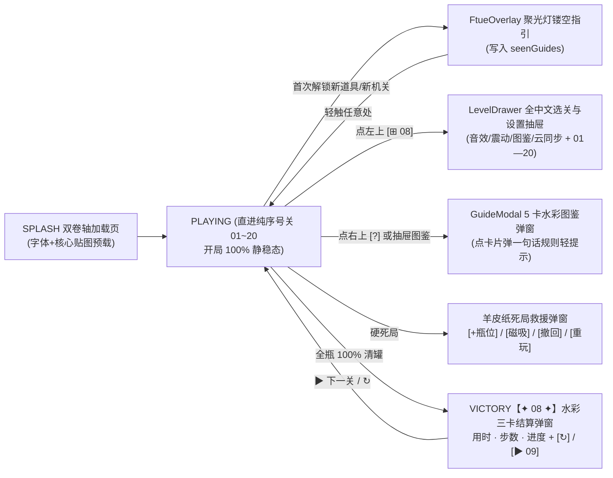

# 《星夜流沙瓶》星夜工坊绘本水彩版 功能需求规格说明书（PRD v5.0）

> [!IMPORTANT]
> 本文档承接《[GDD_星夜流沙瓶.md](./GDD_星夜流沙瓶.md)》、《[关卡设计文档_星夜流沙瓶.md](./关卡设计文档_星夜流沙瓶.md)》与《[UI_UX交互与视听资产规范.md](./UI_UX交互与视听资产规范.md)》，明确 **5 张权威 UI 设计稿逐屏落地标准、内置 `StarryStorybook` 手账字体与全中文界面铁律、「下近上远」3D 木凹槽透视交互、开局零误流静稳态、渐进道具与聚光灯首次指引及 7 项 QA 自动化验收标准**。

---

## 1. 版本范围与功能模块总览

| 功能域 | 包含模块 | 优先级 | 核心落地标准 |
| :--- | :--- | :---: | :--- |
| **启动加载与全中文合规** | 双卷轴羊皮纸加载页（`SplashScreen`）、`StarryStorybook` 字体双端预载、`8+ 适龄提示` | **P0** | Web 与微信真机并行加载自定义字体与核心贴图；全游 100% 纯中文，零英文残留 |
| **高密度双核与静稳态** | 星空通透水晶沙箱 + 圆珠木拨片 + `4+1` 圆杯托敞口瓶 + `4` 条 3D 深胡桃木凹槽队列 | **P0** | 首帧 `settleInitialState` 零误流；流萤星砂 S 曲线入瓶；第 `02~20` 关 `10~20` 瓶 `1:1` 守恒 |
| **五大权威界面 1:1 还原** | 启动加载页 / 局内主界面 / 图鉴弹窗 / 选关与设置抽屉 / 通关结算弹窗 | **P0** | 严格对齐 `docs/assets/ui_design/*.webp` 视觉构图、色彩肌理与微倾手写数字笔触 |
| **渐进解锁与聚光灯指引** | 第 `01` 关四步手势 + `02/03/04` 道具解锁指引 + 新机制首次登场镂空高亮引导 | **P0** | 依托 `SaveData.seenGuides` 精准去重，手势精准指向木凹槽近景瓶与目标机关 |
| **治愈视听与超轻包体** | G 大调 `75 BPM` 治愈无缝循环 BGM + 玻璃木作 SFX + 存档 Schema v2 | **P0** | 主包 `1.42 MB`（含 30 张美术与手绘字体）+ `audio` 分包 `500.5 KB` |

### 核心状态流转图

---

## 2. 局内双核玩法、实木工作台透视与渐进指引需求

### 2.1 开局零误流静稳态与上下双核视觉交互
1. **开局零提前流动（Premature Flow Fix）**：
   - `SandEngine.loadLevel()` 在载入沙区后立即静默执行最多 `120` 步纯重力安息角预落定（冻结颜色锁、染色计数与滤网吸沙，清空速度缓冲 `vel.fill(0)` 与 `lastFlowParticles = 0`），杜绝开局未操作时任何颗粒滑落。
2. **星空水晶沙箱与流萤星砂入瓶表现**：
   - 沙箱空白格全透明透出星夜玻璃天窗；固定隔墙为磨砂石英条，可抽机关为带圆球拉扣的浅橡木圆杆与翡翠胶囊染色环，底部为梯形浅橡木竖齿滤网。
   - 滤网底口与敞口药剂瓶口之间保留 `24~50px` 星夜净空，匹配沙流以柔和荧光 S 曲线光带叠细微星砂粒子钻入敞口瓶内，并在透明瓶颈内呈现垂直落沙细丝与立体椭圆液面上升。
3. **「下近上远」3D 深胡桃木凹槽队列**：
   - 蜂蜜橡木工作台下层设 `3~4` 条带斜切内壁的深胡桃木凹槽：最下方近景（`r = 0`）为饱满可点击的彩带软木塞玻璃瓶，后排（`r = 1..3`）向凹槽远端递进，完整露出软木塞与胸口 `?` / 冰晶壳；派走前排瓶后，后排瓶平滑向下顺移补位并自动揭晓新列首雾面问号瓶。

### 2.2 渐进式道具解锁与聚光灯首次指引（`FtueOverlay`）
| 关卡序号 | 解锁道具 | 首次登场聚光灯指引目标 | 持久化键 (`seenGuides`) |
| :---: | :--- | :--- | :--- |
| **`01`** | 隐藏道具栏 | 四步零弹窗手势引导：点左槽近景蓝瓶 → 点中槽近景黄瓶 → 抽木拨片 → 点右槽近景粉瓶 | 第 1 关实时状态驱动 |
| **`02`** | `UNDO` + `EXTRA_SLOT` | 空位暂存巧取后排技巧 + 底部「撤回 / +加瓶位」奶油方卡 | `mech_l2_slot_parking`, `prop_l2_undo_slot` |
| **`03`** | `VACUUM` | 沙箱内丝线联动拨片 + 底部「隔空磁吸」奶油方卡 | `mech_l3_linked`, `prop_l3_magnet` |
| **`04`** | `SHUFFLE` | 沙箱内高空脆冰（排空垫沙砸硬滤网）+ 底部「候选洗牌」奶油方卡 | `mech_l4_brittle_ice`, `prop_l4_shuffle` |
| **`05`~`10`** | 四道具全开 | 颜色锁（`05`）、雾面问号瓶（`06`）、星耀金沙（`07`）、染色环与斜拨片（`08`）、推拉门（`09`）、冰晶瓶（`10`） | `mech_l5_*` ~ `mech_l10_*` |

---

## 3. 五大界面交互细节规范

1. **顶栏避让与对称布局**：顶栏置于微信右上角官方胶囊 `menuButtonRect` 正下方 `5px`，左侧 `[⊞ 08]` 羊皮纸胶囊呼出选关抽屉，右侧 `[?]` 与 `[↻]` 圆木牌分别呼出图鉴与免费重玩（本关已用过付费道具时二次确认防误触）。
2. **底栏四道具方卡**：桌下深棕暗影栏居中排布 4 枚暖奶油圆角方卡，右上角嵌奶油圆角小方标动态显示真实可用次数（`撤回步数` / `3` / `+1` 或 `✓` / `3`）。
3. **图鉴、选关与结算弹窗**：
   - `GuideModal`：保留设计稿极简 5 卡片视觉（左水彩插画 + 右大号手账体标题），点击任意卡片在顶部弹出单行规则轻提示（`ToastOverlay`），右上珊瑚粉 `×` 或点击遮罩关闭。
   - `LevelDrawer`：顶部四圆钮下方显示纯中文标签（`音效 / 震动 / 图鉴 / 云同步`），中部 `4×5` 方格清晰区分已通关木框（秒数 + 绿勾 `✓`）、当前暖金发光框与未解锁灰褐凹石板（`10/20` Boss 关顶戴小皇冠），底部并排 `8+ 适龄`、`隐私指引` 与双嫩叶进度章。
   - `VictoryModal`：展示 `✦ 08 ✦`、连胜发光胶囊、三张水彩晕染战绩竖卡及底部 `↻` / `▶ 09` 双按钮。

---

## 4. 数据存档（Schema v2）与自动化验收标准（`npm run test:ac`）

存档键 `slt_player_save_v2` 持久化：`currentLevel`、`maxClearedLevel`、`totalClears`、`winStreak`、`bestTimeSecMap`、`dailyFreeRewardDate/Used`、`seenGuides: string[]` 与 `settings`（`soundOn/vibrateOn`）。

| 验收项 | 验收内容 | 自动化覆盖 |
| :--- | :--- | :--- |
| **AC-01~03** | 首章 `01~20` 纯序号高密度关卡（`10~20` 瓶）在 TypeScript `SandEngine` 100% 通关；开局零误流静稳态、高空脆冰、`?`问号瓶揭晓、`❄`冰晶瓶破冰与同色 FIFO 全部精准生效 | `npm run test:ac` |
| **AC-04** | 磁吸满瓶 `1:1` 颗粒守恒通关 + 候选洗牌保底将匹配底沙的玻璃瓶推至木凹槽最前排 `r = 0` | `npm run test:ac` |
| **AC-05** | 双核撤回（派瓶入座 + 抽木拨片回退）原子还原状态，且保留已解锁第 5 杯托权益 | `npm run test:ac` |
| **AC-06** | 存档 Schema v2 初始化、渐进指引 `seenGuides` 并集合并与最佳用时取短合并 | `npm run test:ac` |
| **AC-07** | 多机型（`375×667` / `393×852` / `384×864`）微信胶囊避让、水晶沙箱 + 实木工作台 + 四道具底栏零重叠，且全关卡 JSON 零 `title` 字段 | `npm run test:ac` |
