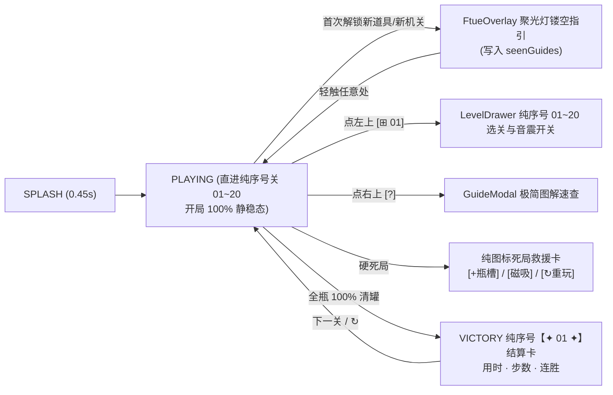

# 《沙里淘大红》日系治愈极简版 功能需求规格说明书（PRD v3.0）

> [!IMPORTANT]
> 本文档承接《[GDD_流沙抽板盲盒.md](./GDD_流沙抽板盲盒.md)》、《[关卡设计文档_沙里淘大红.md](./关卡设计文档_沙里淘大红.md)》与《[技术选型与架构设计文档.md](./技术选型与架构设计文档.md)》，明确**纯序号无关卡名体系、极简无字图标 HUD、系丝带透明玻璃瓶高密度 4 行队列、开局零误流静稳态、渐进式道具解锁与聚光灯首次指引、G 大调治愈音画联动及 7 项 QA 自动化验收标准**。

---

## 1. 版本范围与功能模块总览

| 功能域 | 包含模块 | 优先级 | 核心落地标准 |
| :--- | :--- | :---: | :--- |
| **极速启动与静稳态** | 0.45s 闪屏直入纯序号关（`01~20`）、开局 `settleInitialState` 零误流 | **P0** | 首帧渲染前完成确定性静默落定，未操作时沙粒与底网微光 100% 静止 |
| **高密度双核玩法** | `93.5%` 宽玻璃沙箱 + 磨砂石英隔条/浅枫木拨片 + `4+1` 槽 + `4` 行系丝带玻璃瓶 | **P0** | 第 `02~20` 关配置 `10~20` 只玻璃瓶，全通双反无脑机器人与陷阱校验，`1:1` 颗粒守恒 |
| **极简无字图标 UI** | 顶栏（`01` 选关胶囊 + `?` 圆钮 + `↻` 圆钮）+ 无字四道具底栏 + 纯序号结算卡 | **P0** | 全界面零关卡标题文字、功能钮与道具钮零冗余文字标签、避让微信右上角胶囊 |
| **渐进解锁与聚光灯指引** | 第 `01` 关四步手势 + `02/03/04` 道具解锁指引 + 新机制首次登场镂空高亮引导 | **P0** | 依托 `SaveData.seenGuides` 精准去重，每个新道具/新机制首次出现必触发聚光灯指引 |
| **日系治愈视听与存档** | G 大调 `75 BPM` 毡音钢琴风铃无缝循环 BGM + 水晶玻璃清脆 SFX + 存档 Schema v2 | **P0** | 主包 `1.14 MB` + `audio` 分包 `500.5 KB`；进度/最佳用时/`seenGuides` 跨端安全合并 |

### 核心状态流转图

---

## 2. 局内双核玩法、玻璃瓶表现与渐进指引需求

### 2.1 开局零误流静稳态与上下双核规则
1. **开局零提前流动（Premature Flow Fix）**：
   - `SandEngine.loadLevel()` 在载入沙区后立即静默执行最多 `120` 步纯重力安息角预落定（冻结颜色锁、染色计数与格栅吸沙，清空速度缓冲 `vel.fill(0)` 与 `lastFlowParticles = 0`）。
   - `SandRenderer` 底部格栅琥珀滚动相位仅在 `lastFlowParticles > 0 || pourStreamMs > 0` 时递增，杜绝开局未动时出现任何颗粒滑落或像素抖动。
2. **宽幅沙箱内部构件统一**：
   - 静态隔墙与斜溜槽（`staticWalls`）渲染为**磨砂石英玻璃隔条**；可抽拉横片与可拆斜导流片（`boards`）渲染为**浅枫木奶油拨片**（外侧配圆润小木钮/小拉环，无悬挂汉字牌）。
   - 冰块区域仅保留清透雪花结晶图标与无字融化进度条，不绘制碎片化提示文字。
3. **系丝带透明玻璃瓶与 `4` 行高密度托盘**：
   - `4+1` 激活槽与下方 `3~4` 列候选队列全面采用**系对应沙色绸缎蝴蝶结的圆润透明糖果玻璃瓶**，在槽吸沙时透过透明玻璃瓶壁实时渲染瓶内彩色沙堆上升（`0% → 100%`）。
   - 候选托盘纵向空间支持同屏清晰呈现 **`4` 行玻璃瓶**（超 4 行时第 5 行优雅露出瓶口丝带），第 `02~20` 关配置 `10~20` 只玻璃瓶以拉升思考深度与屏幕利用率。
   - **和纸盲瓶（`mystery: true`）**：后排裹磨砂和纸与 `?`，升至 `Row 0` 自动揭晓真色丝带；**冰封玻璃瓶（`iceLayers: 1~3`）**：裹淡青冰晶壳与 `❄ ×N` 徽标，全场每满走 1 只瓶自动减 1 层冰。

### 2.2 渐进式道具解锁与聚光灯首次指引（`FtueOverlay`）
| 关卡序号 | 解锁道具 | 首次登场聚光灯指引目标 | 持久化键 (`seenGuides`) |
| :---: | :--- | :--- | :--- |
| **`01`** | 隐藏道具栏 | 四步零弹窗手势引导：点蓝瓶 → 点黄瓶 → 抽浅枫木拨片 → 点粉瓶 | 第 1 关实时状态驱动 |
| **`02`** | `UNDO` + `EXTRA_SLOT` | 底部「撤回 / +瓶槽」圆卡 + 沙箱内磨砂斜导流隔条 | `prop_undo_slot`, `mech_slant` |
| **`03`** | `VACUUM` | 底部「磁吸满瓶」圆卡 + 沙箱内银丝滑轮联动双拨片 | `prop_vacuum`, `mech_linked` |
| **`04`** | `SHUFFLE` | 底部「候选洗牌」圆卡 + 沙箱内高空脆冰砖（排空垫沙砸硬底） | `prop_shuffle`, `mech_ice_block` |
| **`05`** | 四道具全开 | 颜色锁拨片与星耀通配金沙 | `mech_color_lock` |
| **`07`** | 四道具全开 | 候选队列中的 `?` 和纸问号盲瓶 | `mech_mystery_bottle` |
| **`08`** | 四道具全开 | 水彩染色星环与带圆环可拆斜导流拨片 | `mech_dye_ring` |
| **`11`** | 四道具全开 | 候选队列中的 `❄` 冰封玻璃瓶 | `mech_iced_bottle` |

---

## 3. 极简无字图标界面规范

1. **顶栏三枚控件（严格避让微信右上角胶囊 `menuButtonRect`）**：
   - `settingsPill`（左）：紧凑磨砂象牙胶囊（`2×2` 圆角网格图标 + 纯两位序号 `01`，无“第X关”及关卡名）。
   - `guidePill`（右二）：`36×36` 纯圆形磨砂图标钮（绘制柔灰 `?` 矢量符，零文字）。
   - `restartPill`（右一）：`36×36` 纯圆形磨砂图标钮（绘制柔灰 `↻` 刷新弧矢，零文字）。
2. **底部四道具圆卡（`propRowRect`）**：
   - 4 枚圆角磨砂奶油方卡，居中绘制大号治愈风图标，右上角悬浮浅色胶囊数字角标，卡底**零文字标签**；未达解锁关卡时自动隐藏，仅居中排布已解锁道具。
3. **弹窗极简化**：
   - `LevelDrawer`：`4×5` 纯序号圆角选关方格（`01`~`20`）+ 顶部声波/手机震动纯图标胶囊开关。
   - `VictoryModal`：顶部星芒纯序号标题 `✦ 01 ✦` + 三栏极简图标指标（⏱用时 / 🐾步数 / 🔥连胜）+ 右侧主行动钮与左侧圆形 `↻` 重玩图标钮。
   - 硬死局救援卡：三枚带图标的清爽磨砂胶囊（`+瓶槽` / `磁吸` / `↻`）。

---

## 4. 数据存档（Schema v2）与自动化验收标准（`npm run test:ac`）

存档键 `slt_player_save_v2` 持久化：`currentLevel`、`maxClearedLevel`、`totalClears`、`winStreak`、`bestTimeSecMap`、`dailyFreeRewardDate/Used`、`seenGuides: string[]` 与 `settings`（`soundOn/vibrateOn`）。云同步合并时 `seenGuides` 取并集、进度取最大值、同关最佳用时取最小值。

| 验收项 | 验收内容 | 自动化覆盖 |
| :--- | :--- | :--- |
| **AC-01~03** | 首章 `01~20` 纯序号高密度关卡（`10~20` 瓶）在 TypeScript `SandEngine` 100% 通关；开局零误流静稳态、高空脆冰软沙缓冲、`?`盲瓶翻牌、`❄`冰封瓶破冰与同色 FIFO 全部精准生效 | `npm run test:ac` |
| **AC-04** | 磁吸满瓶 `1:1` 颗粒守恒通关 + 候选洗牌保底将匹配底沙的玻璃瓶推至 `Row 0` | `npm run test:ac` |
| **AC-05** | 双核撤回（派瓶入槽 + 抽拨片回退）原子还原状态，且保留已解锁第 5 瓶槽权益 | `npm run test:ac` |
| **AC-06** | 存档 Schema v2 初始化、渐进指引 `seenGuides` 并集合并与最佳用时取短合并 | `npm run test:ac` |
| **AC-07** | 多机型（`375×667` / `393×852` / `384×864`）微信胶囊避让、`93.5%` 宽幅沙箱 + `4` 行玻璃瓶托盘 + 纯图标顶底栏零重叠，且全关卡 JSON 零 `title` 字段 | `npm run test:ac` |
