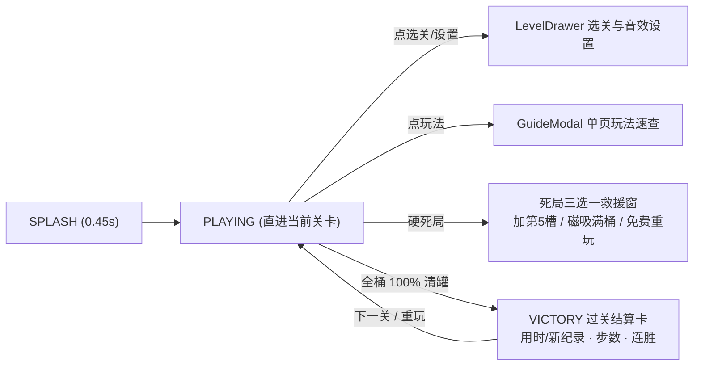

# 《沙里淘大红》纯粹流沙抽栓版 功能需求规格说明书（PRD v2.0）

> [!IMPORTANT]
> 本文档为《沙里淘大红》**纯粹流沙抽栓解谜版（Option B）**的功能需求规格说明书，承接《[GDD_流沙抽板盲盒.md](./GDD_流沙抽板盲盒.md)》、《[关卡设计文档_沙里淘大红.md](./关卡设计文档_沙里淘大红.md)》与《[技术选型与架构设计文档.md](./技术选型与架构设计文档.md)》，明确**1 秒直进关卡流程、上下双核流沙与排桶交互规则、两阶段死局救援、四大 `1:1` 守恒道具、纯粹过关结算面板及 7 项 QA 自动化验收标准**。

---

## 1. 版本范围与功能模块总览

| 功能域 | 包含模块 | 优先级 | 核心落地标准 |
| :--- | :--- | :---: | :--- |
| **极速启动** | 0.45s 闪屏直入当前关（零主页大厅）、静默登录 | **P0** | 单套统一 TypeScript 代码库双端运行（Web 与微信小游戏 100% 同源） |
| **双核局内玩法** | 宽底黄铜滤沙格栅 + `4+1` 卡槽 FIFO + `3~4` 列候选桶 + 6 类上层机关 | **P0** | 首章 20 关全通双反无脑机器人与陷阱校验，`1:1` 严格颗粒守恒 |
| **极简 HUD 与弹窗** | 极简三枚顶栏（`选关/设置`、`玩法速查`、`免费重玩`）+ 过关结算卡 | **P0** | 自动避让微信右上角官方胶囊区，无多余外围入口 |
| **四大救援道具** | `UNDO` 撤回、`VACUUM` 磁吸满桶、`EXTRA_SLOT` 加第 5 槽、`SHUFFLE` 候选洗牌 | **P0** | 全走 `RewardManager` 统一纯 IAA 预留接口，零破坏容量守恒 |
| **纯粹存档 v2** | 最高解锁关、当前关、总通关数、当前连胜、逐关最佳用时、音效/震动开关 | **P0** | 本地 `Storage` 即时落盘 + 微信云开发保高/最短用时合并 |

### 核心状态流转图

---

## 2. 局内上下双核玩法与四大道具功能需求

### 2.1 上下双核耦合与机关规则
1. **宽底黄铜滤沙格栅**：沙箱底部 `x ∈ [22, 127], y ∈ [159, 163]` 铺设多孔滤沙格栅。格栅上凡匹配当前在槽木桶颜色（或通配黄金沙）的流沙颗粒，均实时并发穿过格栅并沿彩色贝塞尔流线注入对应卡槽木桶。
2. **`4+1` 激活接沙槽 FIFO 规则**：默认激活 4 槽（可用 `EXTRA_SLOT` 解锁第 5 槽）；同色多桶在槽时严格按入槽先后（`placedSeq`）优先灌满先入槽的木桶，尽早腾出槽位。
3. **`3~4` 列前后排候选桶**：每列仅最前排（`Row 0`）可点入空卡槽；派走后后排自动上移。
   - **问号盲桶（`mystery`）**：后排隐藏颜色显示 `?`，递进至 `Row 0` 瞬间自动翻牌揭晓真色。
   - **冰封木桶（`iceLayers: 1~3`）**：锁死不可点击；全场每满走任意 1 只桶，所有冰封桶冰层自动 `-1`，归零破冰可点。
4. **上层 6 类控流机关**：普通抽拉木栓、倾斜导流斜桥、绳轮联动双栓、高空脆冰砖（必须清空下垫软沙腾出 `≥ 44` 格净空直砸裸硬底格栅才碎裂）、颜色锁木栓（首只同色桶满桶瞬间自动崩锁）、魔法染色环（改色不可逆）。
5. **1:1 严格容量守恒与清尾**：每只桶容量等于关联沙区总粒数；当在槽桶填充度 `≥ 98.5%` 且格栅连续 `0.40s` 无同色沙流入时，自动 `1:1` 精准吸除残留尾沙完成满桶。
6. **两阶段卡关预警与硬死局救援**：
   - 柔和提示：格栅滞留异色沙 `> 1.5s` 且仍有空槽或可抽木栓时，展示非阻塞底部暖黄轻提示条。
   - 硬死局弹窗：全部已解锁卡槽占满 + 连续 `0.85s` 零沙流入 + 上层无可放出匹配沙的手动木栓 → 弹出三选一救援窗（**加第 5 槽 / 磁吸满桶 / 免费重玩**）。

### 2.2 四大救援道具规范（`RewardManager`）
| 道具 ID | 名称 | 可用条件与核心逻辑 |
| :--- | :--- | :--- |
| `UNDO` | **撤回上一步** | 环形栈深 3 步，双动作全覆盖（选桶入槽与抽木栓均压栈）；回退时原子还原网格、卡槽、候选列、盲桶翻牌与冰桶层数，**且保留本关已解锁的第 5 槽权益**。 |
| `VACUUM` | **磁吸满桶** | 优先选中当前进度最高的在槽木桶（若槽全空则自动选可点列首桶），按「格栅 → 散沙 → 脆冰破冰 → 待染原沙」优先级 **`1:1` 精准扣减真实沙粒**并瞬间吸满腾槽。 |
| `EXTRA_SLOT` | **加第 5 槽** | 每关限 1 次，将激活接沙槽上限由 `4` 永久扩容至 `5`，盘活周转空间。 |
| `SHUFFLE` | **候选洗牌** | 重排所有列中的非冰封候选桶，并**保底将 1 只匹配当前滤网裸露底沙的非冰封桶置于第 0 列排头（`Row 0`）**。 |

---

## 3. 界面交互与极简过关结算规范

1. **顶栏极简三胶囊（`LayoutManager`）**：
   - `settingsPill`（左：`⚙️ 第 X 关 · 关卡名 ▾`）：呼出 `LevelDrawer` 选关与音频/震动抽屉。
   - `guidePill`（中：`📖 玩法`）：呼出单页极简 `GuideModal` 玩法与机关速查卡。
   - `restartPill`（右：`🔄 重玩`）：零广告免费重玩（未使用过道具时秒速重置；已使用道具时弹出轻量二次确认）。
   - 三枚胶囊严格避让微信右上角官方双胶囊安全区（`menuButtonRect` 左侧 `≥ 8px`），且在 `iPhone SE / iPhone 15 Pro / Android 20:9` 全部机型零重叠。
2. **过关结算卡（`VictoryModal`）**：
   - 展示：**本关用时**（刷新个人最佳时附带 `新纪录!` 徽章）、**总操作步数**、**当前连胜场次**。
   - 主按钮：**下一关**（第 20 关通关时显示“首章全通！回味第 1 关”）；次按钮：**再玩一次**。

---

## 4. 数据存档（Schema v2）与自动化验收标准（`npm run test:ac`）

存档键 `slt_player_save_v2` 持久化：`currentLevel`、`maxClearedLevel`、`totalClears`、`winStreak`、`bestTimeSecMap`、`dailyFreeRewardDate/Used` 与 `settings`（`soundOn/vibrateOn`）。双端同步时进度/总通关数取最大值，同关 `bestTimeSecMap` 取更短用时。

| 验收项 | 验收内容 | 自动化覆盖 |
| :--- | :--- | :--- |
| **AC-01~03** | 首章 20 关在 TypeScript `SandEngine` 100% 通关；高空脆冰软沙缓冲、问号盲桶翻牌、冰封桶破冰、同色 FIFO 规则全部精准生效 | `npm run test:ac` |
| **AC-04** | 磁吸满桶 `1:1` 颗粒守恒通关 + 候选洗牌保底将匹配底沙的桶置顶至 `Row 0` | `npm run test:ac` |
| **AC-05** | 双核撤回（选桶+抽栓回退）精确还原状态，且保留已解锁第 5 槽权益 | `npm run test:ac` |
| **AC-06** | 存档 Schema v2 初始化与云端合并规则（进度取大、最佳用时取短） | `npm run test:ac` |
| **AC-07** | 多机型（375×667 / 393×852 / 384×864）微信胶囊避让与极简三枚顶栏 + 五段式布局零重叠 | `npm run test:ac` |
