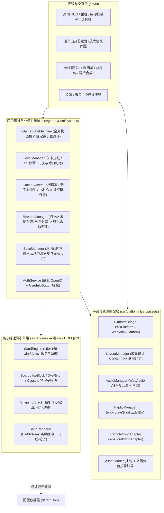
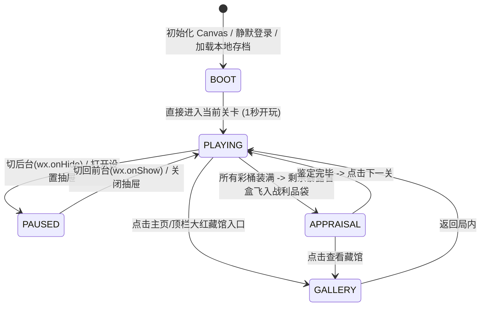
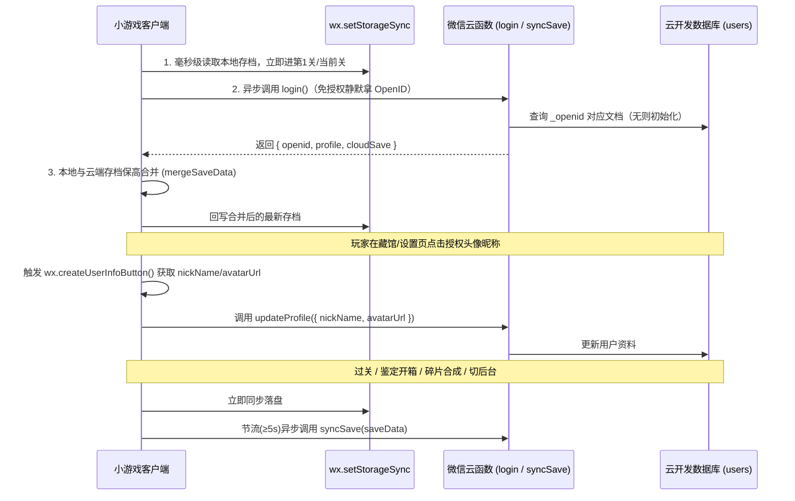

# 《沙里淘大红》技术选型与系统架构设计文档（v1.0）

> [!NOTE]
> 本文档基于《[GDD_流沙抽板盲盒.md](./GDD_流沙抽板盲盒.md)》、《[关卡设计文档_沙里淘大红.md](./关卡设计文档_沙里淘大红.md)》、《[盲盒设计文档_沙里淘大红.md](./盲盒设计文档_沙里淘大红.md)》及《[公仔设计文档_沙里淘大红.md](./公仔设计文档_沙里淘大红.md)》制定，确立项目 MVP v1.0 至 v1.2 阶段的技术选型、工程结构、核心模块架构、数据契约与性能规范，可直接作为工程脚手架搭建与研发落地的权威标准。

---

## 1. 技术选型决策（ADR）

### 1.1 技术栈总览与版本约束

| 维度 | 选定方案 | 版本约束 | 核心决策理由 |
| :--- | :--- | :--- | :--- |
| **开发语言** | **TypeScript**（`strict: true`） | `5.6+` | 强类型约束关卡/盲盒/公仔配置契约与 `TypedArray` 物理状态，杜绝线上拼写与空指针问题 |
| **渲染与引擎** | **原生 Canvas 2D + 离屏像素缓冲** | ES2020 / WXG Canvas 2D | 流沙核心是 `150×165` 网格元胞自动机，直接操作 `Uint8Array` + `Uint32Array` 写入 `ImageData` 比任何通用游戏引擎（Cocos/Pixi）更轻量、帧率更稳，主包零引擎冗余 |
| **运行平台** | **微信小游戏深度定制**（+ 浏览器 Vite 本地预览） | 微信基础库 `≥ 2.30.0` | 不为其他小游戏平台做厚重抽象，直接充分发挥微信原生 API（胶囊避让、短震动、分包、云开发、激励视频）；仅保留薄层 `PlatformBridge` 以便浏览器端秒级热更新调试 |
| **构建工具** | **Vite + 自定义微信产物插件** | `Vite 6.x` / `Node 22+` | 开发期享受浏览器毫秒级 HMR；发布期一键打包至 `dist-wx/`（ESModule/IIFE 单入口 + 自动生成 `game.json`、`project.config.json` 与分包目录），直接导入微信开发者工具预览/提审 |
| **账号与后端** | **本地优先 + 微信云开发（CloudBase）** | `wx.cloud` | 免服务器运维、免域名 ICP 备案、云函数原生获取可信 `openid`；详见 [1.2 微信云开发后端方案](#12-微信云开发后端方案) |
| **音频引擎** | **WebAudio 合成 + 轻量音效包** | `wx.createWebAudioContext` | 流沙 ASMR 沙沙声由带通滤波白噪音实时合成（零音频包体占用），木板咔嗒/破冰/出大红和弦结合轻量 `.mp3` 音效 |
| **状态与存档** | **Offline-First 状态中心** | `wx.setStorageSync` + 云同步 | 局内零网络阻塞，本地即时落盘，过关/开箱/切后台异步节流同步至云端 |
| **美术资产管线** | **ComfyUI + Qwen-Image-2.1 → WebP/PNG 图集** | 遵循 GDD 第 9 章 | 主包仅放 UI 基础元素，30+ 公仔高清图与皮肤放入微信分包按需加载 |

### 1.2 微信云开发后端方案

本项目服务端统一采用 **微信云开发（CloudBase）**，不自建独立服务器，采用**「本地优先 + 云端异步同步」**模式承载微信授权登录、用户信息与游戏存档：

1. **免运维与极简鉴权**：云函数通过 `cloud.getWXContext()` 直接获取微信官方签发的 `OPENID`，无需购买服务器、域名、办理 ICP 备案，也无需维护 `code2Session` 与自定义登录态。
2. **云端资源构成**：
   - **云数据库集合**：`users`（以 `_openid` 索引，存储用户头像昵称与 `PlayerSaveData` 存档）。
   - **云函数（`cloudfunctions/`）**：`login`（静默登录与拉取云端存档）、`syncSave`（校验并合并保存游戏进度与图鉴）、`updateProfile`（写入授权后的微信头像与昵称）。
3. **成本与计费预期**：开发调试期使用免费体验环境（`40,000` 资源点/月），正式上线切换基础套餐（`¥19.9/月`，含 `40,000` 资源点/月，结合客户端节流同步可覆盖数千 DAU）。
4. **上线前配置清单**：在微信开发者工具中依次完成：① 开通云开发获取 `envId` 填入配置 → ② 新建 `users` 数据库集合 → ③ 右键上传并部署 `cloudfunctions/` 下的云函数。
5. **接口解耦预留**：客户端通过 `IRemoteSyncAdapter` 隔离云端调用（默认实现 `WxCloudSyncAdapter`），后续如因业务规模需要接入自建接口，仅替换适配器实现即可，业务代码零改动。

### 1.3 微信授权合规红线（提审必过）

1. **禁止首屏强制弹窗要头像/昵称**：玩家打开游戏 1 秒内必须以静默 `openid`（自动分配默认游客名，如 `摸金新人_8421`）直接进入第 1 关游玩。
2. **按需引导授权**：仅在玩家进入「大红藏馆」或点击「登录/同步头像 / 排行榜」时，在对应按钮区域覆盖微信官方的 `wx.createUserInfoButton()`，点击后获取 `nickName` 与 `avatarUrl` 并写入云端 `users` 集合。

---

## 2. 整体系统架构与工程目录

### 2.1 分层架构图



### 2.2 依赖方向铁律

1. `src/engine/` **严禁直接引用 `wx` 全局对象或浏览器 DOM API**（仅接收 `CanvasRenderingContext2D` 或抽象缓冲），确保物理逻辑可独立运行单元测试与自动化关卡防死锁校验。
2. `src/systems/` 只通过 `PlatformBridge` 与 `IRemoteSyncAdapter` 访问存储、震动、激励视频与云开发。
3. 关卡、盲盒、公仔全部走声明式 JSON 配置，业务代码禁止硬编码具体关卡参数或公仔 ID 分支（第 1 关新手引导与必爽锁通过配置字段 `ftue` / `firstClearGuarantee` 声明驱动）。

### 2.3 推荐目录结构

```text
sha-li-tao-da-hong/
├── docs/                          # 策划、关卡、盲盒、公仔与本架构文档
├── demos/                         # 早期 HTML 玩法验证原型（只读归档）
├── data/                          # 声明式游戏配置源数据（构建期校验与打包）
│   ├── levels/
│   │   └── chapter_01.json        # 第 1~20 关配置（符合 LevelSchema v2，已通过物理模拟校验）
│   ├── vessels.json               # 容器模板（关卡 vesselTemplate 引用）
│   ├── blindboxes.json            # 6 种盲盒配置（符合 BlindBoxSchema）
│   ├── figurines.json             # 双套系 30 款公仔配置（符合 FigurineSchema）
│   ├── art/prompts.json           # 美术资产清单与生图提示词（画风锚点 cover.jpg）
│   ├── registry/id_registry.json  # 全内容 ID 注册表（永不复用，去重用）
│   └── palette.json               # 糖果色流沙调色板与噪点参数
├── src/
│   ├── main.ts                    # 双端统一入口（自动识别 wx / web 环境）
│   ├── types/                     # 全局 TypeScript 数据契约定义
│   │   ├── level.ts
│   │   ├── blindbox.ts
│   │   ├── figurine.ts
│   │   └── save.ts
│   ├── engine/                    # 纯 2D 流沙物理与渲染核心（无平台依赖）
│   │   ├── SandGrid.ts            # 150x165 网格、位编码与邻域读写
│   │   ├── SandEngine.ts          # 元胞自动机步进、木板、冰砖、染色环、胶囊
│   │   ├── BucketSystem.ts        # 1:1 容量统计、≥98.5% 尾沙吸附、双槽并发
│   │   ├── SnapshotStack.ts       # 3 步状态快照（Uint8Array 快速拷贝）
│   │   ├── SandRenderer.ts        # Uint32Array 离屏渲染、噪点着色、吸沙飞线
│   │   └── ParticleSystem.ts      # 破冰碎屑、满桶弹跳、出大红礼花粒子
│   ├── systems/                   # 业务系统
│   │   ├── GameStateMachine.ts    # BOOT / PLAYING / PAUSED / APPRAISAL / GALLERY
│   │   ├── LevelManager.ts        # 关卡装载、堵口 1.5s 预警、过关判定
│   │   ├── GachaSystem.ts         # 掉落权重、新手锁、15金/40红暗保底、未解锁×1.5
│   │   ├── RewardManager.ts       # 统一激励入口（分享/免费 -> 激励视频无缝切换）
│   │   ├── AuthService.ts         # 微信静默登录 + UserInfoButton 头像昵称授权
│   │   └── SaveManager.ts         # 本地存储 + 云端节流同步 + 冲突合并
│   ├── ui/                        # 纯 Canvas 自绘 UI 组件与页面
│   │   ├── UIManager.ts           # 命中检测、层级栈、缓动动画
│   │   ├── GameHUD.ts             # 顶栏总身价/战利品袋、底部接沙桶与道具栏
│   │   ├── AppraisalModal.ts      # 通关鉴定台（0.35s~2.25s 放大镜慢转圈）
│   │   ├── GalleryModal.ts        # 大红藏馆（双套系 Tab、碎片 5/25 合成）
│   │   ├── LevelDrawer.ts         # 选关与设置抽屉
│   │   └── FtueOverlay.ts         # 第 1 关零弹窗手势引导
│   └── platform/                  # 平台适配与外设封装
│       ├── PlatformBridge.ts      # 统一接口定义
│       ├── WxPlatform.ts          # 微信小游戏真实实现
│       ├── WebMockPlatform.ts     # 浏览器调试 Mock 实现（支持快捷键调试）
│       ├── LayoutManager.ts       # 胶囊避让 & 满屏沙盘几何计算
│       ├── AudioManager.ts        # WebAudio 流沙白噪音 ASMR + 音效管理
│       ├── HapticManager.ts       # light / medium / heavy 触觉反馈
│       └── sync/
│           ├── IRemoteSyncAdapter.ts
│           └── WxCloudSyncAdapter.ts
├── assets/                        # 主包轻量美术与图标（≤ 800KB）
├── subpackages/                   # 微信小游戏分包资源（按需加载，不占主包）
│   ├── figurines/                 # 30 款公仔高清图集（WebP/PNG）
│   └── audio/                     # 进阶音效与大红出货和弦
├── cloudfunctions/                # 微信云开发云函数
│   ├── login/                     # 静默登录，返回 openid 与云端最新存档
│   ├── syncSave/                  # 校验并合并保存玩家进度/图鉴/用户信息
│   └── updateProfile/             # 更新授权后的微信头像与昵称
├── scripts/
│   ├── build-wx.ts                # Vite 微信小游戏产物装配脚本（生成 game.json 等）
│   └── validate-data.ts           # JSON 配置与概率总和 100% 自动校验脚本
├── vite.config.ts
├── tsconfig.json
└── package.json
```

---

## 3. 核心模块架构设计

### 3.1 流沙物理引擎（`SandEngine`）

#### 网格编码与内存布局
* **网格规格**：宽 `W = 150`、高 `H = 165`（总单元数 `24,750` 格），屏幕渲染时按满屏沙盘宽度等比放大（例如 `375px` 逻辑宽 × `92% ≈ 345px`，每格约 `2.3px` 逻辑像素，清晰且细腻）。
* **双 `Uint8Array` 扁平缓冲**（单帧零对象分配）：
  * `cells: Uint8Array(W * H)`：低 4 位存储**材质/颜色 ID**（`0=空`, `1=草莓粉`, `2=柠檬黄`, `3=天蓝`, `4=薄荷绿`, `5=黄金狂热沙`, `14=静态容器壁`, `15=可抽木板`）；高 4 位存储**状态标志位**（`bit4: 是否已本帧更新`, `bit5: 是否为冰冻刚体沙`）。
  * `shade: Uint8Array(W * H)`：每粒沙子出生时写入固定 `±12` 亮度扰动值（`0~24` 映射），随沙粒移动同步搬运，呈现真实细腻彩沙颗粒感而非纯色色块。
* **步进规则（Fixed Timestep 60Hz，每帧 2 次子步进保证流动丝滑）**：
  * 自底向上扫描（`y = H - 2` 至 `0`），**奇偶帧交替左右扫描方向**（偶数帧左→右，奇数帧右→左），彻底消除流沙向单侧偏斜的经典伪影。
  * 移动优先级：`正下方 (x, y+1)` → `随机左下/右下 (x±1, y+1)` → `陡坡二阶滑落 (x±2, y+1)`，形成自然休止角与雪崩塌方感。

#### 六大物理机关实现
1. **普通抽拉木板 & 倾斜导流滑板**：线段通过 Bresenham 算法光栅化写入 `cells`（值 `15`）并记录归属 `boardId`；点击命中木板热区（视觉宽度外扩 `12px` 方便单手点按）后，触发抽离动画并瞬间擦除对应网格像素，释放上层沙堆。
2. **🧊 冰冻沙块（`IceBlock`）**：作为独立刚体矩形管理，网格内标记 `frozen` 位不参与元胞流动；每帧检测底边下方是否全为空格，若悬空则按重力加速下落并累计坠落高度 `droppedRows`；撞击静止物时若 `droppedRows ≥ shatterDrop`（默认 `28` 格），立即清除 `frozen` 标志化为流沙 + 触发碎冰粒子与 `medium` 震动；否则原地卡住（忠实还原第 14 关堵口陷阱）。
3. **🌀 染色漏斗/染色环（`DyeRing`）**：定义检测矩形与 `targetColor`，凡是本帧经过该区域的活动沙粒，直接将低 4 位颜色 ID 改写为 `targetColor`。
4. **🔒 上锁木板**：配置 `lockColor`，在 `BucketSystem` 发出 `BUCKET_FILLED(color)` 事件时自动解除所有匹配 `lockColor` 的木板锁定（播放咔哒开锁动画，支持自动抽离或转为可点击）。
5. **✨ 黄金狂热沙（Color ID `5`）**：在出沙口吸沙判定中视为**通配色**，可被任意当前激活彩桶极速吸入。

#### 1:1 零残留吸沙与堵口判定（`BucketSystem`）
* **初始化统计**：关卡加载后遍历所有 `sandZones`（含冰块与经过染色环的预期配额），严格按 `bucketQueue` 分配每桶精确容量 `targetCount`。
* **防卡死清尾机制**：底部漏斗出沙口（中心区域 `x ∈ [65, 85], y ≥ 156`）每帧高速吸入匹配当前激活桶颜色的沙粒；当某桶进度 `filled / targetCount ≥ 0.985` 时，扫描全盘自动吸走角落残余同色散沙并瞬间满桶，确保**100% 零残留**。
* **异色堵口预警**：若出沙口存在沙粒但连续 `1.5 秒` 无法匹配任何当前激活桶（支持「加开第 2 接沙槽」双桶并发匹配），抛出 `CLOG_WARNING` 事件，弹出柔和引导条（抽其他板 / 使用吸尘器或加槽 / 一键免费重玩）。

#### 「撤回上一步」快照机制（`SnapshotStack`）
* 每次点击抽走木板**前**压栈一份快照：包含 `cells.slice()`（`24.75KB`）、`shade.slice()`（`24.75KB`）、木板状态、冰块位置、胶囊坐标与各桶计数。
* 环形栈上限 **3 步**，总内存占用 `< 160KB`，撤回时原样恢复，100% 精准零漂移。

---

### 3.2 游戏状态机与生命周期（`GameStateMachine`）



* **切后台容错**：`wx.onHide` 立即暂停 `requestAnimationFrame` 物理步进、挂起 `AudioContext` 并触发一次静默存档；`wx.onShow` 恢复音频上下文与渲染循环，杜绝锁屏耗电与切回无声。

---

### 3.3 盲盒掉落与鉴定系统（`GachaSystem` & `AppraisalModal`）

1. **结算流程**：整关清空进入 `AppraisalModal` → `GachaSystem.rollBox(boxId, playerState)` 预先算出所有结果（支持 `box_double` 一盒分裂 2 抽）→ 根据目标公仔品质反向映射放大镜慢转时长：
   * `WHITE / GREEN`：`0.35s`（无震动）
   * `BLUE`：`0.55s`（`light`）
   * `PURPLE`：`1.00s`（`medium`）
   * `GOLD`：`1.55s`（`heavy` ×1）
   * `RED`：`2.25s`（极慢阻尼转圈 + 压暗泛红 + 急促心跳 + `heavy` ×2）
2. **暗保底与权重修正**（严格对齐《盲盒设计文档》）：
   * **新手第 1 关必爽锁**：`levelId === 1 && !save.ftueFirstBoxOpened` 时，强制在 `PURPLE (70%) / GOLD (30%)` 中抽取。
   * **动态幸运值**：存档记录 `pityGoldCount`（连抽 15 盒未出金及以上，第 16 盒保底 `GOLD+`）与 `pityRedCount`（连抽 40 盒未出大红，下次开启紫/金盒必出 `RED`）。
   * **未解锁优先**：同品质池内，尚未拥有的公仔权重 `× 1.5`。
3. **重抽提档**：针对 `WHITE / GREEN` 结果提供每关 1 次的【重抽此盒】，通过 `RewardManager` 触发，重抽时将当前品质以下权重清零（保底提升 ≥1 档）。

---

### 3.4 纯 IAA 商业化预留（`RewardManager`）

统一收口所有激励点位（`EXTRA_SLOT` 加开第 2 接沙槽、`VACUUM` 万能吸尘清堵、`UNDO` 撤回上一步、`REROLL_BOX` 盲盒重抽、`BONUS_BOX` 额外盲盒空投）：

```ts
export type RewardScene = 'EXTRA_SLOT' | 'VACUUM' | 'UNDO' | 'REROLL_BOX' | 'BONUS_BOX';
export type RewardMode = 'FREE_DAILY' | 'SHARE_UNLOCK' | 'WX_REWARD_AD';

export interface IRewardManager {
  setMode(mode: RewardMode): void;
  requestReward(scene: RewardScene): Promise<{ granted: boolean; reason?: string }>;
}
```

* **v1.0 冷启动期（< 500 UV）**：默认模式为 `FREE_DAILY`（每日免费次数）+ `SHARE_UNLOCK`（调用 `wx.shareAppMessage` 分享给好友/群，利用 `wx.onShow` 时长回调发放奖励，助力冲刺 500 UV）。
* **v1.1 流量主期（≥ 500 UV）**：配置切换为 `WX_REWARD_AD`，内部调用 `wx.createRewardedVideoAd({ adUnitId })`，仅在 `res.isEnded === true` 时返回 `granted: true`，业务调用方**零代码改动**。

---

### 3.5 微信授权登录与云存档同步（`AuthService` & `SaveManager`）

#### 登录与存档流转


#### 离线冲突合并策略（`mergeSaveData`）
为防止弱网或换设备导致掉档，采用**确定性保高合并**：
* `currentLevel` / `maxClearedLevel`：取 `Math.max(local, cloud)`
* `ownedMap`（各公仔持有数量）：对每个 `figurineId` 取 `Math.max(localCount, cloudCount)`
* `totalNetWorth`：取 `Math.max(local, cloud)`（或以较高时间戳记录为主并校验不低于已拥有图鉴基础估值）
* `shards` / `pityGoldCount` / `pityRedCount`：按 `updatedAt` 较新的一方为准

---

### 3.6 竖屏满屏沙盘布局规范（`LayoutManager`）

严格执行 GDD 第 8.2 条硬指标，启动时调用 `wx.getWindowInfo()` 与 `wx.getMenuButtonBoundingClientRect()` 动态计算屏幕分区：

| 屏幕分区 | 占比规范 | 计算规则与适配要点 |
| :--- | :--- | :--- |
| **顶栏 HUD** | 高度 `10% ~ 12%` | 避让状态栏与右上角微信胶囊（`top = menuRect.top`，右侧内容左边界 `< menuRect.left - 12`），展示当前关卡、总身价、战利品袋与设置按钮 |
| **主玻璃沙盘区** | **宽 `90% ~ 94%` × 高 `60% ~ 64%`** | 横向居中拉满，杜绝两侧大块留白；根据 `150:165` 网格比例计算最大内切矩形 `sandViewport`，保证沙粒正方形不拉伸 |
| **底栏（接沙桶 + 道具栏）** | 高度 `22% ~ 24%` | 上半区为当前激活彩桶（1~2 槽）+ 预告队列（2~3 桶），下半区为三大局内道具（加槽/吸尘/撤回）+ 重玩按钮；底部额外预留 `safeArea.bottom`（iOS Home 指示条安全高度） |

---

## 4. 核心数据契约（TypeScript & JSON Schema）

以下类型定义与现有策划文档完全对齐，存放于 `src/types/`，并作为 `scripts/validate-data.ts` 的构建期校验基准。

### 4.1 关卡配置契约（对齐 `LevelSchema` v2 / `data/levels/chapter_01.json`）

> [!NOTE]
> 以下类型与仓库中已通过物理模拟校验的 [`data/levels/chapter_01.json`](../data/levels/chapter_01.json)、[`data/vessels.json`](../data/vessels.json) 字段一一对应；字段语义详见《关卡设计文档》§4，校验规则见《[内容去重与校验规范](./内容去重与校验规范.md)》。

```ts
// src/types/level.ts
export type SandColorId = 1 | 2 | 3 | 4 | 5; // 1粉 2黄 3蓝 4绿 5黄金狂热沙
export type VesselTemplateId = 'jar_standard_v1' | 'jar_tall_narrow_v1' | 'hourglass_wide_v1' | 'milk_tea_cup_v1' | string;

export interface StaticWallDef { x0: number; y0: number; x1: number; y1: number; thickness: number; }

export interface BoardDef {
  id: string;
  label?: string;
  x0: number; y0: number;
  x1: number; y1: number;
  kind?: 'slant';               // 省略 = 水平抽板
  lockColor?: SandColorId;      // 颜色锁：首只该色桶装满时自动抽开，不出现在 solution 中
}

export interface SandZoneDef {
  id: string;
  color: SandColorId;
  shape: 'rect' | 'poly';
  x0?: number; y0?: number; x1?: number; y1?: number; // rect
  points?: [number, number][];                         // poly
  frozen?: boolean;
  shatterDrop?: number;          // 冰砖摔碎最小落差，默认 28 格
  expectDyeTo?: SandColorId;     // 预期被染色环染成的颜色
}

export interface DyeRingDef {
  id: string;
  fromColors: SandColorId[];
  toColor: SandColorId;
  x0: number; y0: number; x1: number; y1: number;
}

export interface BucketDef { color: SandColorId; zones: string[]; } // 桶容量 = zones 粒数之和（1:1 零残留）

export interface LevelCapsuleDef { boxType: BlindBoxId; x: number; y: number; }

export interface LevelConfig {
  levelId: number;
  key: string;                   // lvl_XXXX，注册表发号，永不复用
  title: string;
  difficulty: 1 | 2 | 3 | 4 | 5;
  type: 'tutorial' | 'normal' | 'bonus' | 'boss';
  mechanics: string[];
  vesselTemplate: VesselTemplateId;
  hint?: string;
  ftue?: {
    handPointBoard?: string;
    highlightBucket?: number;
    highlightLock?: string;
    highlightDyeRing?: number;
    guaranteedFirstBox?: ('PURPLE' | 'GOLD')[];
  };
  staticWalls: StaticWallDef[];
  boards: BoardDef[];
  sandZones: SandZoneDef[];
  dyeRings: DyeRingDef[];
  bucketQueue: BucketDef[];
  solution: string[];            // 标准手动抽板顺序（校验用，运行时可用于提示道具）
  expectTrap?: boolean;
  capsules: LevelCapsuleDef[];
}

export interface ChapterFile {
  chapter: number;
  chapterName: string;
  colorLegend: Record<SandColorId, string>;
  levels: LevelConfig[];
}
```

### 4.2 盲盒配置契约（对齐 `BlindBoxSchema` / `data/blindboxes.json`）

```ts
// src/types/blindbox.ts
export type Rarity = 'WHITE' | 'GREEN' | 'BLUE' | 'PURPLE' | 'GOLD' | 'RED';
export type BlindBoxId = 'box_white' | 'box_purple' | 'box_gold' | 'box_red' | 'box_ice' | 'box_double' | string;

export type DropWeights = Record<Rarity, number>; // 构建期校验总和必须严格等于 100

export interface BlindBoxConfig {
  boxId: BlindBoxId;
  name: string;
  category: 'base' | 'advanced' | 'premium' | 'boss' | 'mechanic' | 'surprise';
  radiusGrid: number;                 // 常规 6.5，红箱/双黄蛋 7.5
  splitCount: number;                 // 常规 1，box_double 为 2
  seriesFilter: string | null;        // null 表示全套系池
  featuredFigurines?: {              // box_ice 对 8 款冰晶/冰饮主题公仔 ×2.0 定向权重（PRD §4.2）
    ids: string[];
    weightMultiplier: number;
  };
  shellStyle: { fill: string; rimOuter: string; rimInner: string; glowColor: string; badgeText: string; };
  dropWeights: DropWeights;
  secondDropWeights?: DropWeights;    // box_double 第 2 格（保底 ≥ BLUE）
}

export interface BlindBoxFile {
  pity: { goldAfter: number; redAfter: number; redPityBoxes: BlindBoxId[]; redPityRule?: string; };
  replayDrops: Record<BlindBoxId, Partial<Record<BlindBoxId, number>>>; // 复刷槽位替换概率（PRD §3.2）
  airdrop: { firstClearEveryNLevels: number; replayEveryNClears: number; weights: Partial<Record<BlindBoxId, number>>; };
  ftue: { levelId: number; boxId: BlindBoxId; forced: Partial<DropWeights>; };
  boxes: BlindBoxConfig[];
}
```

### 4.3 公仔与套系契约（对齐 `FigurineSchema` / `data/figurines.json`）

```ts
// src/types/figurine.ts
export interface RarityDef { label: string; shardValue: number; valuation: [number, number]; }

export interface FigurineItem {
  id: string;            // fig_NNN，注册表发号，永不复用
  name: string;
  rarity: Rarity;
  valuation: number;     // 固定身价估值（须落在 RarityDef.valuation 区间）
  species: string;       // 去重键：物种
  archetype: string;     // 去重键：造型母题（species + archetype 不得重复）
  tags: string[];        // 如 'ice_theme'（与 box_ice.featuredFigurines 一致，校验器保证引用有效）
  quote: string;         // 出货鉴宝台词
  spriteKey?: string;    // 运行时由 assets/manifest.json 注入（图集就绪前用代码占位）
}

export interface FigurineSeriesConfig {
  seriesId: string;
  seriesName: string;
  unlockReward: { type: 'sand_skin' | 'drain_fx'; id: string; name: string; title?: string; };
  items: FigurineItem[];
}

export interface FigurineFile {
  rarities: Record<Rarity, RarityDef>;
  craftRules: { normalCost: number; premiumCost: number; premiumPool: Rarity[]; unownedWeightBoost: number; };
  series: FigurineSeriesConfig[];
}
```

### 4.4 用户资料与云端存档契约（`PlayerSaveData`）

```ts
// src/types/save.ts
export interface UserProfile {
  openid: string;
  nickName: string;
  avatarUrl: string;
  isAuthorized: boolean; // 是否已通过 UserInfoButton 授权
}

export interface PlayerSaveData {
  schemaVersion: 1;
  updatedAt: number;                      // 毫秒时间戳
  currentLevel: number;
  maxClearedLevel: number;                // 用于区分首通高阶盒掉落(>maxClearedLevel)与复刷常规淘金掉落
  replayedClearCount: number;             // 满通后复刷累计通关局数（每满 5 局触发空投盲盒）
  totalNetWorth: number;                  // 藏馆累计总身价（自动映射 Lv.1~Lv.6 头衔）
  ownedMap: Record<string, number>;       // { fig_001: 3, fig_014: 1 }
  shards: number;                         // 淘金碎片（5 碎片普合 / 25 碎片高阶定向）
  pityGoldCount: number;                  // 距上次出金已连抽数（满 15 保底）
  pityRedCount: number;                   // 距上次出大红已连抽数（满 40 高阶盒必爆大红）
  ftueFirstBoxOpened: boolean;            // 第 1 关首盒必爽锁标记
  unlockedSkins: string[];                // 已解锁流沙皮肤 ID（如第一弹银河闪粉沙）
  equippedSkinId: string | null;
  unlockedSuctionFx: string[];            // 已解锁吸沙特效 ID（如第二弹彩虹流光特效）
  equippedSuctionFxId: string | null;
  dailyFreeRewardDate: string;            // YYYY-MM-DD，冷启动期每日 3 次免费激励配额重置
  dailyFreeRewardUsed: number;
  settings: {
    soundOn: boolean;
    vibrateOn: boolean;
  };
}
```

---

## 5. 性能预算、包体控制与真机 60FPS 优化规范

### 5.1 单帧耗时预算（目标真机 60 FPS = 16.6ms / 帧）

| 执行阶段 | 耗时预算 | 核心优化手段 |
| :--- | :---: | :--- |
| **流沙物理步进（2 子步）** | `≤ 3.5 ms` | 1. 一维扁平 `Uint8Array` 索引 `y * W + x`，杜绝二维数组与闭包<br>2. 维护每行活跃边界（Dirty Y-Range），静止区域跳过扫描<br>3. 预分配随机数循环表（XORShift32 内联），避免每粒沙调用 `Math.random()` |
| **流沙像素离屏渲染** | `≤ 3.0 ms` | 1. 维护 `150×165` 离屏 Canvas 与 `ImageData`，通过 `new Uint32Array(imgData.data.buffer)` **单次 32 位整数字写入**（查预计算好的 `Color×Shade` RGBA32 查找表）<br>2. 主屏 `drawImage(offscreen, ...)` 硬件缩放一次上屏，`imageSmoothingEnabled = false` 保留细腻像素颗粒感 |
| **UI / 粒子 / 飞线绘制** | `≤ 4.0 ms` | 1. 静态背景与玻璃容器边框缓存至独立离屏 Canvas，仅在窗口尺寸变化或切关时重绘<br>2. 粒子与吸沙飞线采用固定长度对象池（Object Pool，上限 120 粒子），运行期 **0 GC 分配** |
| **业务与音频调度** | `≤ 1.5 ms` | 吸沙 ASMR 白噪音复用单一 `AudioBufferSourceNode` + 动态调节 `GainNode` 音量，不频繁创建音频节点 |
| **安全余量（系统/GC）** | `≥ 4.6 ms` | 低端安卓机若连续 30 帧平均耗时 `> 20ms`，自动降级粒子上限 50% 并切至 1 子步/帧保流畅 |

### 5.2 微信小游戏包体预算与分包策略

微信小游戏硬性红线：**主包 ≤ 4MB，总包 ≤ 20MB**。本项目按更严格的秒开标准控制：

| 分包名称 | 体积预算 | 包含内容 | 加载时机 |
| :--- | :---: | :--- | :--- |
| **主包（Main）** | **`≤ 1.8 MB`** | 全部打包后 JS 逻辑（预计 `< 150KB` gzip）、`data/*.json`（`< 50KB`）、主界面绘本风背景、木板/容器/6 种盲盒壳体图集、基础短音效 | 启动即加载，目标冷启动 `< 1.5s` |
| **分包 1（`subpackages/figurines`）** | `≤ 4.0 MB` | 30 款公仔高清立绘（WebP 优先 / 256×256 精灵图集，单款 ≤ 80KB） | 进入第 1 关后后台静默 `wx.loadSubpackage` 预加载；未完成前降级显示 Emoji/矢量占位 |
| **分包 2（`subpackages/audio`）** | `≤ 1.5 MB` | 鉴定台心跳循环音效、大红出货欢呼和弦、后续章节主题 BGM | 后台静默预加载 |

### 5.3 Vite 双端构建工作流

* `npm run dev`：启动 Vite 本地开发服务器，自动注入 `WebMockPlatform`，浏览器内直接模拟竖屏手机视口（390×844）与胶囊安全区，提供调试面板（一键跳关、强制出大红、重置存档）。
* `npm run validate`：执行 `scripts/validate-data.ts`，自动校验：
  1. 所有盲盒 `dropWeights` 总和严格等于 `100`；
  2. 所有关卡 `bucketQueue` 与 `sandZones` 颜色配对合法；
  3. 公仔 ID 无重复且与套系引用一致。
* `npm run build:wx`：执行类型检查 (`tsc --noEmit`) → 数据校验 → Vite 打包生成微信小游戏标准目录 `dist-wx/`（包含 `game.js`、`game.json`、`project.config.json`、`assets/`、`subpackages/`），微信开发者工具直接打开 `dist-wx/` 即可真机预览与上传提审。

---

## 6. 研发落地里程碑建议

1. **Phase 1（工程脚手架与核心引擎）**：初始化 Vite + TS + 微信构建脚手架，完成 `SandEngine`（含抽板、冰砖、染色环、上锁板、3 步撤回）与 `LayoutManager` 满屏适配，浏览器端跑通第 1、11、16、19 关。
2. **Phase 2（闭环玩法与大红图鉴）**：接入全部 20 关 JSON、6 种盲盒与 30 款公仔数据，完成 `GachaSystem`、`AppraisalModal` 慢转圈鉴定台、`GalleryModal` 藏馆与碎片合成、WebAudio ASMR 与震动。
3. **Phase 3（微信真机与云开发接入）**：接入 `WxPlatform`、`RewardManager`（冷启动免费/分享模式）、微信云开发 `login` / `syncSave` / `updateProfile` 云函数与 `wx.createUserInfoButton`，完成真机 60FPS 压测与首包体检，提审上线。
