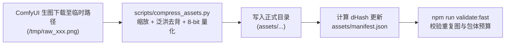

# 《沙里淘大红》美术素材压缩与分包规范（v1.0）

> [!IMPORTANT]
> **项目强制红线**：所有通过 ComfyUI（Qwen-Image-2.1）生成或外部引入的美术图片素材，**严禁将 `1024×1024` / `768×1344` 原始未压缩大图直接写入业务目录或加载运行**。所有素材必须经过 [`scripts/compress_assets.py`](../scripts/compress_assets.py) 完成规格化缩放、边缘去背与无损/调色板压缩，并通过 [`tools/validate-content.js`](../tools/validate-content.js) 的体积与感知哈希（dHash）校验后方可入库使用。

---

## 1. 制定背景与核心目标

1. **微信小游戏包体红线与秒开体验**：微信小游戏主包硬上限为 `4 MB`（本项目严格控制**主包总大小 `≤ 1.8 MB`**，其中主包图片资源合计 `≤ 950 KB`），以保障玩家点击图标 `< 1.5s` 直接进第 1 关开玩。
2. **显存与 60FPS 帧率稳定**：ComfyUI 直出单张 `1024×1024` RGBA 原图体积约 `1.2 ~ 1.8 MB`，解码后单张占用 `4 MB` GPU 纹理内存；85 项原图未压缩直上会导致低端机内存溢出（OOM）与微信闪退。
3. **零外部额度依赖与可复现构建**：采用仓库内置 Python Pillow 管线（[`scripts/compress_assets.py`](../scripts/compress_assets.py)），支持离线批量执行、幂等重入及 CI 体积门禁检查。

---

## 2. 全品类素材尺寸、去背与压缩标准

对齐《[UI_UX交互与视听资产规范.md](./UI_UX交互与视听资产规范.md)》§5 与 [`data/art/prompts.json`](../data/art/prompts.json) 的 85 项静态视觉资产，压缩入库标准如下表所示：

| 资产类别 (`category` / 特例) | 数量 | ComfyUI 原始尺寸 | 入库目标最大尺寸 | 透明去背 (`transparent`) | 编码与量化策略 | 单图体积上限 | 微信打包归属 |
| :--- | :---: | :---: | :---: | :---: | :--- | :---: | :---: |
| **竖屏背景** (`ui_background`) | `6` | `768 × 1344` | **`540 × 960`** *(1.38x 逻辑视口)* | 否（不透明） | 8-bit 自适应调色板 PNG（无噪点抖动 + 阶梯色盘控体）+ `zlib level 9` | `≤ 300 KB` | `ui_bg_gameplay`、`ui_bg_splash` 入**主包**；其余 4 张入 `figurines` 分包 |
| **游戏标题 Logo** (`ui_logo_title`) | `1` | `1024 × 1024` | **`512 × 256`** | **是**（四边泛洪去白 + 紧致裁边） | 8-bit Alpha 调色板 PNG（`FASTOCTREE`） | `≤ 65 KB` | **主包** |
| **应用图标** (`ui_app_icon`) | `1` | `1024 × 1024` | **`512 × 512`** | 否（不透明） | 8-bit 256色调色板 PNG | `≤ 90 KB` | **主包** |
| **横向机关/木板条** (`ui_board_*` / `ui_vessel_rim` / `ui_ice_block` / `ui_btn_wood`) | `5` | `1024 × 1024` | **长边 `256px`** *(自动裁除上下空白冗余)* | **是**（四边泛洪去白 + 保留 `4px` 安全边距） | 8-bit Alpha 调色板 PNG | `≤ 30 KB` | **主包** |
| **通用羊皮纸面板** (`ui_panel_parchment`) | `1` | `1024 × 1024` | **`384 × 512`** | **是**（四边泛洪去白） | 8-bit Alpha 调色板 PNG | `≤ 75 KB` | **主包** |
| **鉴定放大镜** (`ui_magnifier`) | `1` | `1024 × 1024` | **`160 × 160`** | **是**（外围去白 + 镜片内芯半透高光处理） | 8-bit Alpha 调色板 PNG | `≤ 25 KB` | **主包** |
| **常规 UI / 道具 / 机关图标** (`ui_icon` / `ui_vessel_nozzle`) | `28` | `1024 × 1024` | **`128 × 128`** | **是**（四边泛洪去白 + 居中留 `6%` 边距） | 8-bit Alpha 调色板 PNG | `≤ 22 KB` | **主包** |
| **六档品质卡框** (`ui_frame`) | `6` | `768 × 1024` | **`240 × 320`** | **是**（外围去白） | 8-bit Alpha 调色板 PNG | `≤ 45 KB` | **主包** |
| **六款盲盒宝箱** (`blindbox`) | `6` | `1024 × 1024` | **`160 × 160`** | **是**（四边泛洪去白 + 居中留 `6%` 边距） | 8-bit Alpha 调色板 PNG | `≤ 28 KB` | **主包** |
| **双套系公仔立绘** (`figurine`) | `30` | `1024 × 1024` | **`256 × 256`** | **是**（四边泛洪去白 + 居中留 `6%` 边距） | 8-bit Alpha 调色板 PNG | `≤ 45 KB` | **`subpackages/figurines` 分包** |

---

## 3. 核心处理技术细节

### 3.1 保护内部白色的「四边连通域泛洪去背」算法
本游戏包含大量**内部含纯白/浅奶油色主体**的资产（如 `ui_bucket` 待程序着色的白桶、`ui_lock_badge` 白挂锁、`box_white` 素白瓷盒、`fig_001` 灰白仓鼠及所有角色眼白高光）。
* **严禁全局色值一刀切抠图**：全局将 `#FFFFFF` 设为透明会击穿角色眼白与白桶桶身。
* **标准算法**：从原图四条边界的所有近白像素（`min(R,G,B) ≥ 236` 且通道极差 `max - min ≤ 24`）发起 BFS 泛洪搜索，遇到 `#5A3A22` 手绘深棕封闭墨线自动停止；仅将外部连通背景置为全透明，并对交界处 `1~2px` 过渡像素按亮度线性羽化 Alpha 值，彻底消除白边毛刺。
* **放大镜镜片特例（`ui_magnifier`）**：除外部去背外，自动识别圆形黄铜镜框内部的纯白镜片连通域，将其 Alpha 压至约 `15%` 微透反光态，使鉴定扫描时底部的宝盒能自然透出镜片。

### 3.2 PNG 位深与内容校验器兼容性铁律
仓库零依赖校验库 [`tools/lib/png.js`](../tools/lib/png.js) 的 `decodePNG()` 要求输入 PNG 必须满足：
1. **位深固定为 `8-bit`（`IHDR bit_depth = 8`）**，严禁输出 `1/2/4-bit` 低位深索引图；
2. **扫描方式为非隔行（`interlace = 0`）**；
3. **透明像素底色归一为纯白 `(255, 255, 255, 0)`**：在调色板量化后，所有 `alpha = 0` 的调色板槽位 RGB 强制写回 `#FFFFFF`，避免透明区随机杂色干扰 64 位 `dHash` 感知哈希去重计算。

---

## 4. 微信小游戏主包与分包体积门禁

构建脚本 `npm run build:wx` 与校验工具共同执行以下三级预算门禁：

| 包体分区 | 包含图片内容 | 图片体积上限 | 分区总包体上限（含代码/JSON/音频） | 超限处置 |
| :--- | :--- | :---: | :---: | :--- |
| **主包 (`dist-wx/`)** | `ui_bg_gameplay`、`ui_bg_splash` + 品牌 2 项 + 局内/道具/鉴定/藏馆/通用图标 37 项 + 卡框 6 项 + 盲盒 6 项（共 53 张） | **`≤ 950 KB`** | **`≤ 1.80 MB`** *(微信硬红线 4MB)* | 构建失败并打印 Top 5 大图 |
| **公仔与次级背景分包 (`dist-wx/subpackages/figurines/`)** | 30 款公仔立绘 (`fig_001`~`fig_030`) + 4 张非首屏背景 (`appraisal` / `collection` / `level_drawer` / `share_poster`) | **`≤ 2.50 MB`** | **`≤ 4.00 MB`** | 构建失败并阻断发布 |
| **全仓单图门禁** | `assets/` 下任意单张压缩后图片 | 背景 `≤ 280 KB`<br>立绘/组件 `≤ 90 KB` | — | `compress_assets.py --check-budget` 报错退出 |

---

## 5. 标准操作命令与流水线规范



### 常用命令速查

```bash
# 1. 一键运行 ComfyUI 批量生图 + 自动压缩 + 写入 manifest.json（默认并发流水线）
npm run gen:assets

# 2. 对单张原始大图按指定 assetId 规范压缩并去背输出到正式目录
python3 scripts/compress_assets.py /tmp/raw_fig_001.png -o assets/figurines/fig_001.png --asset-id fig_001

# 3. 批量重压缩整个 assets/ 目录（自动匹配 data/art/prompts.json 规格并校验预算）
python3 scripts/compress_assets.py assets/ --check-budget

# 4. 压缩普通宣传图/文档参考图（如局内参考图与封面图，原地保留最优体积）
python3 scripts/compress_assets.py docs/assets/gameplay_ref.jpg --quality 85
python3 scripts/compress_assets.py docs/assets/cover.jpg --quality 85

# 5. 执行内容与图片感知哈希（dHash 汉明距离 ≤6 查重）校验
npm run validate:fast
```

### 研发准入检查清单（PR / Commit 必检）
- [ ] 新增或替换任何图片是否已运行 `scripts/compress_assets.py`？
- [ ] `transparent: true` 的图标/公仔/盲盒边缘是否干净无白框、且内部白色（眼白/白桶/白瓷盒）完好未镂空？
- [ ] `assets/manifest.json` 是否已同步更新 `promptHash`、`dhash`、`width`、`height` 与 `bytes`？
- [ ] `npm run validate:fast` 是否 `0 错误` 通过？
