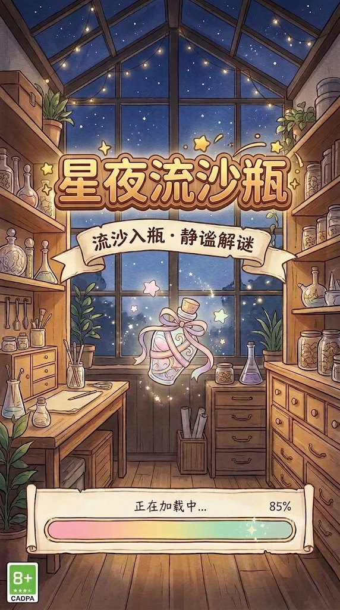

# 《星夜流沙瓶》美术资产清单与生图提示词手册

> [!IMPORTANT]
> 本手册由 `node tools/gen-art-doc.js` 根据 [`data/art/prompts.json`](../data/art/prompts.json) **自动生成，请勿手改**。新增或修改素材时只改 JSON，再重新生成手册；批量生图脚本也读取同一份 JSON，所以手册、校验和出图永远一致。

## 1. 画风一致性硬规范（所有素材强制执行）




| 项目 | 规范 |
| :--- | :--- |
| **局内实机基准** | [`docs/assets/gameplay_ref.jpg`](assets/gameplay_ref.jpg)：局内实机唯一基准图（星夜玻璃天窗背景、通透水晶沙箱、圆珠木拨片与木齿滤网、蜂蜜橡木工作台 4+1 圆杯托、4 条深胡桃木凹槽近大远小软木塞玻璃瓶队列、流萤星砂 S 曲线入瓶光束与暖奶油道具方卡）。生成或调优局内界面/沙盘元素时，把 docs/assets/gameplay_ref.jpg 上传到 ComfyUI input，文件名 style_anchor_gameplay.jpg |
| **图1·封面与角色基准** | [`docs/assets/cover.jpg`](assets/cover.jpg)：游戏启动加载页与世界观画风锚点图（星夜玻璃花房木作草药工坊、悬浮丝带许愿玻璃瓶、手绘钢笔水彩笔触与双描边木牌标题基准）。生图前把 docs/assets/cover.jpg 通过 POST /upload/image 上传到 ComfyUI input，文件名 style_anchor_cover.jpg，通过 `LoadImage` 接入 `TextEncodeQwenImage21` 的 `images.image_1`（resolution 768） |
| **线条** | 温润深胡桃褐（#3B2416）手绘钢笔轮廓线，边缘圆润扎实、笔触温暖自然；禁止生硬锯齿与荧光工业线条 |
| **上色** | 治愈绘本手绘水彩晕染 + 温润蜂蜜橡木纹与象牙羊皮纸肌理；水晶沙箱与药剂玻璃瓶保持清透折光质感 |
| **色调** | 星夜玻璃花房工坊色调：上方深邃午夜靛蓝星空天窗与暖金微星，下方温暖蜂蜜浅橡木桌面与深胡桃木凹槽，流沙与丝带为樱花粉、暖麦黄、晴空蓝、薄荷绿与星耀金沙 |
| **字体与全中文** | 内置开源手账楷体子集 StarryStorybook（霞鹜文楷 Medium 子集 assets/fonts/ui_storybook.ttf），配微倾手写序号（08、01—20、24.5s）；全界面严格纯中文呈现，零英文残留与零原生 Emoji |
| **沙箱与机关** | 主沙盘为立于星空天窗前的高透斜切漏斗水晶沙箱，底部嵌梯形浅橡木竖齿滤网；固定隔条为半透明磨砂石英条，可抽机关为带木圆球拉扣的温润圆木杆与翡翠胶囊染色环 |
| **接沙台与木凹槽** | 实木工作台上层设 4+1 圆形杯托承载敞口系丝带药剂玻璃瓶（流萤星砂 S 曲线光带钻入瓶口）；下层挖设 4 条上窄下宽 3D 深胡桃木凹槽，按『下近上远』透视陈列软木塞丝带瓶、雾面羊皮纸问号瓶与冰晶瓶 |
| **弹窗与底栏** | 桌下深棕暗影区居中排布 4 枚暖奶油圆角方卡道具钮；图鉴、选关与结算统一采用浅橡木画框嵌套象牙羊皮纸内衬与微拱卷边飘带 |
| **禁用词** | Q版潮玩、3D潮玩手办、PVC塑料光泽、24K电镀金属、镜面金属、碳纤维、塑料扭蛋、赛博霓虹、生硬黑框工业管道（同步写入负面提示词） |
| **抠图约束** | 图标、贴图、玻璃瓶、图鉴插画一律纯白 #FFFFFF 背景或精确 Alpha 泛洪去背，主体完整不裁切；经脚本量化为 8-bit PNG 入库 |
| **文字约束** | 除品牌木牌标题「星夜流沙瓶」外，所有背景底板与小图标贴图一律零文字、零数字，所有中文文案由 Canvas 使用 StarryStorybook 字体动态渲染 |
| **设计稿归档** | 5 张权威 UI 设计原稿归档于 docs/assets/ui_design/（splash / gameplay / guide_modal / level_drawer / victory_modal.webp） |
| **采样参数** | Qwen-Image-2.1 · euler / simple · 28 steps · CFG 4.0 · 种子按 assetId 固定（可复现） |

### 1.1 全局画风前缀（自动拼接在每条提示词最前面）

```text
【画风锁定：参照图1与图2的星夜玻璃花房木作工坊绘本水彩风】温暖治愈的手绘钢笔水彩插画：用温润深胡桃褐（#3B2416）钢笔细线勾勒圆润木作与器皿轮廓，水彩清透晕染叠加细腻冷压纸纹与柔和蜂蜜橡木木纹；深邃静谧的靛蓝星空玻璃天窗与室内暖金烛灯交相辉映，流沙与丝缎蝴蝶结为樱花粉、暖麦黄、晴空蓝、薄荷绿及闪烁星耀金沙；高光晶莹柔和，极具童话手账工坊温度。
```

### 1.2 全局负面提示词

```text
照片写实, 3D渲染, C4D, Q版潮玩手办, 3D潮玩手办, PVC塑料光泽, 24K电镀金属, 镜面金属, 碳纤维, 塑料扭蛋, 赛博霓虹, CG光滑渐变, 高对比硬阴影, 模糊, 低分辨率, 噪点, 水印, 签名, 乱码文字, 多余文字, 手机外壳, 设备边框, 截图边框
```

## 2. 素材总清单

共 **30** 项素材：

| 分组 | 数量 | 说明 |
| :--- | :---: | :--- |
| 背景 | 3 | 主局内星夜玻璃天窗无遮挡背景、弹窗后景星夜草药工坊暖光内景、启动加载页星夜花房悬浮许愿瓶 |
| 品牌 | 2 | 游戏立体木牌标题「星夜流沙瓶」、小游戏圆角主图标 |
| 局内元素 | 15 | 玻璃沙箱底部香槟金滤口、玻璃沙箱顶部晶莹厚唇口、浅枫木奶油横抽拨片、浅枫木圆环可抽斜导流片、若竹薄荷色往复推拉拨片、香槟丝线联动双环扣、极简糖果圆挂锁（代码着色）、图鉴插画：彩虹挂锁与十字联动木插销、清透薄荷蓝冰晶砖贴图、图鉴插画：雾面问号瓶与多棱冰晶瓶、水彩星环染色圈装置、图鉴插画：七彩染色环与星耀金沙堆、系丝带透明糖果玻璃瓶（代码着色）、图鉴插画：粉丝带软木塞瓶与木柄滤沙网勺、图鉴插画：高空坠落碎裂脆冰块 |
| 道具 | 4 | 道具图标：+加开玻璃瓶位、道具图标：珊瑚粉隔空吸沙磁铁、道具图标：海盐蓝圆润撤回箭头、顶栏图标：暖麦黄极简重玩圆弧 |
| 引导 | 1 | 日系轻绘引导小手 |
| 通用 | 5 | 极简磨砂奶油胶囊按钮底板、极简磨砂和纸圆角弹窗底板、极简四宫格选关图标、极简治愈音符小喇叭图标、适龄提示嫩叶圆角小盾牌 |

| # | assetId | 名称 | 类型 | 尺寸 | 透明底 | 输出路径 |
| :---: | :--- | :--- | :--- | :---: | :---: | :--- |
| 1 | `ui_bg_gameplay` | 主局内星夜玻璃天窗无遮挡背景 | 背景 | 768×1344 | — | `assets/ui/bg/ui_bg_gameplay.png` |
| 2 | `ui_bg_level_drawer` | 弹窗后景星夜草药工坊暖光内景 | 背景 | 768×1344 | — | `assets/ui/bg/ui_bg_level_drawer.png` |
| 3 | `ui_bg_splash` | 启动加载页星夜花房悬浮许愿瓶 | 背景 | 768×1344 | — | `assets/ui/bg/ui_bg_splash.png` |
| 4 | `ui_logo_title` | 游戏立体木牌标题「星夜流沙瓶」 | 图标 | 1024×1024 | ✅ | `assets/ui/brand/ui_logo_title.png` |
| 5 | `ui_app_icon` | 小游戏圆角主图标 | 图标 | 1024×1024 | — | `assets/ui/brand/ui_app_icon.png` |
| 6 | `ui_vessel_nozzle` | 玻璃沙箱底部香槟金滤口 | 局内贴图 | 1024×1024 | ✅ | `assets/ui/game/ui_vessel_nozzle.png` |
| 7 | `ui_vessel_rim` | 玻璃沙箱顶部晶莹厚唇口 | 局内贴图 | 1024×1024 | ✅ | `assets/ui/game/ui_vessel_rim.png` |
| 8 | `ui_board_wood` | 浅枫木奶油横抽拨片 | 局内贴图 | 1024×1024 | ✅ | `assets/ui/game/ui_board_wood.png` |
| 9 | `ui_board_slant` | 浅枫木圆环可抽斜导流片 | 局内贴图 | 1024×1024 | ✅ | `assets/ui/game/ui_board_slant.png` |
| 10 | `ui_board_push_gate` | 若竹薄荷色往复推拉拨片 | 局内贴图 | 1024×1024 | ✅ | `assets/ui/game/ui_board_push_gate.png` |
| 11 | `ui_linked_gear` | 香槟丝线联动双环扣 | 图标 | 1024×1024 | ✅ | `assets/ui/game/ui_linked_gear.png` |
| 12 | `ui_lock_badge` | 极简糖果圆挂锁（代码着色） | 图标 | 1024×1024 | ✅ | `assets/ui/game/ui_lock_badge.png` |
| 13 | `ui_lock_break_fx` | 图鉴插画：彩虹挂锁与十字联动木插销 | 图标 | 1024×1024 | ✅ | `assets/ui/game/ui_lock_break_fx.png` |
| 14 | `ui_ice_block` | 清透薄荷蓝冰晶砖贴图 | 局内贴图 | 1024×1024 | ✅ | `assets/ui/game/ui_ice_block.png` |
| 15 | `ui_ice_shatter_fx` | 图鉴插画：雾面问号瓶与多棱冰晶瓶 | 图标 | 1024×1024 | ✅ | `assets/ui/game/ui_ice_shatter_fx.png` |
| 16 | `ui_dye_ring` | 水彩星环染色圈装置 | 图标 | 1024×1024 | ✅ | `assets/ui/game/ui_dye_ring.png` |
| 17 | `ui_gold_sand_pile` | 图鉴插画：七彩染色环与星耀金沙堆 | 图标 | 1024×1024 | ✅ | `assets/ui/game/ui_gold_sand_pile.png` |
| 18 | `ui_bucket` | 系丝带透明糖果玻璃瓶（代码着色） | 图标 | 1024×1024 | ✅ | `assets/ui/game/ui_bucket.png` |
| 19 | `ui_bucket_full_fx` | 图鉴插画：粉丝带软木塞瓶与木柄滤沙网勺 | 图标 | 1024×1024 | ✅ | `assets/ui/game/ui_bucket_full_fx.png` |
| 20 | `ui_jam_warning` | 图鉴插画：高空坠落碎裂脆冰块 | 图标 | 1024×1024 | ✅ | `assets/ui/game/ui_jam_warning.png` |
| 21 | `ui_prop_extra_slot` | 道具图标：+加开玻璃瓶位 | 图标 | 1024×1024 | ✅ | `assets/ui/props/ui_prop_extra_slot.png` |
| 22 | `ui_prop_vacuum` | 道具图标：珊瑚粉隔空吸沙磁铁 | 图标 | 1024×1024 | ✅ | `assets/ui/props/ui_prop_vacuum.png` |
| 23 | `ui_prop_undo` | 道具图标：海盐蓝圆润撤回箭头 | 图标 | 1024×1024 | ✅ | `assets/ui/props/ui_prop_undo.png` |
| 24 | `ui_prop_restart` | 顶栏图标：暖麦黄极简重玩圆弧 | 图标 | 1024×1024 | ✅ | `assets/ui/props/ui_prop_restart.png` |
| 25 | `ui_ftue_hand` | 日系轻绘引导小手 | 图标 | 1024×1024 | ✅ | `assets/ui/common/ui_ftue_hand.png` |
| 26 | `ui_btn_wood` | 极简磨砂奶油胶囊按钮底板 | 图标 | 1024×1024 | ✅ | `assets/ui/common/ui_btn_wood.png` |
| 27 | `ui_panel_parchment` | 极简磨砂和纸圆角弹窗底板 | 图标 | 1024×1024 | ✅ | `assets/ui/common/ui_panel_parchment.png` |
| 28 | `ui_icon_settings_gear` | 极简四宫格选关图标 | 图标 | 1024×1024 | ✅ | `assets/ui/common/ui_icon_settings_gear.png` |
| 29 | `ui_icon_sound_horn` | 极简治愈音符小喇叭图标 | 图标 | 1024×1024 | ✅ | `assets/ui/common/ui_icon_sound_horn.png` |
| 30 | `ui_badge_cadpa_frame` | 适龄提示嫩叶圆角小盾牌 | 图标 | 1024×1024 | ✅ | `assets/ui/common/ui_badge_cadpa_frame.png` |

## 3. 逐项完整提示词

> 每条“完整正向提示词”= 全局画风前缀 + 品类模板 + 主体描述，可直接复制到 ComfyUI 的 `TextEncodeQwenImage21.prompt`；负面提示词填入 `negative_prompt`。

### 背景

#### 1. 主局内星夜玻璃天窗无遮挡背景 · `ui_bg_gameplay`

- **尺寸**：768×1344　**种子**：2145824740　**透明底**：否　**输出**：`assets/ui/bg/ui_bg_gameplay.png`
- **主体描述**：星夜玻璃花房仰视高窗夜景：整幅画面是一扇对称深木框哥特圆拱玻璃花房天窗，窗外是静谧深邃的午夜靛蓝星空与点点细碎暖白繁星，画面中央与下方完全干净无任何家具杂物遮挡，专供上层渲染通透水晶流沙箱与下层实木工作台

```text
【画风锁定：参照图1与图2的星夜玻璃花房木作工坊绘本水彩风】温暖治愈的手绘钢笔水彩插画：用温润深胡桃褐（#3B2416）钢笔细线勾勒圆润木作与器皿轮廓，水彩清透晕染叠加细腻冷压纸纹与柔和蜂蜜橡木木纹；深邃静谧的靛蓝星空玻璃天窗与室内暖金烛灯交相辉映，流沙与丝缎蝴蝶结为樱花粉、暖麦黄、晴空蓝、薄荷绿及闪烁星耀金沙；高光晶莹柔和，极具童话手账工坊温度。
竖屏手机游戏治愈绘本背景插画（9:16），星夜玻璃花房草药流沙工坊氛围：星夜玻璃花房仰视高窗夜景：整幅画面是一扇对称深木框哥特圆拱玻璃花房天窗，窗外是静谧深邃的午夜靛蓝星空与点点细碎暖白繁星，画面中央与下方完全干净无任何家具杂物遮挡，专供上层渲染通透水晶流沙箱与下层实木工作台。画面干净通透，不包含任何UI按钮、文字、数字、对话框，纯背景插画直出，无手机外壳与设备边框。
```

#### 2. 弹窗后景星夜草药工坊暖光内景 · `ui_bg_level_drawer`

- **尺寸**：768×1344　**种子**：1614184698　**透明底**：否　**输出**：`assets/ui/bg/ui_bg_level_drawer.png`
- **主体描述**：温馨静谧的星夜木作草药玻璃工坊全景底图：上方斜顶玻璃天窗透出弯月与深蓝繁星，两侧木质博古架摆放透明药剂空瓶与垂挂干花草束，两侧书桌亮着柔和暖黄复古小提灯，木地板温润柔和，正中央柔和虚化留空以衬托前景羊皮纸木框弹窗

```text
【画风锁定：参照图1与图2的星夜玻璃花房木作工坊绘本水彩风】温暖治愈的手绘钢笔水彩插画：用温润深胡桃褐（#3B2416）钢笔细线勾勒圆润木作与器皿轮廓，水彩清透晕染叠加细腻冷压纸纹与柔和蜂蜜橡木木纹；深邃静谧的靛蓝星空玻璃天窗与室内暖金烛灯交相辉映，流沙与丝缎蝴蝶结为樱花粉、暖麦黄、晴空蓝、薄荷绿及闪烁星耀金沙；高光晶莹柔和，极具童话手账工坊温度。
竖屏手机游戏治愈绘本背景插画（9:16），星夜玻璃花房草药流沙工坊氛围：温馨静谧的星夜木作草药玻璃工坊全景底图：上方斜顶玻璃天窗透出弯月与深蓝繁星，两侧木质博古架摆放透明药剂空瓶与垂挂干花草束，两侧书桌亮着柔和暖黄复古小提灯，木地板温润柔和，正中央柔和虚化留空以衬托前景羊皮纸木框弹窗。画面干净通透，不包含任何UI按钮、文字、数字、对话框，纯背景插画直出，无手机外壳与设备边框。
```

#### 3. 启动加载页星夜花房悬浮许愿瓶 · `ui_bg_splash`

- **尺寸**：768×1344　**种子**：1263023937　**透明底**：否　**输出**：`assets/ui/bg/ui_bg_splash.png`
- **主体描述**：星夜玻璃花房工坊纵深主视觉插画：高耸的木框玻璃温室屋顶挂满暖金串灯，窗外繁星闪烁，左右两侧是摆满空玻璃烧瓶、画笔筒与抽屉柜的温暖木工作台；画面正中央夜空窗前悬浮着一只塞着软木塞、缠绕米白粉色双丝带蝴蝶结的晶莹许愿流沙玻璃瓶，四周环绕柔和星芒与金色星尘微粒；上方窗格与下方木地板干净无字

```text
【画风锁定：参照图1与图2的星夜玻璃花房木作工坊绘本水彩风】温暖治愈的手绘钢笔水彩插画：用温润深胡桃褐（#3B2416）钢笔细线勾勒圆润木作与器皿轮廓，水彩清透晕染叠加细腻冷压纸纹与柔和蜂蜜橡木木纹；深邃静谧的靛蓝星空玻璃天窗与室内暖金烛灯交相辉映，流沙与丝缎蝴蝶结为樱花粉、暖麦黄、晴空蓝、薄荷绿及闪烁星耀金沙；高光晶莹柔和，极具童话手账工坊温度。
竖屏手机游戏治愈绘本背景插画（9:16），星夜玻璃花房草药流沙工坊氛围：星夜玻璃花房工坊纵深主视觉插画：高耸的木框玻璃温室屋顶挂满暖金串灯，窗外繁星闪烁，左右两侧是摆满空玻璃烧瓶、画笔筒与抽屉柜的温暖木工作台；画面正中央夜空窗前悬浮着一只塞着软木塞、缠绕米白粉色双丝带蝴蝶结的晶莹许愿流沙玻璃瓶，四周环绕柔和星芒与金色星尘微粒；上方窗格与下方木地板干净无字。画面干净通透，不包含任何UI按钮、文字、数字、对话框，纯背景插画直出，无手机外壳与设备边框。
```

### 品牌

#### 4. 游戏立体木牌标题「星夜流沙瓶」 · `ui_logo_title`

- **尺寸**：1024×1024　**种子**：1769300094　**透明底**：是（纯白底出图后抠图）　**输出**：`assets/ui/brand/ui_logo_title.png`
- **主体描述**：横版治愈绘本立体木牌手绘艺术字，内容准确为五个中文字「星夜流沙瓶」：饱满圆润的手写楷体金杏色渐变字面，外裹胡桃深棕立体双层木牌底座与高光描边，标题上方跳跃着三颗暖金小五角星与流星弧线，仅限「星夜流沙瓶」五字

```text
【画风锁定：参照图1与图2的星夜玻璃花房木作工坊绘本水彩风】温暖治愈的手绘钢笔水彩插画：用温润深胡桃褐（#3B2416）钢笔细线勾勒圆润木作与器皿轮廓，水彩清透晕染叠加细腻冷压纸纹与柔和蜂蜜橡木木纹；深邃静谧的靛蓝星空玻璃天窗与室内暖金烛灯交相辉映，流沙与丝缎蝴蝶结为樱花粉、暖麦黄、晴空蓝、薄荷绿及闪烁星耀金沙；高光晶莹柔和，极具童话手账工坊温度。
治愈绘本手绘水彩游戏UI图标素材：横版治愈绘本立体木牌手绘艺术字，内容准确为五个中文字「星夜流沙瓶」：饱满圆润的手写楷体金杏色渐变字面，外裹胡桃深棕立体双层木牌底座与高光描边，标题上方跳跃着三颗暖金小五角星与流星弧线，仅限「星夜流沙瓶」五字。主体居中约占画面72%，深胡桃褐细钢笔线+清透水彩上色，轮廓圆润清晰。背景：纯白色#FFFFFF，无地面大阴影、无任何文字。
```

#### 5. 小游戏圆角主图标 · `ui_app_icon`

- **尺寸**：1024×1024　**种子**：1430621472　**透明底**：否　**输出**：`assets/ui/brand/ui_app_icon.png`
- **主体描述**：正方形小游戏主图标：深邃星夜玻璃花房暖光散景底色，正中央悬浮一只塞着软木塞、瓶颈系饱满樱花粉丝缎双飘带蝴蝶结的晶莹药剂许愿瓶，瓶腹盛着分层的粉、黄、蓝、绿彩沙与闪烁星砂，周围环绕暖白四角星芒，无任何文字

```text
【画风锁定：参照图1与图2的星夜玻璃花房木作工坊绘本水彩风】温暖治愈的手绘钢笔水彩插画：用温润深胡桃褐（#3B2416）钢笔细线勾勒圆润木作与器皿轮廓，水彩清透晕染叠加细腻冷压纸纹与柔和蜂蜜橡木木纹；深邃静谧的靛蓝星空玻璃天窗与室内暖金烛灯交相辉映，流沙与丝缎蝴蝶结为樱花粉、暖麦黄、晴空蓝、薄荷绿及闪烁星耀金沙；高光晶莹柔和，极具童话手账工坊温度。
治愈绘本手绘水彩游戏UI图标素材：正方形小游戏主图标：深邃星夜玻璃花房暖光散景底色，正中央悬浮一只塞着软木塞、瓶颈系饱满樱花粉丝缎双飘带蝴蝶结的晶莹药剂许愿瓶，瓶腹盛着分层的粉、黄、蓝、绿彩沙与闪烁星砂，周围环绕暖白四角星芒，无任何文字。主体居中约占画面72%，深胡桃褐细钢笔线+清透水彩上色，轮廓圆润清晰。背景：纯白色#FFFFFF，无地面大阴影、无任何文字。
```

### 局内元素

#### 6. 玻璃沙箱底部香槟金滤口 · `ui_vessel_nozzle`

- **尺寸**：1024×1024　**种子**：1061669966　**透明底**：是（纯白底出图后抠图）　**输出**：`assets/ui/game/ui_vessel_nozzle.png`
- **主体描述**：圆润通透的玻璃漏斗底口衔接一枚极简香槟珍珠金多孔滤沙细格栅条，表面温润细腻无铆钉，高透玻璃唇边带清澈白色折光弧，正面平视左右对称

```text
【画风锁定：参照图1与图2的星夜玻璃花房木作工坊绘本水彩风】温暖治愈的手绘钢笔水彩插画：用温润深胡桃褐（#3B2416）钢笔细线勾勒圆润木作与器皿轮廓，水彩清透晕染叠加细腻冷压纸纹与柔和蜂蜜橡木木纹；深邃静谧的靛蓝星空玻璃天窗与室内暖金烛灯交相辉映，流沙与丝缎蝴蝶结为樱花粉、暖麦黄、晴空蓝、薄荷绿及闪烁星耀金沙；高光晶莹柔和，极具童话手账工坊温度。
治愈绘本游戏局内组件贴图：圆润通透的玻璃漏斗底口衔接一枚极简香槟珍珠金多孔滤沙细格栅条，表面温润细腻无铆钉，高透玻璃唇边带清澈白色折光弧，正面平视左右对称。正交平视，主体居中完整、边缘干净，深胡桃褐钢笔线+温润水彩木作或水晶材质表现。背景：纯白色#FFFFFF，无投影、无任何文字。
```

#### 7. 玻璃沙箱顶部晶莹厚唇口 · `ui_vessel_rim`

- **尺寸**：1024×1024　**种子**：1171087390　**透明底**：是（纯白底出图后抠图）　**输出**：`assets/ui/game/ui_vessel_rim.png`
- **主体描述**：横向细长的半透明磨砂水晶玻璃瓶口翻唇条，两端圆润收口，表面有一道清透纯白玻璃高光长弧，宽高比约8:1，左右对称

```text
【画风锁定：参照图1与图2的星夜玻璃花房木作工坊绘本水彩风】温暖治愈的手绘钢笔水彩插画：用温润深胡桃褐（#3B2416）钢笔细线勾勒圆润木作与器皿轮廓，水彩清透晕染叠加细腻冷压纸纹与柔和蜂蜜橡木木纹；深邃静谧的靛蓝星空玻璃天窗与室内暖金烛灯交相辉映，流沙与丝缎蝴蝶结为樱花粉、暖麦黄、晴空蓝、薄荷绿及闪烁星耀金沙；高光晶莹柔和，极具童话手账工坊温度。
治愈绘本游戏局内组件贴图：横向细长的半透明磨砂水晶玻璃瓶口翻唇条，两端圆润收口，表面有一道清透纯白玻璃高光长弧，宽高比约8:1，左右对称。正交平视，主体居中完整、边缘干净，深胡桃褐钢笔线+温润水彩木作或水晶材质表现。背景：纯白色#FFFFFF，无投影、无任何文字。
```

#### 8. 浅枫木奶油横抽拨片 · `ui_board_wood`

- **尺寸**：1024×1024　**种子**：1813162068　**透明底**：是（纯白底出图后抠图）　**输出**：`assets/ui/game/ui_board_wood.png`
- **主体描述**：一枚横向修长圆润的日系浅枫木奶油色抽拉拨片，宽高比约10:1，木质纹理极淡雅温润，右端连接一颗极简奶白色陶瓷小圆球拉扣，拨片与圆扣上完全不挂任何木牌或文字

```text
【画风锁定：参照图1与图2的星夜玻璃花房木作工坊绘本水彩风】温暖治愈的手绘钢笔水彩插画：用温润深胡桃褐（#3B2416）钢笔细线勾勒圆润木作与器皿轮廓，水彩清透晕染叠加细腻冷压纸纹与柔和蜂蜜橡木木纹；深邃静谧的靛蓝星空玻璃天窗与室内暖金烛灯交相辉映，流沙与丝缎蝴蝶结为樱花粉、暖麦黄、晴空蓝、薄荷绿及闪烁星耀金沙；高光晶莹柔和，极具童话手账工坊温度。
治愈绘本游戏局内组件贴图：一枚横向修长圆润的日系浅枫木奶油色抽拉拨片，宽高比约10:1，木质纹理极淡雅温润，右端连接一颗极简奶白色陶瓷小圆球拉扣，拨片与圆扣上完全不挂任何木牌或文字。正交平视，主体居中完整、边缘干净，深胡桃褐钢笔线+温润水彩木作或水晶材质表现。背景：纯白色#FFFFFF，无投影、无任何文字。
```

#### 9. 浅枫木圆环可抽斜导流片 · `ui_board_slant`

- **尺寸**：1024×1024　**种子**：280339762　**透明底**：是（纯白底出图后抠图）　**输出**：`assets/ui/game/ui_board_slant.png`
- **主体描述**：一枚表面光滑细腻的浅奶油枫木细长导流拨片，无笨重金属包角，仅在顶端嵌有一枚精致小巧的象牙白圆环拉扣，正面平放，宽高比约10:1

```text
【画风锁定：参照图1与图2的星夜玻璃花房木作工坊绘本水彩风】温暖治愈的手绘钢笔水彩插画：用温润深胡桃褐（#3B2416）钢笔细线勾勒圆润木作与器皿轮廓，水彩清透晕染叠加细腻冷压纸纹与柔和蜂蜜橡木木纹；深邃静谧的靛蓝星空玻璃天窗与室内暖金烛灯交相辉映，流沙与丝缎蝴蝶结为樱花粉、暖麦黄、晴空蓝、薄荷绿及闪烁星耀金沙；高光晶莹柔和，极具童话手账工坊温度。
治愈绘本游戏局内组件贴图：一枚表面光滑细腻的浅奶油枫木细长导流拨片，无笨重金属包角，仅在顶端嵌有一枚精致小巧的象牙白圆环拉扣，正面平放，宽高比约10:1。正交平视，主体居中完整、边缘干净，深胡桃褐钢笔线+温润水彩木作或水晶材质表现。背景：纯白色#FFFFFF，无投影、无任何文字。
```

#### 10. 若竹薄荷色往复推拉拨片 · `ui_board_push_gate`

- **尺寸**：1024×1024　**种子**：1247649768　**透明底**：是（纯白底出图后抠图）　**输出**：`assets/ui/game/ui_board_push_gate.png`
- **主体描述**：一枚横向清新的淡薄荷鼠尾草绿磨砂活动滑片，右端带一颗圆润奶白玉石推拉圆珠，滑片表面仅饰两道极简浅白细刻线，无弹簧铆钉无文字，宽高比约7:1

```text
【画风锁定：参照图1与图2的星夜玻璃花房木作工坊绘本水彩风】温暖治愈的手绘钢笔水彩插画：用温润深胡桃褐（#3B2416）钢笔细线勾勒圆润木作与器皿轮廓，水彩清透晕染叠加细腻冷压纸纹与柔和蜂蜜橡木木纹；深邃静谧的靛蓝星空玻璃天窗与室内暖金烛灯交相辉映，流沙与丝缎蝴蝶结为樱花粉、暖麦黄、晴空蓝、薄荷绿及闪烁星耀金沙；高光晶莹柔和，极具童话手账工坊温度。
治愈绘本游戏局内组件贴图：一枚横向清新的淡薄荷鼠尾草绿磨砂活动滑片，右端带一颗圆润奶白玉石推拉圆珠，滑片表面仅饰两道极简浅白细刻线，无弹簧铆钉无文字，宽高比约7:1。正交平视，主体居中完整、边缘干净，深胡桃褐钢笔线+温润水彩木作或水晶材质表现。背景：纯白色#FFFFFF，无投影、无任何文字。
```

#### 11. 香槟丝线联动双环扣 · `ui_linked_gear`

- **尺寸**：1024×1024　**种子**：913681264　**透明底**：是（纯白底出图后抠图）　**输出**：`assets/ui/game/ui_linked_gear.png`
- **主体描述**：一枚小巧精致的香槟金与珍珠白同心圆环绳扣，环上轻绕一圈纤细的暖米色丝线结，中心一颗温润圆珠，表达两枚拨片轻柔同步联动

```text
【画风锁定：参照图1与图2的星夜玻璃花房木作工坊绘本水彩风】温暖治愈的手绘钢笔水彩插画：用温润深胡桃褐（#3B2416）钢笔细线勾勒圆润木作与器皿轮廓，水彩清透晕染叠加细腻冷压纸纹与柔和蜂蜜橡木木纹；深邃静谧的靛蓝星空玻璃天窗与室内暖金烛灯交相辉映，流沙与丝缎蝴蝶结为樱花粉、暖麦黄、晴空蓝、薄荷绿及闪烁星耀金沙；高光晶莹柔和，极具童话手账工坊温度。
治愈绘本手绘水彩游戏UI图标素材：一枚小巧精致的香槟金与珍珠白同心圆环绳扣，环上轻绕一圈纤细的暖米色丝线结，中心一颗温润圆珠，表达两枚拨片轻柔同步联动。主体居中约占画面72%，深胡桃褐细钢笔线+清透水彩上色，轮廓圆润清晰。背景：纯白色#FFFFFF，无地面大阴影、无任何文字。
```

#### 12. 极简糖果圆挂锁（代码着色） · `ui_lock_badge`

- **尺寸**：1024×1024　**种子**：1342885424　**透明底**：是（纯白底出图后抠图）　**输出**：`assets/ui/game/ui_lock_badge.png`
- **主体描述**：一把圆润迷你的日系陶瓷质感小挂锁，锁身为纯洁奶白色（供程序叠染成对应沙色），锁梁为柔和香槟浅金色细弯弧，锁面正中嵌一颗小小的水滴形凹点

```text
【画风锁定：参照图1与图2的星夜玻璃花房木作工坊绘本水彩风】温暖治愈的手绘钢笔水彩插画：用温润深胡桃褐（#3B2416）钢笔细线勾勒圆润木作与器皿轮廓，水彩清透晕染叠加细腻冷压纸纹与柔和蜂蜜橡木木纹；深邃静谧的靛蓝星空玻璃天窗与室内暖金烛灯交相辉映，流沙与丝缎蝴蝶结为樱花粉、暖麦黄、晴空蓝、薄荷绿及闪烁星耀金沙；高光晶莹柔和，极具童话手账工坊温度。
治愈绘本手绘水彩游戏UI图标素材：一把圆润迷你的日系陶瓷质感小挂锁，锁身为纯洁奶白色（供程序叠染成对应沙色），锁梁为柔和香槟浅金色细弯弧，锁面正中嵌一颗小小的水滴形凹点。主体居中约占画面72%，深胡桃褐细钢笔线+清透水彩上色，轮廓圆润清晰。背景：纯白色#FFFFFF，无地面大阴影、无任何文字。
```

#### 13. 图鉴插画：彩虹挂锁与十字联动木插销 · `ui_lock_break_fx`

- **尺寸**：1024×1024　**种子**：1942960521　**透明底**：是（纯白底出图后抠图）　**输出**：`assets/ui/game/ui_lock_break_fx.png`
- **主体描述**：图鉴组合水彩插画：左侧是一把彩虹渐变锁身的圆润手绘挂锁（正中带锁孔），右侧并列一枚带圆球木柄的十字交叉联动浅橡木插销木轴，造型清晰易懂

```text
【画风锁定：参照图1与图2的星夜玻璃花房木作工坊绘本水彩风】温暖治愈的手绘钢笔水彩插画：用温润深胡桃褐（#3B2416）钢笔细线勾勒圆润木作与器皿轮廓，水彩清透晕染叠加细腻冷压纸纹与柔和蜂蜜橡木木纹；深邃静谧的靛蓝星空玻璃天窗与室内暖金烛灯交相辉映，流沙与丝缎蝴蝶结为樱花粉、暖麦黄、晴空蓝、薄荷绿及闪烁星耀金沙；高光晶莹柔和，极具童话手账工坊温度。
治愈绘本手绘水彩游戏UI图标素材：图鉴组合水彩插画：左侧是一把彩虹渐变锁身的圆润手绘挂锁（正中带锁孔），右侧并列一枚带圆球木柄的十字交叉联动浅橡木插销木轴，造型清晰易懂。主体居中约占画面72%，深胡桃褐细钢笔线+清透水彩上色，轮廓圆润清晰。背景：纯白色#FFFFFF，无地面大阴影、无任何文字。
```

#### 14. 清透薄荷蓝冰晶砖贴图 · `ui_ice_block`

- **尺寸**：1024×1024　**种子**：694657804　**透明底**：是（纯白底出图后抠图）　**输出**：`assets/ui/game/ui_ice_block.png`
- **主体描述**：一块圆角长方体高透淡冰蓝色水晶冰块，内部封存细密晶莹微气泡与柔白星霜，表面有干净清澈的几何折光切面亮纹，无粗重黑裂纹

```text
【画风锁定：参照图1与图2的星夜玻璃花房木作工坊绘本水彩风】温暖治愈的手绘钢笔水彩插画：用温润深胡桃褐（#3B2416）钢笔细线勾勒圆润木作与器皿轮廓，水彩清透晕染叠加细腻冷压纸纹与柔和蜂蜜橡木木纹；深邃静谧的靛蓝星空玻璃天窗与室内暖金烛灯交相辉映，流沙与丝缎蝴蝶结为樱花粉、暖麦黄、晴空蓝、薄荷绿及闪烁星耀金沙；高光晶莹柔和，极具童话手账工坊温度。
治愈绘本游戏局内组件贴图：一块圆角长方体高透淡冰蓝色水晶冰块，内部封存细密晶莹微气泡与柔白星霜，表面有干净清澈的几何折光切面亮纹，无粗重黑裂纹。正交平视，主体居中完整、边缘干净，深胡桃褐钢笔线+温润水彩木作或水晶材质表现。背景：纯白色#FFFFFF，无投影、无任何文字。
```

#### 15. 图鉴插画：雾面问号瓶与多棱冰晶瓶 · `ui_ice_shatter_fx`

- **尺寸**：1024×1024　**种子**：329756508　**透明底**：是（纯白底出图后抠图）　**输出**：`assets/ui/game/ui_ice_shatter_fx.png`
- **主体描述**：图鉴双瓶并列水彩插画：左侧是一只塞着软木塞、瓶腹印深褐问号的雾面灰白磨砂玻璃瓶，右侧是一只多切面折光的淡天蓝透明冰晶药剂瓶

```text
【画风锁定：参照图1与图2的星夜玻璃花房木作工坊绘本水彩风】温暖治愈的手绘钢笔水彩插画：用温润深胡桃褐（#3B2416）钢笔细线勾勒圆润木作与器皿轮廓，水彩清透晕染叠加细腻冷压纸纹与柔和蜂蜜橡木木纹；深邃静谧的靛蓝星空玻璃天窗与室内暖金烛灯交相辉映，流沙与丝缎蝴蝶结为樱花粉、暖麦黄、晴空蓝、薄荷绿及闪烁星耀金沙；高光晶莹柔和，极具童话手账工坊温度。
治愈绘本手绘水彩游戏UI图标素材：图鉴双瓶并列水彩插画：左侧是一只塞着软木塞、瓶腹印深褐问号的雾面灰白磨砂玻璃瓶，右侧是一只多切面折光的淡天蓝透明冰晶药剂瓶。主体居中约占画面72%，深胡桃褐细钢笔线+清透水彩上色，轮廓圆润清晰。背景：纯白色#FFFFFF，无地面大阴影、无任何文字。
```

#### 16. 水彩星环染色圈装置 · `ui_dye_ring`

- **尺寸**：1024×1024　**种子**：848605557　**透明底**：是（纯白底出图后抠图）　**输出**：`assets/ui/game/ui_dye_ring.png`
- **主体描述**：一枚横向扁椭圆的通透玻璃水彩染色光环：外圈为纤细珍珠白玻璃环，内圈流淌着一圈柔白旋转水彩星雾（供程序动态着粉/黄/蓝/绿色），两端各点缀一颗小星珠

```text
【画风锁定：参照图1与图2的星夜玻璃花房木作工坊绘本水彩风】温暖治愈的手绘钢笔水彩插画：用温润深胡桃褐（#3B2416）钢笔细线勾勒圆润木作与器皿轮廓，水彩清透晕染叠加细腻冷压纸纹与柔和蜂蜜橡木木纹；深邃静谧的靛蓝星空玻璃天窗与室内暖金烛灯交相辉映，流沙与丝缎蝴蝶结为樱花粉、暖麦黄、晴空蓝、薄荷绿及闪烁星耀金沙；高光晶莹柔和，极具童话手账工坊温度。
治愈绘本手绘水彩游戏UI图标素材：一枚横向扁椭圆的通透玻璃水彩染色光环：外圈为纤细珍珠白玻璃环，内圈流淌着一圈柔白旋转水彩星雾（供程序动态着粉/黄/蓝/绿色），两端各点缀一颗小星珠。主体居中约占画面72%，深胡桃褐细钢笔线+清透水彩上色，轮廓圆润清晰。背景：纯白色#FFFFFF，无地面大阴影、无任何文字。
```

#### 17. 图鉴插画：七彩染色环与星耀金沙堆 · `ui_gold_sand_pile`

- **尺寸**：1024×1024　**种子**：785334481　**透明底**：是（纯白底出图后抠图）　**输出**：`assets/ui/game/ui_gold_sand_pile.png`
- **主体描述**：图鉴组合水彩插画：左上方是一枚粉黄绿蓝渐变圆环染色圈，右下方堆着一捧蓬松闪烁四角金星的暖金色星砂小沙丘

```text
【画风锁定：参照图1与图2的星夜玻璃花房木作工坊绘本水彩风】温暖治愈的手绘钢笔水彩插画：用温润深胡桃褐（#3B2416）钢笔细线勾勒圆润木作与器皿轮廓，水彩清透晕染叠加细腻冷压纸纹与柔和蜂蜜橡木木纹；深邃静谧的靛蓝星空玻璃天窗与室内暖金烛灯交相辉映，流沙与丝缎蝴蝶结为樱花粉、暖麦黄、晴空蓝、薄荷绿及闪烁星耀金沙；高光晶莹柔和，极具童话手账工坊温度。
治愈绘本手绘水彩游戏UI图标素材：图鉴组合水彩插画：左上方是一枚粉黄绿蓝渐变圆环染色圈，右下方堆着一捧蓬松闪烁四角金星的暖金色星砂小沙丘。主体居中约占画面72%，深胡桃褐细钢笔线+清透水彩上色，轮廓圆润清晰。背景：纯白色#FFFFFF，无地面大阴影、无任何文字。
```

#### 18. 系丝带透明糖果玻璃瓶（代码着色） · `ui_bucket`

- **尺寸**：1024×1024　**种子**：1612948848　**透明底**：是（纯白底出图后抠图）　**输出**：`assets/ui/game/ui_bucket.png`
- **主体描述**：一只圆胖晶莹的日系透明糖果许愿玻璃小瓶：外翻圆润厚玻璃瓶口，纤巧收束的瓶颈上系着一枚饱满的纯白色丝缎蝴蝶结双飘带（供程序染成粉/黄/蓝/绿对应沙色），鼓鼓的透明圆球玻璃瓶腹带清澈月牙白反光弧，无任何纸贴标签

```text
【画风锁定：参照图1与图2的星夜玻璃花房木作工坊绘本水彩风】温暖治愈的手绘钢笔水彩插画：用温润深胡桃褐（#3B2416）钢笔细线勾勒圆润木作与器皿轮廓，水彩清透晕染叠加细腻冷压纸纹与柔和蜂蜜橡木木纹；深邃静谧的靛蓝星空玻璃天窗与室内暖金烛灯交相辉映，流沙与丝缎蝴蝶结为樱花粉、暖麦黄、晴空蓝、薄荷绿及闪烁星耀金沙；高光晶莹柔和，极具童话手账工坊温度。
治愈绘本手绘水彩游戏UI图标素材：一只圆胖晶莹的日系透明糖果许愿玻璃小瓶：外翻圆润厚玻璃瓶口，纤巧收束的瓶颈上系着一枚饱满的纯白色丝缎蝴蝶结双飘带（供程序染成粉/黄/蓝/绿对应沙色），鼓鼓的透明圆球玻璃瓶腹带清澈月牙白反光弧，无任何纸贴标签。主体居中约占画面72%，深胡桃褐细钢笔线+清透水彩上色，轮廓圆润清晰。背景：纯白色#FFFFFF，无地面大阴影、无任何文字。
```

#### 19. 图鉴插画：粉丝带软木塞瓶与木柄滤沙网勺 · `ui_bucket_full_fx`

- **尺寸**：1024×1024　**种子**：1033308206　**透明底**：是（纯白底出图后抠图）　**输出**：`assets/ui/game/ui_bucket_full_fx.png`
- **主体描述**：图鉴组合水彩插画：左侧是一只塞着软木塞、系樱花粉蝴蝶结双飘带的透明许愿玻璃瓶，右下角斜放一把盛着细白流沙粒的浅木柄圆滤网小勺

```text
【画风锁定：参照图1与图2的星夜玻璃花房木作工坊绘本水彩风】温暖治愈的手绘钢笔水彩插画：用温润深胡桃褐（#3B2416）钢笔细线勾勒圆润木作与器皿轮廓，水彩清透晕染叠加细腻冷压纸纹与柔和蜂蜜橡木木纹；深邃静谧的靛蓝星空玻璃天窗与室内暖金烛灯交相辉映，流沙与丝缎蝴蝶结为樱花粉、暖麦黄、晴空蓝、薄荷绿及闪烁星耀金沙；高光晶莹柔和，极具童话手账工坊温度。
治愈绘本手绘水彩游戏UI图标素材：图鉴组合水彩插画：左侧是一只塞着软木塞、系樱花粉蝴蝶结双飘带的透明许愿玻璃瓶，右下角斜放一把盛着细白流沙粒的浅木柄圆滤网小勺。主体居中约占画面72%，深胡桃褐细钢笔线+清透水彩上色，轮廓圆润清晰。背景：纯白色#FFFFFF，无地面大阴影、无任何文字。
```

#### 20. 图鉴插画：高空坠落碎裂脆冰块 · `ui_jam_warning`

- **尺寸**：1024×1024　**种子**：627542012　**透明底**：是（纯白底出图后抠图）　**输出**：`assets/ui/game/ui_jam_warning.png`
- **主体描述**：图鉴动态水彩插画：两块清透淡蓝方块脆冰带竖直速度线自高处急坠而下，撞击底部绽开碎冰晶粒与浅蓝水花涟漪

```text
【画风锁定：参照图1与图2的星夜玻璃花房木作工坊绘本水彩风】温暖治愈的手绘钢笔水彩插画：用温润深胡桃褐（#3B2416）钢笔细线勾勒圆润木作与器皿轮廓，水彩清透晕染叠加细腻冷压纸纹与柔和蜂蜜橡木木纹；深邃静谧的靛蓝星空玻璃天窗与室内暖金烛灯交相辉映，流沙与丝缎蝴蝶结为樱花粉、暖麦黄、晴空蓝、薄荷绿及闪烁星耀金沙；高光晶莹柔和，极具童话手账工坊温度。
治愈绘本手绘水彩游戏UI图标素材：图鉴动态水彩插画：两块清透淡蓝方块脆冰带竖直速度线自高处急坠而下，撞击底部绽开碎冰晶粒与浅蓝水花涟漪。主体居中约占画面72%，深胡桃褐细钢笔线+清透水彩上色，轮廓圆润清晰。背景：纯白色#FFFFFF，无地面大阴影、无任何文字。
```

### 道具

#### 21. 道具图标：+加开玻璃瓶位 · `ui_prop_extra_slot`

- **尺寸**：1024×1024　**种子**：1796048567　**透明底**：是（纯白底出图后抠图）　**输出**：`assets/ui/props/ui_prop_extra_slot.png`
- **主体描述**：一只圆润通透的迷你糖果玻璃瓶，瓶颈系着柔和樱花粉丝缎蝴蝶结，瓶身右下角贴着一枚清新的若竹薄荷绿圆形加号小徽章，极简无文字

```text
【画风锁定：参照图1与图2的星夜玻璃花房木作工坊绘本水彩风】温暖治愈的手绘钢笔水彩插画：用温润深胡桃褐（#3B2416）钢笔细线勾勒圆润木作与器皿轮廓，水彩清透晕染叠加细腻冷压纸纹与柔和蜂蜜橡木木纹；深邃静谧的靛蓝星空玻璃天窗与室内暖金烛灯交相辉映，流沙与丝缎蝴蝶结为樱花粉、暖麦黄、晴空蓝、薄荷绿及闪烁星耀金沙；高光晶莹柔和，极具童话手账工坊温度。
治愈绘本手绘水彩游戏UI图标素材：一只圆润通透的迷你糖果玻璃瓶，瓶颈系着柔和樱花粉丝缎蝴蝶结，瓶身右下角贴着一枚清新的若竹薄荷绿圆形加号小徽章，极简无文字。主体居中约占画面72%，深胡桃褐细钢笔线+清透水彩上色，轮廓圆润清晰。背景：纯白色#FFFFFF，无地面大阴影、无任何文字。
```

#### 22. 道具图标：珊瑚粉隔空吸沙磁铁 · `ui_prop_vacuum`

- **尺寸**：1024×1024　**种子**：821305734　**透明底**：是（纯白底出图后抠图）　**输出**：`assets/ui/props/ui_prop_vacuum.png`
- **主体描述**：一枚圆润可爱的樱花珊瑚粉U形小磁铁，双极端头为温润奶白色瓷帽，磁极前方轻柔吸引着三颗粉、蓝、黄彩色流沙星粒

```text
【画风锁定：参照图1与图2的星夜玻璃花房木作工坊绘本水彩风】温暖治愈的手绘钢笔水彩插画：用温润深胡桃褐（#3B2416）钢笔细线勾勒圆润木作与器皿轮廓，水彩清透晕染叠加细腻冷压纸纹与柔和蜂蜜橡木木纹；深邃静谧的靛蓝星空玻璃天窗与室内暖金烛灯交相辉映，流沙与丝缎蝴蝶结为樱花粉、暖麦黄、晴空蓝、薄荷绿及闪烁星耀金沙；高光晶莹柔和，极具童话手账工坊温度。
治愈绘本手绘水彩游戏UI图标素材：一枚圆润可爱的樱花珊瑚粉U形小磁铁，双极端头为温润奶白色瓷帽，磁极前方轻柔吸引着三颗粉、蓝、黄彩色流沙星粒。主体居中约占画面72%，深胡桃褐细钢笔线+清透水彩上色，轮廓圆润清晰。背景：纯白色#FFFFFF，无地面大阴影、无任何文字。
```

#### 23. 道具图标：海盐蓝圆润撤回箭头 · `ui_prop_undo`

- **尺寸**：1024×1024　**种子**：1322946540　**透明底**：是（纯白底出图后抠图）　**输出**：`assets/ui/props/ui_prop_undo.png`
- **主体描述**：一枚独立悬空的清透海盐天蓝色圆润水彩左转回退弯箭头符号，边缘圆滑饱满，表面带一道柔和纯白水光高光弧，极简纯粹

```text
【画风锁定：参照图1与图2的星夜玻璃花房木作工坊绘本水彩风】温暖治愈的手绘钢笔水彩插画：用温润深胡桃褐（#3B2416）钢笔细线勾勒圆润木作与器皿轮廓，水彩清透晕染叠加细腻冷压纸纹与柔和蜂蜜橡木木纹；深邃静谧的靛蓝星空玻璃天窗与室内暖金烛灯交相辉映，流沙与丝缎蝴蝶结为樱花粉、暖麦黄、晴空蓝、薄荷绿及闪烁星耀金沙；高光晶莹柔和，极具童话手账工坊温度。
治愈绘本手绘水彩游戏UI图标素材：一枚独立悬空的清透海盐天蓝色圆润水彩左转回退弯箭头符号，边缘圆滑饱满，表面带一道柔和纯白水光高光弧，极简纯粹。主体居中约占画面72%，深胡桃褐细钢笔线+清透水彩上色，轮廓圆润清晰。背景：纯白色#FFFFFF，无地面大阴影、无任何文字。
```

#### 24. 顶栏图标：暖麦黄极简重玩圆弧 · `ui_prop_restart`

- **尺寸**：1024×1024　**种子**：350315129　**透明底**：是（纯白底出图后抠图）　**输出**：`assets/ui/props/ui_prop_restart.png`
- **主体描述**：一枚干净利落的暖麦奶油黄色水彩顺时针单圈刷新圆弧箭头图标，线条圆润柔和，不带任何厚木牌底托或铆钉

```text
【画风锁定：参照图1与图2的星夜玻璃花房木作工坊绘本水彩风】温暖治愈的手绘钢笔水彩插画：用温润深胡桃褐（#3B2416）钢笔细线勾勒圆润木作与器皿轮廓，水彩清透晕染叠加细腻冷压纸纹与柔和蜂蜜橡木木纹；深邃静谧的靛蓝星空玻璃天窗与室内暖金烛灯交相辉映，流沙与丝缎蝴蝶结为樱花粉、暖麦黄、晴空蓝、薄荷绿及闪烁星耀金沙；高光晶莹柔和，极具童话手账工坊温度。
治愈绘本手绘水彩游戏UI图标素材：一枚干净利落的暖麦奶油黄色水彩顺时针单圈刷新圆弧箭头图标，线条圆润柔和，不带任何厚木牌底托或铆钉。主体居中约占画面72%，深胡桃褐细钢笔线+清透水彩上色，轮廓圆润清晰。背景：纯白色#FFFFFF，无地面大阴影、无任何文字。
```

### 引导

#### 25. 日系轻绘引导小手 · `ui_ftue_hand`

- **尺寸**：1024×1024　**种子**：1275798445　**透明底**：是（纯白底出图后抠图）　**输出**：`assets/ui/common/ui_ftue_hand.png`
- **主体描述**：一只白皙圆润的日系绘本风小手，轻柔伸出食指向前轻触，指尖外围泛起两圈淡淡的香槟星光水波纹

```text
【画风锁定：参照图1与图2的星夜玻璃花房木作工坊绘本水彩风】温暖治愈的手绘钢笔水彩插画：用温润深胡桃褐（#3B2416）钢笔细线勾勒圆润木作与器皿轮廓，水彩清透晕染叠加细腻冷压纸纹与柔和蜂蜜橡木木纹；深邃静谧的靛蓝星空玻璃天窗与室内暖金烛灯交相辉映，流沙与丝缎蝴蝶结为樱花粉、暖麦黄、晴空蓝、薄荷绿及闪烁星耀金沙；高光晶莹柔和，极具童话手账工坊温度。
治愈绘本手绘水彩游戏UI图标素材：一只白皙圆润的日系绘本风小手，轻柔伸出食指向前轻触，指尖外围泛起两圈淡淡的香槟星光水波纹。主体居中约占画面72%，深胡桃褐细钢笔线+清透水彩上色，轮廓圆润清晰。背景：纯白色#FFFFFF，无地面大阴影、无任何文字。
```

### 通用

#### 26. 极简磨砂奶油胶囊按钮底板 · `ui_btn_wood`

- **尺寸**：1024×1024　**种子**：19398628　**透明底**：是（纯白底出图后抠图）　**输出**：`assets/ui/common/ui_btn_wood.png`
- **主体描述**：一枚横向大圆角胶囊形的暖象牙白磨砂奶油按钮底板，宽高比约3:1，边缘为极细的暖灰褐手绘线与内侧纯白柔光细边，表面平滑干净无木纹无包角

```text
【画风锁定：参照图1与图2的星夜玻璃花房木作工坊绘本水彩风】温暖治愈的手绘钢笔水彩插画：用温润深胡桃褐（#3B2416）钢笔细线勾勒圆润木作与器皿轮廓，水彩清透晕染叠加细腻冷压纸纹与柔和蜂蜜橡木木纹；深邃静谧的靛蓝星空玻璃天窗与室内暖金烛灯交相辉映，流沙与丝缎蝴蝶结为樱花粉、暖麦黄、晴空蓝、薄荷绿及闪烁星耀金沙；高光晶莹柔和，极具童话手账工坊温度。
治愈绘本手绘水彩游戏UI图标素材：一枚横向大圆角胶囊形的暖象牙白磨砂奶油按钮底板，宽高比约3:1，边缘为极细的暖灰褐手绘线与内侧纯白柔光细边，表面平滑干净无木纹无包角。主体居中约占画面72%，深胡桃褐细钢笔线+清透水彩上色，轮廓圆润清晰。背景：纯白色#FFFFFF，无地面大阴影、无任何文字。
```

#### 27. 极简磨砂和纸圆角弹窗底板 · `ui_panel_parchment`

- **尺寸**：1024×1024　**种子**：641084405　**透明底**：是（纯白底出图后抠图）　**输出**：`assets/ui/common/ui_panel_parchment.png`
- **主体描述**：一张竖版大圆角长方形的暖奶白色日系手漉和纸弹窗面板，宽高比约3:4，边缘仅有一圈柔和细双线边框与四角极细微的小星点装饰，内部92%区域纯净留白

```text
【画风锁定：参照图1与图2的星夜玻璃花房木作工坊绘本水彩风】温暖治愈的手绘钢笔水彩插画：用温润深胡桃褐（#3B2416）钢笔细线勾勒圆润木作与器皿轮廓，水彩清透晕染叠加细腻冷压纸纹与柔和蜂蜜橡木木纹；深邃静谧的靛蓝星空玻璃天窗与室内暖金烛灯交相辉映，流沙与丝缎蝴蝶结为樱花粉、暖麦黄、晴空蓝、薄荷绿及闪烁星耀金沙；高光晶莹柔和，极具童话手账工坊温度。
治愈绘本手绘水彩游戏UI图标素材：一张竖版大圆角长方形的暖奶白色日系手漉和纸弹窗面板，宽高比约3:4，边缘仅有一圈柔和细双线边框与四角极细微的小星点装饰，内部92%区域纯净留白。主体居中约占画面72%，深胡桃褐细钢笔线+清透水彩上色，轮廓圆润清晰。背景：纯白色#FFFFFF，无地面大阴影、无任何文字。
```

#### 28. 极简四宫格选关图标 · `ui_icon_settings_gear`

- **尺寸**：1024×1024　**种子**：419518160　**透明底**：是（纯白底出图后抠图）　**输出**：`assets/ui/common/ui_icon_settings_gear.png`
- **主体描述**：由四枚圆润小方块组成的2乘2极简四宫格选关图标，四枚小圆角方块分别为柔和樱花粉、暖麦黄、海盐蓝、若竹绿水彩平涂，配细腻暖灰褐轮廓线

```text
【画风锁定：参照图1与图2的星夜玻璃花房木作工坊绘本水彩风】温暖治愈的手绘钢笔水彩插画：用温润深胡桃褐（#3B2416）钢笔细线勾勒圆润木作与器皿轮廓，水彩清透晕染叠加细腻冷压纸纹与柔和蜂蜜橡木木纹；深邃静谧的靛蓝星空玻璃天窗与室内暖金烛灯交相辉映，流沙与丝缎蝴蝶结为樱花粉、暖麦黄、晴空蓝、薄荷绿及闪烁星耀金沙；高光晶莹柔和，极具童话手账工坊温度。
治愈绘本手绘水彩游戏UI图标素材：由四枚圆润小方块组成的2乘2极简四宫格选关图标，四枚小圆角方块分别为柔和樱花粉、暖麦黄、海盐蓝、若竹绿水彩平涂，配细腻暖灰褐轮廓线。主体居中约占画面72%，深胡桃褐细钢笔线+清透水彩上色，轮廓圆润清晰。背景：纯白色#FFFFFF，无地面大阴影、无任何文字。
```

#### 29. 极简治愈音符小喇叭图标 · `ui_icon_sound_horn`

- **尺寸**：1024×1024　**种子**：1833236638　**透明底**：是（纯白底出图后抠图）　**输出**：`assets/ui/common/ui_icon_sound_horn.png`
- **主体描述**：一只圆润迷你奶杏色小巧扩音喇叭图标，前方轻飘出两道若竹薄荷绿柔和圆弧声波线，造型现代极简，无底座木盒

```text
【画风锁定：参照图1与图2的星夜玻璃花房木作工坊绘本水彩风】温暖治愈的手绘钢笔水彩插画：用温润深胡桃褐（#3B2416）钢笔细线勾勒圆润木作与器皿轮廓，水彩清透晕染叠加细腻冷压纸纹与柔和蜂蜜橡木木纹；深邃静谧的靛蓝星空玻璃天窗与室内暖金烛灯交相辉映，流沙与丝缎蝴蝶结为樱花粉、暖麦黄、晴空蓝、薄荷绿及闪烁星耀金沙；高光晶莹柔和，极具童话手账工坊温度。
治愈绘本手绘水彩游戏UI图标素材：一只圆润迷你奶杏色小巧扩音喇叭图标，前方轻飘出两道若竹薄荷绿柔和圆弧声波线，造型现代极简，无底座木盒。主体居中约占画面72%，深胡桃褐细钢笔线+清透水彩上色，轮廓圆润清晰。背景：纯白色#FFFFFF，无地面大阴影、无任何文字。
```

#### 30. 适龄提示嫩叶圆角小盾牌 · `ui_badge_cadpa_frame`

- **尺寸**：1024×1024　**种子**：636381592　**透明底**：是（纯白底出图后抠图）　**输出**：`assets/ui/common/ui_badge_cadpa_frame.png`
- **主体描述**：一枚竖版大圆角小盾牌形的若竹薄荷绿水彩底框，外描柔和细白内边，内部完全纯净留白不写任何文字数字，顶端生出一小株治愈双片嫩芽

```text
【画风锁定：参照图1与图2的星夜玻璃花房木作工坊绘本水彩风】温暖治愈的手绘钢笔水彩插画：用温润深胡桃褐（#3B2416）钢笔细线勾勒圆润木作与器皿轮廓，水彩清透晕染叠加细腻冷压纸纹与柔和蜂蜜橡木木纹；深邃静谧的靛蓝星空玻璃天窗与室内暖金烛灯交相辉映，流沙与丝缎蝴蝶结为樱花粉、暖麦黄、晴空蓝、薄荷绿及闪烁星耀金沙；高光晶莹柔和，极具童话手账工坊温度。
治愈绘本手绘水彩游戏UI图标素材：一枚竖版大圆角小盾牌形的若竹薄荷绿水彩底框，外描柔和细白内边，内部完全纯净留白不写任何文字数字，顶端生出一小株治愈双片嫩芽。主体居中约占画面72%，深胡桃褐细钢笔线+清透水彩上色，轮廓圆润清晰。背景：纯白色#FFFFFF，无地面大阴影、无任何文字。
```

## 4. 去重与新增素材流程

1. `node tools/registry.js allocate asset "<素材名>" <assetId>`：注册表先做名称精确 + 模糊查重（包括已下架素材），通过才发 ID；
2. 在 `data/art/prompts.json` 追加条目，只写 `subject` 主体描述，画风前缀与模板自动套用；
3. `node tools/registry.js bootstrap && node tools/validate-content.js --fast`：主体描述两两比对，相似度 ≥0.80 直接报错（避免出雷同图），≥0.62 给警告；
4. `node tools/gen-art-doc.js` 重新生成本手册；
5. 出图后批量脚本把每张图的 dHash 感知哈希写入 `assets/manifest.json`，校验器会把汉明距离 ≤6 的图判为重复图。
