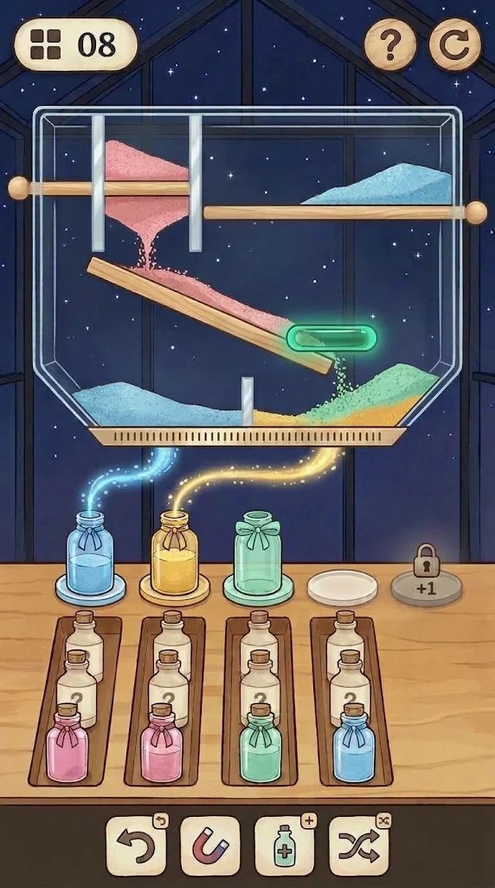

# 《沙里淘大红》美术资产清单与生图提示词手册

> [!IMPORTANT]
> 本手册由 `node tools/gen-art-doc.js` 根据 [`data/art/prompts.json`](../data/art/prompts.json) **自动生成，请勿手改**。新增或修改素材时只改 JSON，再重新生成手册；批量生图脚本也读取同一份 JSON，所以手册、校验和出图永远一致。

## 1. 画风一致性硬规范（所有素材强制执行）




| 项目 | 规范 |
| :--- | :--- |
| **局内实机基准** | [`docs/assets/gameplay_ref.jpg`](assets/gameplay_ref.jpg)：局内实机参考图（局内圆角通透玻璃沙箱、一体式漏斗、粗细双阶颗粒彩沙、连贯流沙柱、抽拉木栓与底栏 UI 的唯一视觉基准）。生成或调优局内界面/沙盘元素时，把 docs/assets/gameplay_ref.jpg 上传到 ComfyUI input，文件名 style_anchor_gameplay.jpg |
| **图1·封面与角色基准** | [`docs/assets/cover.jpg`](assets/cover.jpg)：游戏封面参考图（仅用于封面宣发主视觉及公仔/盲盒角色的 2 头身比例与手绘笔触锚定）。生图前把 docs/assets/cover.jpg 通过 POST /upload/image 上传到 ComfyUI input，文件名 style_anchor_cover.jpg，通过 `LoadImage` 接入 `TextEncodeQwenImage21` 的 `images.image_1`（resolution 768） |
| **线条** | 温暖深棕色（约 #5A3A22）手绘钢笔线，圆润柔和、带轻微抖动与粗细变化；禁止纯黑粗描边、禁止矢量等宽线 |
| **上色** | 水彩晕染 + 彩铅笔触叠色，可见纸纹颗粒；暗部用柔和水彩加深并辅以少量细密排线；禁止 3D 光影、喷枪渐变、硬阴影 |
| **色调** | 暖色为主：蜂蜜木 / 焦糖棕 / 琥珀灯光暖黄；夜空深靛蓝点星；流沙与点缀为柔和糖果马卡龙色（樱花粉、柠檬黄、天空蓝、薄荷绿）+ 闪烁金色细沙 |
| **光效** | 奶白小高光、四角星闪光点、琥珀色柔和光晕（如封面吊灯与星星灯串）；光效贴近主体，不铺满背景 |
| **角色比例** | 对齐封面下方的柴犬、企鹅、红金小龙：约 2 头身、大头小身、圆润敦实，黑亮圆眼带白高光，粉色腮红，表情温柔 |
| **道具母题** | 玻璃沙罐、带「抽」字木牌的木质抽板、复古木柄黄铜放大镜、朱红漆面金边宝箱、木架 / 齿轮 / 小铲子 / 彩沙玻璃瓶 |
| **品质表现** | 白=素雅水彩 / 绿=嫩绿晕光 / 蓝=晴空蓝星点 / 紫=薰衣草紫通透星光 / 金=暖金描金星尘 / 红=朱红宝石般通透 + 暖金卷云；全部用水彩表现，不做金属电镀或珠宝切面 |
| **禁用词** | Q版、Q萌潮玩、3D盲盒手办、PVC塑料光泽、24K电镀金属、镜面金属、碳纤维、塑料扭蛋、写实珠宝切面、赛博霓虹（同步写入负面提示词） |
| **抠图约束** | 公仔、盲盒、图标、贴图、卡框一律纯白 #FFFFFF 背景、无投影、无场景、主体完整不裁切；出图后统一抠成透明 PNG |
| **文字约束** | 除 Logo「沙里淘大红」、抽板木牌上的「抽」、馒头上的「福」、大红箱 / 大红卡框上的「红」外，任何素材不得出现文字 |
| **禁区** | 只学习封面的画风，不复制封面的构图、文字与物件布局；非猫类藏品不得画成猫 |
| **采样参数** | Qwen-Image-2.1 · euler / simple · 28 steps · CFG 4.2 · 种子按 assetId 固定（可复现） |

### 1.1 全局画风前缀（自动拼接在每条提示词最前面）

```text
【画风强制锁定：严格参照图1（游戏封面 cover.jpg）的画风】日系治愈手绘墨线水彩绘本插画：所有轮廓用温暖的深棕色（约#5A3A22）手绘钢笔线勾勒，线条圆润柔和、略带手绘抖动与粗细变化；上色为水彩晕染叠加彩铅笔触，可见细腻纸纹颗粒，暗部用柔和的水彩加深并辅以少量细密排线；整体暖色调，以蜂蜜木色、焦糖棕、琥珀灯光暖黄为主，夜空为深靛蓝并点缀星星，流沙与点缀色为柔和的糖果马卡龙色（樱花粉、柠檬黄、天空蓝、薄荷绿）与闪烁的金色细沙；高光为奶白色小块与四角星闪光点，局部有温暖柔和的光晕。只学习图1的笔触、上色、配色与氛围，不复制图1的构图、文字与物件布局。
```

### 1.2 全局负面提示词

```text
照片写实, 3D渲染, C4D, Q版潮玩手办, 3D盲盒手办, PVC塑料光泽, 24K电镀金属, 镜面金属, 碳纤维, 塑料扭蛋, 写实珠宝切面, 赛博霓虹, 霓虹灯管, 科幻金属, CG光滑渐变, 喷枪阴影, 高对比硬阴影, 赛璐璐日漫, 厚涂油画, 像素风, 矢量扁平图标, 冷灰色调, 纯黑粗描边, 模糊, 低分辨率, 噪点, JPEG伪影, 水印, 签名, 乱码文字, 多余文字, 多余肢体, 畸形手指, 主体被裁切, 手机外壳, 设备边框, 截图边框
```

## 2. 素材总清单

共 **30** 项素材：

| 分组 | 数量 | 说明 |
| :--- | :---: | :--- |
| 背景 | 3 | 主局内流沙界面背景、选关抽屉背景、启动加载页 |
| 品牌 | 2 | 游戏Logo「沙里淘大红」、小游戏图标 |
| 局内元素 | 15 | 沙罐底部黄铜出沙口、沙罐顶部木质罐口、可抽拉木托板、倾斜导流木板、推入式木质闸门插销、联动双栓黄铜滑轮、颜色锁徽章（代码着色）、锁头崩开序列帧参考、冰冻沙砖贴图、冰砖摔碎特效参考、染色环装置、黄金狂热沙标识、接沙桶（代码着色）、满桶弹飞特效参考、堵口预警标识 |
| 道具 | 4 | 道具：加开第2接沙槽、道具：万能吸尘清堵、道具：撤回上一步、免费重玩 |
| 引导 | 1 | 新手引导手指 |
| 通用 | 5 | 通用木质按钮底板、通用弹窗面板、顶栏设置齿轮木钮、音效开关留声小喇叭、适龄提示盾形木牌框 |

| # | assetId | 名称 | 类型 | 尺寸 | 透明底 | 输出路径 |
| :---: | :--- | :--- | :--- | :---: | :---: | :--- |
| 1 | `ui_bg_gameplay` | 主局内流沙界面背景 | 背景 | 768×1344 | — | `assets/ui/bg/ui_bg_gameplay.png` |
| 2 | `ui_bg_level_drawer` | 选关抽屉背景 | 背景 | 768×1344 | — | `assets/ui/bg/ui_bg_level_drawer.png` |
| 3 | `ui_bg_splash` | 启动加载页 | 背景 | 768×1344 | — | `assets/ui/bg/ui_bg_splash.png` |
| 4 | `ui_logo_title` | 游戏Logo「沙里淘大红」 | 图标 | 1024×1024 | ✅ | `assets/ui/brand/ui_logo_title.png` |
| 5 | `ui_app_icon` | 小游戏图标 | 图标 | 1024×1024 | — | `assets/ui/brand/ui_app_icon.png` |
| 6 | `ui_vessel_nozzle` | 沙罐底部黄铜出沙口 | 局内贴图 | 1024×1024 | ✅ | `assets/ui/game/ui_vessel_nozzle.png` |
| 7 | `ui_vessel_rim` | 沙罐顶部木质罐口 | 局内贴图 | 1024×1024 | ✅ | `assets/ui/game/ui_vessel_rim.png` |
| 8 | `ui_board_wood` | 可抽拉木托板 | 局内贴图 | 1024×1024 | ✅ | `assets/ui/game/ui_board_wood.png` |
| 9 | `ui_board_slant` | 倾斜导流木板 | 局内贴图 | 1024×1024 | ✅ | `assets/ui/game/ui_board_slant.png` |
| 10 | `ui_board_push_gate` | 推入式木质闸门插销 | 局内贴图 | 1024×1024 | ✅ | `assets/ui/game/ui_board_push_gate.png` |
| 11 | `ui_linked_gear` | 联动双栓黄铜滑轮 | 图标 | 1024×1024 | ✅ | `assets/ui/game/ui_linked_gear.png` |
| 12 | `ui_lock_badge` | 颜色锁徽章（代码着色） | 图标 | 1024×1024 | ✅ | `assets/ui/game/ui_lock_badge.png` |
| 13 | `ui_lock_break_fx` | 锁头崩开序列帧参考 | 图标 | 1024×1024 | ✅ | `assets/ui/game/ui_lock_break_fx.png` |
| 14 | `ui_ice_block` | 冰冻沙砖贴图 | 局内贴图 | 1024×1024 | ✅ | `assets/ui/game/ui_ice_block.png` |
| 15 | `ui_ice_shatter_fx` | 冰砖摔碎特效参考 | 图标 | 1024×1024 | ✅ | `assets/ui/game/ui_ice_shatter_fx.png` |
| 16 | `ui_dye_ring` | 染色环装置 | 图标 | 1024×1024 | ✅ | `assets/ui/game/ui_dye_ring.png` |
| 17 | `ui_gold_sand_pile` | 黄金狂热沙标识 | 图标 | 1024×1024 | ✅ | `assets/ui/game/ui_gold_sand_pile.png` |
| 18 | `ui_bucket` | 接沙桶（代码着色） | 图标 | 1024×1024 | ✅ | `assets/ui/game/ui_bucket.png` |
| 19 | `ui_bucket_full_fx` | 满桶弹飞特效参考 | 图标 | 1024×1024 | ✅ | `assets/ui/game/ui_bucket_full_fx.png` |
| 20 | `ui_jam_warning` | 堵口预警标识 | 图标 | 1024×1024 | ✅ | `assets/ui/game/ui_jam_warning.png` |
| 21 | `ui_prop_extra_slot` | 道具：加开第2接沙槽 | 图标 | 1024×1024 | ✅ | `assets/ui/props/ui_prop_extra_slot.png` |
| 22 | `ui_prop_vacuum` | 道具：万能吸尘清堵 | 图标 | 1024×1024 | ✅ | `assets/ui/props/ui_prop_vacuum.png` |
| 23 | `ui_prop_undo` | 道具：撤回上一步 | 图标 | 1024×1024 | ✅ | `assets/ui/props/ui_prop_undo.png` |
| 24 | `ui_prop_restart` | 免费重玩 | 图标 | 1024×1024 | ✅ | `assets/ui/props/ui_prop_restart.png` |
| 25 | `ui_ftue_hand` | 新手引导手指 | 图标 | 1024×1024 | ✅ | `assets/ui/common/ui_ftue_hand.png` |
| 26 | `ui_btn_wood` | 通用木质按钮底板 | 图标 | 1024×1024 | ✅ | `assets/ui/common/ui_btn_wood.png` |
| 27 | `ui_panel_parchment` | 通用弹窗面板 | 图标 | 1024×1024 | ✅ | `assets/ui/common/ui_panel_parchment.png` |
| 28 | `ui_icon_settings_gear` | 顶栏设置齿轮木钮 | 图标 | 1024×1024 | ✅ | `assets/ui/common/ui_icon_settings_gear.png` |
| 29 | `ui_icon_sound_horn` | 音效开关留声小喇叭 | 图标 | 1024×1024 | ✅ | `assets/ui/common/ui_icon_sound_horn.png` |
| 30 | `ui_badge_cadpa_frame` | 适龄提示盾形木牌框 | 图标 | 1024×1024 | ✅ | `assets/ui/common/ui_badge_cadpa_frame.png` |

## 3. 逐项完整提示词

> 每条“完整正向提示词”= 全局画风前缀 + 品类模板 + 主体描述，可直接复制到 ComfyUI 的 `TextEncodeQwenImage21.prompt`；负面提示词填入 `negative_prompt`。

### 背景

#### 1. 主局内流沙界面背景 · `ui_bg_gameplay`

- **尺寸**：768×1344　**种子**：2145824740　**透明底**：否　**输出**：`assets/ui/bg/ui_bg_gameplay.png`
- **主体描述**：温暖的木屋淘沙工坊室内，视角正对一面木墙；顶部约11%高度是深靛蓝星夜的木格拱窗与一串暖黄星星灯（右上角留空避让微信胶囊按钮）；画面中部约62%高度、横向92%宽度是一大块干净的浅奶油色空白区域（用于放置代码绘制的玻璃沙罐，不要画任何物体）；左右两侧边缘各露出一小截木架，摆着彩沙玻璃瓶与小齿轮；底部约24%高度是一张厚实的蜂蜜色木质工作台台面，台面上空无一物（用于放置接沙桶与道具栏），台面边缘有手绘木纹

```text
【画风强制锁定：严格参照图1（游戏封面 cover.jpg）的画风】日系治愈手绘墨线水彩绘本插画：所有轮廓用温暖的深棕色（约#5A3A22）手绘钢笔线勾勒，线条圆润柔和、略带手绘抖动与粗细变化；上色为水彩晕染叠加彩铅笔触，可见细腻纸纹颗粒，暗部用柔和的水彩加深并辅以少量细密排线；整体暖色调，以蜂蜜木色、焦糖棕、琥珀灯光暖黄为主，夜空为深靛蓝并点缀星星，流沙与点缀色为柔和的糖果马卡龙色（樱花粉、柠檬黄、天空蓝、薄荷绿）与闪烁的金色细沙；高光为奶白色小块与四角星闪光点，局部有温暖柔和的光晕。只学习图1的笔触、上色、配色与氛围，不复制图1的构图、文字与物件布局。
竖屏手机游戏背景插画（9:16），与图1封面同一世界观（星夜木屋淘沙工坊，琥珀色吊灯与星星灯串的暖光，木架上摆着彩沙玻璃瓶、齿轮与小铲子）：温暖的木屋淘沙工坊室内，视角正对一面木墙；顶部约11%高度是深靛蓝星夜的木格拱窗与一串暖黄星星灯（右上角留空避让微信胶囊按钮）；画面中部约62%高度、横向92%宽度是一大块干净的浅奶油色空白区域（用于放置代码绘制的玻璃沙罐，不要画任何物体）；左右两侧边缘各露出一小截木架，摆着彩沙玻璃瓶与小齿轮；底部约24%高度是一张厚实的蜂蜜色木质工作台台面，台面上空无一物（用于放置接沙桶与道具栏），台面边缘有手绘木纹。不包含任何UI按钮、文字、数字、对话框，纯游戏画面直出，无手机外壳与设备边框。
```

#### 2. 选关抽屉背景 · `ui_bg_level_drawer`

- **尺寸**：768×1344　**种子**：1614184698　**透明底**：否　**输出**：`assets/ui/bg/ui_bg_level_drawer.png`
- **主体描述**：从上往下俯视一个拉开的大木抽屉，抽屉底部铺着一张泛黄的手绘藏宝地图，地图上用虚线串起20个空白圆形关卡位（圆圈内留空不写数字），沿途画着小沙漏、冰块、锁头、奶茶杯等小插画；抽屉边缘有黄铜把手

```text
【画风强制锁定：严格参照图1（游戏封面 cover.jpg）的画风】日系治愈手绘墨线水彩绘本插画：所有轮廓用温暖的深棕色（约#5A3A22）手绘钢笔线勾勒，线条圆润柔和、略带手绘抖动与粗细变化；上色为水彩晕染叠加彩铅笔触，可见细腻纸纹颗粒，暗部用柔和的水彩加深并辅以少量细密排线；整体暖色调，以蜂蜜木色、焦糖棕、琥珀灯光暖黄为主，夜空为深靛蓝并点缀星星，流沙与点缀色为柔和的糖果马卡龙色（樱花粉、柠檬黄、天空蓝、薄荷绿）与闪烁的金色细沙；高光为奶白色小块与四角星闪光点，局部有温暖柔和的光晕。只学习图1的笔触、上色、配色与氛围，不复制图1的构图、文字与物件布局。
竖屏手机游戏背景插画（9:16），与图1封面同一世界观（星夜木屋淘沙工坊，琥珀色吊灯与星星灯串的暖光，木架上摆着彩沙玻璃瓶、齿轮与小铲子）：从上往下俯视一个拉开的大木抽屉，抽屉底部铺着一张泛黄的手绘藏宝地图，地图上用虚线串起20个空白圆形关卡位（圆圈内留空不写数字），沿途画着小沙漏、冰块、锁头、奶茶杯等小插画；抽屉边缘有黄铜把手。不包含任何UI按钮、文字、数字、对话框，纯游戏画面直出，无手机外壳与设备边框。
```

#### 3. 启动加载页 · `ui_bg_splash`

- **尺寸**：768×1344　**种子**：1263023937　**透明底**：否　**输出**：`assets/ui/bg/ui_bg_splash.png`
- **主体描述**：星夜下的小木屋淘沙工坊外景，屋顶烟囱冒出星星形状的烟，窗户透出琥珀色暖光，屋前木台上放着一个大玻璃沙罐，罐里是波浪状分层的樱花粉、柠檬黄、天空蓝、薄荷绿彩沙与闪烁金沙，沙层里隐约露出一个发着暖红光的朱红小宝箱；画面上方约25%留出干净夜空用于放置Logo，下方约15%留空用于加载条

```text
【画风强制锁定：严格参照图1（游戏封面 cover.jpg）的画风】日系治愈手绘墨线水彩绘本插画：所有轮廓用温暖的深棕色（约#5A3A22）手绘钢笔线勾勒，线条圆润柔和、略带手绘抖动与粗细变化；上色为水彩晕染叠加彩铅笔触，可见细腻纸纹颗粒，暗部用柔和的水彩加深并辅以少量细密排线；整体暖色调，以蜂蜜木色、焦糖棕、琥珀灯光暖黄为主，夜空为深靛蓝并点缀星星，流沙与点缀色为柔和的糖果马卡龙色（樱花粉、柠檬黄、天空蓝、薄荷绿）与闪烁的金色细沙；高光为奶白色小块与四角星闪光点，局部有温暖柔和的光晕。只学习图1的笔触、上色、配色与氛围，不复制图1的构图、文字与物件布局。
竖屏手机游戏背景插画（9:16），与图1封面同一世界观（星夜木屋淘沙工坊，琥珀色吊灯与星星灯串的暖光，木架上摆着彩沙玻璃瓶、齿轮与小铲子）：星夜下的小木屋淘沙工坊外景，屋顶烟囱冒出星星形状的烟，窗户透出琥珀色暖光，屋前木台上放着一个大玻璃沙罐，罐里是波浪状分层的樱花粉、柠檬黄、天空蓝、薄荷绿彩沙与闪烁金沙，沙层里隐约露出一个发着暖红光的朱红小宝箱；画面上方约25%留出干净夜空用于放置Logo，下方约15%留空用于加载条。不包含任何UI按钮、文字、数字、对话框，纯游戏画面直出，无手机外壳与设备边框。
```

### 品牌

#### 4. 游戏Logo「沙里淘大红」 · `ui_logo_title`

- **尺寸**：1024×1024　**种子**：1769300094　**透明底**：是（纯白底出图后抠图）　**输出**：`assets/ui/brand/ui_logo_title.png`
- **主体描述**：横版游戏标题字设计，内容为五个中文字「沙里淘大红」，与图1封面标题同风格：圆润饱满的手写粗体字，奶油橙色字面配深棕色粗描边与浅色内描边，「大红」两字为朱红色并带暖金小星光，字体略带彩沙颗粒质感，四周点缀几颗四角星；文字必须准确为「沙里淘大红」，不得出现其他文字

```text
【画风强制锁定：严格参照图1（游戏封面 cover.jpg）的画风】日系治愈手绘墨线水彩绘本插画：所有轮廓用温暖的深棕色（约#5A3A22）手绘钢笔线勾勒，线条圆润柔和、略带手绘抖动与粗细变化；上色为水彩晕染叠加彩铅笔触，可见细腻纸纹颗粒，暗部用柔和的水彩加深并辅以少量细密排线；整体暖色调，以蜂蜜木色、焦糖棕、琥珀灯光暖黄为主，夜空为深靛蓝并点缀星星，流沙与点缀色为柔和的糖果马卡龙色（樱花粉、柠檬黄、天空蓝、薄荷绿）与闪烁的金色细沙；高光为奶白色小块与四角星闪光点，局部有温暖柔和的光晕。只学习图1的笔触、上色、配色与氛围，不复制图1的构图、文字与物件布局。
游戏UI图标素材：横版游戏标题字设计，内容为五个中文字「沙里淘大红」，与图1封面标题同风格：圆润饱满的手写粗体字，奶油橙色字面配深棕色粗描边与浅色内描边，「大红」两字为朱红色并带暖金小星光，字体略带彩沙颗粒质感，四周点缀几颗四角星；文字必须准确为「沙里淘大红」，不得出现其他文字。单个物件居中，约占画面70%，轻微俯视角，深棕手绘墨线描边+水彩彩铅上色，造型简洁、色块清楚，缩小到64px仍可辨认。背景：纯白色#FFFFFF，无投影、无文字。
```

#### 5. 小游戏图标 · `ui_app_icon`

- **尺寸**：1024×1024　**种子**：1430621472　**透明底**：否　**输出**：`assets/ui/brand/ui_app_icon.png`
- **主体描述**：圆角方形应用图标构图：暖奶油色底，中央一个小玻璃沙罐，罐内波浪状彩沙正在倾泻，罐侧伸出一块带「抽」字小木牌的木质抽板（只允许这一个「抽」字），罐前斜放一个朱红金边小宝箱发出暖光；构图饱满、轮廓简洁，缩小后依然清晰

```text
【画风强制锁定：严格参照图1（游戏封面 cover.jpg）的画风】日系治愈手绘墨线水彩绘本插画：所有轮廓用温暖的深棕色（约#5A3A22）手绘钢笔线勾勒，线条圆润柔和、略带手绘抖动与粗细变化；上色为水彩晕染叠加彩铅笔触，可见细腻纸纹颗粒，暗部用柔和的水彩加深并辅以少量细密排线；整体暖色调，以蜂蜜木色、焦糖棕、琥珀灯光暖黄为主，夜空为深靛蓝并点缀星星，流沙与点缀色为柔和的糖果马卡龙色（樱花粉、柠檬黄、天空蓝、薄荷绿）与闪烁的金色细沙；高光为奶白色小块与四角星闪光点，局部有温暖柔和的光晕。只学习图1的笔触、上色、配色与氛围，不复制图1的构图、文字与物件布局。
游戏UI图标素材：圆角方形应用图标构图：暖奶油色底，中央一个小玻璃沙罐，罐内波浪状彩沙正在倾泻，罐侧伸出一块带「抽」字小木牌的木质抽板（只允许这一个「抽」字），罐前斜放一个朱红金边小宝箱发出暖光；构图饱满、轮廓简洁，缩小后依然清晰。单个物件居中，约占画面70%，轻微俯视角，深棕手绘墨线描边+水彩彩铅上色，造型简洁、色块清楚，缩小到64px仍可辨认。背景：纯白色#FFFFFF，无投影、无文字。
```

### 局内元素

#### 6. 沙罐底部黄铜出沙口 · `ui_vessel_nozzle`

- **尺寸**：1024×1024　**种子**：1061669966　**透明底**：是（纯白底出图后抠图）　**输出**：`assets/ui/game/ui_vessel_nozzle.png`
- **主体描述**：玻璃沙罐底部的黄铜漏斗出沙口装饰件：上宽下窄的V形黄铜漏斗，中间是竖直短管，表面有铆钉与手绘划痕，正面平视，左右对称

```text
【画风强制锁定：严格参照图1（游戏封面 cover.jpg）的画风】日系治愈手绘墨线水彩绘本插画：所有轮廓用温暖的深棕色（约#5A3A22）手绘钢笔线勾勒，线条圆润柔和、略带手绘抖动与粗细变化；上色为水彩晕染叠加彩铅笔触，可见细腻纸纹颗粒，暗部用柔和的水彩加深并辅以少量细密排线；整体暖色调，以蜂蜜木色、焦糖棕、琥珀灯光暖黄为主，夜空为深靛蓝并点缀星星，流沙与点缀色为柔和的糖果马卡龙色（樱花粉、柠檬黄、天空蓝、薄荷绿）与闪烁的金色细沙；高光为奶白色小块与四角星闪光点，局部有温暖柔和的光晕。只学习图1的笔触、上色、配色与氛围，不复制图1的构图、文字与物件布局。
游戏局内贴图素材：玻璃沙罐底部的黄铜漏斗出沙口装饰件：上宽下窄的V形黄铜漏斗，中间是竖直短管，表面有铆钉与手绘划痕，正面平视，左右对称。正交平视，物件居中完整，边缘清晰，深棕手绘墨线+水彩上色。背景：纯白色#FFFFFF，无投影、无文字。
```

#### 7. 沙罐顶部木质罐口 · `ui_vessel_rim`

- **尺寸**：1024×1024　**种子**：1171087390　**透明底**：是（纯白底出图后抠图）　**输出**：`assets/ui/game/ui_vessel_rim.png`
- **主体描述**：横向长条的蜂蜜木罐口箍圈，两端有黄铜卡扣，正面平视，宽高比约8:1，左右对称，可横向拉伸

```text
【画风强制锁定：严格参照图1（游戏封面 cover.jpg）的画风】日系治愈手绘墨线水彩绘本插画：所有轮廓用温暖的深棕色（约#5A3A22）手绘钢笔线勾勒，线条圆润柔和、略带手绘抖动与粗细变化；上色为水彩晕染叠加彩铅笔触，可见细腻纸纹颗粒，暗部用柔和的水彩加深并辅以少量细密排线；整体暖色调，以蜂蜜木色、焦糖棕、琥珀灯光暖黄为主，夜空为深靛蓝并点缀星星，流沙与点缀色为柔和的糖果马卡龙色（樱花粉、柠檬黄、天空蓝、薄荷绿）与闪烁的金色细沙；高光为奶白色小块与四角星闪光点，局部有温暖柔和的光晕。只学习图1的笔触、上色、配色与氛围，不复制图1的构图、文字与物件布局。
游戏局内贴图素材：横向长条的蜂蜜木罐口箍圈，两端有黄铜卡扣，正面平视，宽高比约8:1，左右对称，可横向拉伸。正交平视，物件居中完整，边缘清晰，深棕手绘墨线+水彩上色。背景：纯白色#FFFFFF，无投影、无文字。
```

#### 8. 可抽拉木托板 · `ui_board_wood`

- **尺寸**：1024×1024　**种子**：1813162068　**透明底**：是（纯白底出图后抠图）　**输出**：`assets/ui/game/ui_board_wood.png`
- **主体描述**：一块横向细长的蜂蜜色木板，宽高比约10:1，表面有清晰手绘木纹，右端是一个圆形木质拉钮，拉钮下用小铁链挂着一块写有「抽」字的小木牌（仅此一字），正面平视

```text
【画风强制锁定：严格参照图1（游戏封面 cover.jpg）的画风】日系治愈手绘墨线水彩绘本插画：所有轮廓用温暖的深棕色（约#5A3A22）手绘钢笔线勾勒，线条圆润柔和、略带手绘抖动与粗细变化；上色为水彩晕染叠加彩铅笔触，可见细腻纸纹颗粒，暗部用柔和的水彩加深并辅以少量细密排线；整体暖色调，以蜂蜜木色、焦糖棕、琥珀灯光暖黄为主，夜空为深靛蓝并点缀星星，流沙与点缀色为柔和的糖果马卡龙色（樱花粉、柠檬黄、天空蓝、薄荷绿）与闪烁的金色细沙；高光为奶白色小块与四角星闪光点，局部有温暖柔和的光晕。只学习图1的笔触、上色、配色与氛围，不复制图1的构图、文字与物件布局。
游戏局内贴图素材：一块横向细长的蜂蜜色木板，宽高比约10:1，表面有清晰手绘木纹，右端是一个圆形木质拉钮，拉钮下用小铁链挂着一块写有「抽」字的小木牌（仅此一字），正面平视。正交平视，物件居中完整，边缘清晰，深棕手绘墨线+水彩上色。背景：纯白色#FFFFFF，无投影、无文字。
```

#### 9. 倾斜导流木板 · `ui_board_slant`

- **尺寸**：1024×1024　**种子**：280339762　**透明底**：是（纯白底出图后抠图）　**输出**：`assets/ui/game/ui_board_slant.png`
- **主体描述**：一块细长木板，表面刻有一排指向同一方向的箭头凹槽（表示导流），两端包着黄铜护角，平放正视，宽高比约10:1

```text
【画风强制锁定：严格参照图1（游戏封面 cover.jpg）的画风】日系治愈手绘墨线水彩绘本插画：所有轮廓用温暖的深棕色（约#5A3A22）手绘钢笔线勾勒，线条圆润柔和、略带手绘抖动与粗细变化；上色为水彩晕染叠加彩铅笔触，可见细腻纸纹颗粒，暗部用柔和的水彩加深并辅以少量细密排线；整体暖色调，以蜂蜜木色、焦糖棕、琥珀灯光暖黄为主，夜空为深靛蓝并点缀星星，流沙与点缀色为柔和的糖果马卡龙色（樱花粉、柠檬黄、天空蓝、薄荷绿）与闪烁的金色细沙；高光为奶白色小块与四角星闪光点，局部有温暖柔和的光晕。只学习图1的笔触、上色、配色与氛围，不复制图1的构图、文字与物件布局。
游戏局内贴图素材：一块细长木板，表面刻有一排指向同一方向的箭头凹槽（表示导流），两端包着黄铜护角，平放正视，宽高比约10:1。正交平视，物件居中完整，边缘清晰，深棕手绘墨线+水彩上色。背景：纯白色#FFFFFF，无投影、无文字。
```

#### 10. 推入式木质闸门插销 · `ui_board_push_gate`

- **尺寸**：1024×1024　**种子**：1247649768　**透明底**：是（纯白底出图后抠图）　**输出**：`assets/ui/game/ui_board_push_gate.png`
- **主体描述**：一根横向的蜂蜜木活动闸门插杆，左端包着铆钉黄铜护套，右端是黄铜螺旋弹簧推杆旋钮，旋钮下方挂着一块画有双左箭头符号的圆形小木牌，正面平视，宽高比约6:1

```text
【画风强制锁定：严格参照图1（游戏封面 cover.jpg）的画风】日系治愈手绘墨线水彩绘本插画：所有轮廓用温暖的深棕色（约#5A3A22）手绘钢笔线勾勒，线条圆润柔和、略带手绘抖动与粗细变化；上色为水彩晕染叠加彩铅笔触，可见细腻纸纹颗粒，暗部用柔和的水彩加深并辅以少量细密排线；整体暖色调，以蜂蜜木色、焦糖棕、琥珀灯光暖黄为主，夜空为深靛蓝并点缀星星，流沙与点缀色为柔和的糖果马卡龙色（樱花粉、柠檬黄、天空蓝、薄荷绿）与闪烁的金色细沙；高光为奶白色小块与四角星闪光点，局部有温暖柔和的光晕。只学习图1的笔触、上色、配色与氛围，不复制图1的构图、文字与物件布局。
游戏局内贴图素材：一根横向的蜂蜜木活动闸门插杆，左端包着铆钉黄铜护套，右端是黄铜螺旋弹簧推杆旋钮，旋钮下方挂着一块画有双左箭头符号的圆形小木牌，正面平视，宽高比约6:1。正交平视，物件居中完整，边缘清晰，深棕手绘墨线+水彩上色。背景：纯白色#FFFFFF，无投影、无文字。
```

#### 11. 联动双栓黄铜滑轮 · `ui_linked_gear`

- **尺寸**：1024×1024　**种子**：913681264　**透明底**：是（纯白底出图后抠图）　**输出**：`assets/ui/game/ui_linked_gear.png`
- **主体描述**：一枚缠绕着粗麻绳圈的复古黄铜滑轮盘与六齿小齿轮组合扣，中心插着蜂蜜色圆木销钉，表示两块木板绳索联动

```text
【画风强制锁定：严格参照图1（游戏封面 cover.jpg）的画风】日系治愈手绘墨线水彩绘本插画：所有轮廓用温暖的深棕色（约#5A3A22）手绘钢笔线勾勒，线条圆润柔和、略带手绘抖动与粗细变化；上色为水彩晕染叠加彩铅笔触，可见细腻纸纹颗粒，暗部用柔和的水彩加深并辅以少量细密排线；整体暖色调，以蜂蜜木色、焦糖棕、琥珀灯光暖黄为主，夜空为深靛蓝并点缀星星，流沙与点缀色为柔和的糖果马卡龙色（樱花粉、柠檬黄、天空蓝、薄荷绿）与闪烁的金色细沙；高光为奶白色小块与四角星闪光点，局部有温暖柔和的光晕。只学习图1的笔触、上色、配色与氛围，不复制图1的构图、文字与物件布局。
游戏UI图标素材：一枚缠绕着粗麻绳圈的复古黄铜滑轮盘与六齿小齿轮组合扣，中心插着蜂蜜色圆木销钉，表示两块木板绳索联动。单个物件居中，约占画面70%，轻微俯视角，深棕手绘墨线描边+水彩彩铅上色，造型简洁、色块清楚，缩小到64px仍可辨认。背景：纯白色#FFFFFF，无投影、无文字。
```

#### 12. 颜色锁徽章（代码着色） · `ui_lock_badge`

- **尺寸**：1024×1024　**种子**：1342885424　**透明底**：是（纯白底出图后抠图）　**输出**：`assets/ui/game/ui_lock_badge.png`
- **主体描述**：一把圆胖可爱的挂锁，锁身为纯白色（便于程序着色成粉/黄/蓝/绿），锁梁为黄铜色，锁身正中有一个空心圆形色点位置

```text
【画风强制锁定：严格参照图1（游戏封面 cover.jpg）的画风】日系治愈手绘墨线水彩绘本插画：所有轮廓用温暖的深棕色（约#5A3A22）手绘钢笔线勾勒，线条圆润柔和、略带手绘抖动与粗细变化；上色为水彩晕染叠加彩铅笔触，可见细腻纸纹颗粒，暗部用柔和的水彩加深并辅以少量细密排线；整体暖色调，以蜂蜜木色、焦糖棕、琥珀灯光暖黄为主，夜空为深靛蓝并点缀星星，流沙与点缀色为柔和的糖果马卡龙色（樱花粉、柠檬黄、天空蓝、薄荷绿）与闪烁的金色细沙；高光为奶白色小块与四角星闪光点，局部有温暖柔和的光晕。只学习图1的笔触、上色、配色与氛围，不复制图1的构图、文字与物件布局。
游戏UI图标素材：一把圆胖可爱的挂锁，锁身为纯白色（便于程序着色成粉/黄/蓝/绿），锁梁为黄铜色，锁身正中有一个空心圆形色点位置。单个物件居中，约占画面70%，轻微俯视角，深棕手绘墨线描边+水彩彩铅上色，造型简洁、色块清楚，缩小到64px仍可辨认。背景：纯白色#FFFFFF，无投影、无文字。
```

#### 13. 锁头崩开序列帧参考 · `ui_lock_break_fx`

- **尺寸**：1024×1024　**种子**：1942960521　**透明底**：是（纯白底出图后抠图）　**输出**：`assets/ui/game/ui_lock_break_fx.png`
- **主体描述**：同一把白色挂锁崩开瞬间的三连帧横向排列：第一帧锁梁弹起，第二帧锁身裂开飞出碎片和小星星，第三帧只剩几颗小星星；三帧等间距、大小一致

```text
【画风强制锁定：严格参照图1（游戏封面 cover.jpg）的画风】日系治愈手绘墨线水彩绘本插画：所有轮廓用温暖的深棕色（约#5A3A22）手绘钢笔线勾勒，线条圆润柔和、略带手绘抖动与粗细变化；上色为水彩晕染叠加彩铅笔触，可见细腻纸纹颗粒，暗部用柔和的水彩加深并辅以少量细密排线；整体暖色调，以蜂蜜木色、焦糖棕、琥珀灯光暖黄为主，夜空为深靛蓝并点缀星星，流沙与点缀色为柔和的糖果马卡龙色（樱花粉、柠檬黄、天空蓝、薄荷绿）与闪烁的金色细沙；高光为奶白色小块与四角星闪光点，局部有温暖柔和的光晕。只学习图1的笔触、上色、配色与氛围，不复制图1的构图、文字与物件布局。
游戏UI图标素材：同一把白色挂锁崩开瞬间的三连帧横向排列：第一帧锁梁弹起，第二帧锁身裂开飞出碎片和小星星，第三帧只剩几颗小星星；三帧等间距、大小一致。单个物件居中，约占画面70%，轻微俯视角，深棕手绘墨线描边+水彩彩铅上色，造型简洁、色块清楚，缩小到64px仍可辨认。背景：纯白色#FFFFFF，无投影、无文字。
```

#### 14. 冰冻沙砖贴图 · `ui_ice_block`

- **尺寸**：1024×1024　**种子**：694657804　**透明底**：是（纯白底出图后抠图）　**输出**：`assets/ui/game/ui_ice_block.png`
- **主体描述**：一块横向长方体冰砖，半透明淡蓝白色冰壳，内部封着细小的彩色沙粒（以白色为主，便于程序叠色），表面有手绘裂纹与霜花、边角圆润，正面平视

```text
【画风强制锁定：严格参照图1（游戏封面 cover.jpg）的画风】日系治愈手绘墨线水彩绘本插画：所有轮廓用温暖的深棕色（约#5A3A22）手绘钢笔线勾勒，线条圆润柔和、略带手绘抖动与粗细变化；上色为水彩晕染叠加彩铅笔触，可见细腻纸纹颗粒，暗部用柔和的水彩加深并辅以少量细密排线；整体暖色调，以蜂蜜木色、焦糖棕、琥珀灯光暖黄为主，夜空为深靛蓝并点缀星星，流沙与点缀色为柔和的糖果马卡龙色（樱花粉、柠檬黄、天空蓝、薄荷绿）与闪烁的金色细沙；高光为奶白色小块与四角星闪光点，局部有温暖柔和的光晕。只学习图1的笔触、上色、配色与氛围，不复制图1的构图、文字与物件布局。
游戏局内贴图素材：一块横向长方体冰砖，半透明淡蓝白色冰壳，内部封着细小的彩色沙粒（以白色为主，便于程序叠色），表面有手绘裂纹与霜花、边角圆润，正面平视。正交平视，物件居中完整，边缘清晰，深棕手绘墨线+水彩上色。背景：纯白色#FFFFFF，无投影、无文字。
```

#### 15. 冰砖摔碎特效参考 · `ui_ice_shatter_fx`

- **尺寸**：1024×1024　**种子**：329756508　**透明底**：是（纯白底出图后抠图）　**输出**：`assets/ui/game/ui_ice_shatter_fx.png`
- **主体描述**：冰砖摔碎瞬间：中心向四周炸开的大小冰晶碎片、雪花和白色冲击线，碎片为淡蓝白色，手绘排线表现棱面

```text
【画风强制锁定：严格参照图1（游戏封面 cover.jpg）的画风】日系治愈手绘墨线水彩绘本插画：所有轮廓用温暖的深棕色（约#5A3A22）手绘钢笔线勾勒，线条圆润柔和、略带手绘抖动与粗细变化；上色为水彩晕染叠加彩铅笔触，可见细腻纸纹颗粒，暗部用柔和的水彩加深并辅以少量细密排线；整体暖色调，以蜂蜜木色、焦糖棕、琥珀灯光暖黄为主，夜空为深靛蓝并点缀星星，流沙与点缀色为柔和的糖果马卡龙色（樱花粉、柠檬黄、天空蓝、薄荷绿）与闪烁的金色细沙；高光为奶白色小块与四角星闪光点，局部有温暖柔和的光晕。只学习图1的笔触、上色、配色与氛围，不复制图1的构图、文字与物件布局。
游戏UI图标素材：冰砖摔碎瞬间：中心向四周炸开的大小冰晶碎片、雪花和白色冲击线，碎片为淡蓝白色，手绘排线表现棱面。单个物件居中，约占画面70%，轻微俯视角，深棕手绘墨线描边+水彩彩铅上色，造型简洁、色块清楚，缩小到64px仍可辨认。背景：纯白色#FFFFFF，无投影、无文字。
```

#### 16. 染色环装置 · `ui_dye_ring`

- **尺寸**：1024×1024　**种子**：848605557　**透明底**：是（纯白底出图后抠图）　**输出**：`assets/ui/game/ui_dye_ring.png`
- **主体描述**：一个横向扁平的魔法染色环装置：黄铜外框，内圈是一圈旋转的白色魔法光纹（便于程序着色），两侧各有一个小小的齿轮与刷子，正面平视

```text
【画风强制锁定：严格参照图1（游戏封面 cover.jpg）的画风】日系治愈手绘墨线水彩绘本插画：所有轮廓用温暖的深棕色（约#5A3A22）手绘钢笔线勾勒，线条圆润柔和、略带手绘抖动与粗细变化；上色为水彩晕染叠加彩铅笔触，可见细腻纸纹颗粒，暗部用柔和的水彩加深并辅以少量细密排线；整体暖色调，以蜂蜜木色、焦糖棕、琥珀灯光暖黄为主，夜空为深靛蓝并点缀星星，流沙与点缀色为柔和的糖果马卡龙色（樱花粉、柠檬黄、天空蓝、薄荷绿）与闪烁的金色细沙；高光为奶白色小块与四角星闪光点，局部有温暖柔和的光晕。只学习图1的笔触、上色、配色与氛围，不复制图1的构图、文字与物件布局。
游戏UI图标素材：一个横向扁平的魔法染色环装置：黄铜外框，内圈是一圈旋转的白色魔法光纹（便于程序着色），两侧各有一个小小的齿轮与刷子，正面平视。单个物件居中，约占画面70%，轻微俯视角，深棕手绘墨线描边+水彩彩铅上色，造型简洁、色块清楚，缩小到64px仍可辨认。背景：纯白色#FFFFFF，无投影、无文字。
```

#### 17. 黄金狂热沙标识 · `ui_gold_sand_pile`

- **尺寸**：1024×1024　**种子**：785334481　**透明底**：是（纯白底出图后抠图）　**输出**：`assets/ui/game/ui_gold_sand_pile.png`
- **主体描述**：一小堆闪闪发光的金色细沙，沙堆上方飘着几颗金色十字星芒，沙粒用墨线点画表现颗粒感

```text
【画风强制锁定：严格参照图1（游戏封面 cover.jpg）的画风】日系治愈手绘墨线水彩绘本插画：所有轮廓用温暖的深棕色（约#5A3A22）手绘钢笔线勾勒，线条圆润柔和、略带手绘抖动与粗细变化；上色为水彩晕染叠加彩铅笔触，可见细腻纸纹颗粒，暗部用柔和的水彩加深并辅以少量细密排线；整体暖色调，以蜂蜜木色、焦糖棕、琥珀灯光暖黄为主，夜空为深靛蓝并点缀星星，流沙与点缀色为柔和的糖果马卡龙色（樱花粉、柠檬黄、天空蓝、薄荷绿）与闪烁的金色细沙；高光为奶白色小块与四角星闪光点，局部有温暖柔和的光晕。只学习图1的笔触、上色、配色与氛围，不复制图1的构图、文字与物件布局。
游戏UI图标素材：一小堆闪闪发光的金色细沙，沙堆上方飘着几颗金色十字星芒，沙粒用墨线点画表现颗粒感。单个物件居中，约占画面70%，轻微俯视角，深棕手绘墨线描边+水彩彩铅上色，造型简洁、色块清楚，缩小到64px仍可辨认。背景：纯白色#FFFFFF，无投影、无文字。
```

#### 18. 接沙桶（代码着色） · `ui_bucket`

- **尺寸**：1024×1024　**种子**：1612948848　**透明底**：是（纯白底出图后抠图）　**输出**：`assets/ui/game/ui_bucket.png`
- **主体描述**：一只圆胖的小提桶（参照图1右下接沙的小桶造型），桶身为浅奶油白色（便于程序着色成对应沙色），桶口略宽、有一圈翻边，顶部一根弯弯的细提手，桶身正面有一个空白的圆形标签位，正面平视

```text
【画风强制锁定：严格参照图1（游戏封面 cover.jpg）的画风】日系治愈手绘墨线水彩绘本插画：所有轮廓用温暖的深棕色（约#5A3A22）手绘钢笔线勾勒，线条圆润柔和、略带手绘抖动与粗细变化；上色为水彩晕染叠加彩铅笔触，可见细腻纸纹颗粒，暗部用柔和的水彩加深并辅以少量细密排线；整体暖色调，以蜂蜜木色、焦糖棕、琥珀灯光暖黄为主，夜空为深靛蓝并点缀星星，流沙与点缀色为柔和的糖果马卡龙色（樱花粉、柠檬黄、天空蓝、薄荷绿）与闪烁的金色细沙；高光为奶白色小块与四角星闪光点，局部有温暖柔和的光晕。只学习图1的笔触、上色、配色与氛围，不复制图1的构图、文字与物件布局。
游戏UI图标素材：一只圆胖的小提桶（参照图1右下接沙的小桶造型），桶身为浅奶油白色（便于程序着色成对应沙色），桶口略宽、有一圈翻边，顶部一根弯弯的细提手，桶身正面有一个空白的圆形标签位，正面平视。单个物件居中，约占画面70%，轻微俯视角，深棕手绘墨线描边+水彩彩铅上色，造型简洁、色块清楚，缩小到64px仍可辨认。背景：纯白色#FFFFFF，无投影、无文字。
```

#### 19. 满桶弹飞特效参考 · `ui_bucket_full_fx`

- **尺寸**：1024×1024　**种子**：1033308206　**透明底**：是（纯白底出图后抠图）　**输出**：`assets/ui/game/ui_bucket_full_fx.png`
- **主体描述**：装满彩沙的小提桶向上弹起的瞬间，桶口溅出一小撮彩色沙粒与奶白小星星，桶身两侧有弹性挤压的动势线

```text
【画风强制锁定：严格参照图1（游戏封面 cover.jpg）的画风】日系治愈手绘墨线水彩绘本插画：所有轮廓用温暖的深棕色（约#5A3A22）手绘钢笔线勾勒，线条圆润柔和、略带手绘抖动与粗细变化；上色为水彩晕染叠加彩铅笔触，可见细腻纸纹颗粒，暗部用柔和的水彩加深并辅以少量细密排线；整体暖色调，以蜂蜜木色、焦糖棕、琥珀灯光暖黄为主，夜空为深靛蓝并点缀星星，流沙与点缀色为柔和的糖果马卡龙色（樱花粉、柠檬黄、天空蓝、薄荷绿）与闪烁的金色细沙；高光为奶白色小块与四角星闪光点，局部有温暖柔和的光晕。只学习图1的笔触、上色、配色与氛围，不复制图1的构图、文字与物件布局。
游戏UI图标素材：装满彩沙的小提桶向上弹起的瞬间，桶口溅出一小撮彩色沙粒与奶白小星星，桶身两侧有弹性挤压的动势线。单个物件居中，约占画面70%，轻微俯视角，深棕手绘墨线描边+水彩彩铅上色，造型简洁、色块清楚，缩小到64px仍可辨认。背景：纯白色#FFFFFF，无投影、无文字。
```

#### 20. 堵口预警标识 · `ui_jam_warning`

- **尺寸**：1024×1024　**种子**：627542012　**透明底**：是（纯白底出图后抠图）　**输出**：`assets/ui/game/ui_jam_warning.png`
- **主体描述**：一个圆胖的三角形木牌警示牌，橙黄底色，中央画着一个被沙子堵住的小漏斗图案，旁边有两道汗滴，整体可爱不吓人

```text
【画风强制锁定：严格参照图1（游戏封面 cover.jpg）的画风】日系治愈手绘墨线水彩绘本插画：所有轮廓用温暖的深棕色（约#5A3A22）手绘钢笔线勾勒，线条圆润柔和、略带手绘抖动与粗细变化；上色为水彩晕染叠加彩铅笔触，可见细腻纸纹颗粒，暗部用柔和的水彩加深并辅以少量细密排线；整体暖色调，以蜂蜜木色、焦糖棕、琥珀灯光暖黄为主，夜空为深靛蓝并点缀星星，流沙与点缀色为柔和的糖果马卡龙色（樱花粉、柠檬黄、天空蓝、薄荷绿）与闪烁的金色细沙；高光为奶白色小块与四角星闪光点，局部有温暖柔和的光晕。只学习图1的笔触、上色、配色与氛围，不复制图1的构图、文字与物件布局。
游戏UI图标素材：一个圆胖的三角形木牌警示牌，橙黄底色，中央画着一个被沙子堵住的小漏斗图案，旁边有两道汗滴，整体可爱不吓人。单个物件居中，约占画面70%，轻微俯视角，深棕手绘墨线描边+水彩彩铅上色，造型简洁、色块清楚，缩小到64px仍可辨认。背景：纯白色#FFFFFF，无投影、无文字。
```

### 道具

#### 21. 道具：加开第2接沙槽 · `ui_prop_extra_slot`

- **尺寸**：1024×1024　**种子**：1796048567　**透明底**：是（纯白底出图后抠图）　**输出**：`assets/ui/props/ui_prop_extra_slot.png`
- **主体描述**：两只并排的小提桶，右边那只半透明并带一个圆胖的薄荷绿加号徽章，表示多开一个接沙桶

```text
【画风强制锁定：严格参照图1（游戏封面 cover.jpg）的画风】日系治愈手绘墨线水彩绘本插画：所有轮廓用温暖的深棕色（约#5A3A22）手绘钢笔线勾勒，线条圆润柔和、略带手绘抖动与粗细变化；上色为水彩晕染叠加彩铅笔触，可见细腻纸纹颗粒，暗部用柔和的水彩加深并辅以少量细密排线；整体暖色调，以蜂蜜木色、焦糖棕、琥珀灯光暖黄为主，夜空为深靛蓝并点缀星星，流沙与点缀色为柔和的糖果马卡龙色（樱花粉、柠檬黄、天空蓝、薄荷绿）与闪烁的金色细沙；高光为奶白色小块与四角星闪光点，局部有温暖柔和的光晕。只学习图1的笔触、上色、配色与氛围，不复制图1的构图、文字与物件布局。
游戏UI图标素材：两只并排的小提桶，右边那只半透明并带一个圆胖的薄荷绿加号徽章，表示多开一个接沙桶。单个物件居中，约占画面70%，轻微俯视角，深棕手绘墨线描边+水彩彩铅上色，造型简洁、色块清楚，缩小到64px仍可辨认。背景：纯白色#FFFFFF，无投影、无文字。
```

#### 22. 道具：万能吸尘清堵 · `ui_prop_vacuum`

- **尺寸**：1024×1024　**种子**：821305734　**透明底**：是（纯白底出图后抠图）　**输出**：`assets/ui/props/ui_prop_vacuum.png`
- **主体描述**：一台复古圆胖的手持小吸尘器，奶油色机身+黄铜吸嘴，吸嘴前方正在吸入一缕彩色沙粒旋涡

```text
【画风强制锁定：严格参照图1（游戏封面 cover.jpg）的画风】日系治愈手绘墨线水彩绘本插画：所有轮廓用温暖的深棕色（约#5A3A22）手绘钢笔线勾勒，线条圆润柔和、略带手绘抖动与粗细变化；上色为水彩晕染叠加彩铅笔触，可见细腻纸纹颗粒，暗部用柔和的水彩加深并辅以少量细密排线；整体暖色调，以蜂蜜木色、焦糖棕、琥珀灯光暖黄为主，夜空为深靛蓝并点缀星星，流沙与点缀色为柔和的糖果马卡龙色（樱花粉、柠檬黄、天空蓝、薄荷绿）与闪烁的金色细沙；高光为奶白色小块与四角星闪光点，局部有温暖柔和的光晕。只学习图1的笔触、上色、配色与氛围，不复制图1的构图、文字与物件布局。
游戏UI图标素材：一台复古圆胖的手持小吸尘器，奶油色机身+黄铜吸嘴，吸嘴前方正在吸入一缕彩色沙粒旋涡。单个物件居中，约占画面70%，轻微俯视角，深棕手绘墨线描边+水彩彩铅上色，造型简洁、色块清楚，缩小到64px仍可辨认。背景：纯白色#FFFFFF，无投影、无文字。
```

#### 23. 道具：撤回上一步 · `ui_prop_undo`

- **尺寸**：1024×1024　**种子**：1322946540　**透明底**：是（纯白底出图后抠图）　**输出**：`assets/ui/props/ui_prop_undo.png`
- **主体描述**：一个小巧的木框沙漏，外面环绕一个逆时针方向的粗圆箭头，箭头为海盐蓝色

```text
【画风强制锁定：严格参照图1（游戏封面 cover.jpg）的画风】日系治愈手绘墨线水彩绘本插画：所有轮廓用温暖的深棕色（约#5A3A22）手绘钢笔线勾勒，线条圆润柔和、略带手绘抖动与粗细变化；上色为水彩晕染叠加彩铅笔触，可见细腻纸纹颗粒，暗部用柔和的水彩加深并辅以少量细密排线；整体暖色调，以蜂蜜木色、焦糖棕、琥珀灯光暖黄为主，夜空为深靛蓝并点缀星星，流沙与点缀色为柔和的糖果马卡龙色（樱花粉、柠檬黄、天空蓝、薄荷绿）与闪烁的金色细沙；高光为奶白色小块与四角星闪光点，局部有温暖柔和的光晕。只学习图1的笔触、上色、配色与氛围，不复制图1的构图、文字与物件布局。
游戏UI图标素材：一个小巧的木框沙漏，外面环绕一个逆时针方向的粗圆箭头，箭头为海盐蓝色。单个物件居中，约占画面70%，轻微俯视角，深棕手绘墨线描边+水彩彩铅上色，造型简洁、色块清楚，缩小到64px仍可辨认。背景：纯白色#FFFFFF，无投影、无文字。
```

#### 24. 免费重玩 · `ui_prop_restart`

- **尺寸**：1024×1024　**种子**：350315129　**透明底**：是（纯白底出图后抠图）　**输出**：`assets/ui/props/ui_prop_restart.png`
- **主体描述**：一块圆形木牌，上面刻着一个顺时针的循环箭头，箭头为芒果黄色，木牌边缘有黄铜铆钉

```text
【画风强制锁定：严格参照图1（游戏封面 cover.jpg）的画风】日系治愈手绘墨线水彩绘本插画：所有轮廓用温暖的深棕色（约#5A3A22）手绘钢笔线勾勒，线条圆润柔和、略带手绘抖动与粗细变化；上色为水彩晕染叠加彩铅笔触，可见细腻纸纹颗粒，暗部用柔和的水彩加深并辅以少量细密排线；整体暖色调，以蜂蜜木色、焦糖棕、琥珀灯光暖黄为主，夜空为深靛蓝并点缀星星，流沙与点缀色为柔和的糖果马卡龙色（樱花粉、柠檬黄、天空蓝、薄荷绿）与闪烁的金色细沙；高光为奶白色小块与四角星闪光点，局部有温暖柔和的光晕。只学习图1的笔触、上色、配色与氛围，不复制图1的构图、文字与物件布局。
游戏UI图标素材：一块圆形木牌，上面刻着一个顺时针的循环箭头，箭头为芒果黄色，木牌边缘有黄铜铆钉。单个物件居中，约占画面70%，轻微俯视角，深棕手绘墨线描边+水彩彩铅上色，造型简洁、色块清楚，缩小到64px仍可辨认。背景：纯白色#FFFFFF，无投影、无文字。
```

### 引导

#### 25. 新手引导手指 · `ui_ftue_hand`

- **尺寸**：1024×1024　**种子**：1275798445　**透明底**：是（纯白底出图后抠图）　**输出**：`assets/ui/common/ui_ftue_hand.png`
- **主体描述**：一只圆胖可爱的绘本风小手（暖肤色、圆指尖），伸出食指向下点按，指尖有三道小小的点击波纹线

```text
【画风强制锁定：严格参照图1（游戏封面 cover.jpg）的画风】日系治愈手绘墨线水彩绘本插画：所有轮廓用温暖的深棕色（约#5A3A22）手绘钢笔线勾勒，线条圆润柔和、略带手绘抖动与粗细变化；上色为水彩晕染叠加彩铅笔触，可见细腻纸纹颗粒，暗部用柔和的水彩加深并辅以少量细密排线；整体暖色调，以蜂蜜木色、焦糖棕、琥珀灯光暖黄为主，夜空为深靛蓝并点缀星星，流沙与点缀色为柔和的糖果马卡龙色（樱花粉、柠檬黄、天空蓝、薄荷绿）与闪烁的金色细沙；高光为奶白色小块与四角星闪光点，局部有温暖柔和的光晕。只学习图1的笔触、上色、配色与氛围，不复制图1的构图、文字与物件布局。
游戏UI图标素材：一只圆胖可爱的绘本风小手（暖肤色、圆指尖），伸出食指向下点按，指尖有三道小小的点击波纹线。单个物件居中，约占画面70%，轻微俯视角，深棕手绘墨线描边+水彩彩铅上色，造型简洁、色块清楚，缩小到64px仍可辨认。背景：纯白色#FFFFFF，无投影、无文字。
```

### 通用

#### 26. 通用木质按钮底板 · `ui_btn_wood`

- **尺寸**：1024×1024　**种子**：19398628　**透明底**：是（纯白底出图后抠图）　**输出**：`assets/ui/common/ui_btn_wood.png`
- **主体描述**：一块横向圆角长方形的蜂蜜木按钮底板，宽高比约3:1，四角有黄铜包角，按钮表面中央为干净的空白区域，底部有一道较深的木色厚度边

```text
【画风强制锁定：严格参照图1（游戏封面 cover.jpg）的画风】日系治愈手绘墨线水彩绘本插画：所有轮廓用温暖的深棕色（约#5A3A22）手绘钢笔线勾勒，线条圆润柔和、略带手绘抖动与粗细变化；上色为水彩晕染叠加彩铅笔触，可见细腻纸纹颗粒，暗部用柔和的水彩加深并辅以少量细密排线；整体暖色调，以蜂蜜木色、焦糖棕、琥珀灯光暖黄为主，夜空为深靛蓝并点缀星星，流沙与点缀色为柔和的糖果马卡龙色（樱花粉、柠檬黄、天空蓝、薄荷绿）与闪烁的金色细沙；高光为奶白色小块与四角星闪光点，局部有温暖柔和的光晕。只学习图1的笔触、上色、配色与氛围，不复制图1的构图、文字与物件布局。
游戏UI图标素材：一块横向圆角长方形的蜂蜜木按钮底板，宽高比约3:1，四角有黄铜包角，按钮表面中央为干净的空白区域，底部有一道较深的木色厚度边。单个物件居中，约占画面70%，轻微俯视角，深棕手绘墨线描边+水彩彩铅上色，造型简洁、色块清楚，缩小到64px仍可辨认。背景：纯白色#FFFFFF，无投影、无文字。
```

#### 27. 通用弹窗面板 · `ui_panel_parchment`

- **尺寸**：1024×1024　**种子**：641084405　**透明底**：是（纯白底出图后抠图）　**输出**：`assets/ui/common/ui_panel_parchment.png`
- **主体描述**：一张竖版羊皮纸弹窗面板，宽高比约3:4，四周包着蜂蜜木边框与黄铜角饰，顶部中央有一条空白的小木牌标题位，中间大面积空白

```text
【画风强制锁定：严格参照图1（游戏封面 cover.jpg）的画风】日系治愈手绘墨线水彩绘本插画：所有轮廓用温暖的深棕色（约#5A3A22）手绘钢笔线勾勒，线条圆润柔和、略带手绘抖动与粗细变化；上色为水彩晕染叠加彩铅笔触，可见细腻纸纹颗粒，暗部用柔和的水彩加深并辅以少量细密排线；整体暖色调，以蜂蜜木色、焦糖棕、琥珀灯光暖黄为主，夜空为深靛蓝并点缀星星，流沙与点缀色为柔和的糖果马卡龙色（樱花粉、柠檬黄、天空蓝、薄荷绿）与闪烁的金色细沙；高光为奶白色小块与四角星闪光点，局部有温暖柔和的光晕。只学习图1的笔触、上色、配色与氛围，不复制图1的构图、文字与物件布局。
游戏UI图标素材：一张竖版羊皮纸弹窗面板，宽高比约3:4，四周包着蜂蜜木边框与黄铜角饰，顶部中央有一条空白的小木牌标题位，中间大面积空白。单个物件居中，约占画面70%，轻微俯视角，深棕手绘墨线描边+水彩彩铅上色，造型简洁、色块清楚，缩小到64px仍可辨认。背景：纯白色#FFFFFF，无投影、无文字。
```

#### 28. 顶栏设置齿轮木钮 · `ui_icon_settings_gear`

- **尺寸**：1024×1024　**种子**：419518160　**透明底**：是（纯白底出图后抠图）　**输出**：`assets/ui/common/ui_icon_settings_gear.png`
- **主体描述**：一枚厚实的八齿圆润黄铜大齿轮，齿轮中心镶嵌着蜂蜜色木质圆轴与一颗十字螺丝钉，表面有温暖的手绘金属拉丝排线

```text
【画风强制锁定：严格参照图1（游戏封面 cover.jpg）的画风】日系治愈手绘墨线水彩绘本插画：所有轮廓用温暖的深棕色（约#5A3A22）手绘钢笔线勾勒，线条圆润柔和、略带手绘抖动与粗细变化；上色为水彩晕染叠加彩铅笔触，可见细腻纸纹颗粒，暗部用柔和的水彩加深并辅以少量细密排线；整体暖色调，以蜂蜜木色、焦糖棕、琥珀灯光暖黄为主，夜空为深靛蓝并点缀星星，流沙与点缀色为柔和的糖果马卡龙色（樱花粉、柠檬黄、天空蓝、薄荷绿）与闪烁的金色细沙；高光为奶白色小块与四角星闪光点，局部有温暖柔和的光晕。只学习图1的笔触、上色、配色与氛围，不复制图1的构图、文字与物件布局。
游戏UI图标素材：一枚厚实的八齿圆润黄铜大齿轮，齿轮中心镶嵌着蜂蜜色木质圆轴与一颗十字螺丝钉，表面有温暖的手绘金属拉丝排线。单个物件居中，约占画面70%，轻微俯视角，深棕手绘墨线描边+水彩彩铅上色，造型简洁、色块清楚，缩小到64px仍可辨认。背景：纯白色#FFFFFF，无投影、无文字。
```

#### 29. 音效开关留声小喇叭 · `ui_icon_sound_horn`

- **尺寸**：1024×1024　**种子**：1833236638　**透明底**：是（纯白底出图后抠图）　**输出**：`assets/ui/common/ui_icon_sound_horn.png`
- **主体描述**：一只复古留声机的黄铜花瓣形大喇叭，连接在深棕色小木盒底座上，喇叭口前方飘出三道柔和的暖黄色弧形声波纹

```text
【画风强制锁定：严格参照图1（游戏封面 cover.jpg）的画风】日系治愈手绘墨线水彩绘本插画：所有轮廓用温暖的深棕色（约#5A3A22）手绘钢笔线勾勒，线条圆润柔和、略带手绘抖动与粗细变化；上色为水彩晕染叠加彩铅笔触，可见细腻纸纹颗粒，暗部用柔和的水彩加深并辅以少量细密排线；整体暖色调，以蜂蜜木色、焦糖棕、琥珀灯光暖黄为主，夜空为深靛蓝并点缀星星，流沙与点缀色为柔和的糖果马卡龙色（樱花粉、柠檬黄、天空蓝、薄荷绿）与闪烁的金色细沙；高光为奶白色小块与四角星闪光点，局部有温暖柔和的光晕。只学习图1的笔触、上色、配色与氛围，不复制图1的构图、文字与物件布局。
游戏UI图标素材：一只复古留声机的黄铜花瓣形大喇叭，连接在深棕色小木盒底座上，喇叭口前方飘出三道柔和的暖黄色弧形声波纹。单个物件居中，约占画面70%，轻微俯视角，深棕手绘墨线描边+水彩彩铅上色，造型简洁、色块清楚，缩小到64px仍可辨认。背景：纯白色#FFFFFF，无投影、无文字。
```

#### 30. 适龄提示盾形木牌框 · `ui_badge_cadpa_frame`

- **尺寸**：1024×1024　**种子**：636381592　**透明底**：是（纯白底出图后抠图）　**输出**：`assets/ui/common/ui_badge_cadpa_frame.png`
- **主体描述**：一块竖版圆角盾牌形的浅草绿与蜂蜜木双层小徽牌，外圈为温暖木框，内芯为干净平整的嫩绿水彩底面（完全留白不写任何数字或文字，供程序绘制8+字样），顶部点缀两片小嫩叶

```text
【画风强制锁定：严格参照图1（游戏封面 cover.jpg）的画风】日系治愈手绘墨线水彩绘本插画：所有轮廓用温暖的深棕色（约#5A3A22）手绘钢笔线勾勒，线条圆润柔和、略带手绘抖动与粗细变化；上色为水彩晕染叠加彩铅笔触，可见细腻纸纹颗粒，暗部用柔和的水彩加深并辅以少量细密排线；整体暖色调，以蜂蜜木色、焦糖棕、琥珀灯光暖黄为主，夜空为深靛蓝并点缀星星，流沙与点缀色为柔和的糖果马卡龙色（樱花粉、柠檬黄、天空蓝、薄荷绿）与闪烁的金色细沙；高光为奶白色小块与四角星闪光点，局部有温暖柔和的光晕。只学习图1的笔触、上色、配色与氛围，不复制图1的构图、文字与物件布局。
游戏UI图标素材：一块竖版圆角盾牌形的浅草绿与蜂蜜木双层小徽牌，外圈为温暖木框，内芯为干净平整的嫩绿水彩底面（完全留白不写任何数字或文字，供程序绘制8+字样），顶部点缀两片小嫩叶。单个物件居中，约占画面70%，轻微俯视角，深棕手绘墨线描边+水彩彩铅上色，造型简洁、色块清楚，缩小到64px仍可辨认。背景：纯白色#FFFFFF，无投影、无文字。
```

## 4. 去重与新增素材流程

1. `node tools/registry.js allocate asset "<素材名>" <assetId>`：注册表先做名称精确 + 模糊查重（包括已下架素材），通过才发 ID；
2. 在 `data/art/prompts.json` 追加条目，只写 `subject` 主体描述，画风前缀与模板自动套用；
3. `node tools/registry.js bootstrap && node tools/validate-content.js --fast`：主体描述两两比对，相似度 ≥0.80 直接报错（避免出雷同图），≥0.62 给警告；
4. `node tools/gen-art-doc.js` 重新生成本手册；
5. 出图后批量脚本把每张图的 dHash 感知哈希写入 `assets/manifest.json`，校验器会把汉明距离 ≤6 的图判为重复图。
